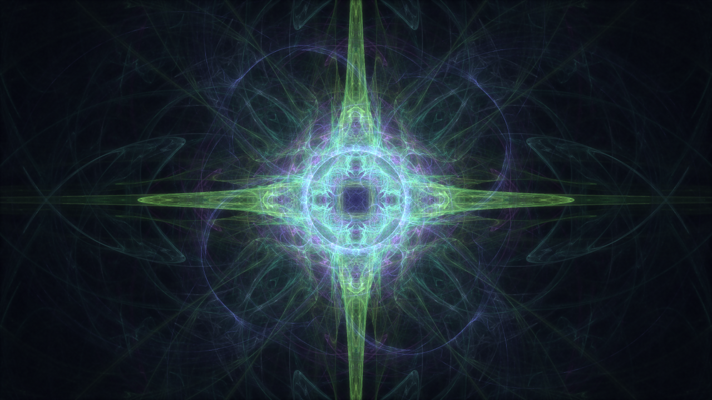

<div align="center">
  
  <h1>Fractique</h1>
  <p><strong>A generator of fractal flames, classic fractals and wallpapers that gives the same picture from the same input, on every platform.</strong></p>
  <p><sub>
    <strong>English</strong> · <a href="docs/readme/README_UK.md">Українська</a> · <a href="docs/readme/README_RU.md">Русский</a> · <a href="docs/readme/README_DE.md">Deutsch</a> · <a href="docs/readme/README_FR.md">Français</a> · <a href="docs/readme/README_ES.md">Español</a> · <a href="docs/readme/README_IT.md">Italiano</a> · <a href="docs/readme/README_JA.md">日本語</a><br>
    <a href="docs/readme/README_CN.md">简体中文</a> · <a href="docs/readme/README_PT.md">Português</a> · <a href="docs/readme/README_KO.md">한국어</a> · <a href="docs/readme/README_HI.md">हिन्दी</a> · <a href="docs/readme/README_TR.md">Türkçe</a> · <a href="docs/readme/README_PL.md">Polski</a> · <a href="docs/readme/README_ID.md">Bahasa Indonesia</a>
  </sub></p>
</div>

Fractique makes three kinds of pictures. Fractal flames: the glowing, wispy kind of fractal made of thin curves and soft light. Classic fractals of 22 kinds, from the Mandelbrot set, Julia sets and strange attractors to the Mandelbulb in three dimensions. And wallpapers: flat sheets with lit edges and soft shadows, each in a light and a dark version. You pick a preset, roll a random picture or layer several flames over each other, and export it at any size, from a phone screen to a 4K monitor. A scene is one small file, and the same file always renders to exactly the same pixels, on Windows, macOS, Linux, Android and iOS alike.

<p align="center">
  
</p>

## What it does

- **Flames:** 49 variations, layers with blend modes, rotational and mirror symmetry, density estimation, glow, and 29 built-in presets.
- **Fractals:** 19 kinds in the plane: escape-time (Mandelbrot, Julia, Burning Ship, Tricorn, Multibrot, Phoenix, Magnet), root-finding (Newton, Nova), orbits drawn as densities (Buddhabrot, Clifford, De Jong, Lorenz, Gumowski-Mira, Hopalong) and geometric (Apollonian gasket, Kleinian group, L-system, Lyapunov), each with presets and a picture for every seed; they share the palettes, the layers and the deep zoom of the flames.
- **Solids:** the Mandelbulb, the Mandelbox and the Menger sponge in three dimensions, with light, shadows and fog; turn around them or go inside.
- **Wallpapers:** one for every seed, out of 14 layouts and 6 materials, each in a light and a dark version, laid out for the size of the screen.
- **The app:** one codebase for Windows, macOS, Linux, Android, iOS and the web. The picture fills the window and glass panels float over it; on the desktop the app has a glass title bar of its own. Three tabs, **Flames**, **Fractals** and **Shapes** (the wallpapers), each keep their own picture and their recent pictures. In 15 languages.
- **GPU acceleration:** where the graphics card is clearly faster than the processor, it draws the flames, three attractors, the escape-time and root-finding fractals and the wallpapers itself, and the processor stays free. Exports at the three higher quality levels are always rendered by the processor, exactly.
- **Randomize and Mutate:** every seed is a picture; flames that would be a dot or a filled square are skipped. Mutate makes a variant of the one you like.
- **Layers:** add a flame from the presets or a random one, remove it, reorder, and set the blend (add, screen, over) and the opacity of each. Up to 16 layers.
- **Picture size:** the window's own, one of 61 screens (computers up to 16K, Android phones and tablets, iPhones, iPads, Macs and Apple Watch), or any width and height from 16 to 16384 pixels.
- **Deep zoom:** drag, wheel and pinch move the view and magnify it as far as it is still a picture: a flame 10 to 300 times, an attractor 10 to 100 times, a wallpaper 8 times and the other fractals up to ten thousand million times. The picture follows at once and is redrawn sharp when the view rests.
- **Phones:** a screen of its own. One round button makes a new picture, a swipe goes to the next wallpaper, a sheet of small live pictures chooses the style, and the pictures you keep form a collection. The kinds of fractal that take the processor long to draw are left out there.
- **Export:** a PNG at any size: at once, as it is on the screen, or rendered in the background at three higher quality levels. On a phone it is saved to Photos or the gallery, or shared. Every feature is free on every platform; only the App Store version (iPhone, iPad, Mac) asks for a one-time purchase, Fractique Pro, to export at 2560 × 1440 pixels or more or at a custom size.
- **Project files:** a `.frcq` file keeps the scene with its view, tone and size, so it opens as it was saved ([docs/scene-format.md](docs/scene-format.md)). Plain `.json` scenes and `.flame` files of flam3 and Apophysis open too. Between launches the app comes back to the session it was left with.
- **Updates:** a window lists every released version with its notes and installs any of them. On Windows the app is one portable `.exe` that replaces itself.
- **Exact repeatability:** the same scene gives the same pixels on every machine, checked by tests on Linux, Windows and macOS ([docs/determinism.md](docs/determinism.md)).
- **The command line tool** (`fractique`): renders flames, fractals and wallpapers to PNG, makes random scenes and variants, converts `.flame` and `.frcq` files.
- **MCP server** (`fractique-mcp`, or `fractique mcp`): an AI agent makes, changes and renders scenes ([docs/mcp.md](docs/mcp.md)).
- **HTTP server** (`fractique-server`): an HTTP API with a render queue and limits, an interactive reference of it at `/docs`, MCP for AI agents at `/mcp`, serves the web app; a download of its own in every release, and a `Dockerfile` to build an image ([docs/server.md](docs/server.md)).

| | |
| --- | --- |
|  |  |
| Emerald Star (two layers) | Ember Vortex |
|  |  |
| Golden Bloom | Solar Mandala |

One hundred more flames, and fractals and wallpapers too, each with the `.frcq` file that renders it again at any size: [the gallery](docs/gallery.md).

Fractals of other kinds: the Mandelbrot set, a Julia set and the Clifford attractor:

| | | |
| --- | --- | --- |
|  |  |  |
| Mandelbrot: Spiral | Julia: Spirals | Clifford: Wings |

More escape-time fractals and the root-finding ones: Burning Ship, Tricorn, Multibrot, Phoenix, Magnet, Newton, Nova:

| | | | |
| --- | --- | --- | --- |
|  |  |  |  |
| Burning Ship: Ship | Tricorn: Island | Multibrot: Spirals | Phoenix: Galaxy |
|  |  |  | |
| Magnet: Pearls | Newton: Seven | Nova: Star | |

Orbits drawn as densities: the Buddhabrot and the De Jong, Lorenz, Gumowski-Mira and Hopalong attractors:

| | | |
| --- | --- | --- |
|  |  |  |
| Buddhabrot: Nebula | De Jong: Classic | Lorenz: Butterfly |
|  |  | |
| Gumowski-Mira: Feathers | Hopalong: Web | |

Geometric fractals: an Apollonian gasket, the limit set of a Kleinian group, an L-system and a Lyapunov fractal:

| | | | |
| --- | --- | --- | --- |
|  |  |  |  |
| Apollonian gasket: Threefold | Kleinian group: Cusp | L-system: Plant | Lyapunov: Feathers |

Solids in three dimensions: the Mandelbulb, the Mandelbox and the Menger sponge:

| | | |
| --- | --- | --- |
|  |  |  |
| Mandelbulb: Crown | Mandelbox: Station | Menger sponge: Classic |

Wallpapers, light and dark, each with its layout and material:

| | | | |
| --- | --- | --- | --- |
|  |  |  |  |
| Waves, Glass | Burst, Glow | Tiles, Relief | Fan, Glass |
|  |  |  |  |
| Discs, Paper | Bars, Paper | Arcs, Carbon | Lines, Paper |

## Quick start

One command builds the app and the command line tool. It installs Rust when it is missing.

| System | Command |
| --- | --- |
| Linux, macOS | `./setup.sh` |
| Windows | `setup.cmd` |

Start the app:

```sh
./target/release/fractique-gui
```

Or render from the command line:

```sh
# a preset as a 4K picture
./target/release/fractique render --preset aurora-spiral --size 3840x2160 --quality high -o aurora.png

# the random flame of seed 42, for a phone screen
./target/release/fractique render --random 42 --size 1080x2400 --quality mobile -o phone.png

# the random view of the Mandelbrot set of seed 7
./target/release/fractique render --random 7 --fractal mandelbrot --size 1920x1080 -o mandelbrot.png

# the wallpaper of seed 7 for a phone, light and dark
./target/release/fractique render --wallpaper 7 --size 1290x2796 -o wallpaper.png
./target/release/fractique render --wallpaper 7 --dark --size 1290x2796 -o wallpaper-dark.png

# keep a random scene as a file, change it, render it
./target/release/fractique randomize 42 -o scene.json
./target/release/fractique render scene.json -o mine.png
```

On Windows the programs are `target\release\fractique-gui.exe` and `target\release\fractique.exe`. Everything the app and the commands do: [docs/usage.md](docs/usage.md).

## Tested on

| Device | System | Processor | Graphics |
| --- | --- | --- | --- |
| PC | Windows 11 | AMD Ryzen 7 5700X | NVIDIA GeForce RTX 4070 |
| PC | Ubuntu 24.04 (WSL2) | AMD Ryzen 7 5700X | None: the processor only |
| Laptop, ASUS TUF Gaming FX505DT | Windows 11 | AMD Ryzen 5 3550H | NVIDIA GeForce GTX 1650 |
| Laptop, HP 15-db1xxx | Debian 13 | AMD Ryzen 3 3200U | AMD Radeon Vega 3 |
| MacBook Pro | macOS | Apple M5 Pro | Apple M5 Pro |
| ZTE Blade A7 | Android 9 | MediaTek Helio P22 | PowerVR GE8320 |
| Asus Zenfone 10 | Android 15 | Qualcomm Snapdragon 8 Gen 2 | Adreno 740 |
| iPhone 13 Pro | iOS 27 | Apple A15 Bionic | Apple A15 |
| iPhone 11 | iOS 27 | Apple A13 Bionic | Apple A13 |

## Documentation

| | |
| --- | --- |
| [docs/usage.md](docs/usage.md) | The app, the commands, the quality levels, how to edit a scene |
| [docs/scene-format.md](docs/scene-format.md) | Every field of a scene file, every variation, sheets, the `.frcq` file |
| [docs/mcp.md](docs/mcp.md) | The MCP server: connecting an AI agent, the tools |
| [docs/server.md](docs/server.md) | The HTTP server: endpoints, limits, Docker |
| [docs/ios.md](docs/ios.md) | Building and running on an iPhone or in the iOS Simulator |
| [docs/releasing.md](docs/releasing.md) | How a release is made, how the app updates itself |
| [docs/architecture.md](docs/architecture.md) | How the parts fit together, how a render works |
| [docs/determinism.md](docs/determinism.md) | Why a render repeats exactly, and what is and is not promised |
| [docs/performance.md](docs/performance.md) | Measured render times and memory |
| [docs/roadmap.md](docs/roadmap.md) | What is done and what comes next |

## License

[PolyForm Noncommercial License 1.0.0](LICENSE.md): free for any noncommercial use. For commercial use, ask the author for a separate license. Third-party licenses are listed in [THIRD_PARTY_NOTICES.md](THIRD_PARTY_NOTICES.md). Contributions: see [CONTRIBUTING.md](CONTRIBUTING.md).
