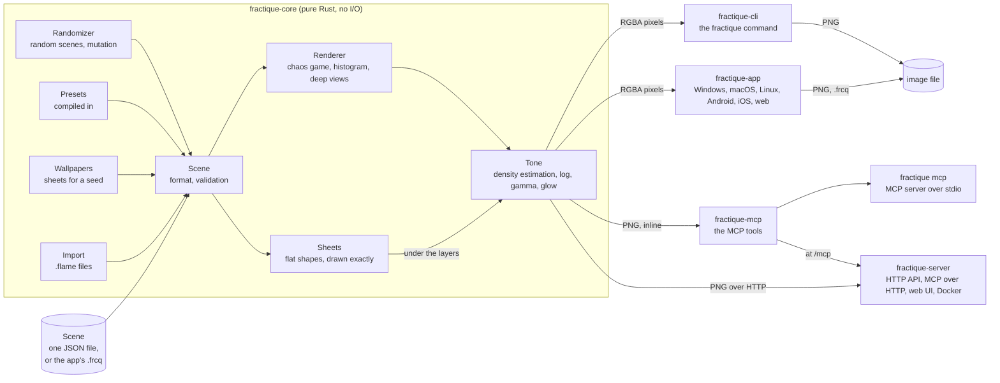
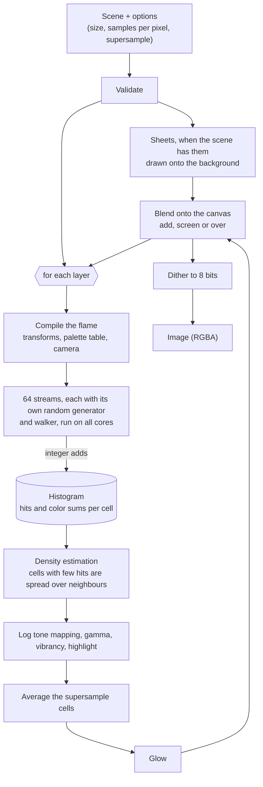

# Architecture

Fractique is a Rust workspace. One crate, **`fractique-core`**, turns a scene into pixels and knows nothing else:
no files, no terminal, no network, no UI. Every other part is a thin wrapper around it, so a scene renders to the
same image wherever it is rendered from.

## Overview

| Crate | State | What it is |
| --- | --- | --- |
| `fractique-core` | works | The renderer, the scene format, presets, the randomizer, the wallpapers, the `.frcq` packing |
| `fractique-cli` | works | The `fractique` command: renders scenes and wallpapers to PNG, converts `.flame` files and the app's `.frcq` files, and runs as an MCP server (`fractique mcp`, see [mcp.md](mcp.md)): an AI agent edits a scene, renders a preview, looks, adjusts |
| `fractique-mcp` | works | The MCP tools and the JSON-RPC answers, without a transport: `fractique mcp` puts them on stdin and stdout, `fractique-server` on `/mcp` ([MCP](#mcp)) |
| `fractique-app` | works | The app, `fractique-gui`: one codebase for Windows, macOS, Linux, Android, iOS and the web ([The app](#the-app)) |
| `fractique-server` | works | The `fractique-server` command: an HTTP API with a render queue and limits, MCP over HTTP at `/mcp`, which also serves the web build of the app; the Docker image ([server.md](server.md)) |

`vendor/` holds `eframe` and `egui-wgpu` with the fix the iOS drawing surface needs; the workspace patches them
in.

### Why this shape

- **One renderer.** The app, the CLI, the MCP server (over stdio and over HTTP) and the HTTP server all call the same `render` function with
  the same scene, so they cannot disagree about what a scene looks like.
- **A scene is data.** Everything a render depends on is in one JSON document (`Scene`): the flames, the palettes,
  the camera, the tone settings, the sheets of a wallpaper and the seed. Presets, random scenes, wallpapers,
  mutations, files and API requests are all the same type. The format is described in
  [scene-format.md](scene-format.md).
- **No I/O in the core.** It compiles for every target unchanged (desktop, Android, iOS, WebAssembly) and is easy
  to test. `file.rs` turns a document into the bytes of a `.frcq` file and back; reading and writing the file is
  the caller's.
- **CPU rendering.** GPUs do not give the same bits from one vendor or driver to the next; the processor does.
  See [determinism.md](determinism.md).

## How a render works

| Step | Where | What happens |
| --- | --- | --- |
| Chaos game | `chaos.rs` | A walker starts at a random point and repeats: pick a transform by weight, apply its affine map, then the weighted sum of its variations, then the optional post map. Each step moves the walker's color toward the transform's color. Every point after the first 24 is plotted. |
| Deep views | `deep.rs` | When a view holds less than an eighth of the flame, the plain chaos game wastes its points outside it. Then the layer is drawn from 8192 particles: points of the flame inside the view, each with the seeds of the steps that made it. They are found window by window, every window half the size of the one before: particles that fall out are replaced by copies of those that stay, and each is moved about inside the window by giving it a new start and keeping its latest steps. The render moves the particles the same way and plots them. Brightness stays what it was where the view began to hold less than an eighth, so a deep view is neither burnt nor black. |
| Streams | `render.rs` | The samples of a layer (`samples per pixel × width × height`) are split over 64 streams. The number is fixed, so the result does not depend on how many cores a machine has. |
| Histogram | `render.rs` | Each plotted point adds 1 to its cell's hit count and its palette color to the cell's color sums. These are integer additions on atomics: the order in which threads add does not change the totals. |
| Density estimation | `tone.rs` | A cell with few hits is noise, so it is spread with a wide kernel; a cell with many hits stays sharp. This is what makes sparse wisps smooth without blurring the dense structure. |
| Tone mapping | `tone.rs` | Brightness follows the logarithm of the density, relative to the average density, so the same scene has the same brightness at any resolution, quality and zoom. Gamma, vibrancy and highlight shape it. |
| Glow | `tone.rs` | A Gaussian blur of the layer is added back. Its radius is a share of the image's shorter side. |
| Sheets | `sheets.rs` | A wallpaper's sheets are drawn onto the background before any layer. For every pixel and every sheet, bottom to top: the distance to the sheet's shapes gives its coverage (one pixel of soft edge), the rim along its edge and, moved toward the light, the shadow it casts on what is under it. Nothing is sampled, so the seed, the samples per pixel and the supersample do not change it. |
| Layers | `render.rs` | Each layer has its own flame, camera and tone settings and is blended onto the canvas in order. `render_layer` develops one layer and `compose` blends developed layers, so a caller can keep the layers that did not change. `render_density` stops before the tone mapping and `develop` finishes it: together they are `render_layer`, bit for bit, so a caller can keep a layer's density and change its brightness, gamma, vibrancy, highlight and glow without the chaos game. The smoothing is already in the density. |
| Dither | `render.rs` | An 8×8 ordered dither removes the bands that 8 bits would show in faint gradients on a dark background. |

### Any resolution

The camera is not in pixels. At zoom 1 the shorter side of the image shows 4 world units, whatever the size, and a
wider image shows more of the world on its long side. The number of samples grows with the number of pixels, and
glow and smoothing are sized relative to the image. So one scene gives the same picture at 640×360 and at
3840×2160: the large one is sharper, not different.

### Any zoom

A view can be magnified until the 64-bit numbers of the renderer run out of digits, at about ten thousand million
times; the app stops there. A deep view costs five to ten times a plain one, because every point is sent through
the steps its particle keeps. Where the flame has nothing, a deep view is empty: the gaps between its threads are
wider than the threads. A flame whose transforms blur (`blur`, `gaussian_blur`) is smooth below the size of
its blur and shows no more detail there.

### Phones

A phone renders the same scene with the same code at a lower quality level: fewer samples per pixel and no
supersampling (`mobile`: 30 samples per pixel). Density estimation is what keeps that from looking noisy. See
[performance.md](performance.md) for the numbers.

## Wallpapers

`random_wallpaper(seed, request)` in `wallpaper.rs` builds a scene of sheets. The request names the proportion of
the image, light or dark, and optionally a layout, a material and a hue; the seed decides the rest. One generator
picks the layout and the material, a second places the shapes of that layout for the proportion, a third chooses
the colors and the light of the material. Colors are chosen in OKLCH, so equal steps look equal. `chosen` tells
which layout and material a seed gives, without building the scene.

## The randomizer

`random_scene_of(generator, seed)` builds a flame of 2 to 4 transforms from a weighted list of variations, picks a
palette and sometimes a symmetry and a second layer. It then probes the flame with 30 000 points to place the
camera, and rejects flames that are a dot, dust or a filled square, trying up to 40 candidates per layer. All of it
is driven by the seed alone, so a seed is a scene. `mutate(scene, seed, strength)` nudges the transforms of an
existing scene.

A change to a generator's list, parameters or checks would change the scene of every seed, so a generator is never
changed: a better one is added beside it with the next number, its own random streams and its own pinned tests.

| Generator | What |
| --- | --- |
| 1 (`random_scene(seed)`) | The first 27 variations (all of the first 28 but `blur`); `julian` and `curl` get random parameters. The command line tool's default |
| 2 | All 49 variations, each parametric one with random parameters in a range chosen for it. A variation that ignores its point (`blur`, `gaussian_blur`, `square`, `pie`, `arch`) is used at most once per flame, alone in its transform, only in a flame of three or four transforms, and with a small `post` map that places it; `noise` and `radial_blur` are never a transform's second variation, and `noise` leads a transform only where one of those five still could. On the 48×48 grid of the probe it also refuses specks (less than 16 % of the cells hit, or 90 % of the points in fewer than 130 cells), a dot in a haze and an even fog (too little difference between neighbouring cells), and moves the camera 1.6 times closer when half of the points are in fewer than 45 cells of a frame more than half covered. The app's Randomize uses it |

The limits of generator 2 were chosen by looking at the pictures of seeds 1 to 144, not derived.

## MCP

The tools live once, in `fractique-mcp`, a library with no transport in it. A separate crate, and not a library
target of the command line tool, because the HTTP server would otherwise depend on a program and its argument
parser, and not a module of the core, because the tools read files, encode PNG and speak JSON-RPC, which the core
must not know.

| Part | Where | What |
| --- | --- | --- |
| Tools | `fractique-mcp` | `tools` lists them, `prepare` runs one or, for `render_scene`, returns the render to run; `handle` answers `initialize`, `ping` and `tools/list`; `reporter` turns the renderer's progress into notifications that only grow |
| What a transport allows | `Host` in `fractique-mcp` | The protocol revisions, whether the arguments that read and write files exist, and the limits of a render. `Host::LOCAL` allows everything; the HTTP server gives its own |
| stdio | `fractique-cli/src/mcp.rs` | Reads lines, queues the calls for one worker thread, writes lines |
| HTTP | `fractique-server/src/mcp.rs` | Sessions, the headers, one event stream for each call. A render is prepared first, then takes a ticket and a slot of the server's queue like `POST /render`, so a refused request never waits |

A call over HTTP is a task that sends its messages into a channel; the response body is the other end. A
cancellation, the end of the session, a closed connection and the time limit all set the one flag the renderer
reads and wake the task if it still waits for a slot. Nothing polls.

The helpers the command line tool shares with the tools (reading a scene from JSON or `.frcq` bytes, encoding a
PNG, a wallpaper request from names) are in `fractique-mcp` too, and the limits of the HTTP server are checked by
its `Limits`, for `/render` and `/mcp` alike.

## The app

`fractique-app` is built with `egui` and `eframe` on `wgpu`. The picture is always rendered by `fractique-core`
on the processor, in a thread of its own. The graphics card shows it, draws the glass over it, draws a
[preview](#the-preview-on-the-graphics-card) of what the processor will render while a control moves, and plays
[the chaos game](#the-chaos-game-on-the-graphics-card) of a flame itself, so that a picture is on the screen while
the processor still renders.

| File | What |
| --- | --- |
| `lib.rs` | The window: the inspector, the toolbar, the title bar the app draws itself, the sheets with lists, the session, the render passes of the picture |
| `phone.rs` | The phone's screen: the round buttons, the placard, the styles with their small pictures, the collection |
| `export.rs` | An export: a render in a thread of its own, with progress and cancel |
| `update.rs`, `updates.rs` | The releases, the download and the install; the updates window ([releasing.md](releasing.md)) |
| `glass.rs`, `glass.wgsl`, `blur.rs` | The picture on the screen and the glass panes over it: each pane shows a blurred, refracted part of the picture |
| `preview.rs`, `preview.wgsl` | The preview on the graphics card: the layers' levels as textures, the tone mapping, the glow and the blending in shaders |
| `chaos.rs`, `chaos.wgsl`, `levels.wgsl` | The chaos game on the graphics card: the walkers and the histogram in one compute shader, the density estimation in another |
| `widgets.rs` | The controls: rows, pills, sliders, switches; the fonts |
| `i18n.rs`, `locales/` | The texts, in 15 languages |
| `android.rs`, `ios.rs` | The gallery, Photos and sharing |
| `store.rs`, `storekit.rs` | The App Store builds only (the `store` feature): which sizes need the purchase, its states, StoreKit ([The purchase](#the-purchase-in-the-app-store-builds)) |
| `main.rs` | The start on a computer and in a browser; a file given at start |
| `instance.rs` | One window at a time on a computer: a second start gives its file to the window that is open and ends |
| `association.rs` | Windows: the program registers itself as the one that opens `.frcq` files ([releasing.md](releasing.md#files-of-the-app-frcq)) |

How the picture reaches the screen:

| Step | What happens |
| --- | --- |
| A change | The scene, the size or the view changes. The render in progress is cancelled and a new one starts. A moved or zoomed view waits until it has rested for 0.18 s; until then the picture already on the screen is moved and scaled by the graphics card |
| Passes | A draft first (480 pixels on its longer side, 12 samples per pixel), then the full picture. A view magnified more than 4 times gets a pass in between (1280 pixels, 16 samples). The picture is shown after each. Where the graphics card plays [the chaos game](#the-chaos-game-on-the-graphics-card), its picture stands in for the drafts |
| The full picture | At the chosen size, up to 4096 pixels a side with 32 samples per pixel on a computer, 1600 and 18 on a phone, 900 and 14 in a browser |
| Kept layers | A layer's pixels depend only on its flame, its place, the seed and the size. Developed layers are kept (up to 1200 MB on a computer, 160 MB on a phone and in a browser), so a change to one layer renders that layer only, and **Reset view** comes back without a render. With GPU acceleration on, the densities are kept in the same room: a change to a layer's tone develops it again without the chaos game |
| Threads | Renders run on a pool that leaves two cores to the window. A browser page has one thread and renders there, without a draft |
| Events | A finished pass is sent over a channel and asks for a repaint. Nothing polls |

An export is a separate render at the size and quality chosen, with the scene as it is on the screen. The session
is written whenever it changes, not at exit: a phone ends an app without telling it.

### The purchase in the App Store builds

The `store` feature of `fractique-app` is off by default and on in `ios/build-rust.sh`, the build that goes to
the App Store. Without it `store.rs` and `storekit.rs` are not compiled, the lists hold no lock and no size is
refused: the Windows, Linux, Android and web builds carry nothing of it. With it, an export of 3 686 400 pixels
(2560 × 1440) or more, choosing such a size for the picture and a size typed in need the non-consumable product
`app.fractique.pro`; the picture on the screen is never limited ([usage.md](usage.md#free-and-fractique-pro)).

| Part | What it does |
| --- | --- |
| The rule (`store.rs`) | `is_large` counts pixels; `needs_pro` adds that a size outside the list needs the purchase. The size presets are tagged by family (screens, Android, Apple), and a build with the feature offers screens and Apple devices |
| The states (`store.rs`) | `Store` is loading, ready, buying, owned or failed with a reason. It owns a backend (`load`, `buy`, `restore`) and a channel of events: the product with its price, owned, cancelled, restore finished, failed |
| StoreKit (`storekit.rs`, iOS and macOS) | Xcode compiles only `ios/stub.c`, so there is no Swift target: the backend talks to the original StoreKit API through `objc2`. A class made at run time is the delegate of the `SKProductsRequest` and the observer of the `SKPaymentQueue`; it is added when the app starts, so a purchase paid for while the app was closed arrives too. Every transaction is finished. The price is formatted with the product's own locale; when the app's fonts lack a character of it, the amount with the currency code is shown |
| Events | A StoreKit callback sends an event over the channel and asks for a repaint; the next frame takes it in. Nothing polls |
| Remembered | A purchase or a restore sets a flag in `NSUserDefaults`; with it the app starts owned and asks the App Store nothing |
| The sheet (`lib.rs`) | A locked size, **Save** or **Share** with one, or **Apply** under **Custom** opens the Fractique Pro sheet and remembers what was asked for; when the purchase arrives, the export starts or the size is set |

For a test, `FRACTIQUE_STORE=locked|owned|failed|loading|buying` puts a fake backend in place of StoreKit on a
build with the feature: `locked` offers the product at $4.99 and `buy` succeeds at once. `FRACTIQUE_SHOW=pro`
opens the sheet, `FRACTIQUE_SHOW=export` and `FRACTIQUE_SHOW=sizes` the lists, and `phone` in the value
(`pro-phone`, `export-phone`) gives the phone's screen, so a `--screenshot` shows each state. Without the
variable a Linux, Windows or Android build with the feature has no store and no limit. On iOS and macOS the
variable is read in a debug build only: a release build cannot be unlocked from a terminal. The tests of
`store.rs` run in every build and cover the rule and the states with the fake backend.

### The preview on the graphics card

With **GPU acceleration** on, a change to the tone, to a layer's opacity or blend, or to the zoom does not start a
render at once. The graphics card draws the picture from the layers the processor rendered last, and the render
starts when the control has rested for 0.18 s, as it does for a moved view. Its picture then replaces the preview.

| Step | What happens |
| --- | --- |
| Levels | Each render pass keeps, for every layer, its density (`render_density`). `Density::levels` gives four numbers a pixel: the average color and the brightness before the tone settings. They go to the graphics card as one half-float texture a layer (8 bytes a pixel), read texel by texel, so no float filtering is needed |
| Tone | A fragment shader repeats `tone.rs` for a pixel: brightness, the cap, gamma, vibrancy, highlight |
| Glow | The toned layer is drawn into a smaller picture, blurred across and down there, and added back. The smaller picture is chosen so that the blur's sigma stays under 4 of its pixels |
| Blend | The layers are drawn in order onto the background with the graphics card's own blending: add, screen, over. The canvas has 8 bits a channel, so it is clamped after every layer, not once at the end |
| Under the glass | The picture is shrunk and blurred the same way for the panes |
| View | The zoom slider moves and scales the picture on the screen, like a drag or a pinch |

What the preview does not do: density estimation (a change of `smoothing` is rendered), dithering, sheets (a scene
with sheets is not previewed), and a change to a flame itself, to the order of the layers or to the size. Then, and
when the layers on the graphics card are not those of the scene, the render starts at once, as it does with GPU
acceleration off. A draft smaller than the preview on the screen is skipped.

The preview is not offered when the graphics card cannot hold half-float textures or draw into an 8-bit picture.
An error of the graphics card while the preview is built or drawn (no memory for a texture, a shader it refuses)
switches the preview off for the session and the processor renders as before. `FRACTIQUE_GPU=off` starts the app
without it.

For a test, `FRACTIQUE_ADJUST=brightness,gamma,glow,zoom` starts the app with these tone settings, and with
`FRACTIQUE_SHOW=preview` they are set once the picture is rendered and stay the graphics card's: a
`--screenshot` of each shows the preview beside what the processor renders.

### The chaos game on the graphics card

With **GPU acceleration** on, a flame that has to be rendered anew (a random flame, a preset, a mutation, a moved
view, another size) is drawn by the graphics card first: at the full size, with the first picture after one batch
of samples and a finer one after each of the next. The processor renders the same scene meanwhile, without its
drafts, and its picture replaces the graphics card's. The toolbar shows the time the first picture took.
[performance.md](performance.md#the-first-picture-on-the-graphics-card) has the numbers.

| Step | What happens |
| --- | --- |
| Walkers | A compute shader (`chaos.wgsl`) runs one walker for every 16 pixels, up to 262 144 at once. Each does what `chaos.rs` and `render.rs` do: it picks a transform by weight, applies the affine map, the variations (all 49), the post map, moves its color, hides the point by the transform's opacity, and plots it through the final transform, the symmetry and the camera. The numbers are 32-bit floats. Each walker has its own random numbers (xoroshiro64**), seeded from the scene's seed, the layer and the walker's number, and starts with 24 steps that are not plotted |
| Histogram | Four 32-bit integers a cell: the hits and the three color sums, added with atomic operations, so the order of the walkers does not matter. A cell's color sums stop at 16 000 000 hits, where they would overflow; its hits go on |
| Levels | A second shader (`levels.wgsl`) repeats the density estimation of `tone.rs`: the same kernels, chosen by the same table of hits, gathered for every pixel. Tiles of 16 × 16 cells tell how far a pixel has to look. It writes the levels that the shaders of [the preview](#the-preview-on-the-graphics-card) start from, so the tone, the glow, the blending and the view are the preview's |
| Batches | The first batch plots 2 samples per pixel; once a batch has shown how fast the card is, a later run starts with as many as fit in 20 ms. Each next batch is sized by how long the last one took: 40 ms, or 2.5 times the shortest batch when the levels alone take longer than that, and never less than a sixteenth of all samples. The run ends at the samples per pixel of the full pass |
| Events | A batch is one submission. A thread that sleeps in the driver until that submission is finished takes in how many points landed in the picture and asks for a repaint; the next frame sends the next batch. The window's thread never waits for the graphics card |
| Replaced | When the processor's picture arrives it is shown, and the histograms are freed. An export (**Instant** too), the recent pictures and a saved file never take the graphics card's picture |

A change to the tone, to an opacity or to a blend while the graphics card's picture is on the screen draws it again
with the new settings; the chaos game goes on.

What stays the processor's alone:

| What | Why |
| --- | --- |
| Wallpapers | Sheets are drawn exactly, not sampled |
| A view that holds less than an eighth of the flame's points | The processor draws it from particles ([Any zoom](#any-zoom)); the plain chaos game would waste its points and give another brightness. The graphics card counts the points that land in the picture, gives the view up after its first batch, and the render begins again with its drafts |
| A view too fine for 32-bit floats | When the cells per unit times the distance of the view's far edge from the origin is above 400 000. Measured by moving a flame away from the origin: up to a million the picture stays the processor's, at three million it begins to differ |
| A layer whose density the processor kept | It develops the layer faster than the chaos game is played again |
| A flame with more than 256 variations in all, a picture whose histogram is larger than the card's largest buffer, a scene whose layers need more than 1 GB | The processor renders, with drafts |
| A browser | The page renders on the thread that draws, so the graphics card's picture would wait for it |

The chaos game is not offered where the graphics card has no compute shaders (WebGL2, OpenGL ES 3.0), where a
compute shader cannot write a half-float texture, or where a limit is too low: 64 invocations a workgroup, 4096
workgroups, 3 storage buffers and 1 storage texture a stage, 17 kB of uniforms. The shaders are compiled in a
thread of their own when the app starts; a render that began before they were ready begins again. An error of the
graphics card (a shader it refuses, no memory for a histogram, a batch that does not finish in 20 s) switches the
chaos game off for the session: the processor renders as before.

The graphics card's picture is not the processor's pixel for pixel: its random numbers are others, so the grain
differs, and 32-bit floats round differently from one card to the next. Shapes, colors and brightness are the
same. On one card and driver a scene gives the same picture again.

For a test, `FRACTIQUE_SHOW=gpu` keeps the graphics card's picture (the processor does not render) and hides the
panels, so a `--screenshot` is that picture; `FRACTIQUE_SHOW=gpu-first` stops after the first batch;
`FRACTIQUE_SHOW=picture` hides the panels over the processor's picture, to compare with. A scene file given on the
command line is the scene. `FRACTIQUE_DEBUG_TIMES=1` prints the graphics card and the seconds from the request to
each picture. The tests of `chaos.rs` compare three presets with the processor's render when the machine has a
graphics card with compute shaders; three more, run with `--ignored`, print the differences for every preset,
for 20 seeds of each random generator and for every variation, and how far 32-bit floats reach.

## Limits

| | |
| --- | --- |
| Image side | 1 to 16 384 pixels |
| Supersample | 1 to 4 |
| Samples per pixel | 1 to 100 000 |
| Histogram cells (`width × height × supersample²`) | at most 2²⁸ |
| Layers per scene | 1 to 16, or none when the scene has sheets |
| Transforms per flame | 1 to 64 |
| Sheets per scene | 1 to 48 |
| Shapes per sheet | 1 to 32 |
| Magnification of a view in the app | 0.0001 to 10 000 000 000 |
| Unpacked `.frcq` document | at most 64 MB |
