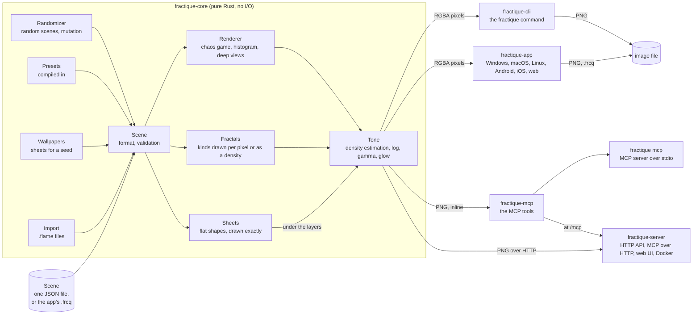
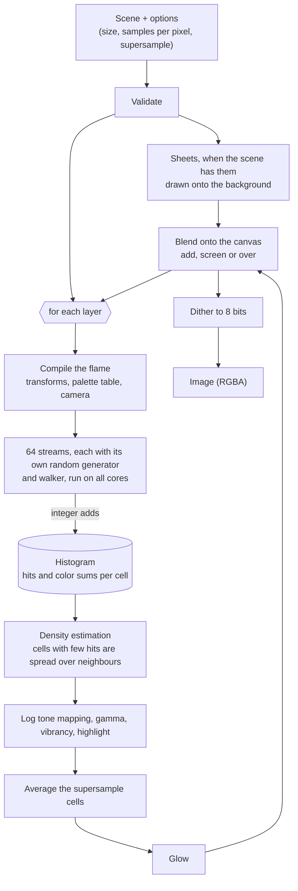

# Architecture

Fractique is a Rust workspace. One crate, **`fractique-core`**, turns a scene into pixels and knows nothing else:
no files, no terminal, no network, no UI. Every other part is a thin wrapper around it, so a scene renders to the
same image wherever it is rendered from.

## Overview

| Crate | State | What it is |
| --- | --- | --- |
| `fractique-core` | works | The renderer, the scene format, presets, the randomizer, the fractals of other kinds, the wallpapers, the `.frcq` packing |
| `fractique-cli` | works | The `fractique` command: renders scenes and wallpapers to PNG, converts `.flame` files and the app's `.frcq` files, and runs as an MCP server (`fractique mcp`, see [mcp.md](mcp.md)): an AI agent edits a scene, renders a preview, looks, adjusts |
| `fractique-mcp` | works | The MCP tools and the JSON-RPC answers, without a transport: `fractique mcp` puts them on stdin and stdout, `fractique-server` on `/mcp` ([MCP](#mcp)) |
| `fractique-app` | works | The app, `fractique-gui`: one codebase for Windows, macOS, Linux, Android, iOS and the web ([The app](#the-app)) |
| `fractique-server` | works | The `fractique-server` command: an HTTP API with a render queue and limits, MCP over HTTP at `/mcp`, which also serves the web build of the app; the Docker image ([server.md](server.md)) |

`vendor/` holds `eframe` and `egui-wgpu` with the fix the iOS drawing surface needs and a lock around the
configuring of a surface ([why](#fractals-drawn-pixel-by-pixel-on-the-graphics-card)); the workspace patches
them in.

### Why this shape

- **One renderer.** The app, the CLI, the MCP server (over stdio and over HTTP) and the HTTP server all call the same `render` function with
  the same scene, so they cannot disagree about what a scene looks like.
- **A scene is data.** Everything a render depends on is in one JSON document (`Scene`): the flames, the fractals
  of other kinds, the palettes, the camera, the tone settings, the sheets of a wallpaper and the seed. Presets, random scenes, wallpapers,
  mutations, files and API requests are all the same type. The format is described in
  [scene-format.md](scene-format.md).
- **No I/O in the core.** It compiles for every target unchanged (desktop, Android, iOS, WebAssembly) and is easy
  to test. `file.rs` turns a document into the bytes of a `.frcq` file and back; reading and writing the file is
  the caller's.
- **CPU rendering.** GPUs do not give the same bits from one vendor or driver to the next; the processor does.
  See [determinism.md](determinism.md).

## How a render works

| Step | Where | What happens |
| --- | --- | --- |
| Chaos game | `chaos.rs` | A walker starts at a random point and repeats: pick a transform by weight, apply its affine map, then the weighted sum of its variations, then the optional post map. Each step moves the walker's color toward the transform's color. Every point after the first 24 is plotted. |
| Deep views | `deep.rs` | When a view holds less than an eighth of the flame, the plain chaos game wastes its points outside it. Then the layer is drawn from 8192 particles: points of the flame inside the view, each with the seeds of the steps that made it. They are found window by window, every window half the size of the one before: particles that fall out are replaced by copies of those that stay, and each is moved about inside the window by giving it a new start and keeping its latest steps. The render moves the particles the same way and plots them. Brightness stays what it was where the view began to hold less than an eighth, so a deep view is neither burnt nor black. |
| Streams | `render.rs` | The samples of a layer (`samples per pixel × width × height`) are split over 64 streams. The number is fixed, so the result does not depend on how many cores a machine has. |
| Histogram | `render.rs` | Each plotted point adds 1 to its cell's hit count and its palette color to the cell's color sums. These are integer additions on atomics: the order in which threads add does not change the totals. |
| Density estimation | `tone.rs` | A cell with few hits is noise, so it is spread with a wide kernel; a cell with many hits stays sharp. This is what makes sparse wisps smooth without blurring the dense structure. |
| Tone mapping | `tone.rs` | Brightness follows the logarithm of the density, relative to the average density, so the same scene has the same brightness at any resolution, quality and zoom. Gamma, vibrancy and highlight shape it. |
| Glow | `tone.rs` | A Gaussian blur of the layer is added back. Its radius is a share of the image's shorter side. |
| Sheets | `sheets.rs` | A wallpaper's sheets are drawn onto the background before any layer. For every pixel and every sheet, bottom to top: the distance to the sheet's shapes gives its coverage (one pixel of soft edge), the rim along its edge and, moved toward the light, the shadow it casts on what is under it. Nothing is sampled, so the seed, the samples per pixel and the supersample do not change it. |
| Fractals | `fractal/` | A layer that holds a fractal of another kind is drawn by that kind: pixel by pixel into the layer itself, or as the points of orbits into the same histogram, which then goes through the density estimation, the tone mapping and the glow above ([Fractals of other kinds](#fractals-of-other-kinds)). |
| Layers | `render.rs` | Each layer has its own flame or fractal, camera and tone settings and is blended onto the canvas in order. `render_layer` develops one layer and `compose` blends developed layers, so a caller can keep the layers that did not change. `render_density` stops before the tone mapping and `develop` finishes it: together they are `render_layer`, bit for bit, so a caller can keep a layer's density and change its brightness, gamma, vibrancy, highlight and glow without the chaos game. The smoothing is already in the density. |
| Dither | `render.rs` | An 8×8 ordered dither removes the bands that 8 bits would show in faint gradients on a dark background. |

### Any resolution

The camera is not in pixels. At zoom 1 the shorter side of the image shows 4 world units, whatever the size, and a
wider image shows more of the world on its long side. The number of samples grows with the number of pixels, and
glow and smoothing are sized relative to the image. So one scene gives the same picture at 640×360 and at
3840×2160: the large one is sharper, not different.

### Any zoom

A view can be magnified until the 64-bit numbers of the renderer run out of digits, at about ten thousand million
times; the app stops there. A deep view costs five to ten times a plain one, because every point is sent through
the steps its particle keeps. Where the flame has nothing, a deep view is empty: the gaps between its threads are
wider than the threads. A flame whose transforms blur (`blur`, `gaussian_blur`) is smooth below the size of
its blur and shows no more detail there.

### Phones

A phone renders the same scene with the same code at a lower quality level: fewer samples per pixel and no
supersampling (`mobile`: 30 samples per pixel). Density estimation is what keeps that from looking noisy. See
[performance.md](performance.md) for the numbers.

## Fractals of other kinds

A layer is a flame or a fractal of another kind (`Content` in `scene.rs`). A fractal names its kind and carries a
camera, a tone, a palette and the kind's parameters by name ([scene-format.md](scene-format.md#fractal)).
Everything a kind is lives in one file, as a `Spec`: its name, its family, its parameters with their ranges, its
default tone, how it is drawn, its randomizer, its mutation and its presets. The command line tool, the MCP tools,
the HTTP server and the app read the kinds from the registry. Only the app names kinds: those the graphics card
draws (`orbit.rs`, `field.rs`) and those it marks as heavy (`HEAVY` in `lib.rs`).

| Part | Where | What |
| --- | --- | --- |
| Registry | `fractal/mod.rs` | `Spec`, `Param`, `Preset`, the two traits a kind implements, `all`, `spec`, `random_scene`, `preset`. The kinds of a family are one sorted list in the family's `mod.rs`: `escape`, `root`, `orbit`, `geometric`, `solid` |
| Per pixel | `fractal/pixel.rs` | A kind that is a `Field` answers for a point of the plane: a place on the palette and a light, or nothing. `pixel::draw` maps pixels to points through the camera, takes one sample a pixel on all cores, a row at a time, then draws the pixels that differ from a neighbour again from a grid of samples, and applies brightness and glow. Progress counts rows, and the cancel flag is read at every row |
| Density | `render.rs`, `gather_orbit` | A kind that is an `Orbit` gives each of the 64 streams a `Walk`, which plots points with a place on the palette. They land in the flame's histogram through the same camera, as integer adds, and the layer is developed by `tone.rs` like a flame: `render_density` and `develop` work for it |
| Escape-time helpers | `fractal/escape/mod.rs` | The parameters the family shares, the smooth count, the distance estimate with the dark rim and the fade, the step limit that grows with the zoom, `Seen`, which measures a probe, and what the randomizers share: the walk toward the edge of a set (`descend`), the judging of a view (`fitted`, `judged`) and the move of a mutation (`moved`). The root-finding kinds use them too |
| Root-finding helpers | `fractal/root/mod.rs` | The parameters the family shares, the part of the last step in the smooth count, and the light by the count |
| Orbit helpers | `fractal/orbit/mod.rs` | `System`: a map or a flow with its starting point, its step and its point in the picture. `Traced` makes an `Orbit` of one: it measures a short orbit first, colors by the rank of the pace, the direction or the height among what it measured, and can move and scale the picture to a size near 1. `judged` frames an orbit and measures whether it is worth a picture; `random_by` and `mutate_by` are the randomizer and the mutation the attractors share. An `Orbit` may bring its own colors in place of the layer's palette (`Orbit::colors`): the Nebulabrot does |
| Text parameters | `fractal/mod.rs`, `Text` | A kind whose parameters are not all numbers is built with `Draw::PixelText` or `Draw::DensityText` in place of `Draw::Pixel` or `Draw::Density`: the list of its texts (a name, a default, a check that refuses what the kind cannot read, and the values its presets take by their names) and a function that builds the kind from the whole `Fractal`. The texts are in `Fractal::text`, beside `params`, and `Spec::text` reads one with its default |
| Curves | `fractal/geometric/mod.rs`, `Lines` | A kind that is a curve (`kleinian`, `l_system`) builds its line segments once, on one thread, and hands them to `Lines`, the `Orbit` that keeps those that reach the view and spreads the points of every run evenly along their length, one at a random place in each equal stretch. `Orbit::gain`, 1 for a cloud of points, is what a density is multiplied by: the histogram is scaled by the zoom squared, which is right for points spread over an area, and `Lines` answers with the length drawn over the zoom, so a line is as bright at every zoom and for every length |
| Probes for randomizers | `pixel::probe`, `density::probe` | A 48 × 48 grid of samples over the middle of a view, and the 30 000 points of one orbit with the camera that frames them, on the grid the flame randomizer judges by |

A per-pixel layer is not a density, so `render_density` refuses it and `render_layer` draws it; a caller that
keeps layers treats it like any other developed layer.

### Random and Mutate

`fractal::random_scene(kind, seed)` calls the kind's `random`, which tries candidates from its own random
streams (`fractal::stream`) until one passes what it measures, and `random::mutate` calls the kind's `mutate`
for a fractal layer. The limits below were chosen by looking at the pictures of seeds 1 to 80 of each kind.

| Kind | A candidate | Kept when |
| --- | --- | --- |
| `mandelbrot` | A walk of 1 to 9 steps from the whole set: each step probes the view, weighs every cell by what its 3 × 3 neighbourhood holds (the edge of the set most, filaments by their spread of counts, flat cells nothing), moves into a cell drawn by weight and magnifies 2 to 5 times. Four views in ten are turned | At most 28 % of the probe is inside the set, 16 to 80 % of neighbouring cells differ by more than a tenth of the spread of counts, and the counts have a spread. The colors are then spread over the counts between the 10th and the 95th percentile, and the iterations set to three times the deepest count seen |
| `julia` | The constant is where a walk of 2 to 5 steps on the Mandelbrot set ends; the view is the whole Julia set, or three times in ten a part of it | As for `mandelbrot` |
| `burning_ship` | As `mandelbrot`, with a walk of 1 to 6 steps. Six walks in ten start at the long mast on the real axis (around −1.78, magnified 7 times), where the ships are; the others at the whole set | As `mandelbrot`, and three more checks (below): no stripes, not noise, lit |
| `tricorn` | As `mandelbrot`, with a walk of 1 to 8 steps | As `burning_ship` |
| `multibrot` | A whole power from 3 to 6, then as `mandelbrot` with a walk of 1 to 7 steps | As `burning_ship` |
| `phoenix` | A feedback between −0.75 and 0.75. Three times in ten the map of the first form, with a walk of 1 to 6 steps. Otherwise the Julia form of the constant where a walk of 2 to 5 steps on that map ends, whole or, three times in ten, a part of it | As `burning_ship` |
| `magnet` | The second type four times in ten, then as `mandelbrot` with a walk of 1 to 7 steps | As `burning_ship` |
| `newton` | zⁿ − 1 with n from 3 to 8 (45 in 100) or one of the five named polynomials; a relaxation of 1 (45 in 100) or one within 0.15 to 0.75 of 1 in any direction of the complex plane; a view that frames the roots, then a walk of 0 to 3 steps toward the borders between basins. Four views in ten are turned | At most 25 % of the probe never arrives, 8 to 60 % of neighbouring cells lie in different basins, and half of the probe or more has a light above 0.4 at shade 0.5 |
| `nova` | Degree 3 (55 in 100) or 2 to 6; a relaxation of 1 (half) or between 0.6 and 1.8. Six times in ten the map of the first form, with a walk of 1 to 6 steps; otherwise the Julia form of the constant where a walk of 2 to 5 steps ends, whole or a part of it | As `burning_ship`; a Nova does not fade, so it is always lit |
| `clifford` | `a` and `b` between 1.1 and 2.6 of either sign, `c` and `d` between −1.6 and 1.6 | The orbit is framed as a flame must be, covers 22 % of the grid, holds half of its points in 20 cells or more and has contrast between neighbouring cells |
| `de_jong`, `gumowski_mira`, `hopalong`, `lorenz`, `buddhabrot` | The ranges are in [usage.md](usage.md#fractals-of-other-kinds). 30 000 points are taken from 8 walks, one of every few points where an orbit is long, and framed with a part of them left outside on each side: none for `lorenz`, 0.5 % for `de_jong` and `gumowski_mira`, 2 % for `buddhabrot`, 4 % for `hopalong` | The share of the 48 × 48 grid covered, the cells that hold half of the points and the contrast between neighbouring cells, as hundredths of the points, are at least: `de_jong` 15 %, 40, 30; `gumowski_mira` 12 %, 16, 85; `hopalong` 30 %, 15, 60; `lorenz` 14 %, 40, 30; `buddhabrot` 22 %, 20, 50. A `buddhabrot` tries 8 candidates, the others 40, and the first candidate that could be framed is taken when none passes. These limits were chosen on the pictures of seeds 1 to 40 and of the presets |
| `apollonian` | A first circle of radius 0.25 to 0.75, a balance of 1 three times in ten and 0.35 to 1 otherwise, any style and coloring, turned by a multiple of 30°. Half of the seeds show the whole gasket; the other half walk 1 to 3 steps into the gaps, each to a cell of the probe with four neighbours or more in other circles, magnifying 2 to 3.5 times | At most 40 % of the probe is outside the gasket, no circle fills more than 55 % of it, and 8 % of neighbouring cells lie in different circles |
| `kleinian` | A straight way from traces whose group is surely discrete (3, or 3 and 2) toward traces whose group is surely not (1.5 to 1.6, with an imaginary part up to ±0.6), for both traces alike, as conjugates, with the second fixed at 2 or at a random value; Maskit's recipe is tried one time in five and passes more often, so about four seeds in ten show its band. The way is halved eight times to find where the search stops ending, and the group is taken 0 to 12 % short of that edge | The search ends within 2 500 000 words at the picture's fineness; with Grandma's recipe the curve covers 8 to 55 % of the grid of its probe, which frames it; Maskit's band is framed by its height |
| `l_system` | One of 26 systems from "The Algorithmic Beauty of Plants" and its kin, with its own angle or, more than half of the time, one up to 18 % off (a plant: 10° less to 14° more), iterated while the steps stay a 110th of the drawing's span (a plant: a 500th) and under 200 000 | The drawing covers 9 to 70 % of the grid of its probe, has contrast between neighbouring cells, and, if it is not a plant, its usual cell holds at most 3.2 lines side by side: more is a blot |
| `lyapunov` | A sequence of 2 to 10 random letters with both A and B, a view magnified 1.6 to 16 times whose longer side stays where both rates are under 4 | At most 5 % of the probe runs away, 12 to 70 % of it is chaos, and 12 to 60 % of neighbouring cells differ by more than 0.08 in their exponents |

The three checks the later escape-time kinds add (`judged` in `fractal/escape/mod.rs`), chosen by looking at the
pictures of seeds 1 to 40 of each:

| Check | What is measured | Refused |
| --- | --- | --- |
| Stripes | At every cell of the probe, the direction in which the place on the palette changes, from two more samples an eighth of a cell away. The directions, doubled in angle, are averaged: 0 is no direction, 1 is one direction everywhere. Views of `tricorn` and `burning_ship` are often stretched into stripes, since their maps are not conformal | 0.5 and more |
| Noise | The share of neighbouring cells that differ by more than a tenth of the spread of counts | More than 65 % |
| Lit | The share of the probe with a light above 0.2 at the default `edge` and `fade`: a view full of the dust of a set is dark all over | Less than an eighth |

### How to add a fractal type

1. Write one file in the family's folder, `crates/fractique-core/src/fractal/<family>/<kind>.rs`, with a
   `pub(super) static SPEC: Spec`. `escape/mandelbrot.rs` is the pattern for a per-pixel kind,
   `orbit/clifford.rs` for a density kind. It holds the parameters, the default tone, `Draw::Pixel` or
   `Draw::Density` with the function that builds the kind from its parameters (in the order of `params`) and
   the camera, `random`, `mutate`, at least one preset, and a test with the kind's golden hash
   (`fractal::golden`).
2. Add the file's name to the list in the family's `mod.rs`, in alphabetical order. That is the whole
   registration: a test refuses a list out of order, a kind without a preset, a random scene that does not
   validate and a preset whose name is a flame's.
3. Add the texts to `crates/fractique-app/locales/fractals/<family>.json`: `p_<parameter>` for each new
   parameter and `n_<kind>_<preset>` for each preset, in all 15 languages. The names of the 22 planned kinds are
   there already as `f_<kind>` (`f_burning_ship`, `f_de_jong`, `f_gumowski_mira`, `f_l_system`, `f_apollonian`,
   `f_kleinian`, `f_menger_sponge` and the plain ones): name the kind accordingly. Run `tools/i18n/make_fonts.py`
   after it.
4. Document the kind in its family's section of [scene-format.md](scene-format.md#fractal) and add it to the
   table of families there; add a line to `CHANGELOG.md`.
5. Look at 40 seeds of `fractique render --random SEED --fractal <kind>` and tune the randomizer until most are
   pictures worth keeping.

Nothing else changes: the app's list and tiles, its sliders, `fractique fractals`, `--fractal`, the MCP tools and
`GET /fractals` take the kind from the registry. In the app an escape-time or a root-finding kind also needs its
function in `field_escape.wgsl` or `field_root.wgsl` and its entry in `KINDS` of `field.rs` (a test refuses one
without), and a kind that takes the processor long is added to `HEAVY` in `lib.rs`. The rules of
[determinism.md](determinism.md) hold for a kind as for the rest of the core: `math.rs` for every transcendental
function, `fractal::stream` or the `Rng` it is handed for every random number, no state shared between samples or
walks.

A kind whose parameters are not all numbers (the rules of an L-system, the sequence of a Lyapunov fractal) lists
them as `Text`s in `Draw::PixelText` or `Draw::DensityText`, and its builder is handed the whole `Fractal`; a
scene holds them in `text`, beside `params`. Their names go into the locale file as `p_<name>` like those of the
numbers, and the app shows a field for each under the sliders: what is typed is kept while it cannot be read, in
another color, and reaches the scene once it can.

### The ray-marched kinds

The `solid` family (Mandelbulb, Mandelbox, Menger sponge) is drawn per pixel, so it needs no third way through
the renderer: a solid kind is a `Field`, and `pixel::draw` gives it the sampling, the grid of samples at the
edges, the threads, the progress, the cancel flag, the palette and the glow. What the family adds lives in
`fractal/solid/mod.rs`, next to the list of its kinds:

| Part | What it does |
| --- | --- |
| A distance estimator a kind | `Solid::distance(point) -> (f64, f64)`: no more than the distance to the solid, and a value for its color (an orbit trap). `reach` is the radius of a ball that holds the solid, `STRIDE` the share of the estimate a ray may walk |
| The marcher, shared | `Marcher<S>` turns the point of the plane into a ray from the eye (the 2D camera pans and zooms the picture of the solid; the eye's direction and distance are parameters of the kind), walks it by the estimate up to a step limit, and stops where the estimate is under a pixel's width at that depth |
| The light, shared | The normal from four more estimates, a key light with a soft shadow, how open the surface is from five estimates along the normal, a fog by depth and a halo for the rays that pass close by; the result is the `light` of the `Sample`, and the trap its place on the palette ([scene-format.md](scene-format.md#solid-kinds)) |
| The randomizer's eye, shared | `fitted` probes a view on the 48 × 48 grid and counts its flaws: too little of the frame filled, too dark, flat, colors that do not run, or noise (two points a pixel and a half apart that differ, measured as a picture 1080 high would draw them). `picked` takes the first attempt without a flaw |

The family needed three things of `Field`, each a method with a default that leaves the other kinds as they
were:

| Method | Why |
| --- | --- |
| `sample_within(x, y, pixel)` | The width of a pixel on the plane: a ray stops at a pixel's width from the solid, so a draft of 480 pixels walks fewer steps than the picture and a deep zoom finds its detail. The default calls `sample` |
| `framed(corners, pixel)` | The kind made ready for one picture. A solid marches one wider ray for every 4 × 4 pixels and notes how deep the rays of that cell are clear of the solid; each sample starts there. The table is computed before the samples from the scene and the size alone, so no state is shared between samples and the threads change nothing. The default prepares nothing |
| `smooth()` | How much a pixel may differ from its neighbours and still be drawn from one sample: 0.2 for a solid, whose lit surface differs a little everywhere, 0.02 for the rest |

The zoom of the 2D camera is a longer lens, not a step forward. A step forward along the ray through the middle
of the picture would have to stop at the solid, and the solid is full of holes: the smallest move of the view
would make the eye jump. With a lens the point under the finger stays under it, the picture the app stretches
while the next one renders is the right one, and `distance` is there to go nearer.

All of it is float work for one pixel in a fixed order, so the promise holds without anything new. A whole power
of the Mandelbulb is computed by products and square roots alone; the Mandelbox and the Menger sponge use no
function of `math.rs` in their estimates at all.

## Wallpapers

`random_wallpaper(seed, request)` in `wallpaper.rs` builds a scene of sheets. The request names the proportion of
the image, light or dark, and optionally a layout, a material and a hue; the seed decides the rest. One generator
picks the layout and the material, a second places the shapes of that layout for the proportion, a third chooses
the colors and the light of the material. Colors are chosen in OKLCH, so equal steps look equal. `chosen` tells
which layout and material a seed gives, without building the scene.

## The randomizer

`random_scene_of(generator, seed)` builds a flame of 2 to 4 transforms from a weighted list of variations, picks a
palette and sometimes a symmetry and a second layer. It then probes the flame with 30 000 points to place the
camera, and rejects flames that are a dot, dust or a filled square, trying up to 40 candidates per layer. All of it
is driven by the seed alone, so a seed is a scene. `mutate(scene, seed, strength)` nudges the transforms of an
existing scene.

A change to a generator's list, parameters or checks would change the scene of every seed, so a generator is never
changed: a better one is added beside it with the next number, its own random streams and its own pinned tests.

| Generator | What |
| --- | --- |
| 1 (`random_scene(seed)`) | The first 27 variations (all of the first 28 but `blur`); `julian` and `curl` get random parameters. The command line tool's default |
| 2 | 48 of the 49 variations (`rectangles` tiles a flame into squares and is never drawn), each parametric one with random parameters in a range chosen for it. A variation that ignores its point (`blur`, `gaussian_blur`, `square`, `pie`, `arch`) is used at most once per flame, alone in its transform, only in a flame of three or four transforms, and with a small `post` map that places it; `noise` and `radial_blur` are never a transform's second variation, and `noise` leads a transform only where one of those five still could. On the 48×48 grid of the probe it also refuses specks (less than 16 % of the cells hit, or 90 % of the points in fewer than 130 cells), a dot in a haze and an even fog (too little difference between neighbouring cells), and moves the camera 1.6 times closer when half of the points are in fewer than 45 cells of a frame more than half covered. The app's Randomize uses it |

The limits of generator 2 were chosen by looking at the pictures of seeds 1 to 144, not derived.

## MCP

The tools live once, in `fractique-mcp`, a library with no transport in it. A separate crate, and not a library
target of the command line tool, because the HTTP server would otherwise depend on a program and its argument
parser, and not a module of the core, because the tools read files, encode PNG and speak JSON-RPC, which the core
must not know.

| Part | Where | What |
| --- | --- | --- |
| Tools | `fractique-mcp` | `tools` lists them, `prepare` runs one or, for `render_scene`, returns the render to run; `handle` answers `initialize`, `ping` and `tools/list`; `reporter` turns the renderer's progress into notifications that only grow |
| What a transport allows | `Host` in `fractique-mcp` | The protocol revisions, whether the arguments that read and write files exist, and the limits of a render. `Host::LOCAL` allows everything; the HTTP server gives its own |
| stdio | `fractique-cli/src/mcp.rs` | Reads lines, queues the calls for one worker thread, writes lines |
| HTTP | `fractique-server/src/mcp.rs` | Sessions, the headers, one event stream for each call. A render is prepared first, then takes a ticket and a slot of the server's queue like `POST /render`, so a refused request never waits |

A call over HTTP is a task that sends its messages into a channel; the response body is the other end. A
cancellation, the end of the session, a closed connection and the time limit all set the one flag the renderer
reads and wake the task if it still waits for a slot. Nothing polls.

The helpers the command line tool shares with the tools (reading a scene from JSON or `.frcq` bytes, encoding a
PNG, a wallpaper request from names) are in `fractique-mcp` too, and the limits of the HTTP server are checked by
its `Limits`, for `/render` and `/mcp` alike.

## The app

`fractique-app` is built with `egui` and `eframe` on `wgpu`. The graphics card shows the picture and draws the
glass over it. Who makes the picture depends on the device. Where the graphics card is [clearly faster than the
processor](#when-the-graphics-card-is-used) and **GPU acceleration** is on, the card plays [the chaos
game](#the-chaos-game-on-the-graphics-card) of a flame, walks the orbits of a Clifford, a De Jong or a Lorenz
attractor, or draws an escape-time or a root-finding kind pixel by pixel, itself and its picture is the screen's:
the processor renders nothing for the screen. Everywhere else, and for what the card does not draw, the picture is
rendered by `fractique-core` on the processor, in a thread of its own, as an export at Standard, High or Ultra
always is.

| File | What |
| --- | --- |
| `lib.rs` | The window: the inspector, the toolbar, the title bar the app draws itself, the sheets with lists, the session, the render passes of the picture |
| `phone.rs` | The phone's screen: the round buttons, the placard, the styles with their small pictures (layouts, materials, presets, the kinds of fractal), the collection |
| `export.rs` | An export: a render in a thread of its own, with progress and cancel |
| `update.rs`, `updates.rs` | The releases, the download and the install; the updates window ([releasing.md](releasing.md)) |
| `glass.rs`, `glass.wgsl`, `blur.rs` | The picture on the screen and the glass panes over it: each pane shows a blurred, refracted part of the picture |
| `preview.rs`, `preview.wgsl` | The preview on the graphics card: the layers' levels as textures, the tone mapping, the glow and the blending in shaders |
| `chaos.rs`, `flame.wgsl`, `chaos.wgsl`, `levels.wgsl` | The chaos game on the graphics card: a flame's transforms and variations (`flame.wgsl`), the walkers and the histogram in one compute shader, the density estimation in another |
| `deep.rs`, `deep.wgsl` | [Deep views on the graphics card](#deep-views-on-the-graphics-card): the plan of a view that holds little of the flame, and the particles it is drawn from |
| `orbit.rs`, `orbit.wgsl` | The orbit kinds the graphics card draws: what the shader reads of each, and their walkers, which plot into the same histogram |
| `field.rs`, `field.wgsl`, `field_escape.wgsl`, `field_root.wgsl` | The escape-time and root-finding kinds the graphics card draws pixel by pixel |
| `widgets.rs` | The controls: rows, pills, sliders, switches; the fonts; the measures of a pane |
| `motion.rs` | [Motion](#motion): the times and the easing of every transition, what is on the screen and how far, the blur over a picture that is being drawn |
| `probe.rs` | A test run's record: a line a frame, and consecutive frames as pictures |
| `i18n.rs`, `locales/` | The texts, in 15 languages: one file a language, and in `locales/fractals/` one file a family of fractals with the names of its kinds, parameters, choices and presets in every language, and `flame.json` with the names of the flame presets |
| `android.rs`, `ios.rs` | The gallery, Photos and sharing |
| `store.rs`, `storekit.rs` | The App Store builds only (the `store` feature): which sizes need the purchase, its states, StoreKit ([The purchase](#the-purchase-in-the-app-store-builds)) |
| `main.rs` | The start on a computer and in a browser; a file given at start |
| `instance.rs` | One window at a time on a computer: a second start gives its file to the window that is open and ends |
| `association.rs` | Windows: the program registers itself as the one that opens `.frcq` files ([releasing.md](releasing.md#files-of-the-app-frcq)) |

How the picture reaches the screen:

| Step | What happens |
| --- | --- |
| A change | The scene, the size or the view changes. The render in progress is cancelled and a new one starts. A moved or zoomed view, and a window whose size changes, wait until they have rested for 0.18 s; until then the picture already on the screen is moved and scaled by the graphics card |
| A view that would take too long | `pace.rs`. A view is rendered when its picture is expected within 10 s (`LONGEST`); otherwise no render starts and the picture the app has is shown magnified and moved, as during a drag: the one on the screen while it covers the view, the whole view's (rendered again from the kept layers, or by the card) once it does not. The status line says so. The graphics card is taken to be fast for every view it draws (`Chaos::draws` asks without sending anything). For the processor the time is the work of the picture, the samples of its flames and attractors and the steps of its fractals drawn pixel by pixel, over the most work a second a render of that kind has shown in this session, kept apart for whole and for deep views; the trial's rate stands in for flames until one is measured. A view magnified 2.83 times or more counts as deep (an eighth of the scene, from where `deep.rs` of the core takes over), and a deep view of a flame is taken to cost ten times a whole one until one has been rendered. A render whose progress after a second says it will pass 10 s is stopped and its view magnified too. The whole view is always rendered. A wallpaper has no view of its own: it is only ever magnified. An export of a magnified view saves what the screen shows, resampled to the export's size |
| The limits of a view | `View::limited` and `App::zoom_by`, applied every frame, so a view from a file or from **Recent** is held to them too. Out: `FLOOR` (0.2 of the picture's framing, over the scale of the controls) for every picture that is drawn anew for its view; 1 for a wallpaper, which is one picture and has nothing beside it. In: `MAX_MAGNIFICATION` over the kind's own zoom, where 64-bit numbers run out; the graphics card gives a view up where its 32-bit numbers do and the processor draws it; a view that is only the picture the app has, magnified, stops at `IMAGE_CEILING` (8) times that picture, as does a wallpaper. Aside: a wallpaper always covers the window; a figure smaller than the view stays inside the view whole, and a view smaller than the figure stays inside the figure but for a tenth of a view (`PAN_MARGIN`). The scale is one number, `App::scale`, the wheel's times the controls': the detail line shows it, the limits hold for it, and the **Scale** slider shows and sets it. The wheel, a pinch, the slider and a test run's step all go through `App::zoom_by`, within `App::reach`: from the floor to the ceiling, or, where the deepest views of the picture are not drawn (found by halving between the whole view, which always is, and the ceiling), to the deepest that is, or to eight times the picture the app has. The slider spans exactly that, logarithmically, so its knob is at an end if and only if the view is at that limit; its ends glide (`PANEL`) to those of another picture and its knob (`SMALL`) to a scale set elsewhere. `scale_label` writes the scale for the slider and the detail line alike: two decimals below 10, one below 100, none above, `9.5e9` from a million on. A step that ends at a limit changes nothing, so it starts no render, no blur and no count. Outside a picture that stands for its own view `glass.wgsl` draws the window's background. Beside a picture that stands for another view, moved or made smaller until the next is drawn, it draws the picture's blurred copy turned over at the edge and fading into the background over a third of the picture, so that no edge crosses the window as a line. A moved view of a kind drawn pixel by pixel is shown without a blur only where the card draws it in under 0.1 s (`BRISK`) |
| Passes | A draft first (480 pixels on its longer side, 12 samples per pixel), then the full picture. A view magnified more than 4 times gets a pass in between (1280 pixels, 16 samples). The picture is shown after each. Where the graphics card plays [the chaos game](#the-chaos-game-on-the-graphics-card) of the scene, none of these passes runs |
| The full picture | At the chosen size, up to 4096 pixels a side with 32 samples per pixel on a computer, 1600 and 18 on a phone, 900 and 14 in a browser |
| Kept layers | A layer's pixels depend only on its flame, its place, the seed and the size. Developed layers are kept (up to 1200 MB on a computer, 160 MB on a phone and in a browser), so a change to one layer renders that layer only, and **Reset view** comes back without a render. With GPU acceleration on, the densities are kept in the same room: a change to a layer's tone develops it again without the chaos game |
| Threads | Renders run on a pool that leaves two cores to the window. A browser page has one thread and renders there, without a draft |
| Events | A finished pass is sent over a channel and asks for a repaint. Nothing polls |

The **Fractals** tab holds a scene like the **Flames** tab, with its own picture kept while another tab is shown.
Its list of types, its tiles on a phone and its sliders are made from the registry of the core: a slider for every
parameter of the chosen layer's kind, labelled by the text `p_<parameter>`. The nine kinds of `HEAVY` are marked in
the list and left out of the tiles. **Randomize** puts the random fractal of the next seed into the chosen layer,
**Mutate** calls the core's mutation. A scene with a fractal the card has no shader for
([orbits](#orbits-on-the-graphics-card), [kinds drawn pixel by
pixel](#fractals-drawn-pixel-by-pixel-on-the-graphics-card)) is the processor's alone: it is not previewed by the
graphics card and the chaos game is not played for it, so it renders with drafts as it does with GPU acceleration
off, and its layers are kept like any others.

For a test, `FRACTIQUE_SHOW=fractals` starts the app in that tab, `FRACTIQUE_FRACTAL=julia` with another kind
than the first, `FRACTIQUE_SHOW=kinds` with the list of types open, and `fractals-phone` and
`fractals-phone-sheet` give the phone's screen and its styles.

An export is a separate render at the size and quality chosen, with the scene as it is on the screen. The session
is written whenever it changes, not at exit: a phone ends an app without telling it.

### The measures of a pane

Every pane of glass (a sheet, a list, the inspector, the phone's controls) is laid out with the same few numbers,
kept in `widgets.rs`, so that no pane has its own:

| Measure | Points | What |
| --- | --- | --- |
| `PAD` | 22 | From each of a pane's four edges to its content. `widgets::pane()` is the frame that has it |
| `OUTER` | 12 | On a phone, from the screen's safe edges to a pane: at its sides always, above and below when the pane is as high as the screen allows |
| `CLOSE` | 28 | The round close button. A pane's first line (`widgets::title`, `widgets::heading`) is that high, with the text centred in it, so the button fills the corner of the padding: `PAD` from the top and from the right edge. Beside a taller title (the controls' "Fractique") it stands on the title's line |
| `HEAD` | 4 | Under a list's heading, before its first row |
| `SECTION`, `CAPTION` | 14, 2 | Above a section's caption, and between the caption and its control |

On a phone every sheet is as wide as the screen leaves inside `OUTER` and `PAD` (`sheet_width`), up to a width
that reads well on a phone held on its side; on a computer each sheet has its own width. A list is centred
(`list_place`) and grows until `OUTER` is left above and below it; its rows end `PAD` above the pane's edge, and
while it is scrolled a row may be cut there. Two things stand apart by design: the styles' handle takes the place
of the top padding, and the gap under a title depends on what follows it (a caption, a line of text, a row).

Glass shows what lies under it, so two panes never overlap: a list or a sheet hides the panel it would cover, and
a pane that would reach another one in a small window moves (the glass panel of **F2** stands above the toolbar
there). A test run writes the rectangles of its panes beside its screenshot (`.panes`), for a script to check.

### The window comes first

The window keeps its frames and answers at once whatever picture is being drawn. A program cannot reserve a
share of a graphics card; what it can do is never ask for more than its share and never have work waiting
ahead of the window's own frame. `pace.rs` holds the numbers.

| Rule | How |
| --- | --- |
| The frame | The window draws a frame in 16.7 ms and no sooner (`FRAME`; `lib.rs` holds it to that on every screen, so a 120 or 144 Hz screen shows 60 frames a second too) |
| The slice | Of a frame the card may work on a picture for what the window leaves: the frame, less what the card needs for the window's own frame, less 3 ms (`pace::allowance`, `MARGIN`), and never more than 0.8 of a frame; half of that while the window is used and for 0.3 s after: a button or a finger held, the wheel, a pinch, a key, a text typed, a pane in motion (`pace::used`). A pointer that only moves over the window does not count. What the window needs is measured on the device as it runs: a thread sleeps in the driver until each frame of the window is finished and tells how long the card took for it; the most of late counts, a frame at the most, and fades by a sixteenth a frame. On an RTX 4070 that is 0.4 to 2 ms (6 at most while a picture is drawn), so the slice is 10 to 13 ms, 5 to 6.5 while the window is used. Until a frame has told, and for the kinds drawn pixel by pixel and the wallpapers, it is half a frame and a quarter (`SHARE`, `SHARE_ATTENDED`) |
| Units, one after the other | The chaos game, its deep views, the orbits and the density estimation are cut into units of about 1.5 ms of the card's time (`UNIT` in `chaos.rs`; 3 ms for a deep view, whose units tell of every particle). The end of a unit sends the next (`Parts::pump`, from `map_async` on the thread that waits for the card; the window's thread never waits), for as long as the frame's slice lasts (`pace::within`); then nothing is sent until the next frame opens a slice. So a unit never begins past the slice, the slice is filled whatever a scene costs, and the frame is late by one unit at the most: that holds by construction, not by an estimate of what fits. A unit and the way back from it take about 0.25 ms |
| The size of a unit | `pace::next`: by what the last took, at once, at most 8 times larger. Every run begins with half of the 24 unplotted steps of every walker and nothing else, and takes the other half with its first plotted steps: together they are 8 ms for a flame that is dear a step. A strip of the density estimation begins with 16 rows and is at most twice as many as the last (four times while it takes under a quarter of a unit), since rows of an empty part of the picture say little of the next |
| What is not cut | A stage of a deep view (the pilot, a window of particles) is one submission of 5 to 12 ms on an RTX 4070: it begins inside the slice and can end up to that much past it. The kinds drawn pixel by pixel and the wallpapers send their batches one after the other without a slice (`field.rs`, sized for half a frame at their dearest); 4 194 304 steps (`MOST_IN_ALL`) and the other bounds of [a submission](#the-work-of-one-submission) stay the most a unit may be, and no longer bind |
| The shaders are run once at the start | A card works a shader out when it first runs it. Once the shaders are compiled a small picture of a flame and one of an attractor are drawn, unit by unit like any picture, at the size of the picture that follows (`Chaos::warm`); nothing else is begun meanwhile, and a draft of the processor stands in as it does while the shaders are compiled |
| A card that goes silent | A unit is sent by the run it belongs to and its end is heard by that run alone: a run that is cut sends nothing more, and its last unit cannot advance or hold the next run, which waits a second at most for a batch a picture drawn pixel by pixel left on its way. Where the card is not heard of for 5 s while a picture is on its way (`Chaos::stalled`, looked at by the frames the counting time asks for), the picture is begun again once on the card and is the processor's the second time |
| The cost | A picture takes about as long as its work on the card divided by the share of the frame it gets: 0.15 to 0.36 s for a flame of 3840 × 2160, where one batch a frame sized to the slice took 0.5 to 0.9 s. A card is told to leave a picture to the processor when its work, at the share it gets, would take longer than the processor |
| The processor | Renders run on a pool that leaves two cores to the window; a picture reaches the screen as one upload |
| Outside the app's reach | Another program using the card, a driver that stalls inside one dispatch (a batch that takes over 0.5 s still ends the card's part in the picture), and the first compilation of a shader, which is done on a thread of its own at the start |

### Motion

Nothing on the screen appears, goes, moves or changes size at once. `motion.rs` holds the times and the easing
every transition uses, so they are changed in one place.

| Constant | Value | What takes that long |
| --- | --- | --- |
| `PANEL` | 0.18 s | A sheet, a list or a panel coming or going; the picture fading into the next one; the blur over the picture leaving |
| `SMALL` | 0.12 s | A control lighting up under the pointer, a switch, the mark of a chosen segment, a small picture arriving, a sheet growing to its content |
| `GIVE` | 0.08 s | What a sheet covers (the toolbar, the panel, a phone's buttons) going away under it; the blur over the picture coming |
| `SHIFT` | 12 points | How far a pane rises while it fades in |
| `VEIL` | 0.7 | The share of its blurred copy the picture is shown as while a new one is drawn |
| `RAMP` | 48 points | The stretch of a window's width over which the panel makes room for the toolbar |

Everything eases out (`ease`, a cubic), and nothing takes longer than a quarter of a second: the file refuses to
compile otherwise. Where Windows is set to show no animations (`SPI_GETCLIENTAREAANIMATION`), and with
`FRACTIQUE_MOTION=off`, every time is zero.

| Part | How |
| --- | --- |
| Coming and going | `Stage` keeps, by name, how far each part is shown, from 0 to 1 (`Motion`). A sheet is drawn while that is above zero, so it is still drawn while it closes; closing, it takes no clicks and its backdrop is gone, so a click meant for what is under it lands at once. A motion turned back midway goes on from where it is and takes the share of the time that is left |
| Glass and texts as one | The panes are drawn under the widgets but must stand where the widgets are. Their places in the list of shapes are kept free when the frame begins and filled once the widgets are laid out, so a pane and its texts use the same rectangle in the same frame, with the same opacity and the same rise |
| What a sheet covers | A sheet's glass is under every text, so two panes in one place are both read at once. A pane gives way to an open sheet if and only if the sheet, at the place where it will stand, comes nearer to it than 12 points (`motion::gives_way`, with the rectangles of the frame before: `seat` keeps where each pane was last seen, `covers` where each open sheet stands). It is decided by the rectangles alone, at every size of the window and in every language: the panel under a list of languages in a narrow window goes, the toolbar far from it in a wide one stays. A pane goes whole (`GIVE`) while the sheet comes (`PANEL`) and comes back when the sheet has fallen under half; having gone, it comes back only when the sheet is 8 points farther off, so a dragged edge does not make it flap. The title bar never gives way, and a phone's round buttons go together |
| A sheet that changes height | egui places a centred sheet by the size it had a frame ago, so a sheet whose content grew would jump, a frame late. `leaf` lets the height glide (`SMALL`) around the point the sheet hangs from and hides what the sheet has not grown to yet |
| Layouts at a width | The panel grows shorter as the toolbar comes to stand under it, over `RAMP` points before it does, not at one width; the toolbar's buttons grow from their narrow to their wide padding between 676 and 724 points of width. A threshold that is a switch (`latch`) turns on above its band and off below it |
| A window that is resized | The picture is drawn anew when its size has stood for 0.18 s (`Rest`), not at every step of the drag; a picture of a chosen size is not drawn for the window at all, so a window that changes raises no blur and starts no time for it. Until then the picture on the screen is laid out for the new size at the scale the new one will have, which goes by the window's shorter side: it is cut or gets room beside it, and is never squeezed (`laid`) |
| A window that leaps | Full screen, maximizing and restoring change the window's size in one step, and the system does it: the app cannot move its window smoothly. What is in the window goes on from where it stood on the screen (`motion::Leap`, `stand` in `lib.rs`). The panes are laid out in a frame that glides (`PANEL`) from where the window's frame of before lies in the window of now, by the window's place on the screen before and after, to the window; the picture is drawn as it lies in the window of now, seen through a frame that glides from where the picture stood, so it neither jumps nor is squeezed; the blur comes in that frame and the new picture is drawn when the size has stood, as after any change of size. Going to full screen the window's content grows from its place; leaving it, what was the screen shrinks into the window and the panes come in over its edges. Only a size a button or a key of the app asked for leaps (within half a second of asking); a dragged edge and a window the system snapped are laid out as they are. On Windows the system's own animation of a window that is maximized or restored is off from the asking to the end of the glide (`DWMWA_TRANSITIONS_FORCEDISABLED`): two motions at once read as a jump. A maximized window goes to full screen as it is and comes back maximized, one step each way: winit keeps the client area of a maximized window without decorations at the work area (its answer to `WM_NCCALCSIZE`), which left a strip where the taskbar was, so while the app is in full screen the window's own procedure answers that the whole window is the client area (`motion::whole`). Restoring the window on the way, as before, put it on the screen at its small size, with the desktop around it, for 1 to 3 frames of the display (and for 9 to 11 with the system's animation of a maximized window): a screen capture shows it, the app's own frames do not. A leap asked for while another moves goes on from where that one is. What a width decides (the wide layout, the toolbar's padding) goes by the window as it is, and the panel and the toolbar never cross on the way (`motion::under`): a panel that has to make room for the toolbar does so first (`GIVE`), one that gets room takes it (`SMALL`) when the frame has arrived, and what the gliding frame itself asks for is the least the panel gives. The panes are not held inside the window by egui (`constrain(false)`): held there by the size they had a frame ago, the panel jumped over the title bar for one frame whenever the window became smaller |
| The interface going and coming back | The eye of the title bar, **H**, a click on the bare picture and a tap on a phone hide the panes and bring them back. `Stage::dim` is how far the interface is gone: every part is shown by that much less, so all panes fade as one (`PANEL`), one frame on their way in the frame of the press (`Stage::prompt`; the eye's press is read before the panes are laid out), sink 12 points as they go and rise as they come, and take no clicks while they go. A list that is open is closed. The picture is the whole window in both modes and does not move. The button that resets the view stands apart (`Stage::apart`): it stays and glides between its place above the toolbar and the window's foot |
| A picture that stands for a deeper view | While a view is drawn, the picture on the screen stands for it, magnified as the view is. It is magnified at most 8 times (`stand_in`, the ceiling of a picture that is only magnified), around the same point: a view wheeled on while its picture is still awaited (a deep fractal the processor draws in seconds) showed a few pixels of the last picture under the blur, which is one flat colour |
| One picture after another | The shader holds the picture and the one before it, each with its own view, and shows a share of each: a picture fades in over the one before it, the first over the dark window. A picture is not put on the screen where it is made: it is offered (`Offer`) and the screen takes it when its turn comes (`motion::turn`) |
| Two stages while a picture is on its way | From the frame that asks for a picture to the finished one the screen shows two things and one change between them. **Stage 1** is one still picture under the whole blur (`Veil`; the blur is a share of the blurred copy the panes already use, one more `mix` in `glass.wgsl`, no pass and no texture). It is the picture on the screen: the old one, kept where it was last seen when the scene is another, or the magnified one of a view that moved or a window that changed size, which follows the wheel and the edge as they move and changes in nothing else. For a new scene a first, small picture of it (the processor's draft, the card's first batch copied out of its textures) takes the old one's place once, in a fade under the whole blur, and only if the finished picture is not there first. **Stage 2** is the finished picture, which fades in as the blur leaves, in one ease. Nothing else reaches the screen: later drafts are not shown, and of the card's batches only the first and the last are drawn at all (`chaos_draw`); the card goes on in its own textures while the screen holds a copy (`Preview::snapshot`). The blur begins in the frame of the click, one frame into its rise (`GIVE`), is decided at the end of the frame together with the panes (`glass::Frame::finish`), stands until the finished picture has taken the screen and while a button or a finger is held, and never leaves before it has fully come: the shortest course is a quarter of a second and none flicks. A picture that is there in the frame that asked for it gets no blur. Not staged, and shown as they are drawn: a moved view of a kind the card draws within a frame, a tone the card follows by itself, and a view that is only magnified ([too long to render](#the-app)). Nothing of this reaches an export, a small picture or a saved file |
| A view that moves | For a scene the card draws pixel by pixel, the screen shows the view itself while it is dragged, wheeled or pinched, not the picture it had, moved: a **draft**, the same view drawn with one sample a pixel into a small picture and shown at the picture's size (`pace::Draft`, `begin_draft` and `draft_step` in `lib.rs`). It begins a quarter of the picture a side and goes down the steps 1/2, 1/3, 1/4, 1/6, 1/8, 1/12: a draft the card worked on for longer than its slice of a frame (4.2 ms) is followed at once by one small enough to fit, and one that would fit a step finer with room to spare (0.7 of the slice), eight times more often than not, by a finer one. Its shorter side is never under 180 pixels (320 × 180 of a picture of 16 to 9), which is the least that is still the picture. A draft is drawn 1.25 times wider and higher than the view, so the frame it is late by, and a step of the wheel, show the picture too and nothing beside it. One draft is on its way at a time: the next is of the view as it is when the one before has landed. The picture itself begins when the draft on the screen is of the very view (`pace::hand_over`), which is when the view has stood still for as long as a draft takes, one frame; a view that moves again drops it and goes on with drafts. The draft takes the screen in the place of what was there, with no fade: it moves under the hand. The finished picture replaces it in the one cross-fade. The blur is what it is for any picture that is waited for: none where the card draws the picture in under 0.1 s, so the draft is seen as it is and sharpens once; otherwise it comes with the first move, stands over the draft while the view moves and the picture is drawn, and leaves as the picture fades in. The draft has textures of its own (`Preview::draw_draft`), so the picture drawn last stays whole until the next one is; its levels come from a pool of their own in `field.rs`. Not drafted: a scene the card draws whole in under half a frame (it is drawn for every frame as before), a wallpaper (it is one picture, shown larger), flames, attractors and deep views (accumulated from samples: a draft of them through the chaos game takes 0.1 to 0.9 s and is specks, see [performance.md](performance.md)), and whatever the processor renders. Those keep the picture they had, moved, with its blurred continuation beside it |
| Repaints | A motion asks for the next frame only while it moves; a blur that is held asks for none, and the rest of a resized window is one `request_repaint_after`. Nothing polls |

For a test: `FRACTIQUE_TRACE=file` writes a line a frame (the time since the start, the time the frame took, the
window's size, how many renders have started, each pane's rectangle and opacity, the blur and the fade of the
picture) and the times of the start (`start app`, `start frame`, `start draft`, `start card`);
`FRACTIQUE_FRAMES=folder` with the steps `frames:60` or `sweep:1280:640:20:800` (from a width to a width by a
step, at a height) saves that many consecutive frames, and `FRACTIQUE_FIRST=30` the first of the run; while
frames are recorded the steps after it are taken one a frame, `skip:8` waits and `rest` ends that;
`size:900:700` sets the window's size, `fullscreen`, `maximize` and `restore` press those buttons, `hide` and `show` the eye, `zoom:2` magnifies the view, `wheel:0.97:30` does so by that much a frame for that many frames,
`drag:0.14:0.9:0.19:0.9:30` drags from a
point to a point (shares of the window) over that many frames, `preset:emerald-star` picks a preset and `gpu`
turns the acceleration off or on; the trace also holds the text of the toolbar's detail line, where each pane was
last seen and whether it gave way, and where the open sheets stand; the trace also says whether a picture is awaited
and counts the pictures shown, the range of the scale slider with where its knob is drawn (`scale 0.2000..2055.8351 knob 0.1742`), and holds the size of the draft shown last with the milliseconds the card worked
on it (`draft 1200x675 2.58`) and the share of the view the picture on the screen does not cover (`beside`); `FRACTIQUE_SHARE=0.5` gives a picture that share of every frame whatever the window needs, and the trace holds what the card took for the window's own frame (`own 0.62`); `FRACTIQUE_CLOCK=1` makes every frame a
sixtieth of a second, so a run repeats; `FRACTIQUE_VEIL=1` sets another strength of the blur. A test window stands far outside every screen and
must not come onto one: with `FRACTIQUE_SCREEN=1900x1060` it is maximized and made full screen on a screen of
that many points by its size alone, in the order and the steps winit takes on Windows (`probe::Sham`;
`1920x1080+1046+42` also says where the window that is neither stands), `FRACTIQUE_VISIBLE=1` runs the steps in
a window on the screen, with the system's own full screen, for what only a real window shows (maximised with `FRACTIQUE_VISIBLE=max`), and
`FRACTIQUE_SCALE=2` holds the pixels a point, which the system changes for a window beside no screen. The trace
also holds how the picture lies in the window (`lay`, `past`), the size in pixels, the scale, whether the window
is maximized or in full screen with its place on the screen (`window 01:0:0`) and whether the interface is
hidden (`bare`). `FRACTIQUE_SYSTEM_MOTION=1` leaves the system's animation of a maximized window on, to compare.

### The purchase in the App Store builds

The `store` feature of `fractique-app` is off by default and on in `ios/build-rust.sh`, the build that goes to
the App Store. Without it `store.rs` and `storekit.rs` are not compiled, the lists hold no lock and no size is
refused: the Windows, Linux, Android and web builds carry nothing of it. With it, an export of 3 686 400 pixels
(2560 × 1440) or more, choosing such a size for the picture and a size typed in need the non-consumable product
`app.fractique.pro`; the picture on the screen is never limited ([usage.md](usage.md#free-and-fractique-pro)).

| Part | What it does |
| --- | --- |
| The rule (`store.rs`) | `is_large` counts pixels; `needs_pro` adds that a size outside the list needs the purchase. The size presets are tagged by family (screens, Android, Apple), and a build with the feature offers screens and Apple devices |
| The states (`store.rs`) | `Store` is loading, ready, buying, owned or failed with a reason. It owns a backend (`load`, `buy`, `restore`) and a channel of events: the product with its price, owned, cancelled, restore finished, failed |
| StoreKit (`storekit.rs`, iOS and macOS) | Xcode compiles only `ios/stub.c`, so there is no Swift target: the backend talks to the original StoreKit API through `objc2`. A class made at run time is the delegate of the `SKProductsRequest` and the observer of the `SKPaymentQueue`; it is added when the app starts, so a purchase paid for while the app was closed arrives too. Every transaction is finished. The price is formatted with the product's own locale; when the app's fonts lack a character of it, the amount with the currency code is shown |
| Events | A StoreKit callback sends an event over the channel and asks for a repaint; the next frame takes it in. Nothing polls |
| Remembered | A purchase or a restore sets a flag in `NSUserDefaults`; with it the app starts owned and asks the App Store nothing |
| The sheet (`lib.rs`) | A locked size, **Save** or **Share** with one, or **Apply** under **Custom** opens the Fractique Pro sheet and remembers what was asked for; when the purchase arrives, the export starts or the size is set |

For a test, `FRACTIQUE_STORE=locked|owned|failed|loading|buying` puts a fake backend in place of StoreKit on a
build with the feature: `locked` offers the product at $4.99 and `buy` succeeds at once. `FRACTIQUE_SHOW=pro`
opens the sheet, `FRACTIQUE_SHOW=export` and `FRACTIQUE_SHOW=sizes` the lists, and `phone` in the value
(`pro-phone`, `export-phone`) gives the phone's screen, so a `--screenshot` shows each state. Without the
variable a Linux, Windows or Android build with the feature has no store and no limit. On iOS and macOS the
variable is read in a debug build only: a release build cannot be unlocked from a terminal. The tests of
`store.rs` run in every build and cover the rule and the states with the fake backend.

### The preview on the graphics card

This is for a picture the processor rendered while **GPU acceleration** is on: a view the graphics card gave up,
or a flame it does not draw. A change to the tone, to a layer's opacity or blend, or to the zoom does not start a
render at once. The graphics card draws the picture from the layers the processor rendered last, and the render
starts when the control has rested for 0.18 s, as it does for a moved view. Its picture then replaces the preview.
A picture the card made itself needs none of this: it is drawn again from its own levels.

| Step | What happens |
| --- | --- |
| Levels | Each render pass keeps, for every layer, its density (`render_density`). `Density::levels` gives four numbers a pixel: the average color and the brightness before the tone settings. They go to the graphics card as one half-float texture a layer (8 bytes a pixel), read texel by texel, so no float filtering is needed |
| Tone | A fragment shader repeats `tone.rs` for a pixel: brightness, the cap, gamma, vibrancy, highlight |
| Glow | The toned layer is drawn into a smaller picture, blurred across and down there, and added back. The smaller picture is chosen so that the blur's sigma stays under 4 of its pixels |
| Blend | The layers are drawn in order onto the background with the graphics card's own blending: add, screen, over. The canvas has 8 bits a channel, so it is clamped after every layer, not once at the end |
| Under the glass | The picture is shrunk and blurred the same way for the panes |
| View | The zoom slider moves and scales the picture on the screen, like a drag or a pinch |

What the preview does not do: density estimation (a change of `smoothing` is rendered), dithering, sheets (a scene
with sheets is not previewed), and a change to a flame itself, to the order of the layers or to the size. Then, and
when the layers on the graphics card are not those of the scene, the render starts at once, as it does with GPU
acceleration off. A draft smaller than the preview on the screen is skipped.

The preview exists only [where the graphics card is used](#when-the-graphics-card-is-used). An error of the
graphics card while the preview is built or drawn (no memory for a texture, a shader it refuses) ends the card's
part for the session: the switch goes and the processor renders as before. `FRACTIQUE_GPU=off` starts the app
with the switch off.

For a test, `FRACTIQUE_ADJUST=brightness,gamma,glow,zoom` starts the app with these tone settings, and with
`FRACTIQUE_SHOW=preview` they are set once the picture is rendered and stay the graphics card's: a
`--screenshot` of each shows the preview beside what the processor renders.

### The chaos game on the graphics card

With **GPU acceleration** on, a flame is drawn by the graphics card alone: at the full size, with the first picture
after one batch of samples and a finer one after each of the next, up to the samples per pixel of the full pass.
That picture is the screen's. The processor does not render the scene, so a new flame costs it no more than the
window does. The toolbar shows the time the picture took.
[performance.md](performance.md#the-picture-of-the-graphics-card) has the numbers.

| Step | What happens |
| --- | --- |
| Walkers | A compute shader (`chaos.wgsl`) runs one walker for every 16 pixels, up to 262 144 at once, and fewer where the 24 unplotted steps of that many would take more than half of what [one submission may do](#the-work-of-one-submission). Each does what `chaos.rs` and `render.rs` do: it picks a transform by weight, applies the affine map, the variations (all 49), the post map, moves its color, hides the point by the transform's opacity, and plots it through the final transform, the symmetry and the camera. The numbers are 32-bit floats. Each walker has its own random numbers (xoroshiro64**), seeded from the scene's seed, the layer and the walker's number, and starts with 24 steps that are not plotted |
| Histogram | Four 32-bit integers a cell: the hits and the three color sums, added with atomic operations, so the order of the walkers does not matter. A cell's color sums stop at 16 000 000 hits, where they would overflow; its hits go on |
| Levels | A second shader (`levels.wgsl`) repeats the density estimation of `tone.rs`: the same kernels, chosen by the same table of hits, gathered for every pixel. Tiles of 16 × 16 cells tell how far a pixel has to look. It writes the levels that the shaders of [the preview](#the-preview-on-the-graphics-card) start from, so the tone, the glow and the blending are the preview's |
| Units | The work is sent in units of about 1.5 ms, each from the end of the one before, while the [slice of the frame](#the-window-comes-first) lasts. The first is as small as a unit can be, and each next one is sized by how long the last took. Whatever that asks for, a unit stays within [the work of one submission](#the-work-of-one-submission) |
| Levels | The density estimation is drawn twice for a picture, not after every batch: once when 2 samples a pixel are plotted, for the first picture, and once at the end. It is drawn in its own units, a strip of rows each (16 rows at first, then as many as a unit holds), after one that looks the tiles over; nothing is walked meanwhile, so the strips are of one histogram |
| Events | A batch is one submission. A thread that sleeps in the driver until that submission is finished takes in how many points landed in the picture and asks for a repaint; the next frame sends the next batch. The window's thread never waits for the graphics card |
| Kept | With the last batch the histograms and the walkers are freed; the levels stay on the card (8 bytes a pixel for each layer) for as long as the picture is on the screen |

What else follows from a picture that never leaves the card:

| What | How |
| --- | --- |
| Tone, opacity, blend | A change draws the picture again from the levels, at once and as often as the control moves. Nothing is rendered and nothing waits for the control to rest |
| View and zoom | A moved or zoomed view moves and scales the picture on the screen; when it has rested for 0.18 s the chaos game is played again for the new view |
| **Instant** export | Saves the picture that is on the screen: it is copied back from the card and written as a PNG. While samples are still being plotted the export waits for the last batch. An export at another size than the picture's, and one of a picture the card gave up meanwhile, is rendered by the processor as before |
| Light or dark ink, darker glass | The lightness that picks them is measured on the blurred picture under the panes, copied back from the card after each drawing |
| **Recent** | A picture is remembered when its last batch is finished, and before **Mutate** or **Back** replaces it |
| The tabs | A tab keeps the processor's finished picture to come back to; the card's picture is not kept, so coming back to the flames plays the chaos game again |
| Saved files, the session | They hold the scene, not pixels: nothing waits for a picture |

What the processor still renders for the screen, with its drafts and passes as before:

| What | Why |
| --- | --- |
| Sheets under a flame or a fractal | [The card draws sheets alone](#wallpapers-on-the-graphics-card) |
| A scene with a fractal in any layer that is not one of [the orbits the card walks](#orbits-on-the-graphics-card), unless all its layers are [drawn pixel by pixel](#fractals-drawn-pixel-by-pixel-on-the-graphics-card) | The graphics card has shaders for flames, for three attractors and for the escape-time and root-finding kinds. The processor renders the whole scene, with drafts, and the preview is not drawn for it either |
| A picture whose density estimation would look at more than 17 179 869 184 cells in one submission | [The work of one submission](#the-work-of-one-submission) has a bound that is known before it is sent. With the smoothing at 1 that leaves the card five layers at 3840 × 2160 |
| A view that holds less than an eighth of the flame's points, in a scene with an attractor beside the flame | The card draws such a view from particles only in a scene of flames alone ([Deep views on the graphics card](#deep-views-on-the-graphics-card)): the particles are not inside [the bounds](#the-work-of-one-submission) such a scene is held to. The card counts the points that land in the picture and gives the view up after its first batch |
| A view too fine for 32-bit floats | When the cells per unit times the distance of the view's far edge from the origin is above 400 000. Measured by moving a flame away from the origin: up to a million the picture stays the processor's, at three million it begins to differ |
| A picture the card is slow at | After every batch the time the run will take is held against what the processor is expected to need for the picture (its samples a second in the trial below, and never less than 0.3 s). A run that would take longer is given up |
| A flame with more than 256 variations in all, a picture whose histogram is larger than the card's largest buffer, a scene whose layers need more than 1 GB | The card does not hold them |
| A layer the card does not draw | `packed` in `chaos.rs` answers for a flame and `Recipe` in `orbit.rs` for a fractal whether the card draws it; a scene with a layer it does not draw is the processor's whole |
| The first picture after the app starts, sometimes | The shaders are compiled in a thread of their own. Until they are, a draft from the processor stands in |

The graphics card's picture is not the processor's pixel for pixel: its random numbers are others, so the grain
differs, and 32-bit floats round differently from one card to the next. Shapes, colors and brightness are the
same. On one card and driver a scene gives the same picture again.

#### Deep views on the graphics card

A view that holds less than an eighth of the flame's points is drawn by the card too, from particles, as
`deep.rs` of `fractique-core` draws it ([Any zoom](#any-zoom)): the plain chaos game would waste nearly all its
points outside the picture. `deep.rs` of the app decides each step and `deep.wgsl` takes it, one submission a
step, so that the card tells what its particles did before the next step is chosen.

| Step | What happens |
| --- | --- |
| The first batch | Is the plain chaos game, as for any flame. It tells how many points landed in the picture. Fewer than an eighth of those plotted: the histogram is cleared and the view is drawn from particles. A view magnified more than twice is not shown before its first batch has told this, so the screen keeps the picture it had |
| Particles | One for every 64 pixels, at least 8192 and at most 65 536. A particle is a point of the flame inside the window together with the seeds of the 128 steps that made it and of what was done to plot it (final transform, symmetry, opacity). A step with the same seed moves a point the same way again. Each particle has a walker of its own that plays the plain chaos game and gives it new starts; the seed of the walker's step at a time is worked out from that time, so the walker's past is not stored |
| Pilot | The windows are those of the core: the view's own size doubled until it is magnified at most twice, then half the size at every step. Every particle's walker takes 8 steps and the particle keeps the first of its points that is inside the first window. The share of the tries that were inside is the share of the flame the window holds |
| A window | Particles that are not inside it are replaced by copies of those that are (decided on the processor from one mark a particle, read back). Then every particle is moved 6 times: it keeps its latest `k` steps, takes the rest and the start from its walker, and stays where it was when the new point is not inside the window. The card counts, for every `k`, the moves tried, the moves accepted and how far they went; from these the range of `k` for the next window is chosen as in the core (accepted at least one time in twenty; fine enough at a 512th of the view). The particles inside the next window are marked and counted: their share times the share so far is what that window holds |
| Plotting | In the last window, which is the picture, every particle is moved once for every point it plots, and now and then far, with fewer kept steps than the range, which carries particles between the parts of the view. A batch is sized by the time the one before took, as for the plain chaos game, and never asks for more than 268 435 456 steps of the chaos game, counting a point as two steps and the mean of the range. The picture is shown once 2 samples a pixel are plotted, and again after every batch |
| Brightness | A density is a cell's count times `exposure × cells / points plotted`. The exposure is the core's: the share of the flame in view times the zoom squared, taken at the zoom where the view began to hold less than an eighth (found between two windows, where the share falls as a power of the zoom). Up to that zoom this is what the plain chaos game gives, since the points it would have plotted in all are the points in view over the share; past it the average density stays what it was, so a deep view is neither burnt nor black |
| An empty view | When no particle is inside a window the flame has nothing there: the layer is drawn empty, as the core draws it |

The random numbers are the card's own and the numbers are 32-bit floats, so the picture is not the processor's
pixel for pixel: it differs from it as two renders of the processor with different seeds differ from each other
([performance.md](performance.md#deep-views-on-the-graphics-card)). A view too fine for 32-bit floats is refused
before anything is sent, as for the plain chaos game. The shaders of a deep view are compiled after the others,
and a card that refuses them leaves deep views to the processor and keeps the rest.

#### The work of one submission

The bounds below hold for a scene with an attractor in it. A scene of flames alone is walked as it was before
them: its walkers are as many as a sixteenth of the pixels (at most 262 144), a batch is sized by
the slice of the frame alone, and a batch is given 20 s. That path ran on every card it was tried on without a hang; the bounds were
made for the shaders that came after it.

A shader that works for seconds takes the screen with it, and a graphics driver that waits too long for one resets
the card. So what a submission may do is bounded by constants of `chaos.rs`, and held against a scene before
anything is sent:

| Part | Bound |
| --- | --- |
| The walkers of all layers together | 4 steps a pixel and never more than 4 194 304 steps (`MOST_STEPS`, `MOST_IN_ALL`). A step of a flame counts once for every four variations its heaviest transform and the final transform apply. The unplotted steps of the first batch are inside the bound. A picture so small that this is less than a step for each walker gets one step for each of its 64 walkers a layer |
| A walker of an orbit | The steps the batch gives it (`budget` in `orbit.wgsl`), plotted or not: its loop ends there whatever the orbit does |
| The density estimation | For every cell of a layer the cells its widest kernel reaches, at most 19 × 19; all layers together at most 17 179 869 184 (`MOST_TAPS`), which a picture of 3840 × 2160 with five layers stays under: this bound is loose until the estimation is done in bands, and the 0.5 s limit is what stops a card that is too slow for it. A scene that needs more is the processor's |
| A submission that takes longer than 0.5 s | The picture is given up and the processor renders it; the card is not asked for that picture again, and draws the next one. The time is measured on the processor, which a render at full load delays, so it tells little about the card as a whole: before, it ended the card's part for the session. A submission that has not ended after 20 s more is not waited for: that ends the card's part for the session |

Before these bounds a batch was sized by the pace alone: it grew up to four times from one batch to the next, was
never less than a sixteenth of all samples, and was given 20 s. Its worst case was all the samples of a picture in
one submission (265 million steps for 3840 × 2160 at 32 samples per pixel, and 1400 million for the largest
picture the card held) and a density estimation over every layer of a picture of any size.

#### Orbits on the graphics card

A layer that holds a Clifford, a De Jong or a Lorenz attractor is walked by a second compute shader
(`orbit.wgsl`) into the same histogram, and everything after the histogram is the flame's: the levels, the
preview's tone and glow, the batches and the bounds above. Flames and these layers can share a scene.

| Kind | On the card | How, or why not |
| --- | --- | --- |
| `clifford` | Yes | The map in 32-bit floats, colored by its own rule. Every walker starts at a random point and takes 32 unplotted steps |
| `de_jong` | Yes | The map in 32-bit floats. The ranks that color it (the pace, the direction, the height) are the tables the core measured, read by the shader |
| `lorenz` | Yes | Every walk of the processor follows the one orbit, so the core tracks its state at every 64th step (`Orbit::prepared`), up to 1 048 576 steps. A walker begins at a tracked state and is set back onto the next one 64 steps later: 32-bit floats never drift from the 64-bit orbit for longer than that, and no walker walks to its place unseen |
| `gumowski_mira` | No | An orbit is 202 000 steps that only one walker can take, one after another. With four times the bound of a submission it still came to 27 batches and 2.8 s for a picture of 1920 × 1080 on a GeForce GTX 1650, where the processor beside it needed 1.4 s |
| `hopalong` | No | In 32-bit floats an orbit leaves the curve the 64-bit orbit draws |
| `buddhabrot` | No | The steps a walker takes for one orbit depend on the point it tries: there is no bound that is known before it walks |

Two more rules keep an attractor the processor's:

| What | Why |
| --- | --- |
| An orbit that ends on a cycle | The card walks many short orbits where the processor walks 64 long ones. That shows the same only if an orbit looks late as it looks early: `steady` in `orbit.rs` compares three windows of 4096 points of one orbit on a grid of 32 × 32 and leaves the kind to the processor when they differ by half of their points |
| More than 512 steps a pixel in all | `Recipe::work` gives the steps the walkers take for the whole picture; a scene above it is not begun |

`Orbit::prepared` in `fractique-core` gives what a kind worked out from its parameters before any walk (numbers
and tables, in the order the kind's file names them), for a renderer outside the core that repeats the walks in
its own arithmetic. It changes no pixel of the core's render.

#### Fractals drawn pixel by pixel on the graphics card

With **GPU acceleration** on, a scene whose layers are all of the escape-time kinds (`mandelbrot`, `julia`,
`burning_ship`, `tricorn`, `multibrot`, `phoenix`, `magnet`) or the root-finding kinds (`newton`, `nova`) is
drawn by the graphics card alone, as a flame is: the picture is the screen's and its Instant export, and the
processor renders only the exact exports. A moved view is drawn again at once, without the rest of 0.18 s, and
while it moves the screen shows a small draft of it ([Motion](#motion)).

| Step | What happens |
| --- | --- |
| Shaders | `field.wgsl` holds what the kinds share (the view, the palette, the color of a sample, the two passes); `field_escape.wgsl` and `field_root.wgsl` hold one function a kind, which repeats the kind's file in `fractique-core` in 32-bit floats. `field.rs` turns a layer's parameters into the numbers the function reads. A kind's shader is compiled in a thread of its own when the kind is first asked for; until then a draft from the processor stands in |
| Passes | When one sample a pixel would not fit in a batch, the whole picture is drawn first with one sample a block of 2 to 64 pixels a side. Then every pixel gets one sample, in bands of 8 rows. Then the pixels that differ from a neighbour by more than 0.02 are counted, and drawn again from the grid of samples `pixel.rs` uses (2 × 2 at the 32 samples of the full pass) |
| Levels | A sample is a color already, with the layer's gamma in it. It is written to the half-float texture the shaders of [the preview](#the-preview-on-the-graphics-card) start from, which for such a layer apply the brightness, the opacity, the blend and the glow only |
| The bound | Every loop of the shaders ends at the steps the scene asks for (`iterations`, more for a deeper view, as in `fractique-core`), and at 4 000 000 whatever it asks. Before a batch is sent, its samples times the steps a sample takes at the very most (times the degree for Newton and Nova, times the multiplications of a whole power for Multibrot) are held to the steps the card has shown it walks in 0.1 s, and never above 100 000 000; a card nothing is known about yet is taken to walk 50 000 000 a second. The layers of a scene share the bound |
| The card's speed | The first picture of a kind in a session begins with up to four batches whose samples walk every step, whatever their orbits do: their work is known exactly, so their time tells the steps a second. Each is sized by the bound the one before has shown. The most steps a second any batch has shown counts |
| The edges | The pixels to draw again are counted by a batch that only reads the picture (at most 4 000 000 pixels of it), so the batch that draws them is sized by their number. Where a band of 8 rows holds more of them than one batch may, it is drawn in pieces sized as if every pixel were one |
| Batches | A batch is one dispatch a layer in one submission. Its samples are those that would have taken 40 ms in the batch before, between a quarter of it and four times it, and never more than the bound |
| Events | The thread that sleeps in the driver until a submission is finished takes in what the batch counted and sends the next one itself: a batch does not wait for a frame of the window. It asks for a repaint, and the frame draws what is there. wgpu refuses to configure the window's surface while another thread submits, so `egui-wgpu` in `vendor/` holds a lock around that, which this thread takes for a submission |
| Given up | A batch that takes longer than 0.5 s ends the card's part for the session, by the same rule as [above](#the-work-of-one-submission) |

What the processor renders of these kinds:

| What | Why |
| --- | --- |
| A scene whose smallest batch, 64 pixels with their grid of samples, could take more than the bound | Decided before anything is sent: with the 2 × 2 grid that is more than 390 000 steps a sample on a card that has shown its speed, and more than 19 500 on one that has not |
| A view too fine for 32-bit floats | When the pixels per unit times the distance of the view's far edge from the origin is above 400 000 for the escape-time kinds and 2 000 000 for Newton and Nova |
| A scene that holds a flame or a fractal of another family beside them | The picture of these kinds is not made from a histogram, so they do not share a run with flames and orbits. The geometric kinds and the solids have no shader: the steps of a ray through a solid depend on the scene in more ways than one number bounds |
| Supersampling | The card draws at the size of the screen only |

The card's picture is not the processor's pixel for pixel. Compared in blocks of 8 × 8 pixels on a GeForce GTX
1650, a plain and a deep preset of every kind at 640 × 400, 1280 × 720 and 1920 × 1080 differ by 0.3 to 0.4 of
255 on average and by 4 at most. [performance.md](performance.md#fractals-on-the-graphics-card) has the times.

#### Wallpapers on the graphics card

With **GPU acceleration** on, a scene of sheets with no layer over them (every wallpaper of the Shapes tab) is
drawn by the graphics card alone, as the kinds drawn pixel by pixel are, through the same chain of batches: the
picture is the screen's and its Instant export, and the processor renders only the exact exports. A new
wallpaper, a swipe to the next one, another layout, material, color, light or dark, and another size are each
one such picture. A zoomed view is not drawn: the whole wallpaper is, and the screen magnifies it.

| Step | What happens |
| --- | --- |
| Shader | `sheets.wgsl` repeats `sheets.rs` of `fractique-core` for one pixel in 32-bit floats: the distance to a box, a petal, a ring and a wave, with the same early answer for a shape farther away than the shadow reaches; the nearest shape of a sheet, the shadow it casts, its coverage, the rise of the distance over 0.001 for the rim, the bevel, the gradient and the blend. It is compiled in a thread of its own when a wallpaper is first asked for; until then a draft from the processor stands in |
| Numbers | `sheets.rs` of the app packs a shape into seven rows of four numbers, as `Solid::new` works them out in 64 bits (the center, the turn, the reach, the extent, the kind's own numbers, a wave's swells), and a sheet into three (its colors, its opacity, where its shapes begin). The shapes are one storage buffer, the sheets a uniform |
| Ties | On the diagonal of a corner of a box that is not turned two sides are equally near, and with both steps of the rise leading away from that corner the processor's rise there is nothing where its 64-bit numbers tie, and across only or down only where their last bit differs: which of the three is rounding, and 32-bit floats cannot tell. So for every such box whose diagonal runs through the centers of pixels (within a sixteenth of one), `sheets.rs` of the app works the processor's rise out in 64 bits for each of those pixels, with the same arithmetic, and adds the answers after the shapes, two bits a pixel; the shader takes its rise from them there. The squares of the layout `tiles` are such boxes at every size |
| Levels | A pixel's color is written to the half-float texture [the preview](#the-preview-on-the-graphics-card) starts from. The preview draws it onto the canvas as it is, with the ordered dither of `render.rs`, so that a number of the picture is the processor's or one step from it |
| The bound | The work of a pixel is counted in units: 1 for a shape that is too far to matter, 4 for one whose distance is worked out, 3 more for every swell of a wave. A pixel takes at most twice the units of all the shapes of its sheets plus twice the dearest shape of each (the two looks for the nearest shape, the two more for the rise): 48 to 304 for the 14 layouts, 50 688 for 48 sheets of 32 waves of 4 swells. Before a batch is sent, its pixels times that are held to the units the card has shown it works in 0.05 s, and never above 100 000 000; a card is taken to work at least 50 000 000 a second. The loops of the shader end at 48 sheets, 32 shapes and 4 swells whatever the buffers say |
| Passes | When one sample a pixel would not fit in a batch, the whole picture is drawn first with one sample a block of 2 to 64 pixels a side. Then every pixel is drawn, in bands of 8 rows. The edges are smooth by the coverage, so nothing is drawn twice |
| Batches | One dispatch in one submission, sized to take 20 ms by the batch before, between a quarter of it and four times it, and never more than the bound. The shader counts the units it worked, and the most units a second any batch has shown is the card's speed. The end of a batch sends the next, [as for the kinds drawn pixel by pixel](#fractals-drawn-pixel-by-pixel-on-the-graphics-card), and a batch that takes longer than 0.5 s gives the picture to the processor |

What the processor renders:

| What | Why |
| --- | --- |
| A scene whose smallest batch, 64 pixels, could take more than the bound | Decided before anything is sent: more than 39 062 units a pixel on a card that has not shown more than the least speed, 1 562 500 on any |
| A shape too large for 32-bit floats | When the largest number its distance is made from (the radius of a ring or of a petal's arc, the phase of a swell, with the distance of the picture's far edge) measures more than 1 048 576 pixels: a sixteenth of a pixel would be lost. No generated wallpaper comes near it, up to 7680 × 4320 |
| Sheets with a flame or a fractal over them | The sheets are then the ground of a picture made from a histogram |
| Supersampling, exports at Standard and higher, the command line tool, the MCP tools, the server | The card draws for the screen only |

Compared on a GeForce RTX 4070, every layout with every material, light and dark, three seeds each, at
1920 × 1080 and 1080 × 2400 (1008 pictures): 2.0 to 3.8 of a hundred numbers of a picture differ from the
processor's, by one step of 255 (by up to 4 in a few pairs), and blocks of 8 × 8 pixels differ by 0.035 on average
and by 0.3 at most. The layouts `tiles` and `slats` were compared at 2560 × 1440 and 3840 × 2160 too, with
the same result; the largest difference of a number, 4, is in the tiles.
[performance.md](performance.md#wallpapers-on-the-graphics-card) has the times.

### When the graphics card is used

The **Graphics** section with the switch exists only where the card plays the chaos game clearly faster than the
processor. Elsewhere there is no switch and nothing is done on the card but showing the picture: no chaos game and
no preview, so the app behaves as it did before either.

| Step | What happens |
| --- | --- |
| Able | Asked once, when the app starts: compute shaders, a half-float texture a compute shader can write, 64 invocations a workgroup, 4096 workgroups, 3 storage buffers and 1 storage texture a stage, 17 kB of uniforms. WebGL2 and OpenGL ES 3.0 have no compute shaders. A browser is counted as not able: the page renders on the thread that draws |
| The trial | A graphics card of its own, not one that shares the processor's chip, is used without a trial. Any other card that is able and not known yet is tried once the first picture is on the screen (rendered by the processor) and no render runs: `aurora-spiral` at 1280 × 720 with the samples of the full pass, first on the card, then on the processor. The card's time is the best of up to three runs, each the sum of its batches; the processor's counts only when no other render ran beside it, and is taken again otherwise |
| The verdict | The card is used when the processor needed at least 1.3 times the card's time. The margin was two with a trial of 800 × 450; an Adreno 740 phone, whose card is plainly worth using, came out at 1.7 there, because so small a picture is over before the card's fixed costs stop counting. A card that is merely as fast is still left out: it is not worth pictures that differ from device to device |
| Remembered | The verdict is kept in the app's settings with the card's name, the driver's version and the app's version, together with the processor's samples a second. The trial runs again when one of the three changes |
| Errors | A shader the card refuses, no memory for a histogram or a texture, a submission that does not end: the card's part ends for the session, the switch goes and the processor renders. During the trial the same ends as a verdict against the card |
| A picture given up | A batch that takes longer than its time (0.5 s for a scene with an attractor and for a fractal drawn pixel by pixel, 20 s for flames), a picture the card is slower at than the processor, a view it cannot hold: that picture is the processor's and the next one is the card's again. The eight pictures given up last are remembered and not tried again |

Under the switch the app shows the card's name and the graphics interface as the system reports them, cut to the
panel's width, and a note that the picture and an Instant export can differ slightly from device to device.

For a test, `FRACTIQUE_GPU` sets the device: `none` is one that is not able, `slow` one whose card takes ten
thousand times as long in the trial, `measure` runs the trial whatever is remembered, `fast` skips it and uses
the card, `off` starts with the switch off. A `--screenshot` waits for the verdict. `FRACTIQUE_SCROLL=points`
scrolls the controls down, to where the switch is. `FRACTIQUE_SHOW=gpu` hides the panels over the card's
picture; `FRACTIQUE_SHOW=gpu-first` stops it after the first batch; `FRACTIQUE_SHOW=picture` hides the panels
over whatever picture the device makes. `FRACTIQUE_EXPORT=file` starts an Instant export to that file as soon as
the card's first picture is on the screen, so that it has to wait, and the screenshot waits for it: the two files
are then the same picture. `FRACTIQUE_QUALITY=1` makes it an export of that quality (0 Instant to 3 Ultra),
`FRACTIQUE_CANCEL=writing` (or `rendering`) cancels it in that stage, and the trace holds how far the export is
and its stage in every frame (`export 0.874 writing`). A scene file given on the command line is the scene, and `FRACTIQUE_PICTURE=320x200`
is the size of the picture whatever the window's. `FRACTIQUE_THEN=14,1,14:0.01:0` shows these views one after
another before the screenshot is taken (the magnification, or the magnification and the place to the right and
down), each when the picture of the one before is whole, or 1.5 s after it was asked for where the processor
renders it. `FRACTIQUE_STEPS=randomize,mutate,mutate,back` presses these buttons one after another before the
screenshot is taken, each when the picture of the one before is whole, and `FRACTIQUE_SHOW=recent` (also
`fractals-recent`, `wall-recent`) opens the list of recent pictures, whose small pictures the screenshot waits for. `FRACTIQUE_DEBUG_TIMES=1` prints the graphics card, the trial,
every render the processor starts, the seconds from the request to each picture and to a saved export, and for
every batch of the card the milliseconds it took and the millions of steps its walkers were allowed. The tests of
`chaos.rs` compare three flames and three attractors with the processor's render when the machine has a graphics
card with compute shaders, and two deep views of a flame; seven more, run with `--ignored`, print the differences
for every preset, for 20 seeds of each random generator, for every variation and for the presets and ten seeds of
every orbit kind, how far 32-bit floats reach into a flame and into an attractor, the differences and the times
of deep views magnified 3 to 1000 times, and how far a deep view is from the plain chaos game with as many
points in the picture. The tests of `field.rs` do the same for the kinds drawn
pixel by pixel, and check their bound without a card. One of them
(`a_picture_of_the_graphics_card_is_as_smooth_as_the_processors`) draws presets of the escape-time and
root-finding kinds, whole and at moderate views, and holds the card's picture to the processor's: the difference
is bounded, the card's picture has no fewer than half the processor's colors, and no more pixels that differ
sharply from their neighbour than the processor's has, so a picture cut to fewer levels or one with seams fails. The tests of `sheets.rs` validate the shader, check that
every generated wallpaper is one the card takes and that the heaviest scene is bounded, and compare a wallpaper
of every layout and the heaviest scene with the processor's render; two more, run with `--ignored`, print the
differences for every layout and material and the times beside the processor's.

## Limits

| | |
| --- | --- |
| Image side | 1 to 16 384 pixels |
| Supersample | 1 to 4 |
| Samples per pixel | 1 to 100 000 |
| Histogram cells (`width × height × supersample²`) | at most 2²⁸ |
| Layers per scene | 1 to 16, or none when the scene has sheets |
| Transforms per flame | 1 to 64 |
| Iterations of an escape-time fractal | 16 to 100 000, and at most 4 000 000 steps a point after the zoom has raised them |
| Samples a pixel of a per-pixel fractal | 1, and 4 to 64 where the picture is not smooth |
| A text of a fractal | at most 2000 bytes |
| Steps of an `l_system` | at most 1 048 576 drawn and 16 000 000 symbols: iterations past that are not applied |
| The search of a `kleinian` | at most 1200 letters a word, 12 000 000 words and 2 000 000 segments |
| Sheets per scene | 1 to 48 |
| Shapes per sheet | 1 to 32 |
| Magnification of a view in the app | 0.0001 to 10 000 000 000; for a fractal, together with the zoom of its scene |
| Unpacked `.frcq` document | at most 64 MB |
