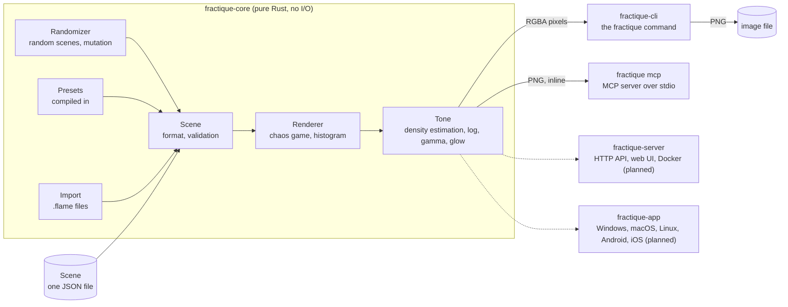
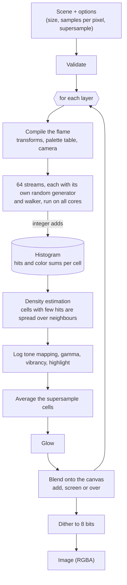

# Architecture

Fractique is a Rust workspace. One crate, **`fractique-core`**, turns a scene into pixels and knows nothing else:
no files, no terminal, no network, no UI. Every other part is a thin wrapper around it, so a scene renders to the
same image wherever it is rendered from.

## Overview

| Crate | State | What it is |
| --- | --- | --- |
| `fractique-core` | works | The renderer, the scene format, presets, the randomizer |
| `fractique-cli` | works | The `fractique` command: renders scenes to PNG, converts `.flame` files, and runs as an MCP server (`fractique mcp`, see [mcp.md](mcp.md)): an AI agent edits a scene, renders a preview, looks, adjusts |
| `fractique-server` | planned | HTTP API with a job queue, the web UI, the Docker image |
| `fractique-app` | planned | The app for desktop and phones |

### Why this shape

- **One renderer.** The app, the CLI, the MCP server and the HTTP server all call the same `render` function with
  the same scene, so they cannot disagree about what a scene looks like.
- **A scene is data.** Everything a render depends on is in one JSON document (`Scene`): the flames, the palettes,
  the camera, the tone settings and the seed. Presets, random scenes, mutations, files and API requests are all the
  same type. The format is described in [scene-format.md](scene-format.md).
- **No I/O in the core.** It compiles for every target unchanged (desktop, Android, iOS, WebAssembly) and is easy
  to test.
- **CPU rendering.** GPUs do not give the same bits from one vendor or driver to the next; the processor does.
  See [determinism.md](determinism.md).

## How a render works

| Step | Where | What happens |
| --- | --- | --- |
| Chaos game | `chaos.rs` | A walker starts at a random point and repeats: pick a transform by weight, apply its affine map, then the weighted sum of its variations, then the optional post map. Each step moves the walker's color toward the transform's color. Every point after the first 24 is plotted. |
| Deep views | `deep.rs` | When a view holds less than an eighth of the flame, the plain chaos game wastes its points outside it. Then the layer is drawn from 8192 particles: points of the flame inside the view, each with the seeds of the steps that made it. They are found window by window, every window half the size of the one before: particles that fall out are replaced by copies of those that stay, and each is moved about inside the window by giving it a new start and keeping its latest steps. The render moves the particles the same way and plots them. Brightness stays what it was where the view began to hold less than an eighth, so a deep view is neither burnt nor black. |
| Streams | `render.rs` | The samples of a layer (`samples per pixel × width × height`) are split over 64 streams. The number is fixed, so the result does not depend on how many cores a machine has. |
| Histogram | `render.rs` | Each plotted point adds 1 to its cell's hit count and its palette color to the cell's color sums. These are integer additions on atomics: the order in which threads add does not change the totals. |
| Density estimation | `tone.rs` | A cell with few hits is noise, so it is spread with a wide kernel; a cell with many hits stays sharp. This is what makes sparse wisps smooth without blurring the dense structure. |
| Tone mapping | `tone.rs` | Brightness follows the logarithm of the density, relative to the average density, so the same scene has the same brightness at any resolution, quality and zoom. Gamma, vibrancy and highlight shape it. |
| Glow | `tone.rs` | A Gaussian blur of the layer is added back. Its radius is a share of the image's shorter side. |
| Layers | `render.rs` | Each layer has its own flame, camera and tone settings and is blended onto the canvas in order. |
| Dither | `render.rs` | An 8×8 ordered dither removes the bands that 8 bits would show in faint gradients on a dark background. |

### Any resolution

The camera is not in pixels. At zoom 1 the shorter side of the image shows 4 world units, whatever the size, and a
wider image shows more of the world on its long side. The number of samples grows with the number of pixels, and
glow and smoothing are sized relative to the image. So one scene gives the same picture at 640×360 and at
3840×2160: the large one is sharper, not different.

### Any zoom

A view can be magnified until the 64-bit numbers of the renderer run out of digits, at about ten thousand million
times; the app stops there. A deep view costs five to ten times a plain one, because every point is sent through
the steps its particle keeps. Where the flame has nothing, a deep view is empty: the gaps between its threads are
wider than the threads. A flame whose transforms blur (`blur`, `gaussian_blur`) is smooth below the size of
its blur and shows no more detail there.

### Phones

A phone renders the same scene with the same code at a lower quality level: fewer samples per pixel and no
supersampling (`mobile`: 30 samples per pixel). Density estimation is what keeps that from looking noisy. See
[performance.md](performance.md) for the numbers.

## The randomizer

`random_scene(seed)` builds a flame of 2 to 4 transforms from a weighted list of variations, picks a palette and
sometimes a symmetry and a second layer. It then probes the flame with 30 000 points to place the camera, and
rejects flames that are a dot, dust or a filled square, trying up to 40 candidates per layer. All of it is driven by
the seed alone, so a seed is a scene. `mutate(scene, seed, strength)` nudges the transforms of an existing scene.

## Limits

| | |
| --- | --- |
| Image side | 1 to 16 384 pixels |
| Supersample | 1 to 4 |
| Samples per pixel | 1 to 100 000 |
| Histogram cells (`width × height × supersample²`) | at most 2²⁸ |
| Layers per scene | 1 to 16 |
| Transforms per flame | 1 to 64 |
