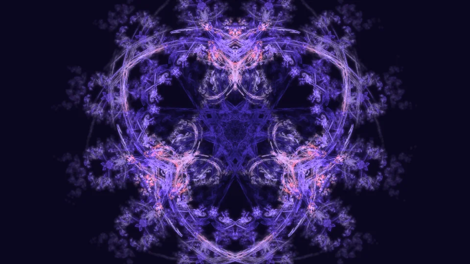
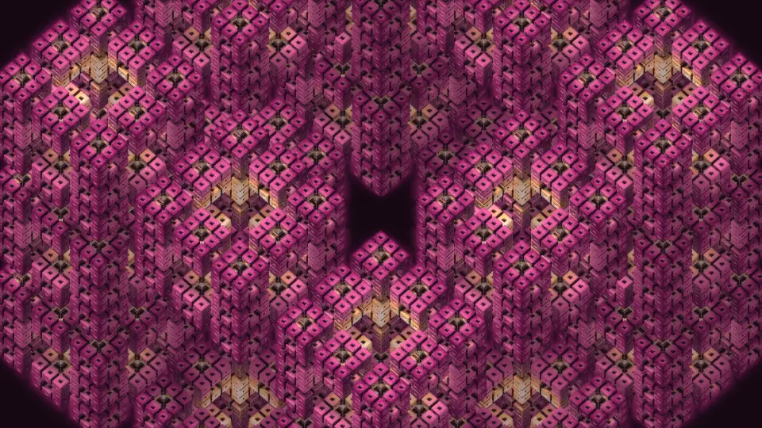
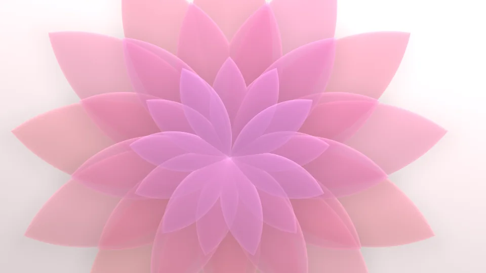
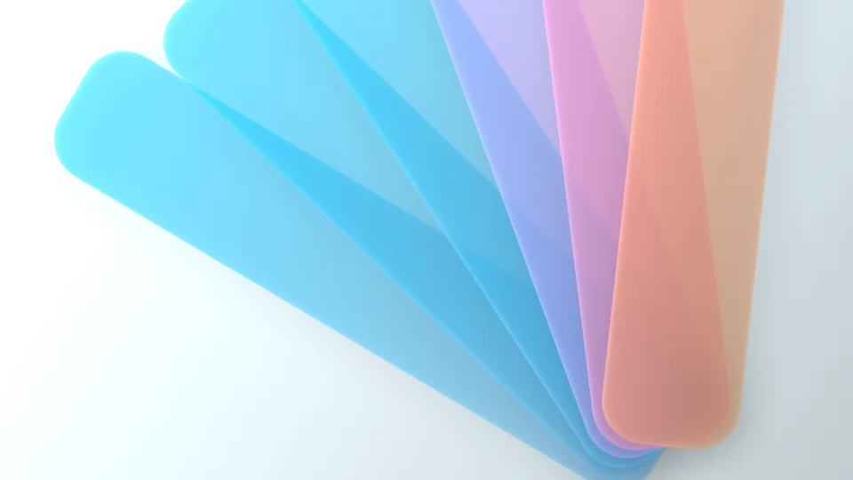

# Gallery

100 flames, 100 fractals, 100 isometric fractals and 100 wallpapers made with Fractique, each a small picture and the `.frcq` file it was
rendered from. The file holds the whole scene, so it renders the same picture again at any size and quality, on any
machine.

A click on a picture downloads its `.frcq` file; the name under it leads to the file in the repository. To open a
file in the app, choose **Scene**, **Open** or double-click the file. To render one from the command line at 4K:

```sh
fractique render docs/gallery/flames/001-phoenix-flare.frcq --size 3840x2160 --quality high -o 001-phoenix-flare.png
```

The pictures are 960 × 540 pixels, rendered at `--quality high` and saved as WebP. They and these pages are
made from the `.frcq` files by `tools/gallery/make_gallery.py` ([usage.md](../usage.md#14-the-gallery)).

## [Flames](flames/README.md)

| | | | |
| --- | --- | --- | --- |
| [](https://github.com/tarpetos/fractique/raw/master/docs/gallery/flames/001-phoenix-flare.frcq) | [](https://github.com/tarpetos/fractique/raw/master/docs/gallery/flames/002-peacock-plume.frcq) | [](https://github.com/tarpetos/fractique/raw/master/docs/gallery/flames/003-amethyst-heart.frcq) | [](https://github.com/tarpetos/fractique/raw/master/docs/gallery/flames/004-nautilus-frost.frcq) |
| [Phoenix Flare](flames/001-phoenix-flare.frcq) | [Peacock Plume](flames/002-peacock-plume.frcq) | [Amethyst Heart](flames/003-amethyst-heart.frcq) | [Nautilus Frost](flames/004-nautilus-frost.frcq) |

[All 100 flames](flames/README.md)

## [Fractals](fractals/README.md)

| | | | |
| --- | --- | --- | --- |
| [](https://github.com/tarpetos/fractique/raw/master/docs/gallery/fractals/F001-ember-cathedral.frcq) | [](https://github.com/tarpetos/fractique/raw/master/docs/gallery/fractals/F002-teal-maelstrom.frcq) | [](https://github.com/tarpetos/fractique/raw/master/docs/gallery/fractals/F003-abyss-galaxies.frcq) | [](https://github.com/tarpetos/fractique/raw/master/docs/gallery/fractals/F004-neon-garden.frcq) |
| [Ember Cathedral](fractals/F001-ember-cathedral.frcq) | [Teal Maelstrom](fractals/F002-teal-maelstrom.frcq) | [Abyss Galaxies](fractals/F003-abyss-galaxies.frcq) | [Neon Garden](fractals/F004-neon-garden.frcq) |

[All 100 fractals](fractals/README.md)

## [Isometric fractals](isometric/README.md)

| | | | |
| --- | --- | --- | --- |
| [](https://github.com/tarpetos/fractique/raw/master/docs/gallery/isometric/I001-copper-citadel.frcq) | [](https://github.com/tarpetos/fractique/raw/master/docs/gallery/isometric/I002-rosewood-maze.frcq) | [](https://github.com/tarpetos/fractique/raw/master/docs/gallery/isometric/I003-brass-shrine.frcq) | [](https://github.com/tarpetos/fractique/raw/master/docs/gallery/isometric/I004-flame-altar.frcq) |
| [Copper Citadel](isometric/I001-copper-citadel.frcq) | [Rosewood Maze](isometric/I002-rosewood-maze.frcq) | [Brass Shrine](isometric/I003-brass-shrine.frcq) | [Flame Altar](isometric/I004-flame-altar.frcq) |

[All 100 isometric fractals](isometric/README.md)

## [Wallpapers](wallpapers/README.md)

| | | | |
| --- | --- | --- | --- |
| [](https://github.com/tarpetos/fractique/raw/master/docs/gallery/wallpapers/W001-pink-lotus.frcq) | [](https://github.com/tarpetos/fractique/raw/master/docs/gallery/wallpapers/W002-teal-ribbons.frcq) | [](https://github.com/tarpetos/fractique/raw/master/docs/gallery/wallpapers/W003-cobalt-wing.frcq) | [](https://github.com/tarpetos/fractique/raw/master/docs/gallery/wallpapers/W004-ember-discs.frcq) |
| [Pink Lotus](wallpapers/W001-pink-lotus.frcq) | [Teal Ribbons](wallpapers/W002-teal-ribbons.frcq) | [Cobalt Wing](wallpapers/W003-cobalt-wing.frcq) | [Ember Discs](wallpapers/W004-ember-discs.frcq) |

[All 100 wallpapers](wallpapers/README.md)
