# Fractals

[Gallery](../README.md) · next: [Isometric fractals](../isometric/README.md)

A click on a picture downloads its `.frcq` file; the name under it leads to the file in the repository.

Fractals of other kinds, most of them presets of their kind and some views of a random seed. They open in the
**Fractals** tab.

| | | | |
| --- | --- | --- | --- |
|  |  |  |  |
| [Ember Cathedral](F001-ember-cathedral.frcq) | [Teal Maelstrom](F002-teal-maelstrom.frcq) | [Abyss Galaxies](F003-abyss-galaxies.frcq) | [Neon Garden](F004-neon-garden.frcq) |
|  |  | [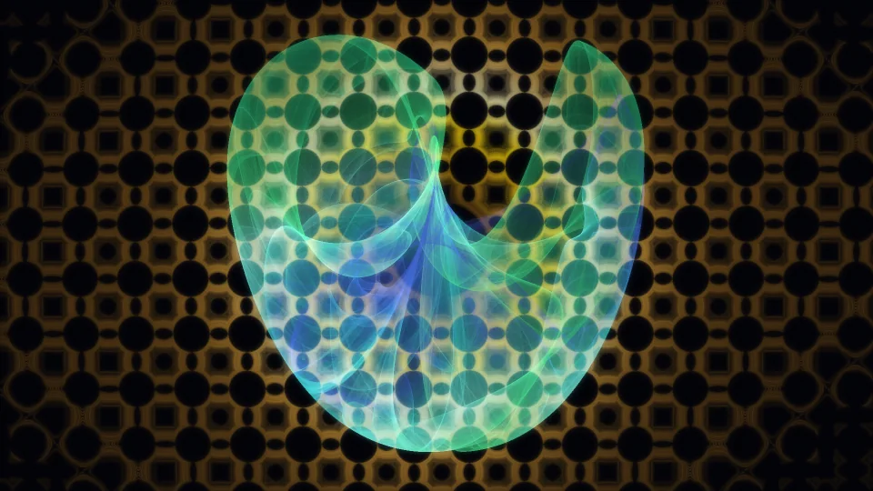](https://github.com/tarpetos/fractique/raw/master/docs/gallery/fractals/F007-jade-honeycomb.frcq) | [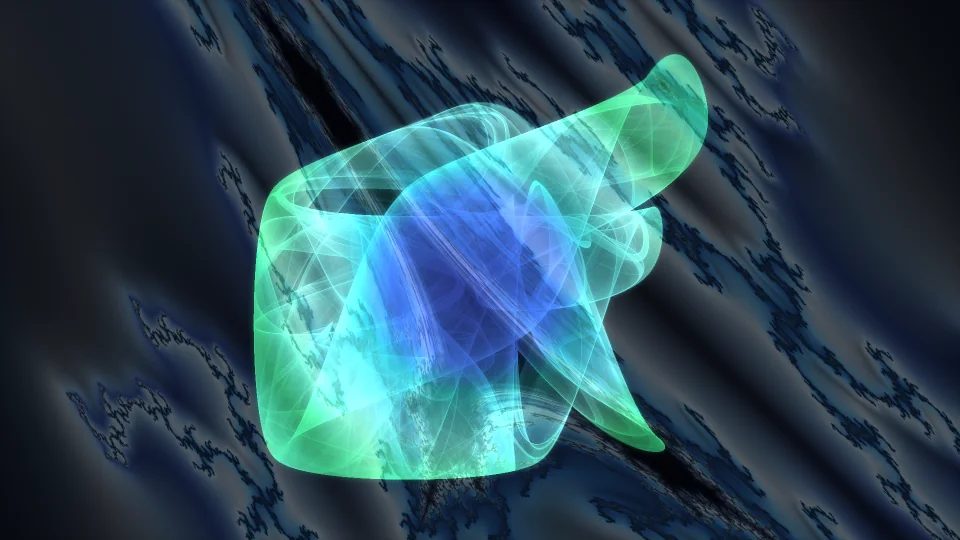](https://github.com/tarpetos/fractique/raw/master/docs/gallery/fractals/F008-glass-scroll.frcq) |
| [Peacock Star](F005-peacock-star.frcq) | [Lotus Buddha](F006-lotus-buddha.frcq) | [Jade Honeycomb](F007-jade-honeycomb.frcq) | [Glass Scroll](F008-glass-scroll.frcq) |
|  |  |  |  |
| [Indigo Lace](F009-indigo-lace.frcq) | [Marble Gasket](F010-marble-gasket.frcq) | [Reef Bulb](F011-reef-bulb.frcq) | [Copper Vault](F012-copper-vault.frcq) |
|  |  | [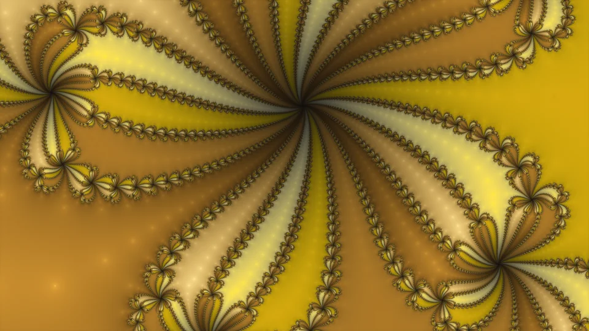](https://github.com/tarpetos/fractique/raw/master/docs/gallery/fractals/F015-golden-petals.frcq) | [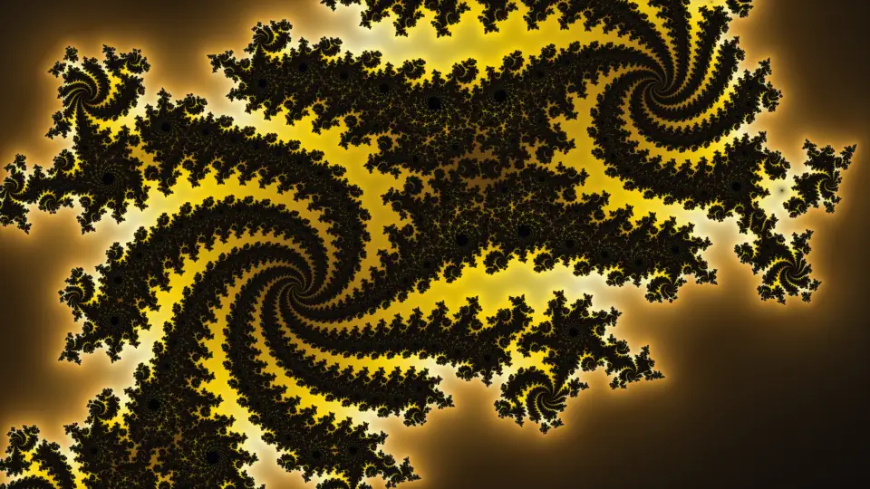](https://github.com/tarpetos/fractique/raw/master/docs/gallery/fractals/F016-golden-feathers.frcq) |
| [Frost Whirlpools](F013-frost-whirlpools.frcq) | [Fern Cyclone](F014-fern-cyclone.frcq) | [Golden Petals](F015-golden-petals.frcq) | [Golden Feathers](F016-golden-feathers.frcq) |
|  | [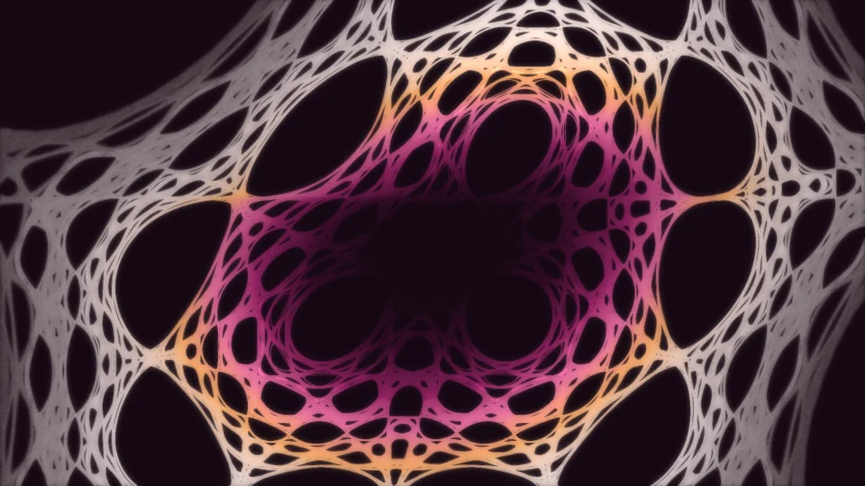](https://github.com/tarpetos/fractique/raw/master/docs/gallery/fractals/F018-rosewood-web.frcq) |  | [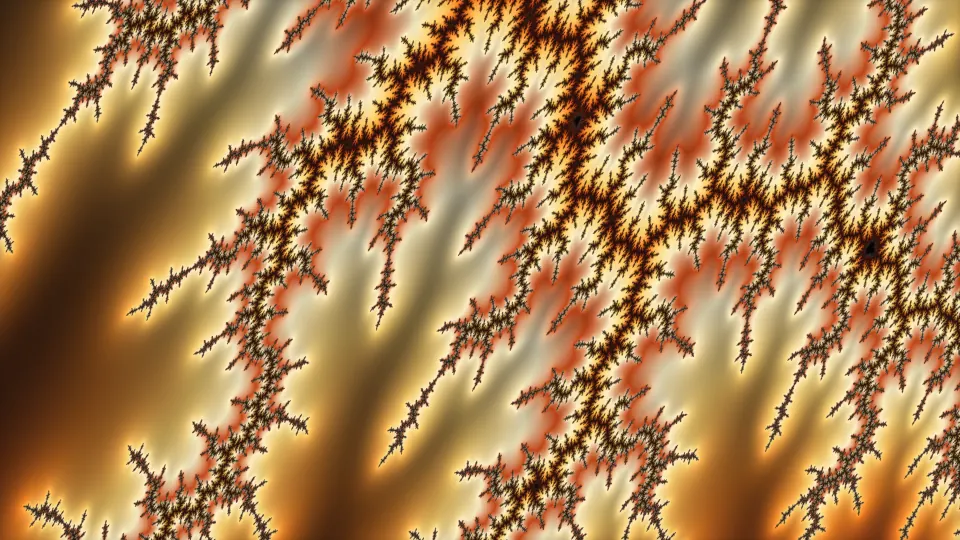](https://github.com/tarpetos/fractique/raw/master/docs/gallery/fractals/F020-ember-brambles.frcq) |
| [Sapphire Web](F017-sapphire-web.frcq) | [Rosewood Web](F018-rosewood-web.frcq) | [Midnight Armada](F019-midnight-armada.frcq) | [Ember Brambles](F020-ember-brambles.frcq) |
| [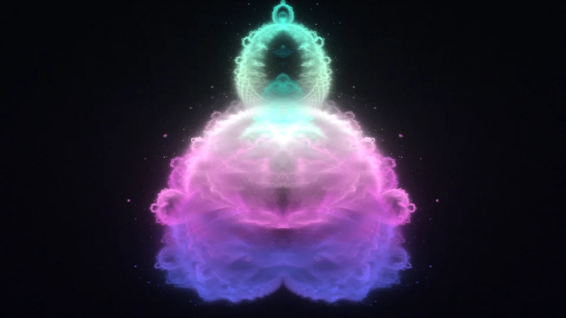](https://github.com/tarpetos/fractique/raw/master/docs/gallery/fractals/F021-pearl-stupa.frcq) | [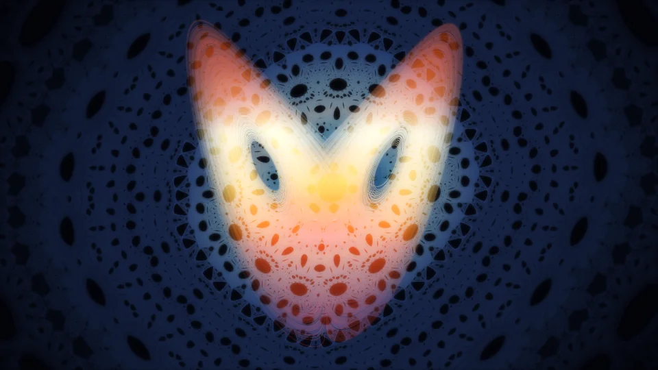](https://github.com/tarpetos/fractique/raw/master/docs/gallery/fractals/F022-ember-mask.frcq) | [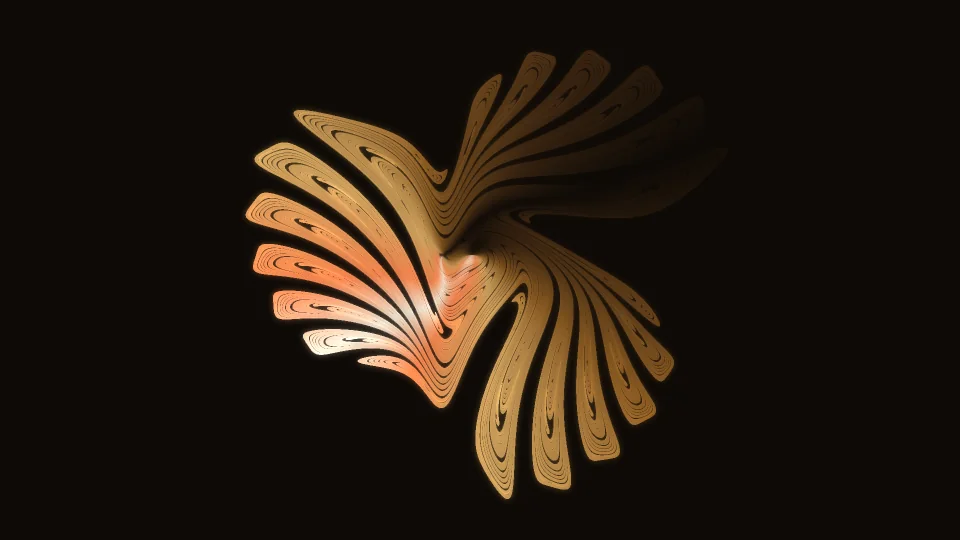](https://github.com/tarpetos/fractique/raw/master/docs/gallery/fractals/F023-bronze-plume.frcq) |  |
| [Pearl Stupa](F021-pearl-stupa.frcq) | [Ember Mask](F022-ember-mask.frcq) | [Bronze Plume](F023-bronze-plume.frcq) | [Aurora Lattice](F024-aurora-lattice.frcq) |
| [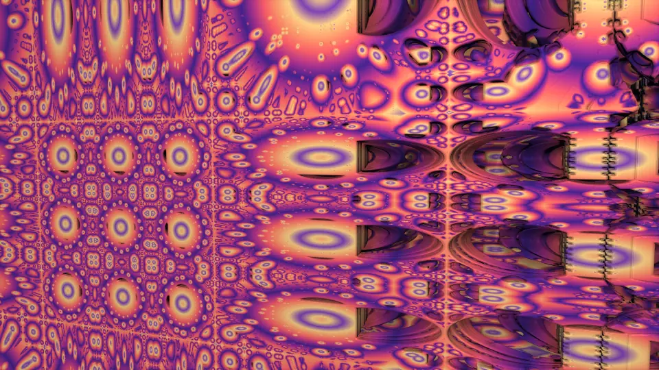](https://github.com/tarpetos/fractique/raw/master/docs/gallery/fractals/F025-sunset-arcade.frcq) |  |  | [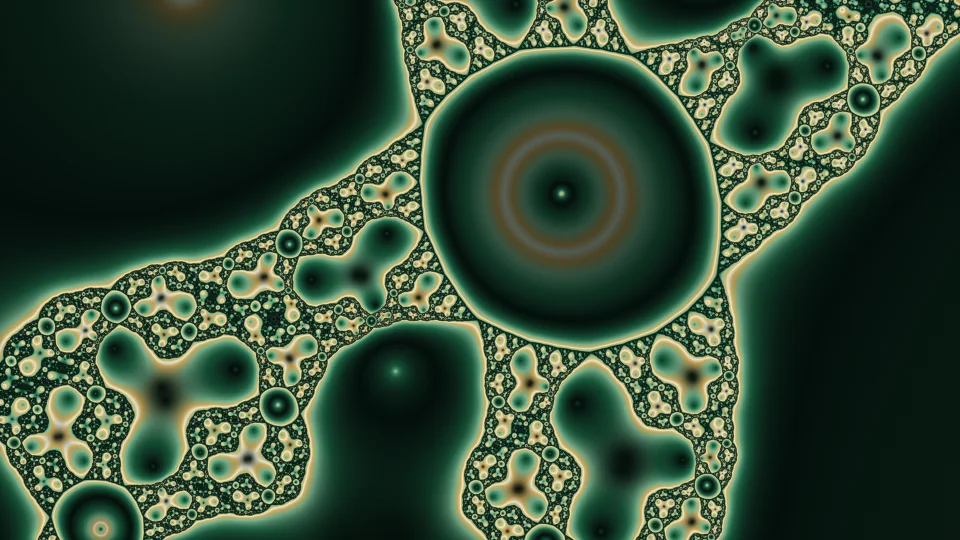](https://github.com/tarpetos/fractique/raw/master/docs/gallery/fractals/F028-forest-coral.frcq) |
| [Sunset Arcade](F025-sunset-arcade.frcq) | [Coral Reef](F026-coral-reef.frcq) | [Amber Terraces](F027-amber-terraces.frcq) | [Forest Coral](F028-forest-coral.frcq) |
| [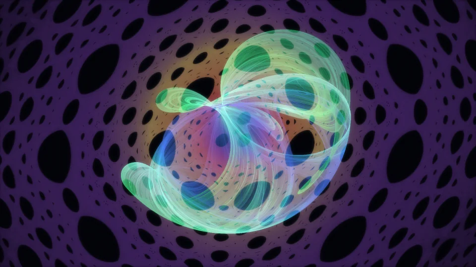](https://github.com/tarpetos/fractique/raw/master/docs/gallery/fractals/F029-opal-shell.frcq) | [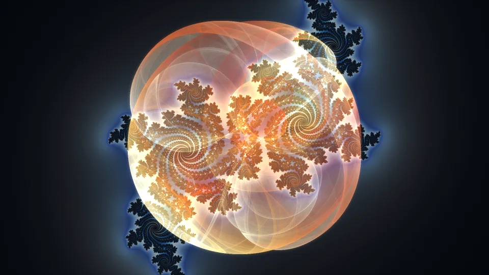](https://github.com/tarpetos/fractique/raw/master/docs/gallery/fractals/F030-amber-globe.frcq) | [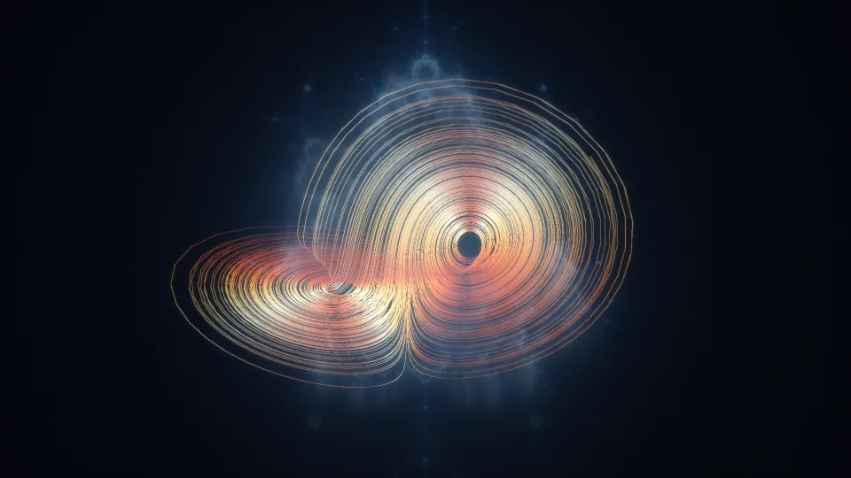](https://github.com/tarpetos/fractique/raw/master/docs/gallery/fractals/F031-copper-vinyl.frcq) | [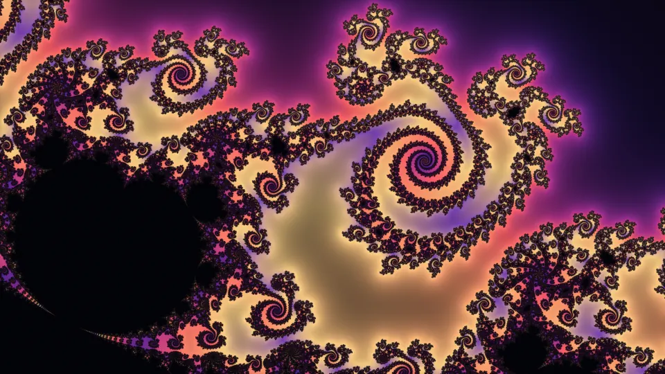](https://github.com/tarpetos/fractique/raw/master/docs/gallery/fractals/F032-sunset-scrolls.frcq) |
| [Opal Shell](F029-opal-shell.frcq) | [Amber Globe](F030-amber-globe.frcq) | [Copper Vinyl](F031-copper-vinyl.frcq) | [Sunset Scrolls](F032-sunset-scrolls.frcq) |
| [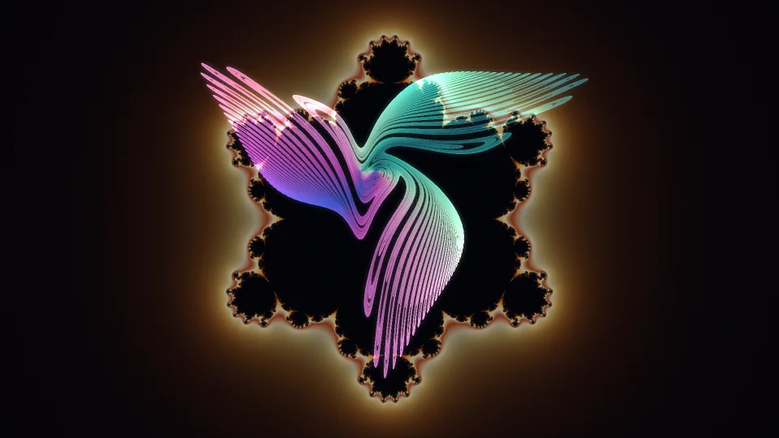](https://github.com/tarpetos/fractique/raw/master/docs/gallery/fractals/F033-bird-in-bloom.frcq) | [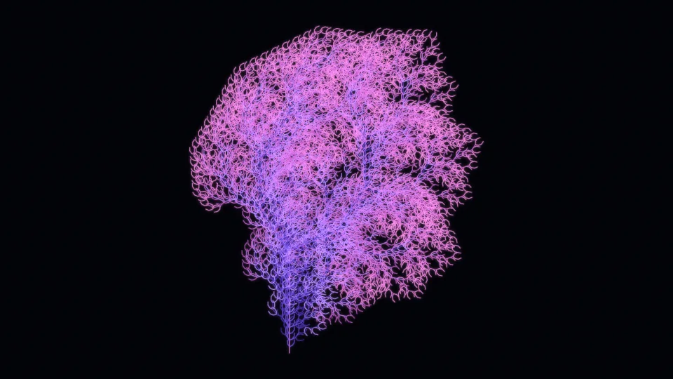](https://github.com/tarpetos/fractique/raw/master/docs/gallery/fractals/F034-lilac-bush.frcq) |  |  |
| [Bird In Bloom](F033-bird-in-bloom.frcq) | [Lilac Bush](F034-lilac-bush.frcq) | [Lime Twins](F035-lime-twins.frcq) | [Sunset Fronds](F036-sunset-fronds.frcq) |
|  | [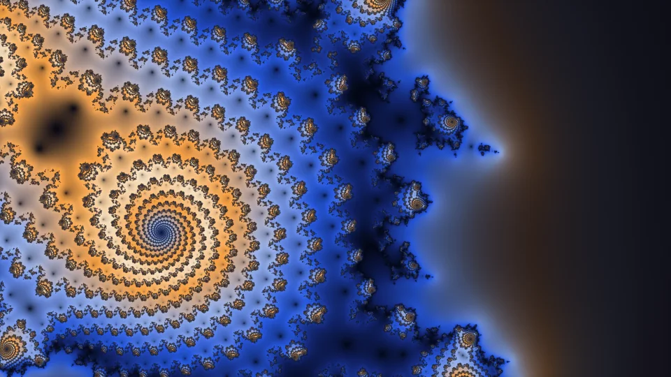](https://github.com/tarpetos/fractique/raw/master/docs/gallery/fractals/F038-cobalt-shell.frcq) |  |  |
| [Tangerine Fans](F037-tangerine-fans.frcq) | [Cobalt Shell](F038-cobalt-shell.frcq) | [Copper Compass](F039-copper-compass.frcq) | [Lime Reef](F040-lime-reef.frcq) |
| [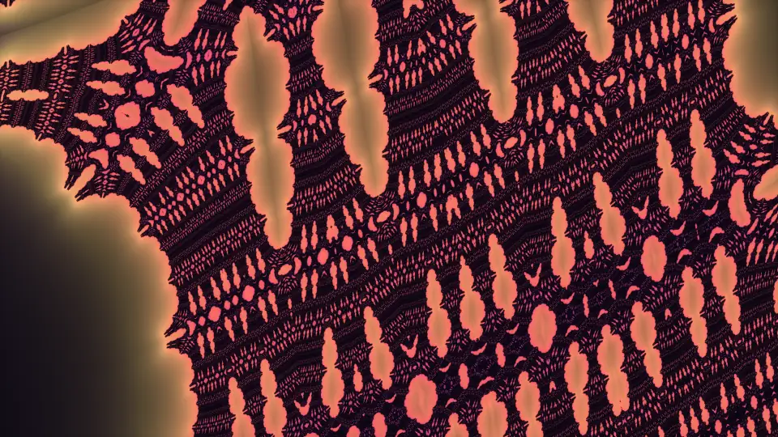](https://github.com/tarpetos/fractique/raw/master/docs/gallery/fractals/F041-coral-rigging.frcq) |  | [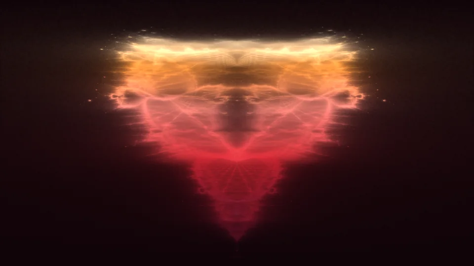](https://github.com/tarpetos/fractique/raw/master/docs/gallery/fractals/F043-garnet-kite.frcq) | [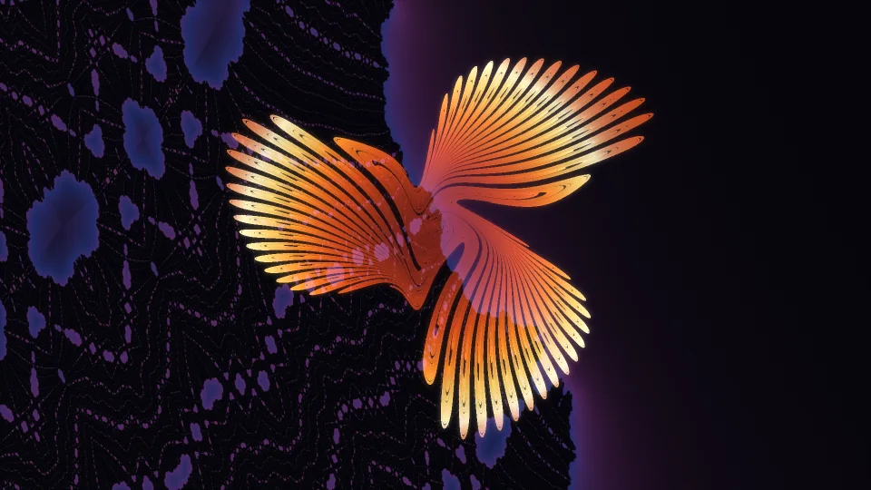](https://github.com/tarpetos/fractique/raw/master/docs/gallery/fractals/F044-amber-wings.frcq) |
| [Coral Rigging](F041-coral-rigging.frcq) | [Mint Hurricane](F042-mint-hurricane.frcq) | [Garnet Kite](F043-garnet-kite.frcq) | [Amber Wings](F044-amber-wings.frcq) |
|  |  |  | [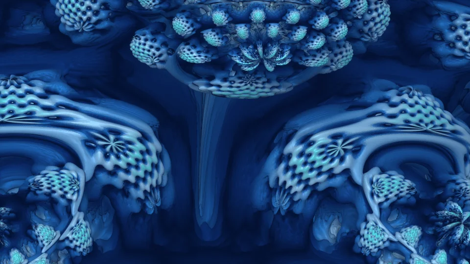](https://github.com/tarpetos/fractique/raw/master/docs/gallery/fractals/F048-abyss-mushroom.frcq) |
| [Peacock Fan](F045-peacock-fan.frcq) | [Golden Drapes](F046-golden-drapes.frcq) | [Violet Amphitheatre](F047-violet-amphitheatre.frcq) | [Abyss Mushroom](F048-abyss-mushroom.frcq) |
|  | [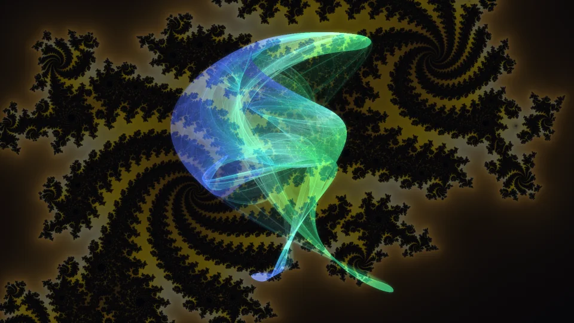](https://github.com/tarpetos/fractique/raw/master/docs/gallery/fractals/F050-jade-kite.frcq) | [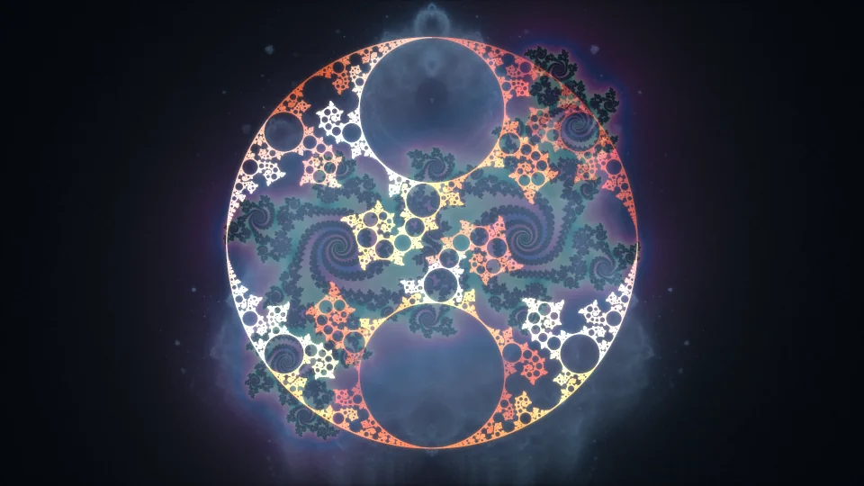](https://github.com/tarpetos/fractique/raw/master/docs/gallery/fractals/F051-coral-rosary.frcq) | [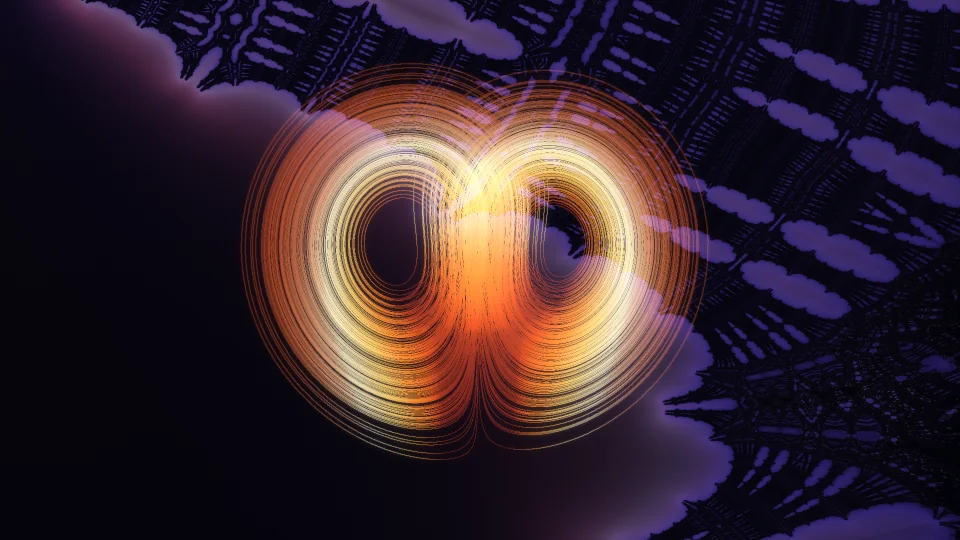](https://github.com/tarpetos/fractique/raw/master/docs/gallery/fractals/F052-ember-owl.frcq) |
| [Lime Courtyard](F049-lime-courtyard.frcq) | [Jade Kite](F050-jade-kite.frcq) | [Coral Rosary](F051-coral-rosary.frcq) | [Ember Owl](F052-ember-owl.frcq) |
| [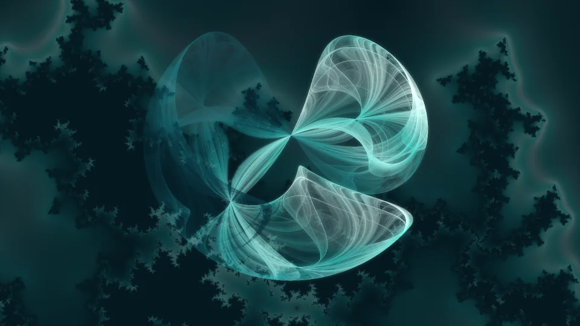](https://github.com/tarpetos/fractique/raw/master/docs/gallery/fractals/F053-lagoon-butterfly.frcq) | [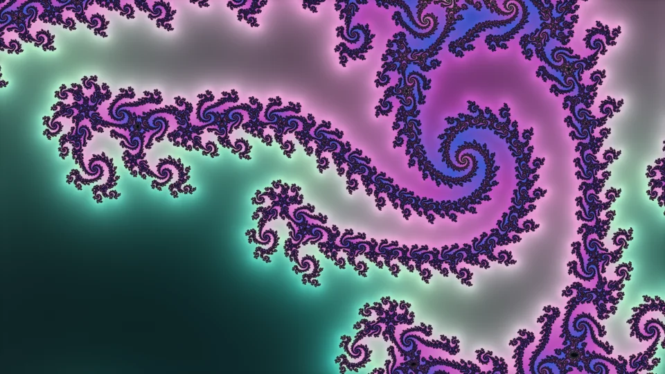](https://github.com/tarpetos/fractique/raw/master/docs/gallery/fractals/F054-orchid-wave.frcq) |  |  |
| [Lagoon Butterfly](F053-lagoon-butterfly.frcq) | [Orchid Wave](F054-orchid-wave.frcq) | [Amber Filigree](F055-amber-filigree.frcq) | [Frost Archipelago](F056-frost-archipelago.frcq) |
| [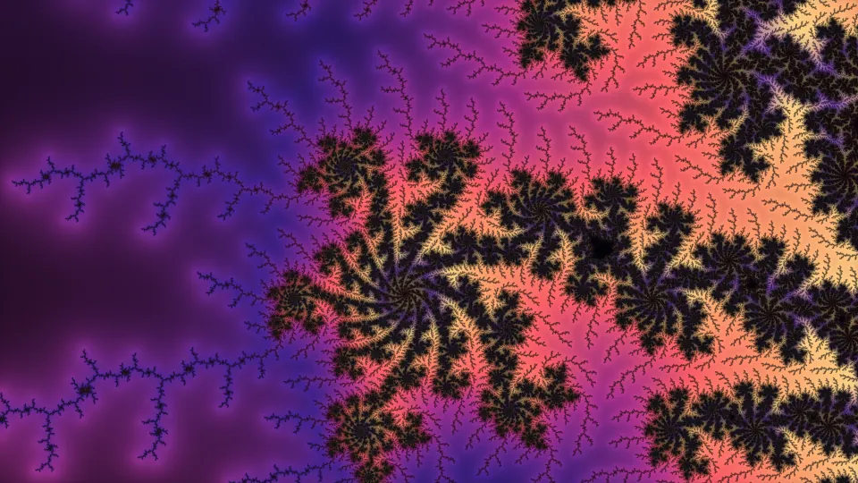](https://github.com/tarpetos/fractique/raw/master/docs/gallery/fractals/F057-magenta-comet.frcq) | [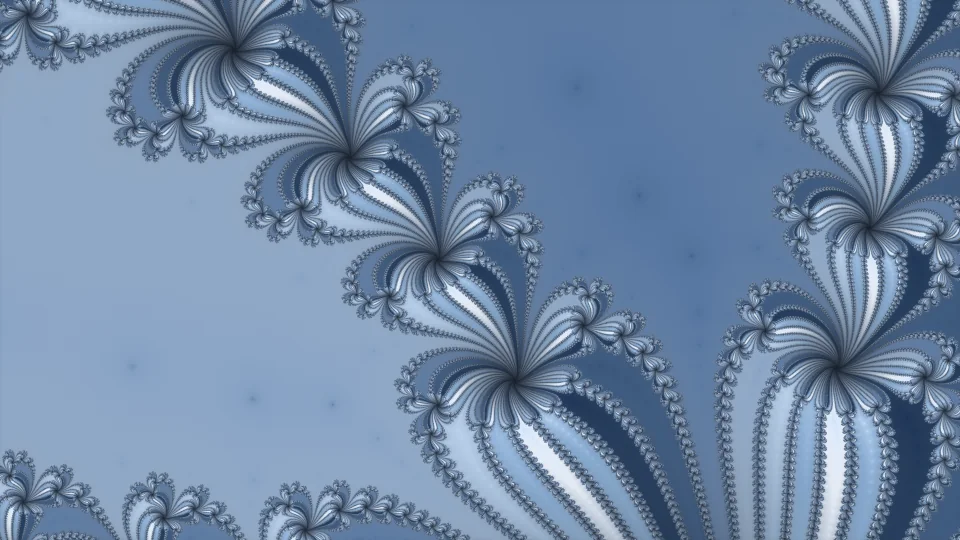](https://github.com/tarpetos/fractique/raw/master/docs/gallery/fractals/F058-frost-plumes.frcq) |  | [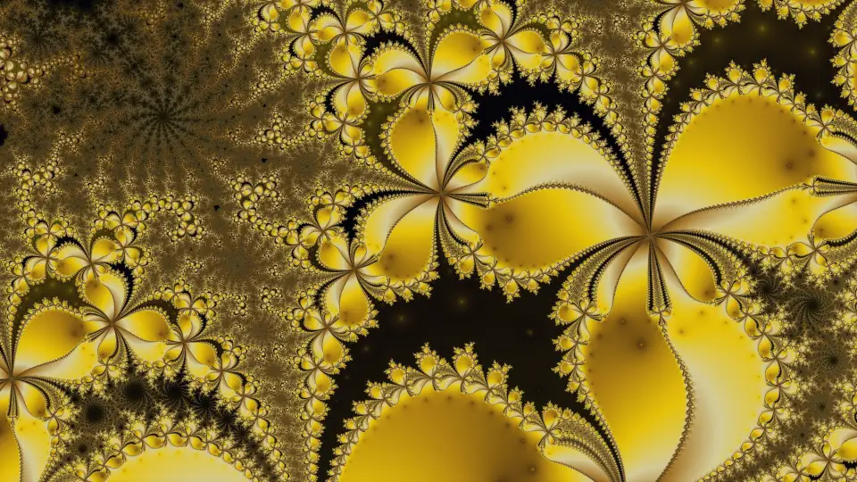](https://github.com/tarpetos/fractique/raw/master/docs/gallery/fractals/F060-brass-orchids.frcq) |
| [Magenta Comet](F057-magenta-comet.frcq) | [Frost Plumes](F058-frost-plumes.frcq) | [Emerald Galaxy](F059-emerald-galaxy.frcq) | [Brass Orchids](F060-brass-orchids.frcq) |
|  |  | [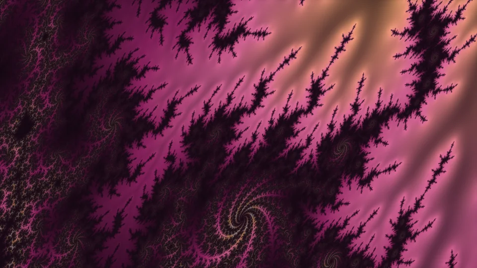](https://github.com/tarpetos/fractique/raw/master/docs/gallery/fractals/F063-rosewood-storm.frcq) |  |
| [Ice Chainmail](F061-ice-chainmail.frcq) | [Ember Shoals](F062-ember-shoals.frcq) | [Rosewood Storm](F063-rosewood-storm.frcq) | [Moon Lantern](F064-moon-lantern.frcq) |
| [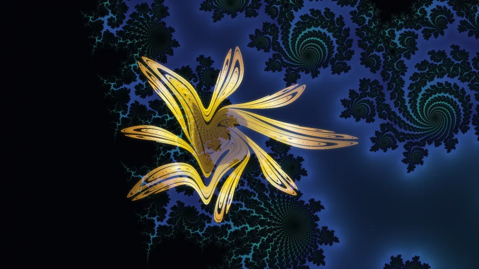](https://github.com/tarpetos/fractique/raw/master/docs/gallery/fractals/F065-golden-lily.frcq) |  | [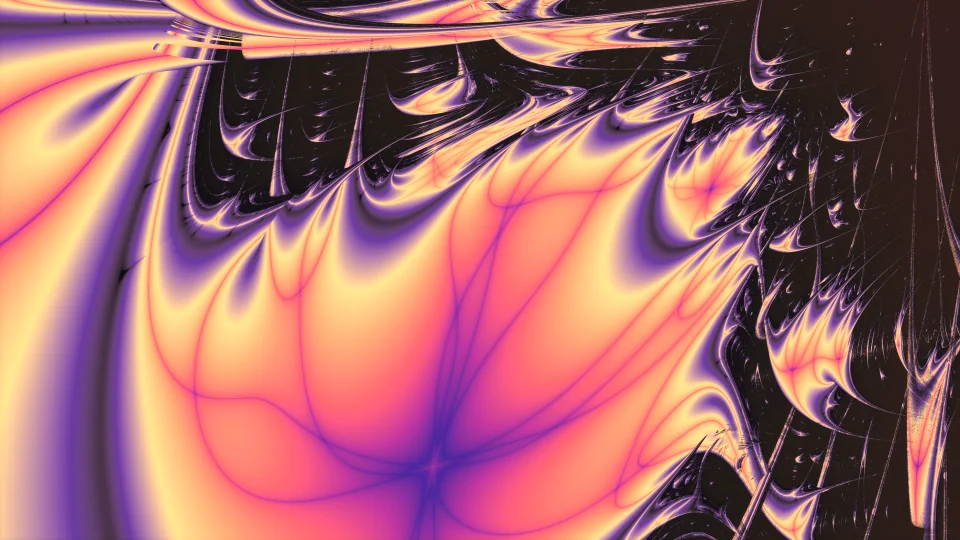](https://github.com/tarpetos/fractique/raw/master/docs/gallery/fractals/F067-coral-leaf.frcq) | [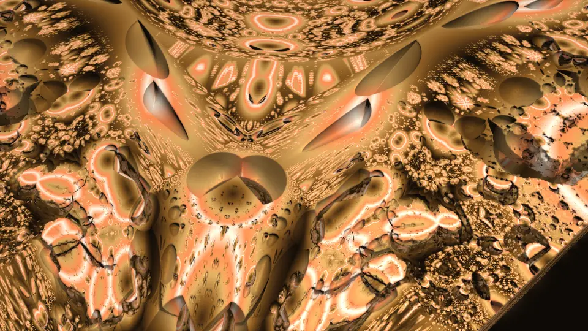](https://github.com/tarpetos/fractique/raw/master/docs/gallery/fractals/F068-bronze-cavern.frcq) |
| [Golden Lily](F065-golden-lily.frcq) | [Sunset Starfish](F066-sunset-starfish.frcq) | [Coral Leaf](F067-coral-leaf.frcq) | [Bronze Cavern](F068-bronze-cavern.frcq) |
| [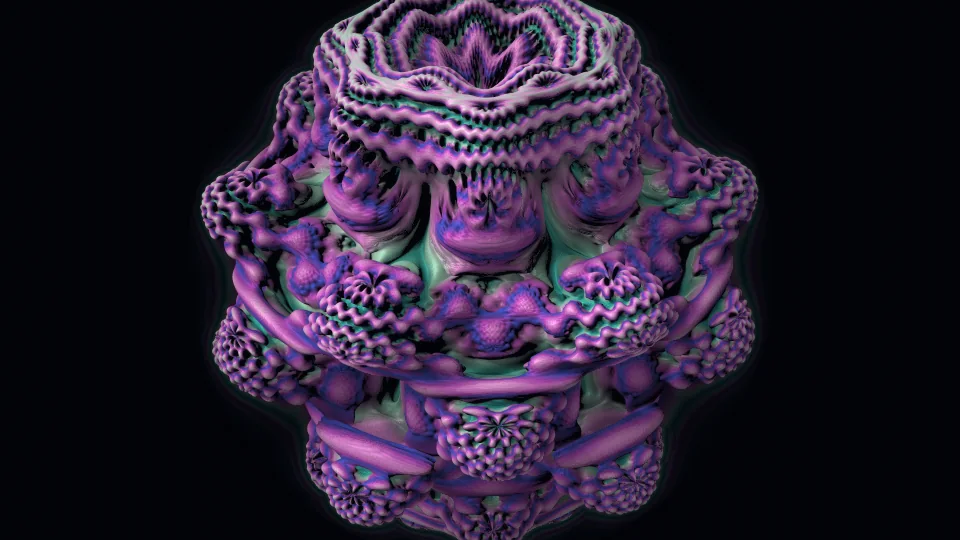](https://github.com/tarpetos/fractique/raw/master/docs/gallery/fractals/F069-orchid-urn.frcq) |  |  | [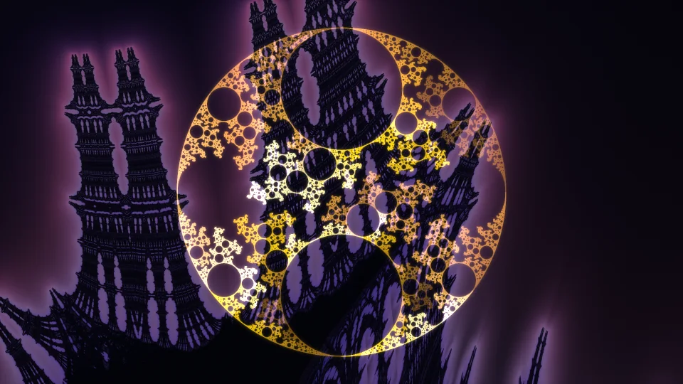](https://github.com/tarpetos/fractique/raw/master/docs/gallery/fractals/F072-gilded-gasket.frcq) |
| [Orchid Urn](F069-orchid-urn.frcq) | [Copper Honeycomb](F070-copper-honeycomb.frcq) | [Lantern Pearls](F071-lantern-pearls.frcq) | [Gilded Gasket](F072-gilded-gasket.frcq) |
| [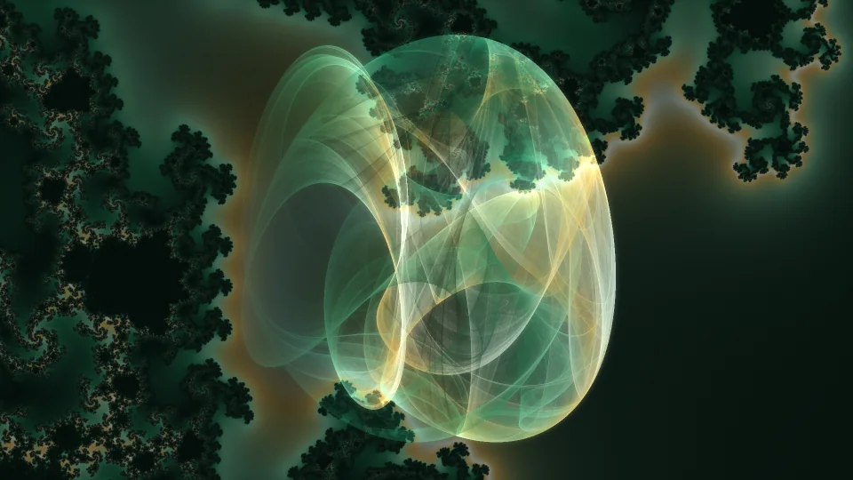](https://github.com/tarpetos/fractique/raw/master/docs/gallery/fractals/F073-forest-egg.frcq) | [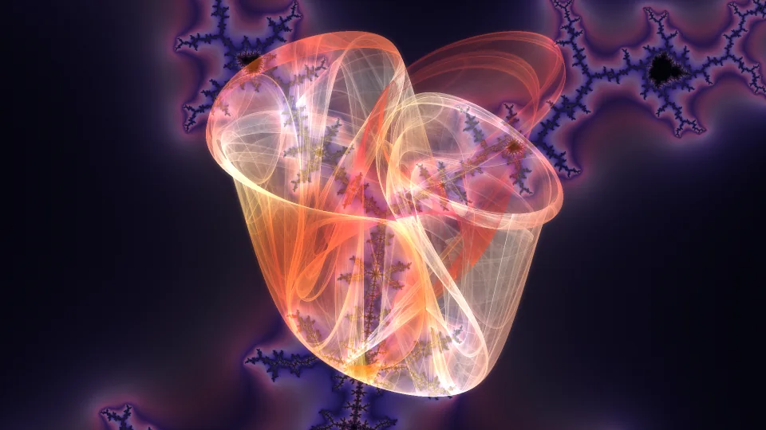](https://github.com/tarpetos/fractique/raw/master/docs/gallery/fractals/F074-coral-chalice.frcq) | [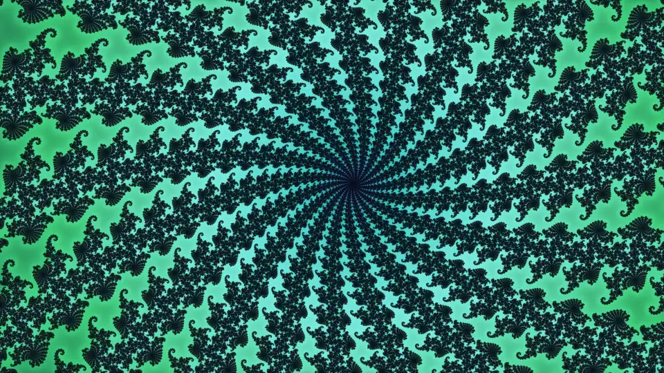](https://github.com/tarpetos/fractique/raw/master/docs/gallery/fractals/F075-jade-pinwheel.frcq) | [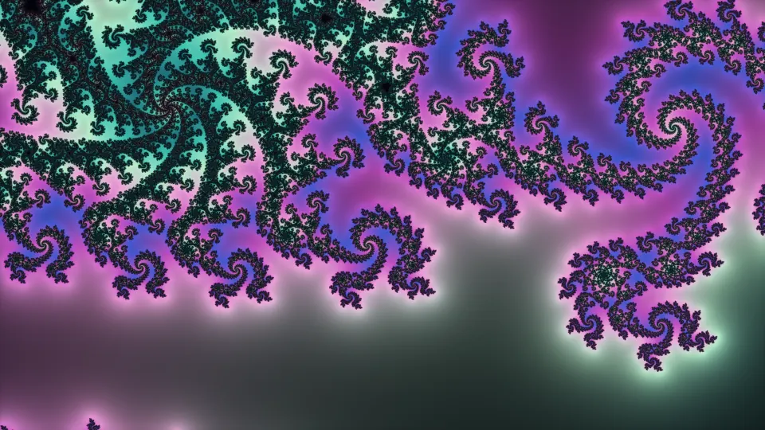](https://github.com/tarpetos/fractique/raw/master/docs/gallery/fractals/F076-rose-surf.frcq) |
| [Forest Egg](F073-forest-egg.frcq) | [Coral Chalice](F074-coral-chalice.frcq) | [Jade Pinwheel](F075-jade-pinwheel.frcq) | [Rose Surf](F076-rose-surf.frcq) |
| [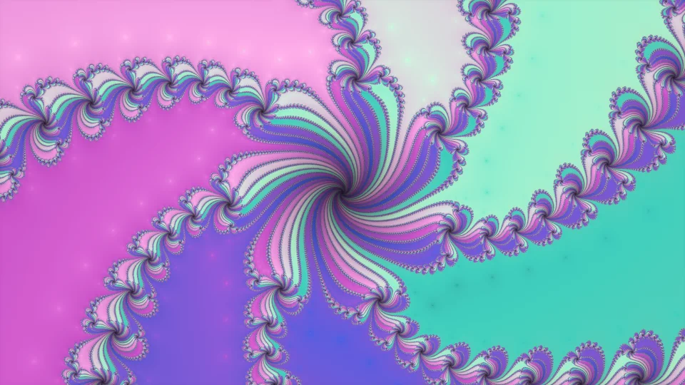](https://github.com/tarpetos/fractique/raw/master/docs/gallery/fractals/F077-candy-pinwheel.frcq) |  |  | [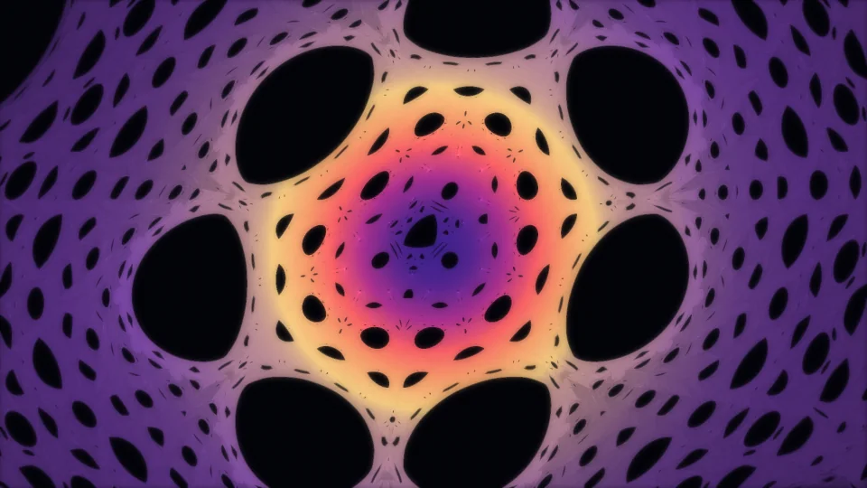](https://github.com/tarpetos/fractique/raw/master/docs/gallery/fractals/F080-sunset-eye.frcq) |
| [Candy Pinwheel](F077-candy-pinwheel.frcq) | [Amethyst Curl](F078-amethyst-curl.frcq) | [Rose Windmill](F079-rose-windmill.frcq) | [Sunset Eye](F080-sunset-eye.frcq) |
| [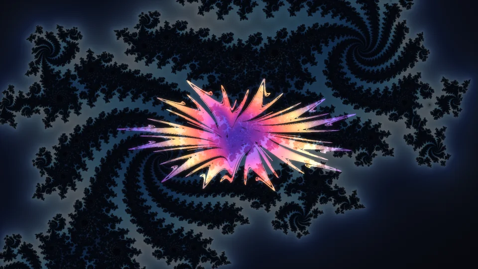](https://github.com/tarpetos/fractique/raw/master/docs/gallery/fractals/F081-sunburst-urchin.frcq) | [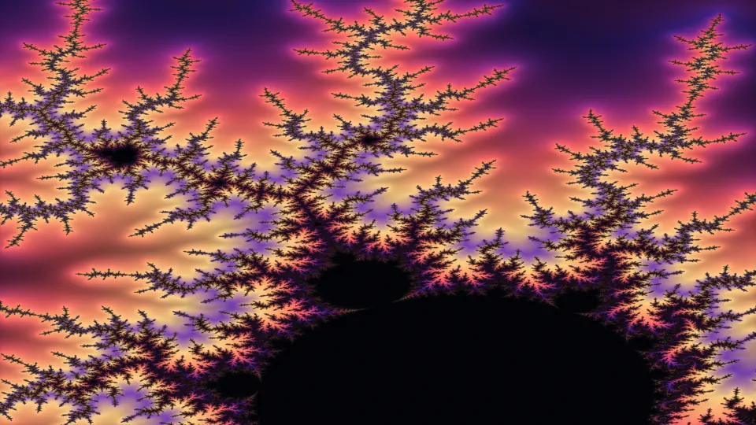](https://github.com/tarpetos/fractique/raw/master/docs/gallery/fractals/F082-sunset-ridge.frcq) | [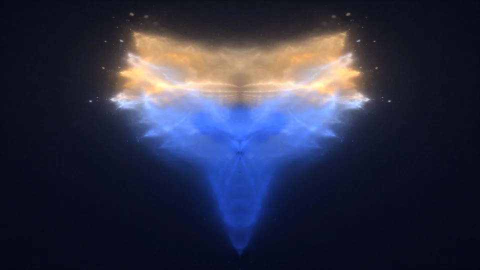](https://github.com/tarpetos/fractique/raw/master/docs/gallery/fractals/F083-cobalt-moth.frcq) | [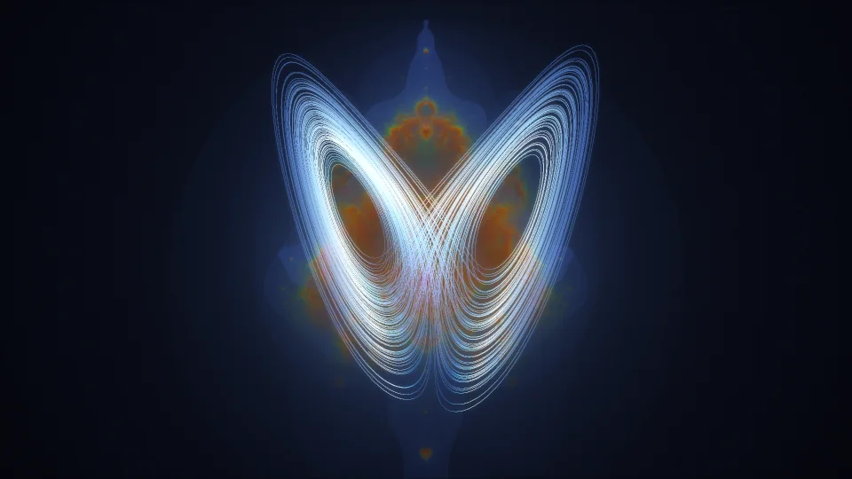](https://github.com/tarpetos/fractique/raw/master/docs/gallery/fractals/F084-silver-butterfly.frcq) |
| [Sunburst Urchin](F081-sunburst-urchin.frcq) | [Sunset Ridge](F082-sunset-ridge.frcq) | [Cobalt Moth](F083-cobalt-moth.frcq) | [Silver Butterfly](F084-silver-butterfly.frcq) |
| [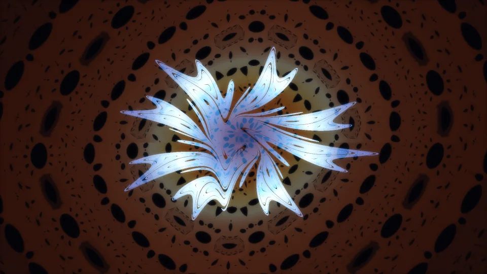](https://github.com/tarpetos/fractique/raw/master/docs/gallery/fractals/F085-frost-pinwheel.frcq) |  |  | [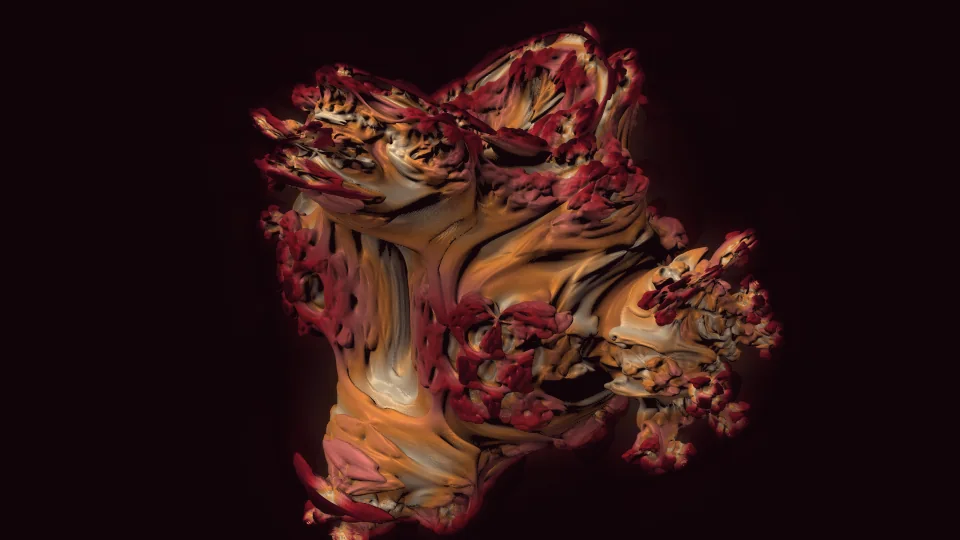](https://github.com/tarpetos/fractique/raw/master/docs/gallery/fractals/F088-garnet-sculpture.frcq) |
| [Frost Pinwheel](F085-frost-pinwheel.frcq) | [Aqua Web](F086-aqua-web.frcq) | [Canyon Terraces](F087-canyon-terraces.frcq) | [Garnet Sculpture](F088-garnet-sculpture.frcq) |
|  |  |  |  |
| [Blue Ziggurat](F089-blue-ziggurat.frcq) | [Copper Octopus](F090-copper-octopus.frcq) | [Plum Nautilus](F091-plum-nautilus.frcq) | [Rose Bouquet](F092-rose-bouquet.frcq) |
|  |  | [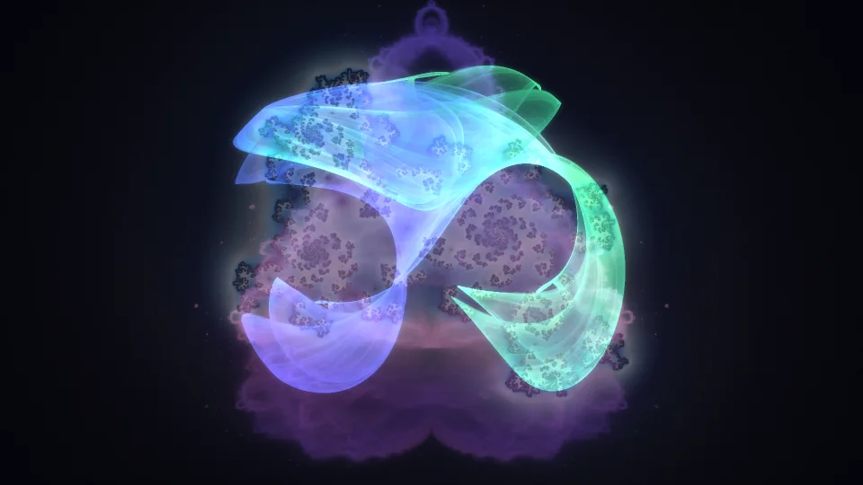](https://github.com/tarpetos/fractique/raw/master/docs/gallery/fractals/F095-mint-scarf.frcq) | [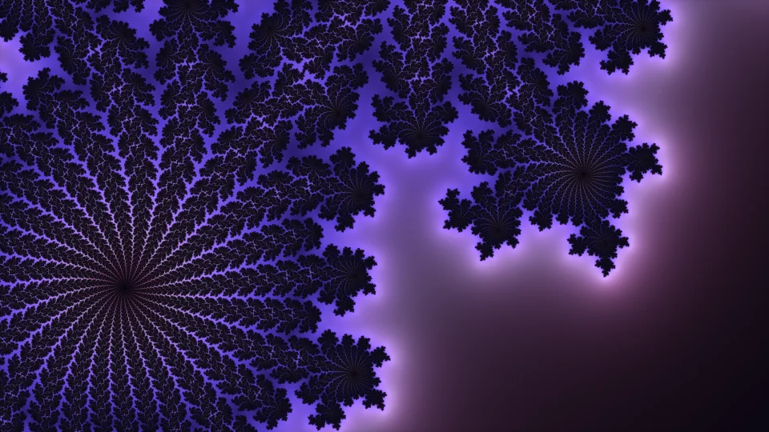](https://github.com/tarpetos/fractique/raw/master/docs/gallery/fractals/F096-indigo-fan.frcq) |
| [Abyss Paisley](F093-abyss-paisley.frcq) | [Violet Seahorses](F094-violet-seahorses.frcq) | [Mint Scarf](F095-mint-scarf.frcq) | [Indigo Fan](F096-indigo-fan.frcq) |
|  |  |  |  |
| [Desert Lightning](F097-desert-lightning.frcq) | [Lagoon Palm](F098-lagoon-palm.frcq) | [Coral Seahorse](F099-coral-seahorse.frcq) | [Rust Canopy](F100-rust-canopy.frcq) |

[Gallery](../README.md) · next: [Isometric fractals](../isometric/README.md)
