# Fractals

[Gallery](../README.md) · next: [Wallpapers](../wallpapers/README.md)

A click on a picture downloads its `.frcq` file; the name under it leads to the file in the repository.

Fractals of other kinds, most of them presets of their kind and some views of a random seed. They open in the
**Fractals** tab.

| | | | |
| --- | --- | --- | --- |
|  | [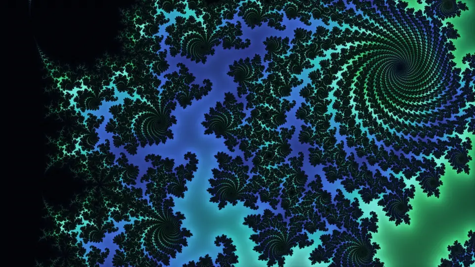](https://github.com/tarpetos/fractique/raw/master/docs/gallery/fractals/F002-teal-maelstrom.frcq) |  |  |
| [Ember Cathedral](F001-ember-cathedral.frcq) | [Teal Maelstrom](F002-teal-maelstrom.frcq) | [Golden Galaxies](F003-golden-galaxies.frcq) | [Neon Garden](F004-neon-garden.frcq) |
|  |  | [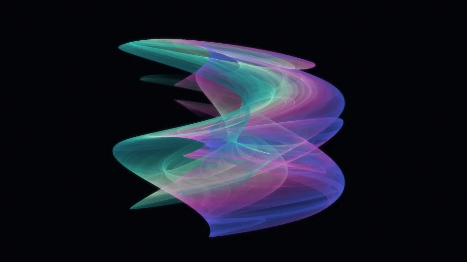](https://github.com/tarpetos/fractique/raw/master/docs/gallery/fractals/F007-silk-strata.frcq) |  |
| [Peacock Star](F005-peacock-star.frcq) | [Lotus Buddha](F006-lotus-buddha.frcq) | [Silk Strata](F007-silk-strata.frcq) | [Sunset Lorenz](F008-sunset-lorenz.frcq) |
|  |  |  | [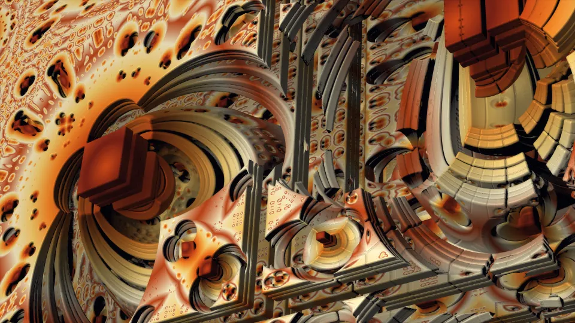](https://github.com/tarpetos/fractique/raw/master/docs/gallery/fractals/F012-copper-vault.frcq) |
| [Indigo Lace](F009-indigo-lace.frcq) | [Marble Gasket](F010-marble-gasket.frcq) | [Reef Bulb](F011-reef-bulb.frcq) | [Copper Vault](F012-copper-vault.frcq) |
| [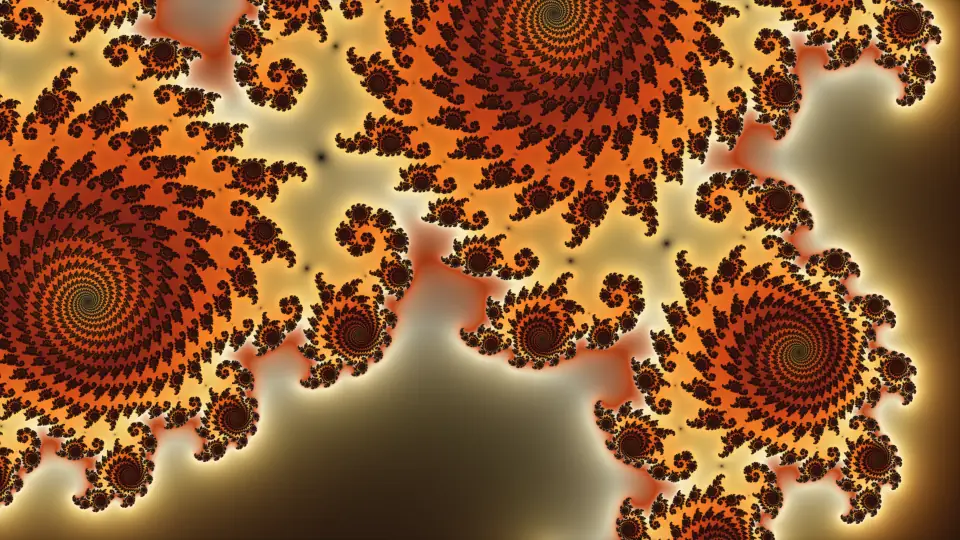](https://github.com/tarpetos/fractique/raw/master/docs/gallery/fractals/F013-amber-whirlpools.frcq) | [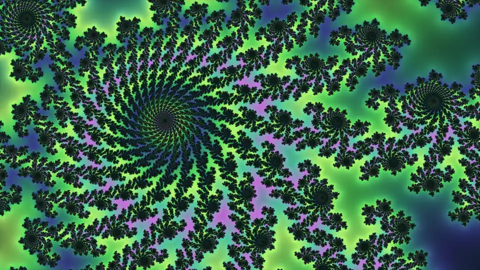](https://github.com/tarpetos/fractique/raw/master/docs/gallery/fractals/F014-fern-cyclone.frcq) |  |  |
| [Amber Whirlpools](F013-amber-whirlpools.frcq) | [Fern Cyclone](F014-fern-cyclone.frcq) | [Golden Petals](F015-golden-petals.frcq) | [Golden Feathers](F016-golden-feathers.frcq) |
|  | [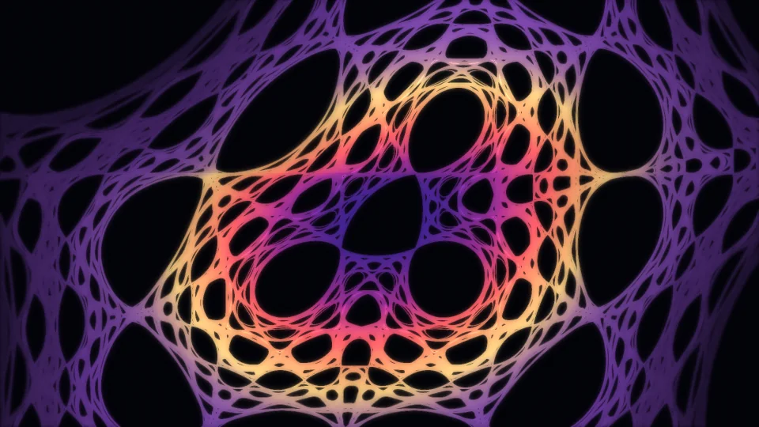](https://github.com/tarpetos/fractique/raw/master/docs/gallery/fractals/F018-neon-web.frcq) | [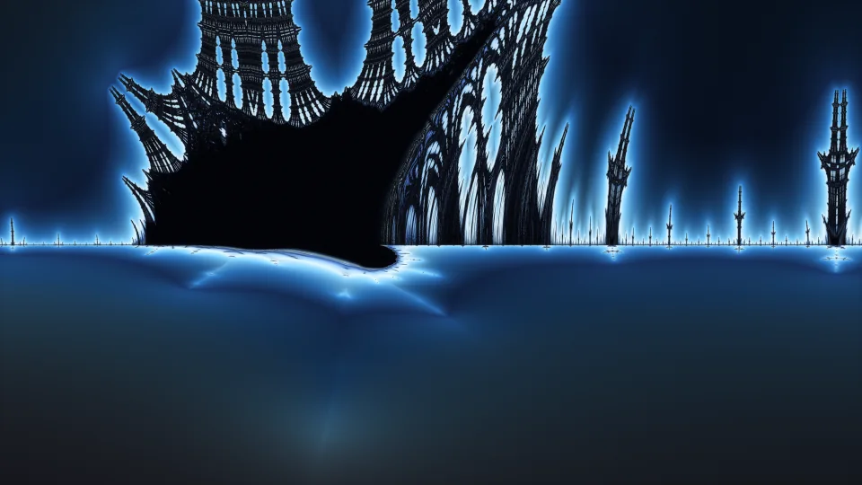](https://github.com/tarpetos/fractique/raw/master/docs/gallery/fractals/F019-midnight-armada.frcq) |  |
| [Sapphire Web](F017-sapphire-web.frcq) | [Neon Web](F018-neon-web.frcq) | [Midnight Armada](F019-midnight-armada.frcq) | [Ember Brambles](F020-ember-brambles.frcq) |
|  | [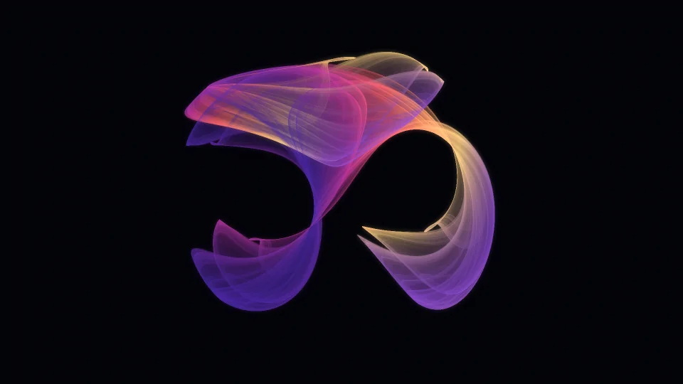](https://github.com/tarpetos/fractique/raw/master/docs/gallery/fractals/F022-violet-ribbon.frcq) |  |  |
| [Pearl Stupa](F021-pearl-stupa.frcq) | [Violet Ribbon](F022-violet-ribbon.frcq) | [Copper Plume](F023-copper-plume.frcq) | [Aurora Lattice](F024-aurora-lattice.frcq) |
|  |  | [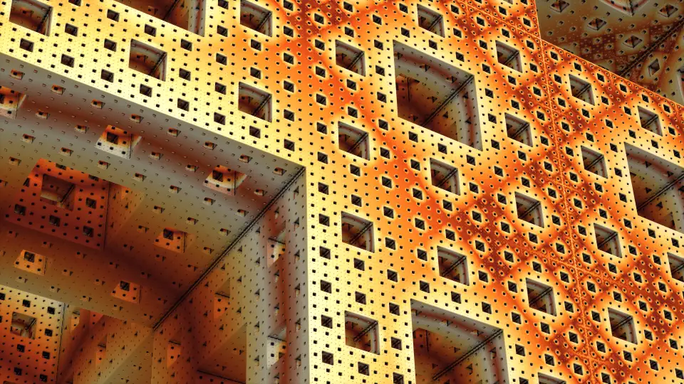](https://github.com/tarpetos/fractique/raw/master/docs/gallery/fractals/F027-amber-terraces.frcq) | [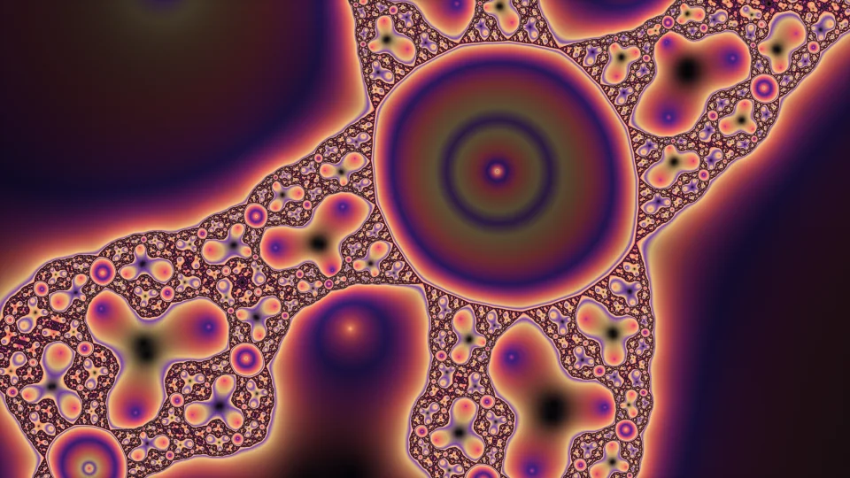](https://github.com/tarpetos/fractique/raw/master/docs/gallery/fractals/F028-dusk-coral.frcq) |
| [Sunset Arcade](F025-sunset-arcade.frcq) | [Coral Reef](F026-coral-reef.frcq) | [Amber Terraces](F027-amber-terraces.frcq) | [Dusk Coral](F028-dusk-coral.frcq) |
|  | [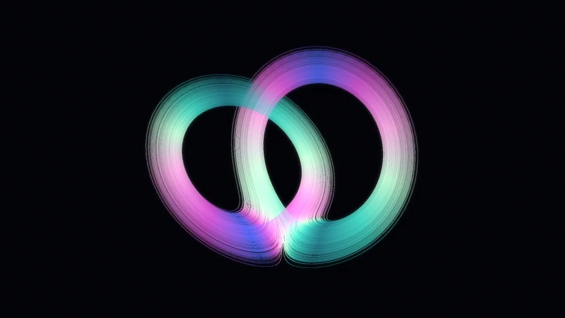](https://github.com/tarpetos/fractique/raw/master/docs/gallery/fractals/F030-mint-rings.frcq) | [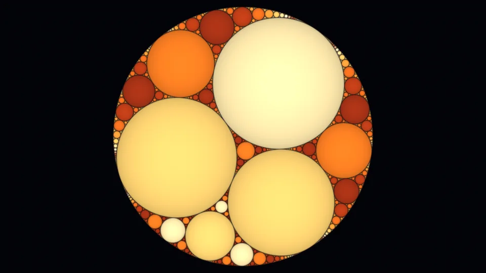](https://github.com/tarpetos/fractique/raw/master/docs/gallery/fractals/F031-citrus-gasket.frcq) |  |
| [Orchid Shell](F029-orchid-shell.frcq) | [Mint Rings](F030-mint-rings.frcq) | [Citrus Gasket](F031-citrus-gasket.frcq) | [Sunset Scrolls](F032-sunset-scrolls.frcq) |
| [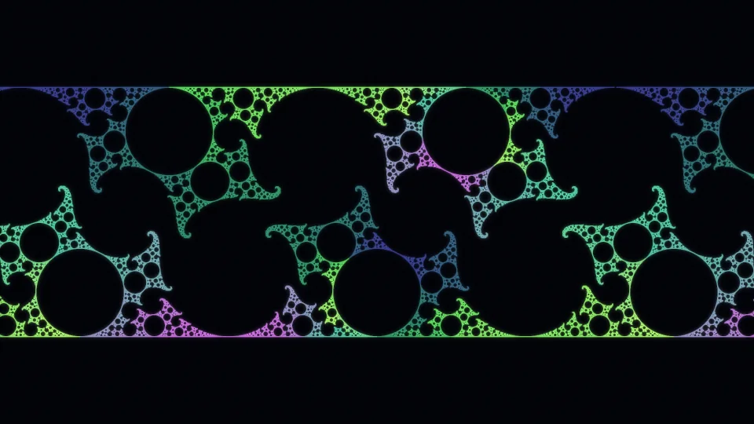](https://github.com/tarpetos/fractique/raw/master/docs/gallery/fractals/F033-fern-frieze.frcq) |  |  |  |
| [Fern Frieze](F033-fern-frieze.frcq) | [Lilac Bush](F034-lilac-bush.frcq) | [Lime Twins](F035-lime-twins.frcq) | [Sunset Fronds](F036-sunset-fronds.frcq) |
| [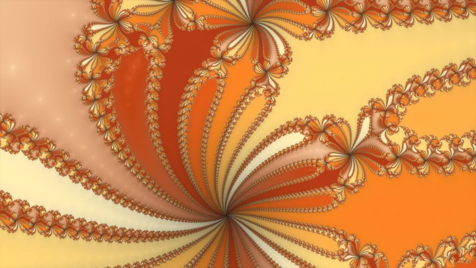](https://github.com/tarpetos/fractique/raw/master/docs/gallery/fractals/F037-tangerine-fans.frcq) | [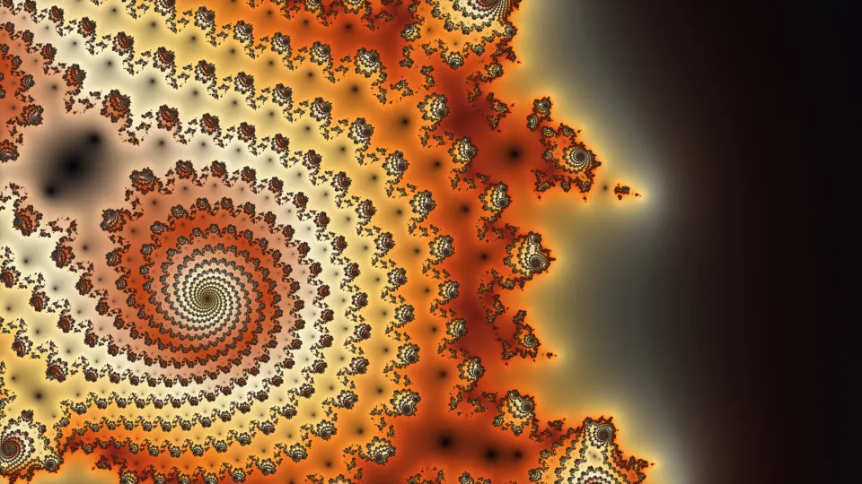](https://github.com/tarpetos/fractique/raw/master/docs/gallery/fractals/F038-amber-shell.frcq) |  |  |
| [Tangerine Fans](F037-tangerine-fans.frcq) | [Amber Shell](F038-amber-shell.frcq) | [Copper Compass](F039-copper-compass.frcq) | [Lime Reef](F040-lime-reef.frcq) |
|  | [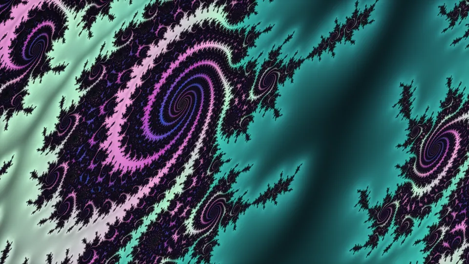](https://github.com/tarpetos/fractique/raw/master/docs/gallery/fractals/F042-mint-hurricane.frcq) | [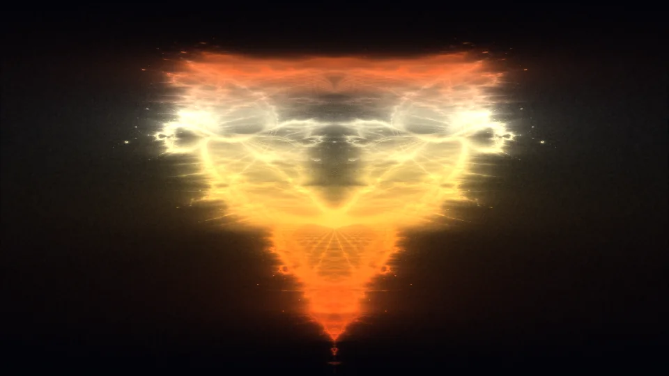](https://github.com/tarpetos/fractique/raw/master/docs/gallery/fractals/F043-ember-kite.frcq) | [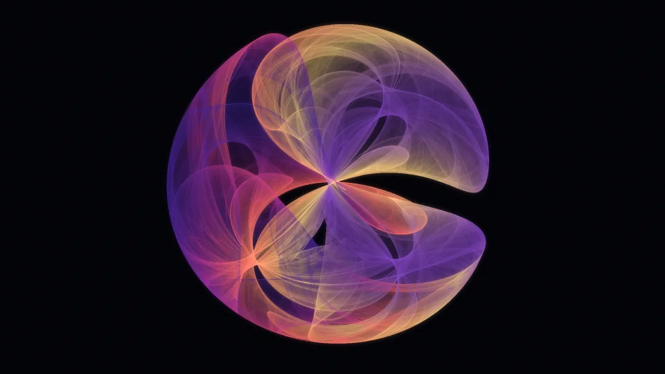](https://github.com/tarpetos/fractique/raw/master/docs/gallery/fractals/F044-dusk-petals.frcq) |
| [Coral Rigging](F041-coral-rigging.frcq) | [Mint Hurricane](F042-mint-hurricane.frcq) | [Ember Kite](F043-ember-kite.frcq) | [Dusk Petals](F044-dusk-petals.frcq) |
| [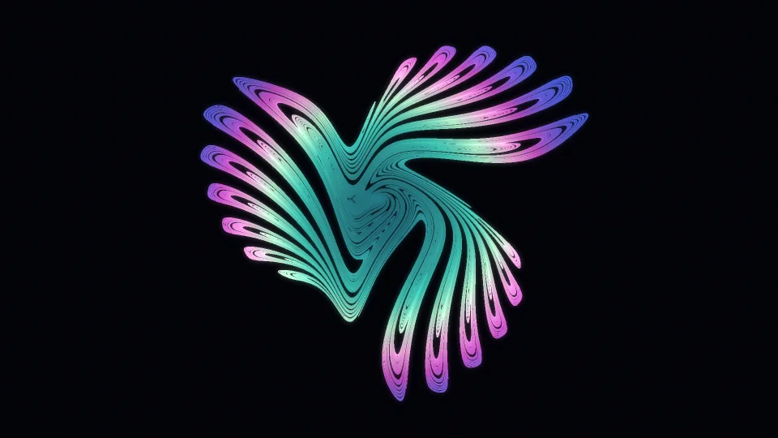](https://github.com/tarpetos/fractique/raw/master/docs/gallery/fractals/F045-peacock-fan.frcq) |  |  |  |
| [Peacock Fan](F045-peacock-fan.frcq) | [Golden Drapes](F046-golden-drapes.frcq) | [Violet Amphitheatre](F047-violet-amphitheatre.frcq) | [Magma Mushroom](F048-magma-mushroom.frcq) |
|  |  | [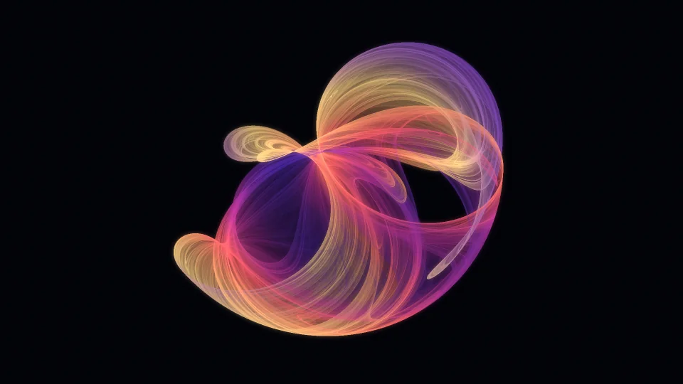](https://github.com/tarpetos/fractique/raw/master/docs/gallery/fractals/F051-sunset-conch.frcq) | [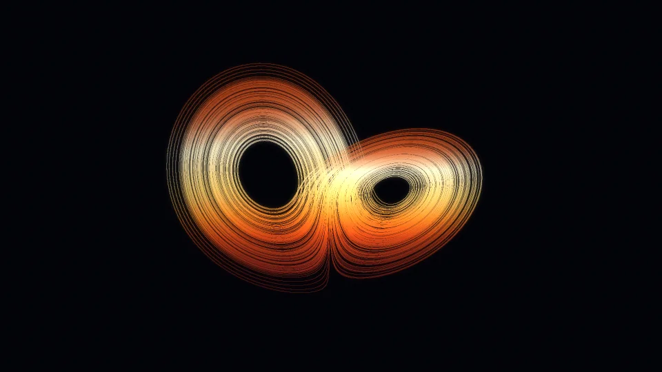](https://github.com/tarpetos/fractique/raw/master/docs/gallery/fractals/F052-ember-lorenz.frcq) |
| [Lime Courtyard](F049-lime-courtyard.frcq) | [Pebble Lagoon](F050-pebble-lagoon.frcq) | [Sunset Conch](F051-sunset-conch.frcq) | [Ember Lorenz](F052-ember-lorenz.frcq) |
| [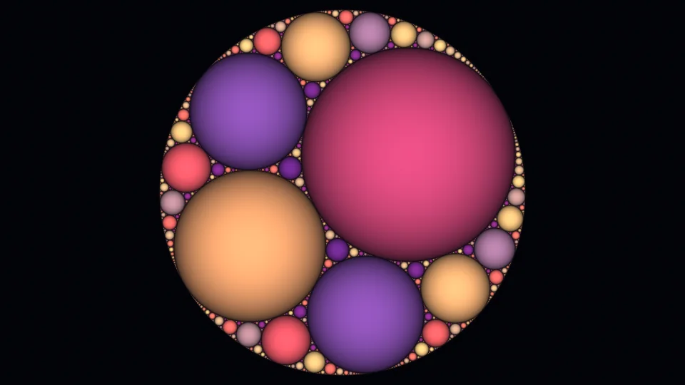](https://github.com/tarpetos/fractique/raw/master/docs/gallery/fractals/F053-berry-gasket.frcq) |  | [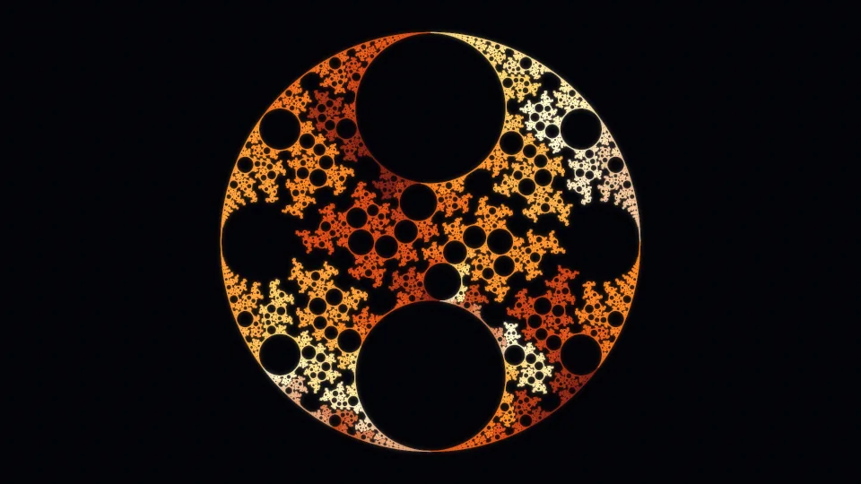](https://github.com/tarpetos/fractique/raw/master/docs/gallery/fractals/F055-amber-filigree.frcq) |  |
| [Berry Gasket](F053-berry-gasket.frcq) | [Orchid Wave](F054-orchid-wave.frcq) | [Amber Filigree](F055-amber-filigree.frcq) | [Frost Archipelago](F056-frost-archipelago.frcq) |
|  | [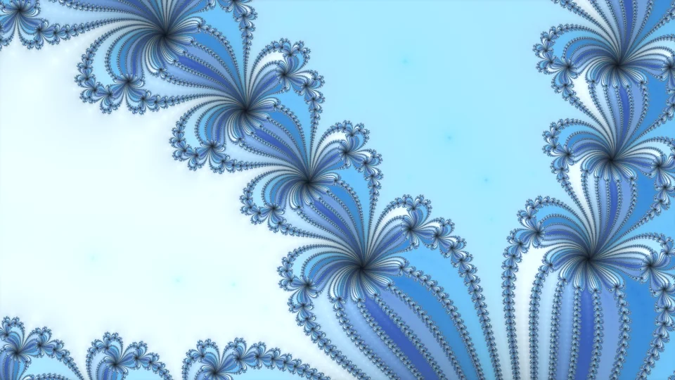](https://github.com/tarpetos/fractique/raw/master/docs/gallery/fractals/F058-porcelain-plumes.frcq) | [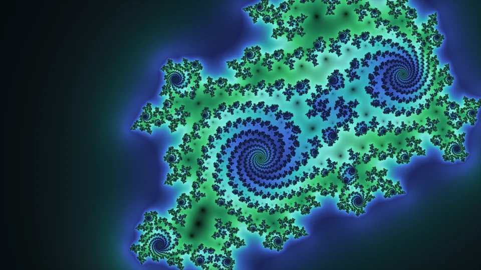](https://github.com/tarpetos/fractique/raw/master/docs/gallery/fractals/F059-emerald-galaxy.frcq) |  |
| [Magenta Comet](F057-magenta-comet.frcq) | [Porcelain Plumes](F058-porcelain-plumes.frcq) | [Emerald Galaxy](F059-emerald-galaxy.frcq) | [Brass Orchids](F060-brass-orchids.frcq) |
|  | [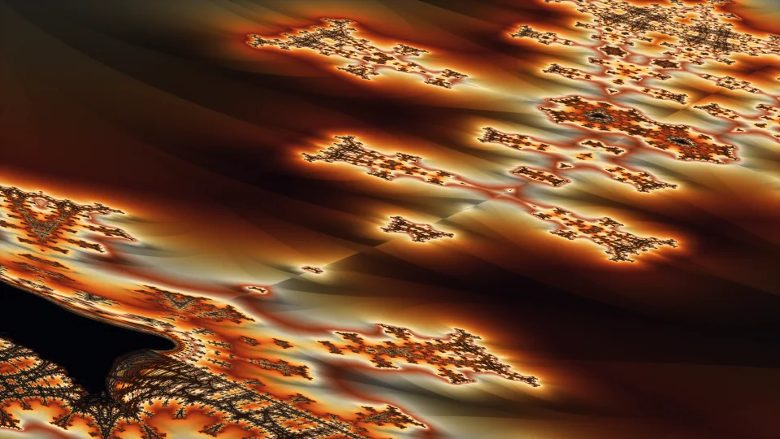](https://github.com/tarpetos/fractique/raw/master/docs/gallery/fractals/F062-ember-shoals.frcq) | [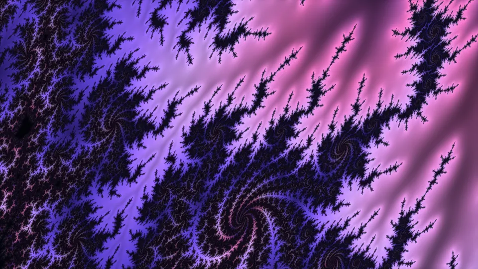](https://github.com/tarpetos/fractique/raw/master/docs/gallery/fractals/F063-lavender-storm.frcq) | [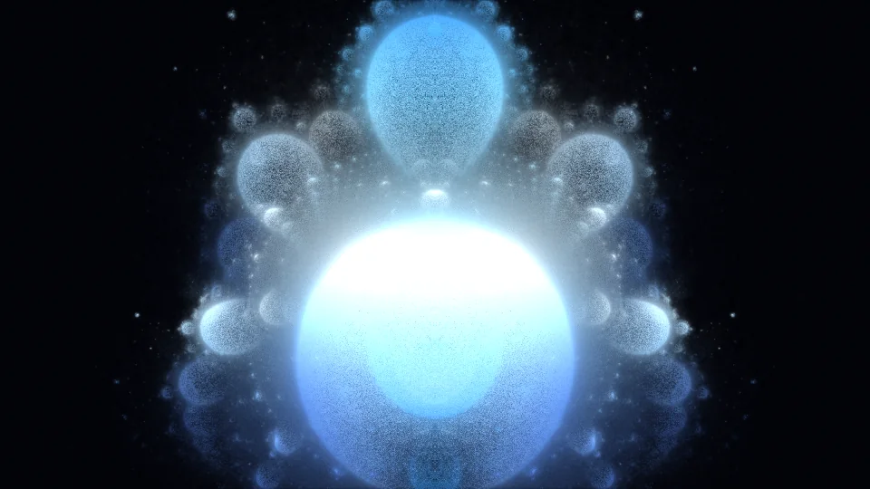](https://github.com/tarpetos/fractique/raw/master/docs/gallery/fractals/F064-moon-lantern.frcq) |
| [Ice Chainmail](F061-ice-chainmail.frcq) | [Ember Shoals](F062-ember-shoals.frcq) | [Lavender Storm](F063-lavender-storm.frcq) | [Moon Lantern](F064-moon-lantern.frcq) |
|  | [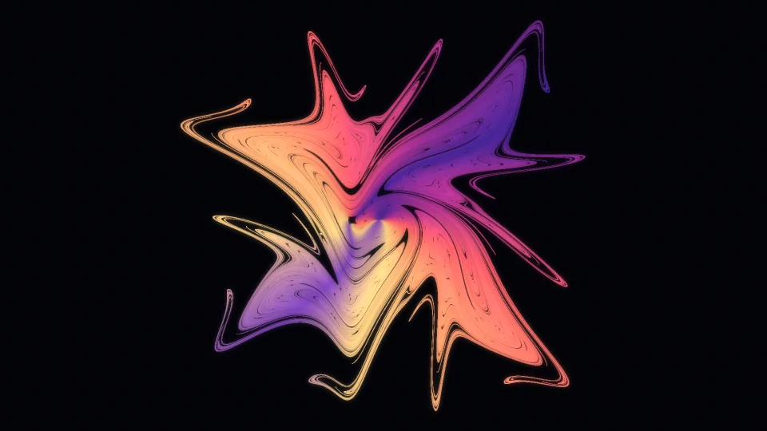](https://github.com/tarpetos/fractique/raw/master/docs/gallery/fractals/F066-sunset-starfish.frcq) |  | [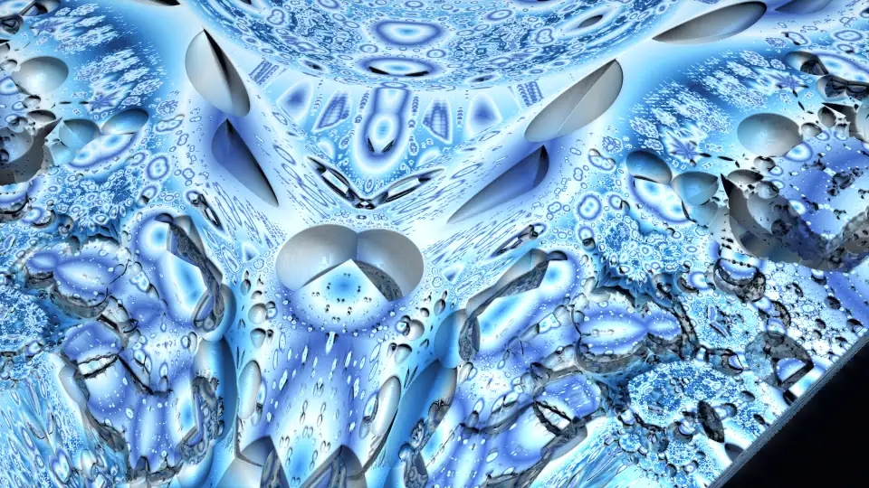](https://github.com/tarpetos/fractique/raw/master/docs/gallery/fractals/F068-frost-cavern.frcq) |
| [Copper Rose](F065-copper-rose.frcq) | [Sunset Starfish](F066-sunset-starfish.frcq) | [Coral Leaf](F067-coral-leaf.frcq) | [Frost Cavern](F068-frost-cavern.frcq) |
|  |  | [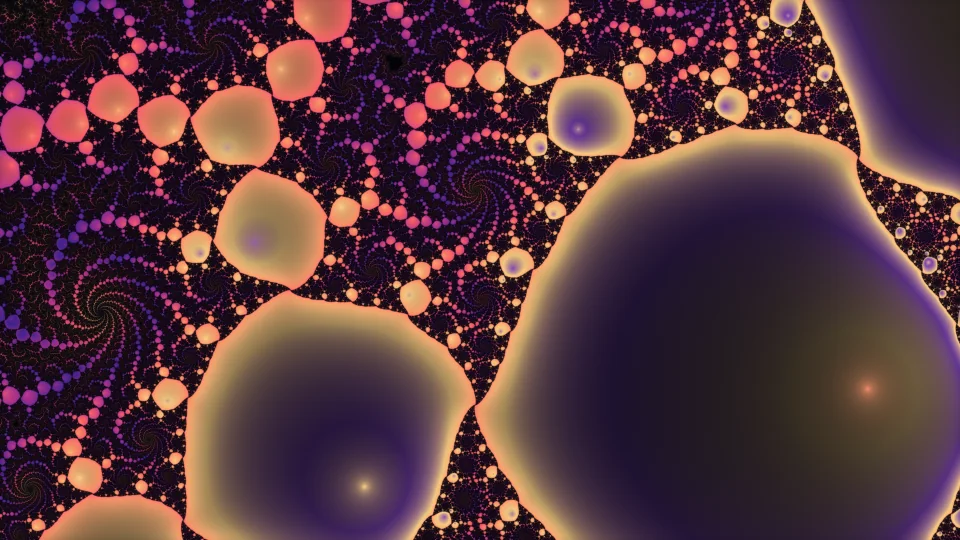](https://github.com/tarpetos/fractique/raw/master/docs/gallery/fractals/F071-lantern-pearls.frcq) | [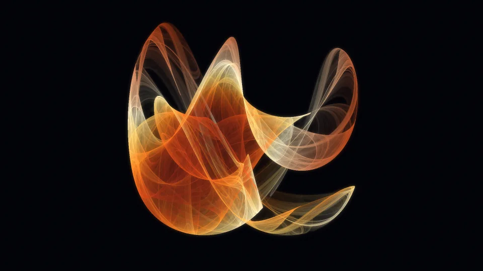](https://github.com/tarpetos/fractique/raw/master/docs/gallery/fractals/F072-amber-sails.frcq) |
| [Orchid Urn](F069-orchid-urn.frcq) | [Copper Honeycomb](F070-copper-honeycomb.frcq) | [Lantern Pearls](F071-lantern-pearls.frcq) | [Amber Sails](F072-amber-sails.frcq) |
|  |  |  |  |
| [Rainbow Butterfly](F073-rainbow-butterfly.frcq) | [Eclipse Gasket](F074-eclipse-gasket.frcq) | [Jade Pinwheel](F075-jade-pinwheel.frcq) | [Rose Surf](F076-rose-surf.frcq) |
|  |  |  |  |
| [Candy Pinwheel](F077-candy-pinwheel.frcq) | [Violet Curl](F078-violet-curl.frcq) | [Rose Windmill](F079-rose-windmill.frcq) | [Sunset Eye](F080-sunset-eye.frcq) |
|  |  |  |  |
| [Violet Towers](F081-violet-towers.frcq) | [Sunset Ridge](F082-sunset-ridge.frcq) | [Aurora Moth](F083-aurora-moth.frcq) | [Opal Torus](F084-opal-torus.frcq) |
| [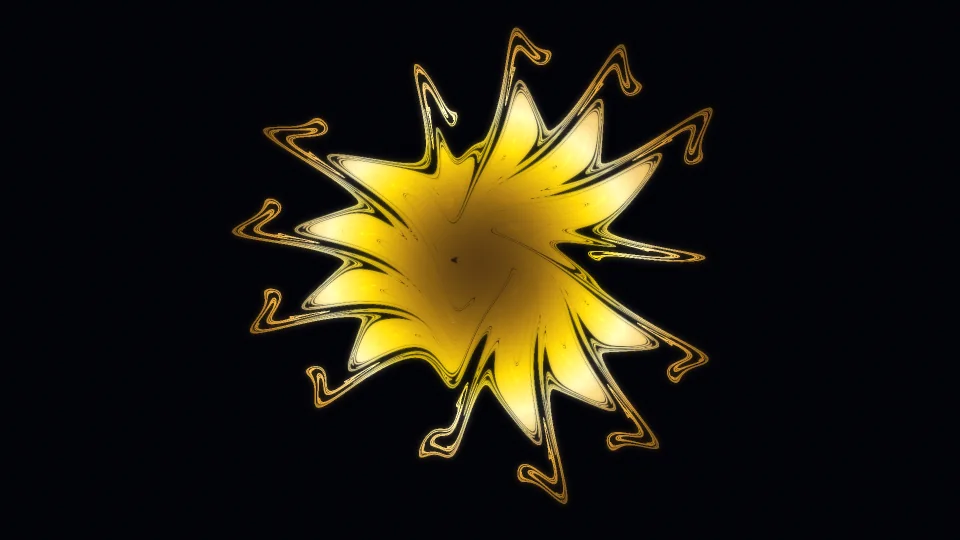](https://github.com/tarpetos/fractique/raw/master/docs/gallery/fractals/F085-golden-sunburst.frcq) | [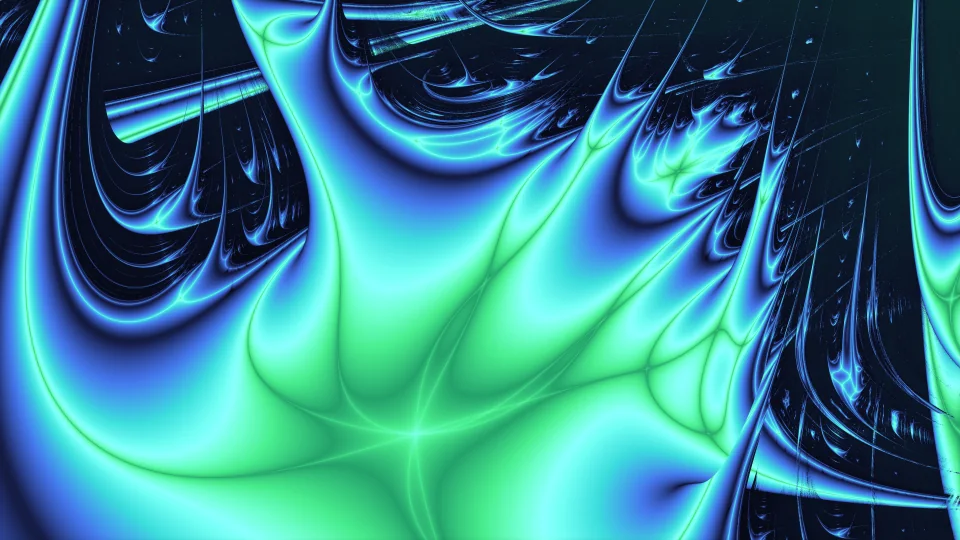](https://github.com/tarpetos/fractique/raw/master/docs/gallery/fractals/F086-aqua-web.frcq) |  |  |
| [Golden Sunburst](F085-golden-sunburst.frcq) | [Aqua Web](F086-aqua-web.frcq) | [Canyon Terraces](F087-canyon-terraces.frcq) | [Ice Sculpture](F088-ice-sculpture.frcq) |
|  |  | [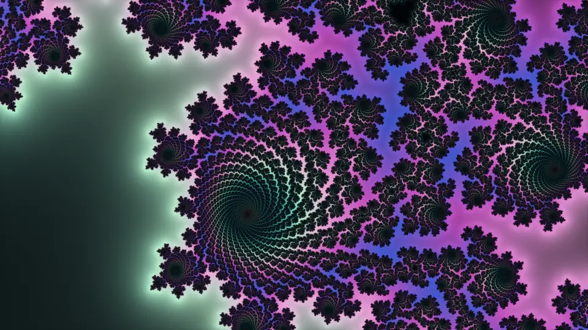](https://github.com/tarpetos/fractique/raw/master/docs/gallery/fractals/F091-plum-nautilus.frcq) | [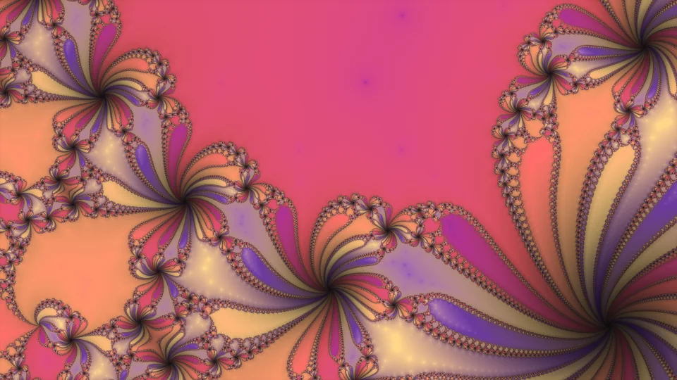](https://github.com/tarpetos/fractique/raw/master/docs/gallery/fractals/F092-rose-bouquet.frcq) |
| [Blue Ziggurat](F089-blue-ziggurat.frcq) | [Copper Octopus](F090-copper-octopus.frcq) | [Plum Nautilus](F091-plum-nautilus.frcq) | [Rose Bouquet](F092-rose-bouquet.frcq) |
| [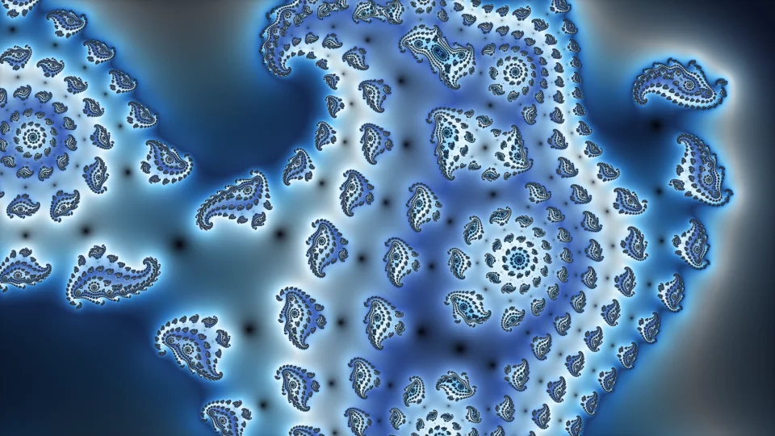](https://github.com/tarpetos/fractique/raw/master/docs/gallery/fractals/F093-paisley-frost.frcq) |  |  |  |
| [Paisley Frost](F093-paisley-frost.frcq) | [Violet Seahorses](F094-violet-seahorses.frcq) | [Bubble Lattice](F095-bubble-lattice.frcq) | [Indigo Fan](F096-indigo-fan.frcq) |
|  |  | [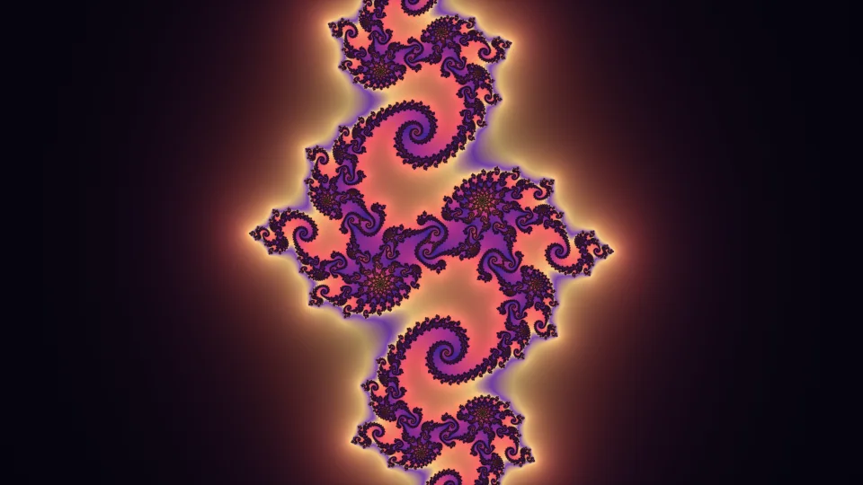](https://github.com/tarpetos/fractique/raw/master/docs/gallery/fractals/F099-coral-seahorse.frcq) |  |
| [Desert Lightning](F097-desert-lightning.frcq) | [Gilded Palm](F098-gilded-palm.frcq) | [Coral Seahorse](F099-coral-seahorse.frcq) | [Rust Canopy](F100-rust-canopy.frcq) |

[Gallery](../README.md) · next: [Wallpapers](../wallpapers/README.md)
