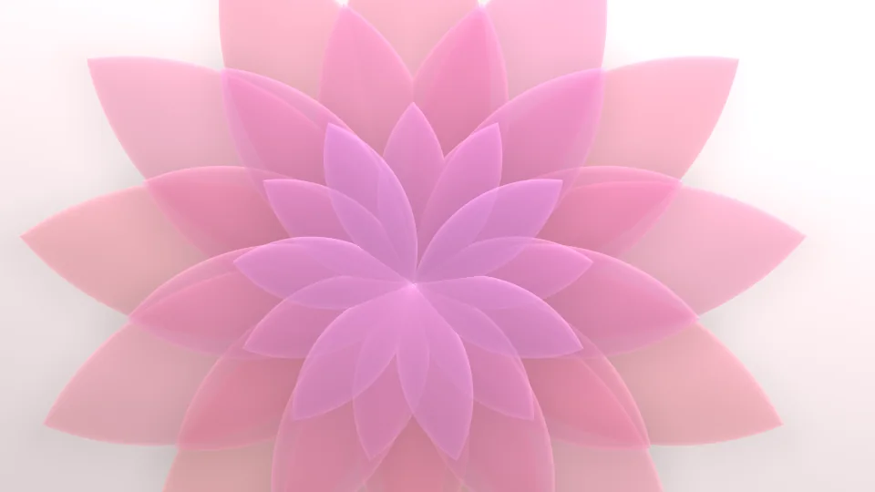
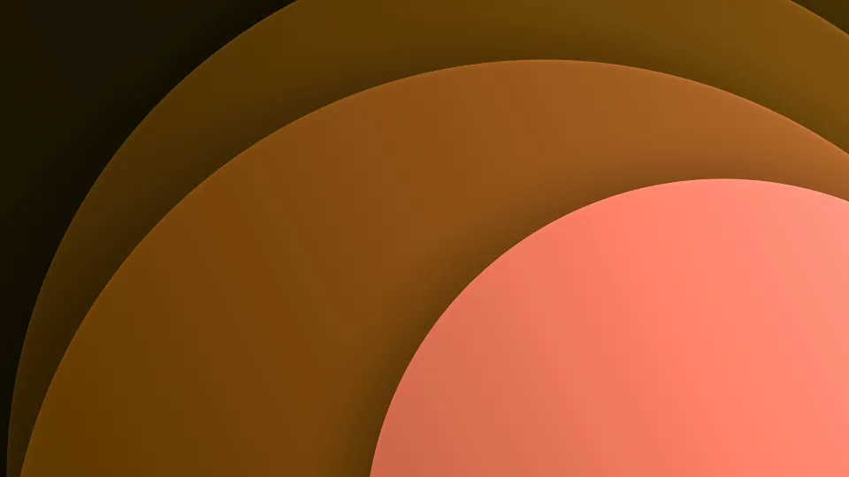
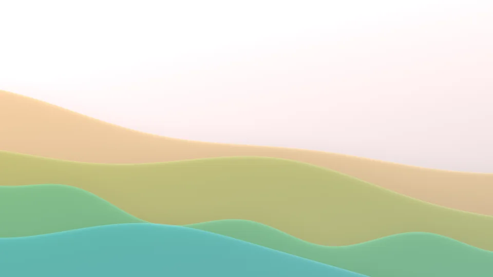
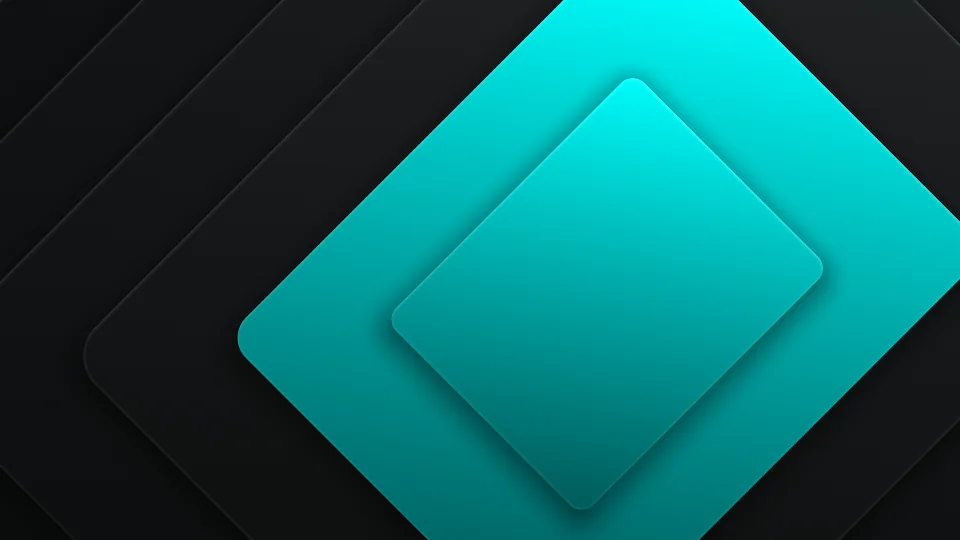
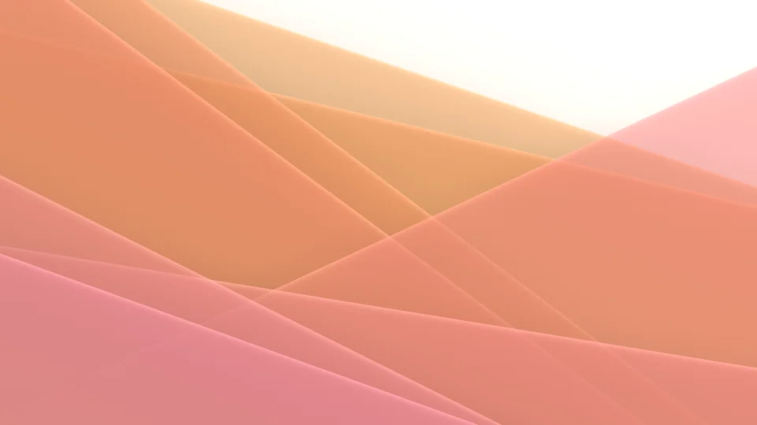

# Wallpapers

[Gallery](../README.md) · next: [Flames](../flames/README.md)

A wallpaper's file holds its seed, layout and material, and the shapes laid out for a 16:9 screen. The app
opens it in the **Shapes** tab and lays the wallpaper out anew from the seed; the commands draw the shapes
in the file. The first one is also `fractique render --wallpaper 35 --layout burst --material glass --size 3840x2160`.

| | | | |
| --- | --- | --- | --- |
|  |  |  |  |
| Pink Lotus | Teal Ribbons | Aqua Fan | Ember Discs |
|  |  |  |  |
| Dune Waves | Cyan Frames | Jade Arcs | Plum Tiles |
|  |  |  |  |
| Peach Planes | Night Bars | Sand Blossom | Slate Slats |

[Gallery](../README.md) · next: [Flames](../flames/README.md)
