# Wallpapers

[Gallery](../README.md) · next: [Flames](../flames/README.md)

A click on a picture downloads its `.frcq` file; the name under it leads to the file in the repository.

A wallpaper's file holds its seed, layout and material, and the shapes laid out for a 16:9 screen. The app
opens it in the **Shapes** tab and lays the wallpaper out anew from the seed; the commands draw the shapes
in the file. The first one is also `fractique render --wallpaper 35 --layout burst --material glass --size 3840x2160`.

| | | | |
| --- | --- | --- | --- |
|  |  |  |  |
| [Pink Lotus](W001-pink-lotus.frcq) | [Teal Ribbons](W002-teal-ribbons.frcq) | [Cobalt Wing](W003-cobalt-wing.frcq) | [Ember Discs](W004-ember-discs.frcq) |
|  |  |  | [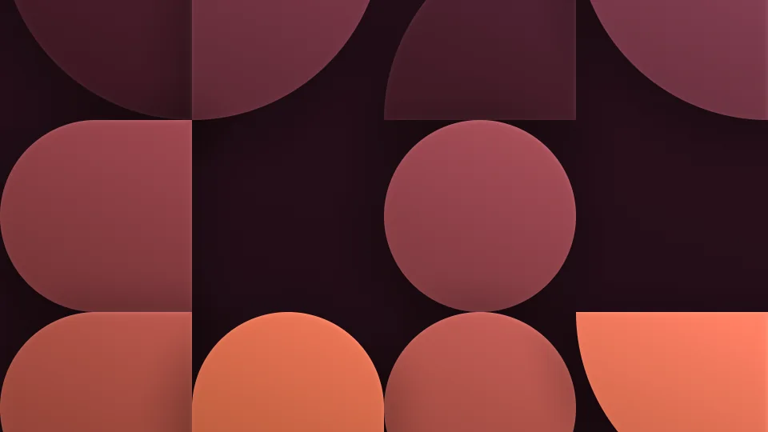](https://github.com/tarpetos/fractique/raw/master/docs/gallery/wallpapers/W008-garnet-tiles.frcq) |
| [Dune Waves](W005-dune-waves.frcq) | [Cyan Frames](W006-cyan-frames.frcq) | [Jade Arcs](W007-jade-arcs.frcq) | [Garnet Tiles](W008-garnet-tiles.frcq) |
|  | [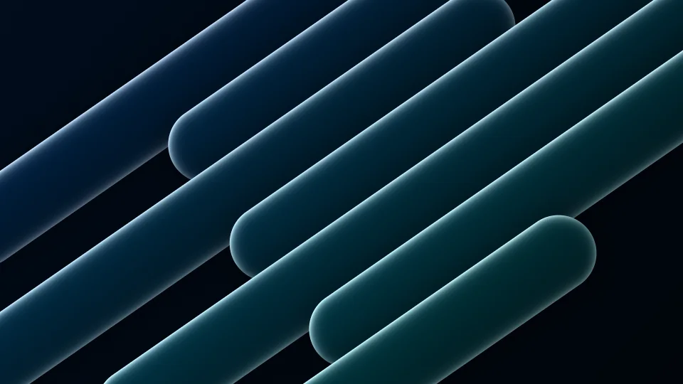](https://github.com/tarpetos/fractique/raw/master/docs/gallery/wallpapers/W010-night-bars.frcq) |  |  |
| [Peach Planes](W009-peach-planes.frcq) | [Night Bars](W010-night-bars.frcq) | [Sand Blossom](W011-sand-blossom.frcq) | [Slate Slats](W012-slate-slats.frcq) |
| [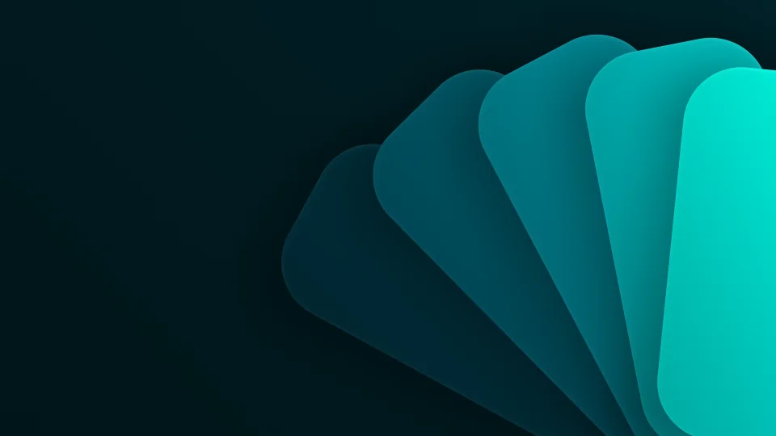](https://github.com/tarpetos/fractique/raw/master/docs/gallery/wallpapers/W013-abyss-fan.frcq) |  |  |  |
| [Abyss Fan](W013-abyss-fan.frcq) | [Golden Starflower](W014-golden-starflower.frcq) | [Green Pencils](W015-green-pencils.frcq) | [Violet Facets](W016-violet-facets.frcq) |
|  |  | [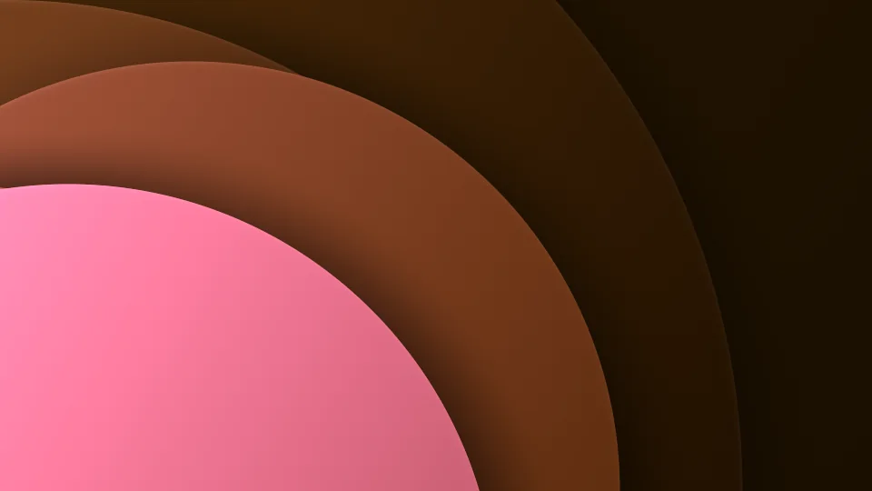](https://github.com/tarpetos/fractique/raw/master/docs/gallery/wallpapers/W019-pink-moonrise.frcq) |  |
| [Azure Frames](W017-azure-frames.frcq) | [Lagoon Arch](W018-lagoon-arch.frcq) | [Pink Moonrise](W019-pink-moonrise.frcq) | [Violet Dunes](W020-violet-dunes.frcq) |
| [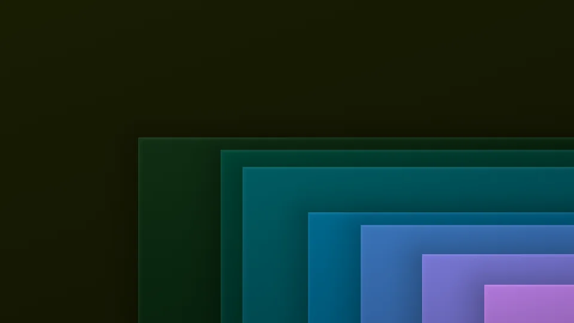](https://github.com/tarpetos/fractique/raw/master/docs/gallery/wallpapers/W021-spectrum-steps.frcq) |  |  |  |
| [Spectrum Steps](W021-spectrum-steps.frcq) | [Mint Skyline](W022-mint-skyline.frcq) | [Frost Bands](W023-frost-bands.frcq) | [Jade Ribbons](W024-jade-ribbons.frcq) |
| [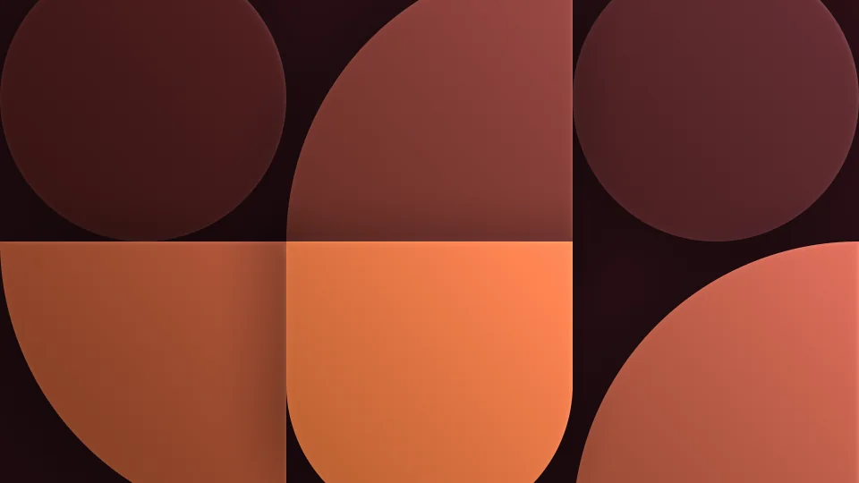](https://github.com/tarpetos/fractique/raw/master/docs/gallery/wallpapers/W025-terracotta-tiles.frcq) |  | [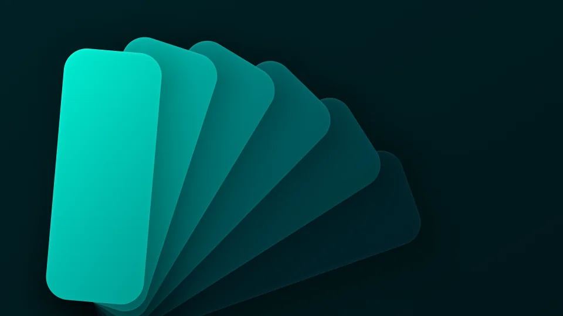](https://github.com/tarpetos/fractique/raw/master/docs/gallery/wallpapers/W027-turquoise-fan.frcq) |  |
| [Terracotta Tiles](W025-terracotta-tiles.frcq) | [Green Strings](W026-green-strings.frcq) | [Turquoise Fan](W027-turquoise-fan.frcq) | [Rosewood Waterlily](W028-rosewood-waterlily.frcq) |
|  |  |  |  |
| [Ocean Bars](W029-ocean-bars.frcq) | [Autumn Facets](W030-autumn-facets.frcq) | [Saffron Diamond](W031-saffron-diamond.frcq) | [Green Target](W032-green-target.frcq) |
| [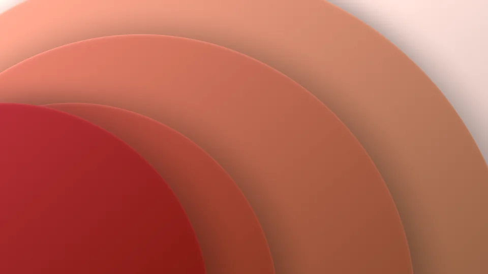](https://github.com/tarpetos/fractique/raw/master/docs/gallery/wallpapers/W033-bronze-ripples.frcq) |  | [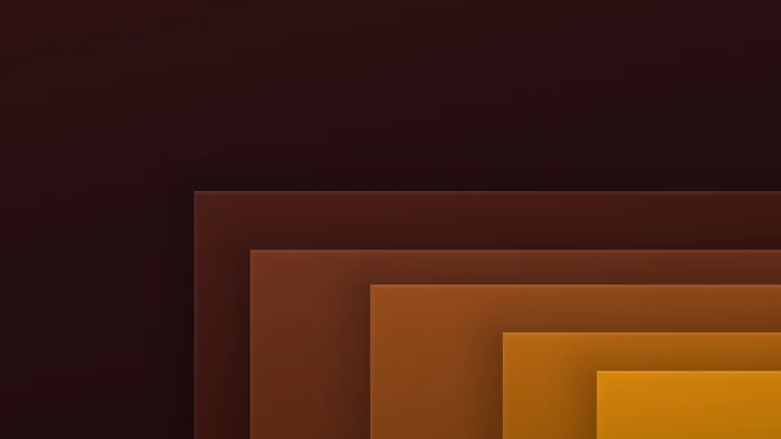](https://github.com/tarpetos/fractique/raw/master/docs/gallery/wallpapers/W035-ember-steps.frcq) |  |
| [Bronze Ripples](W033-bronze-ripples.frcq) | [Emerald Hills](W034-emerald-hills.frcq) | [Ember Steps](W035-ember-steps.frcq) | [Amber Skyline](W036-amber-skyline.frcq) |
|  | [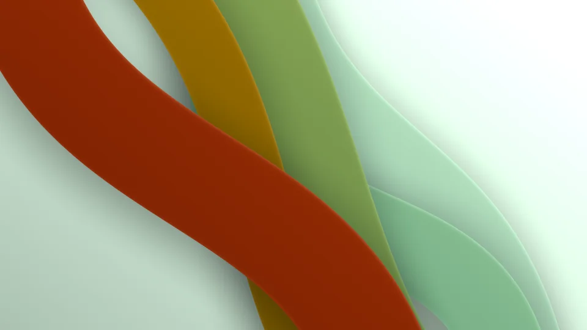](https://github.com/tarpetos/fractique/raw/master/docs/gallery/wallpapers/W038-forest-ribbons.frcq) |  |  |
| [Rosewood Bands](W037-rosewood-bands.frcq) | [Forest Ribbons](W038-forest-ribbons.frcq) | [Indigo Tiles](W039-indigo-tiles.frcq) | [Cyan Strings](W040-cyan-strings.frcq) |
|  |  | [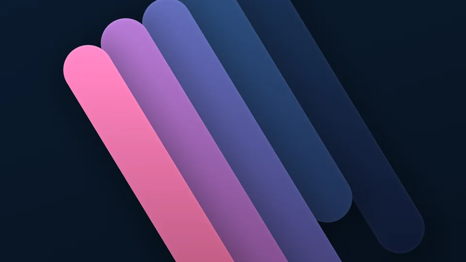](https://github.com/tarpetos/fractique/raw/master/docs/gallery/wallpapers/W043-amethyst-pipes.frcq) | [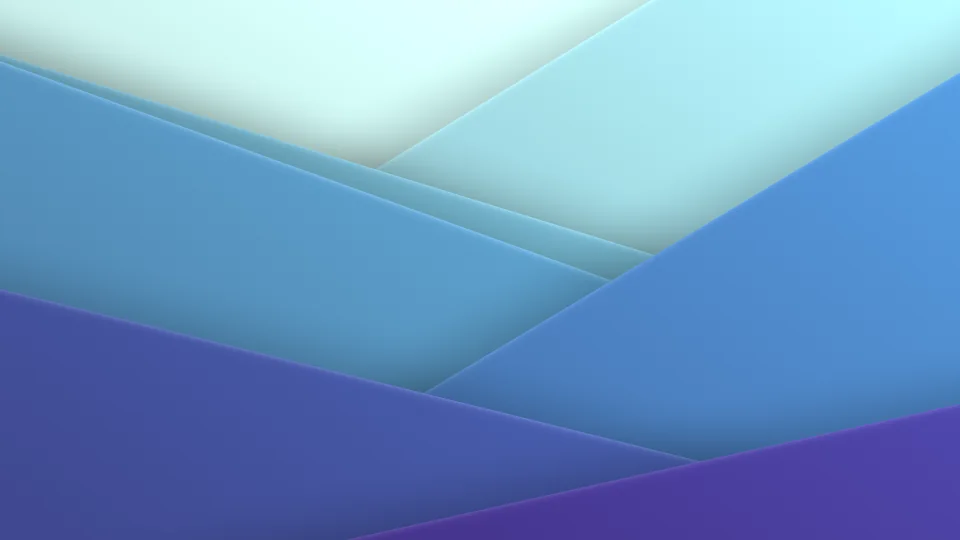](https://github.com/tarpetos/fractique/raw/master/docs/gallery/wallpapers/W044-ocean-facets.frcq) |
| [Sunset Fan](W041-sunset-fan.frcq) | [Blue Trillium](W042-blue-trillium.frcq) | [Amethyst Pipes](W043-amethyst-pipes.frcq) | [Ocean Facets](W044-ocean-facets.frcq) |
| [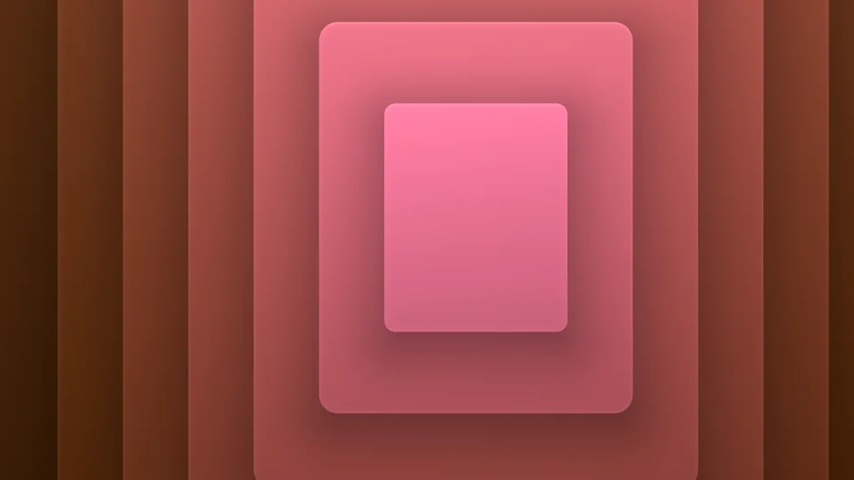](https://github.com/tarpetos/fractique/raw/master/docs/gallery/wallpapers/W045-rose-window.frcq) |  |  | [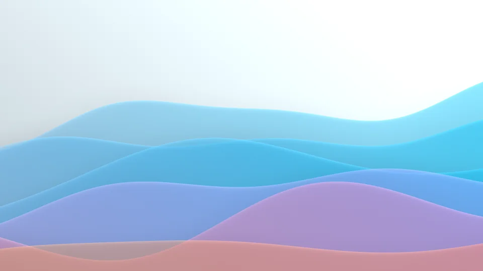](https://github.com/tarpetos/fractique/raw/master/docs/gallery/wallpapers/W048-cobalt-tide.frcq) |
| [Rose Window](W045-rose-window.frcq) | [Lilac Comma](W046-lilac-comma.frcq) | [Teal Eclipse](W047-teal-eclipse.frcq) | [Cobalt Tide](W048-cobalt-tide.frcq) |
|  |  |  |  |
| [Magenta Steps](W049-magenta-steps.frcq) | [Jade Shards](W050-jade-shards.frcq) | [Sky Bands](W051-sky-bands.frcq) | [Aqua Ribbons](W052-aqua-ribbons.frcq) |
| [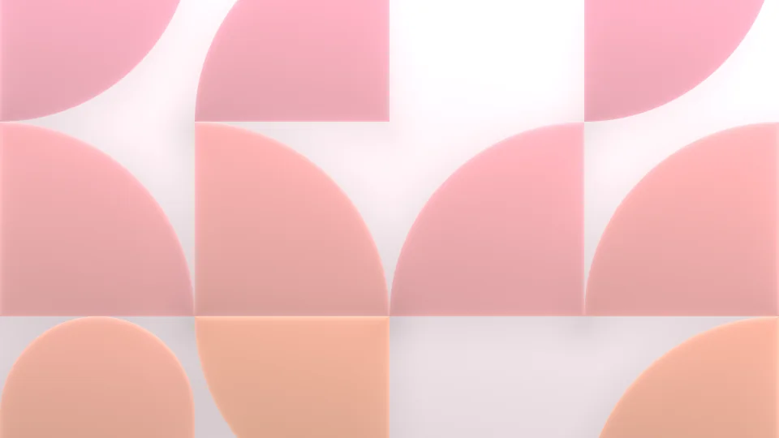](https://github.com/tarpetos/fractique/raw/master/docs/gallery/wallpapers/W053-garnet-quarters.frcq) |  |  | [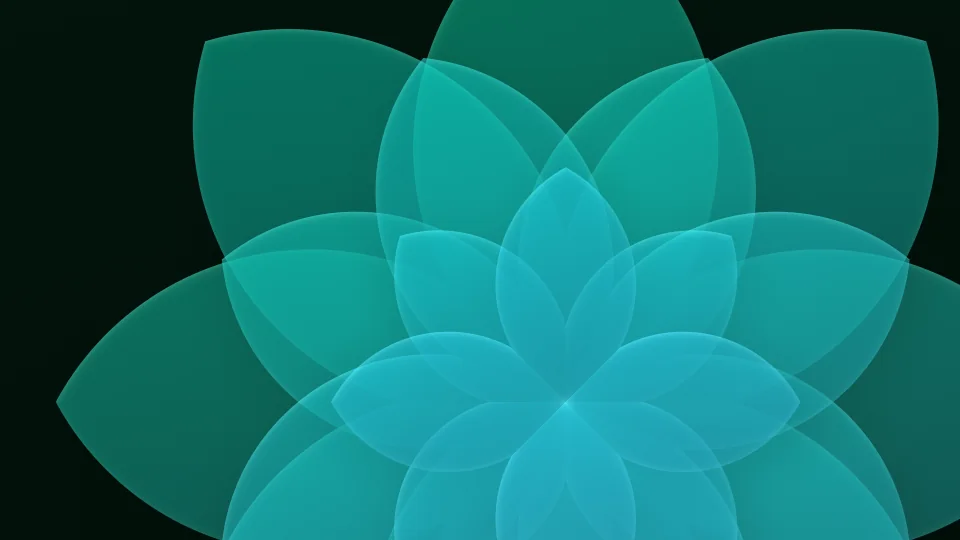](https://github.com/tarpetos/fractique/raw/master/docs/gallery/wallpapers/W056-teal-waterlily.frcq) |
| [Garnet Quarters](W053-garnet-quarters.frcq) | [Orchid Strings](W054-orchid-strings.frcq) | [Cobalt Fan](W055-cobalt-fan.frcq) | [Teal Waterlily](W056-teal-waterlily.frcq) |
|  |  |  | [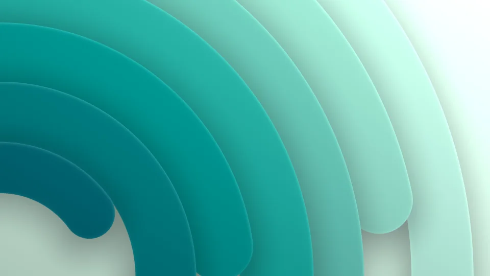](https://github.com/tarpetos/fractique/raw/master/docs/gallery/wallpapers/W060-teal-amphitheatre.frcq) |
| [Dusk Bars](W057-dusk-bars.frcq) | [Abyss Facets](W058-abyss-facets.frcq) | [Magenta Diamond](W059-magenta-diamond.frcq) | [Teal Amphitheatre](W060-teal-amphitheatre.frcq) |
| [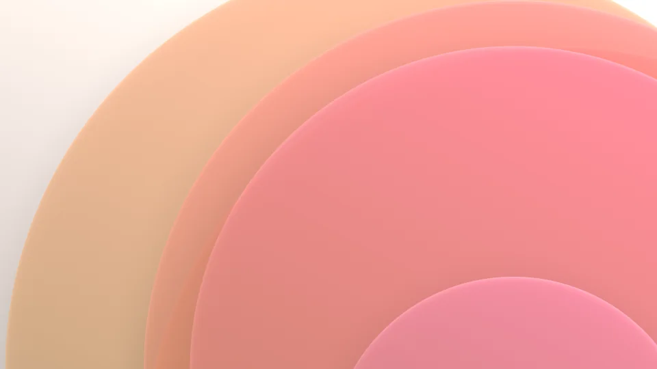](https://github.com/tarpetos/fractique/raw/master/docs/gallery/wallpapers/W061-peach-discs.frcq) |  |  |  |
| [Peach Discs](W061-peach-discs.frcq) | [Sunset Dunes](W062-sunset-dunes.frcq) | [Lagoon Steps](W063-lagoon-steps.frcq) | [Neon Skyline](W064-neon-skyline.frcq) |
|  |  |  | [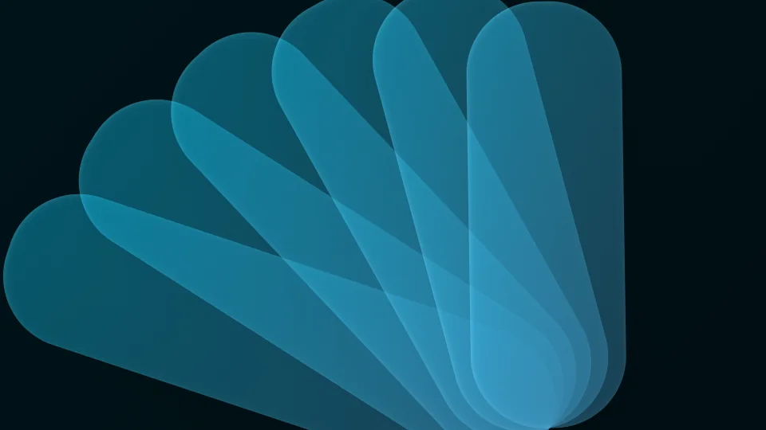](https://github.com/tarpetos/fractique/raw/master/docs/gallery/wallpapers/W068-frost-fan.frcq) |
| [Pearl Bands](W065-pearl-bands.frcq) | [Candy Ribbons](W066-candy-ribbons.frcq) | [Teal Dots](W067-teal-dots.frcq) | [Frost Fan](W068-frost-fan.frcq) |
| [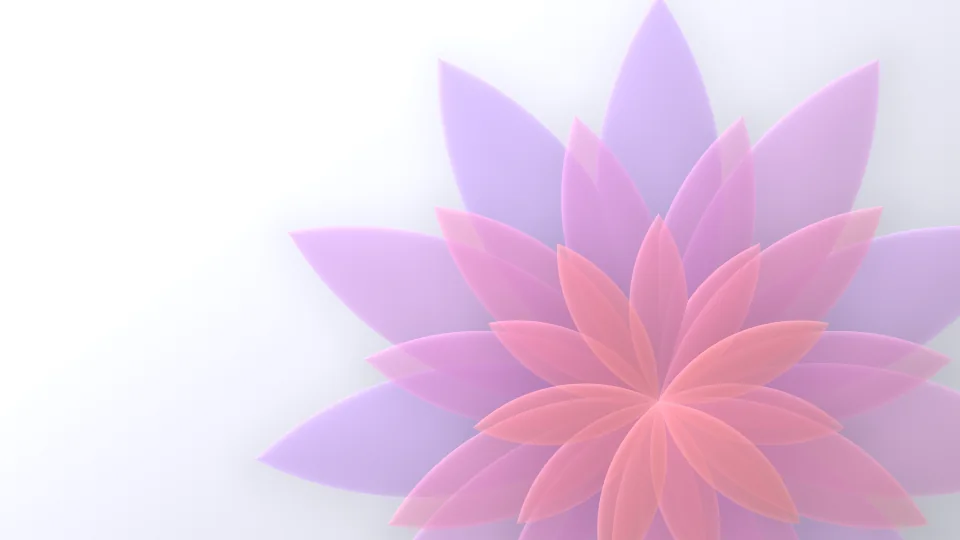](https://github.com/tarpetos/fractique/raw/master/docs/gallery/wallpapers/W069-rose-lotus.frcq) | [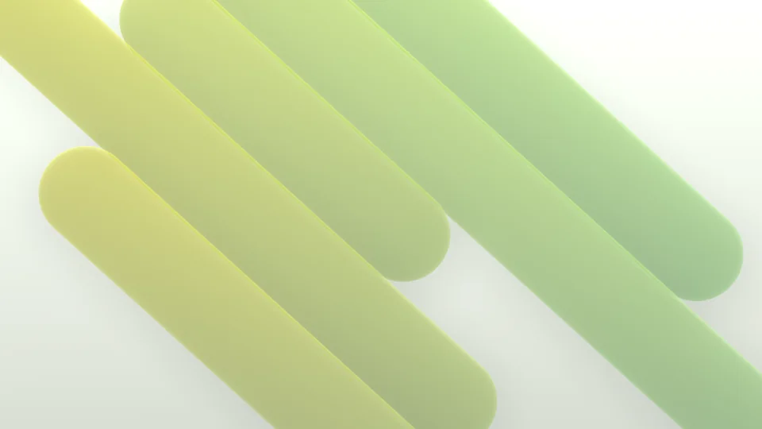](https://github.com/tarpetos/fractique/raw/master/docs/gallery/wallpapers/W070-lemon-bars.frcq) | [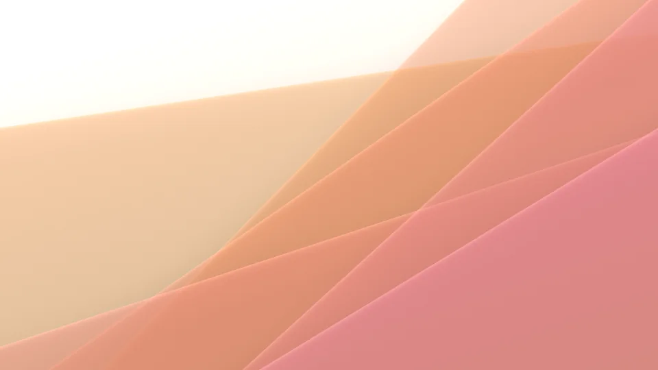](https://github.com/tarpetos/fractique/raw/master/docs/gallery/wallpapers/W071-peach-facets.frcq) |  |
| [Rose Lotus](W069-rose-lotus.frcq) | [Lemon Bars](W070-lemon-bars.frcq) | [Peach Facets](W071-peach-facets.frcq) | [Sky Diamonds](W072-sky-diamonds.frcq) |
| [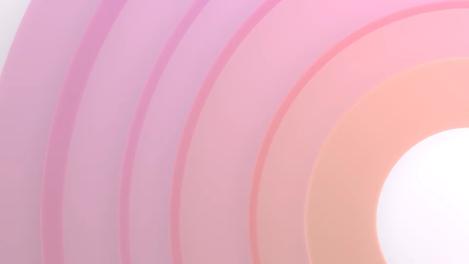](https://github.com/tarpetos/fractique/raw/master/docs/gallery/wallpapers/W073-rosewood-arcs.frcq) |  | [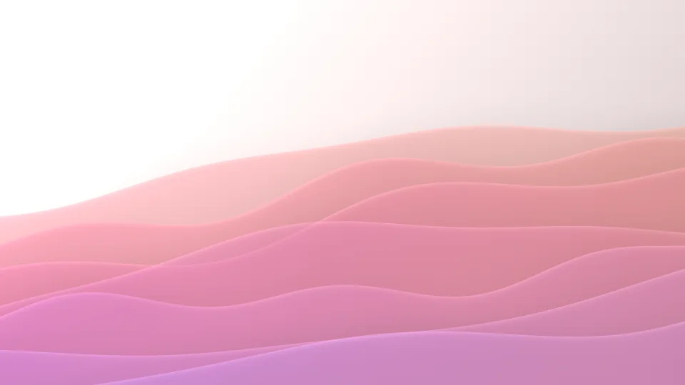](https://github.com/tarpetos/fractique/raw/master/docs/gallery/wallpapers/W075-rose-tide.frcq) |  |
| [Rosewood Arcs](W073-rosewood-arcs.frcq) | [Seafoam Moons](W074-seafoam-moons.frcq) | [Rose Tide](W075-rose-tide.frcq) | [Aqua Steps](W076-aqua-steps.frcq) |
|  | [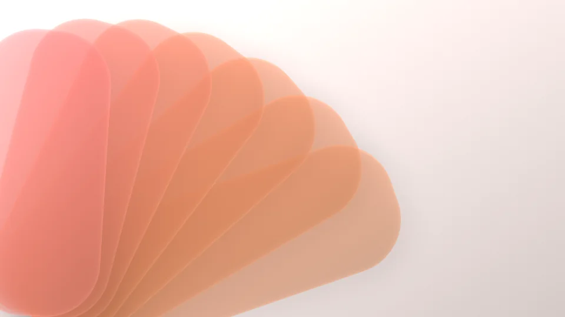](https://github.com/tarpetos/fractique/raw/master/docs/gallery/wallpapers/W078-bronze-fan.frcq) |  |  |
| [Glacier Shards](W077-glacier-shards.frcq) | [Bronze Fan](W078-bronze-fan.frcq) | [Night Agave](W079-night-agave.frcq) | [Aurora Bars](W080-aurora-bars.frcq) |
|  | [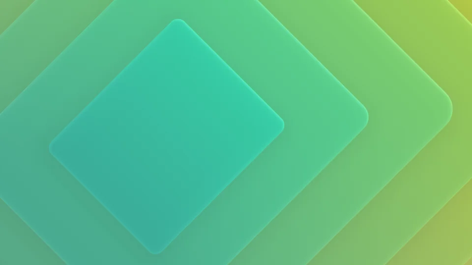](https://github.com/tarpetos/fractique/raw/master/docs/gallery/wallpapers/W082-lime-diamonds.frcq) | [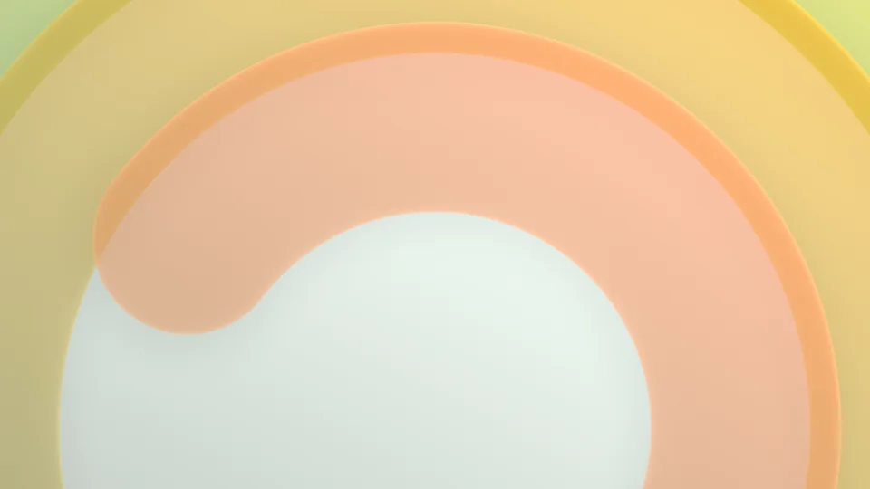](https://github.com/tarpetos/fractique/raw/master/docs/gallery/wallpapers/W083-forest-halo.frcq) |  |
| [Teal Facets](W081-teal-facets.frcq) | [Lime Diamonds](W082-lime-diamonds.frcq) | [Forest Halo](W083-forest-halo.frcq) | [Cyan Moon](W084-cyan-moon.frcq) |
|  | [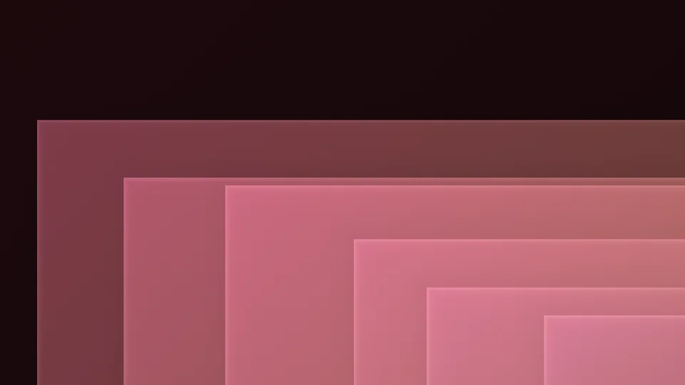](https://github.com/tarpetos/fractique/raw/master/docs/gallery/wallpapers/W086-rose-steps.frcq) | [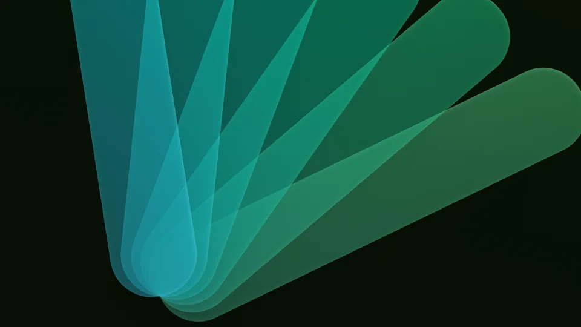](https://github.com/tarpetos/fractique/raw/master/docs/gallery/wallpapers/W087-emerald-fan.frcq) | [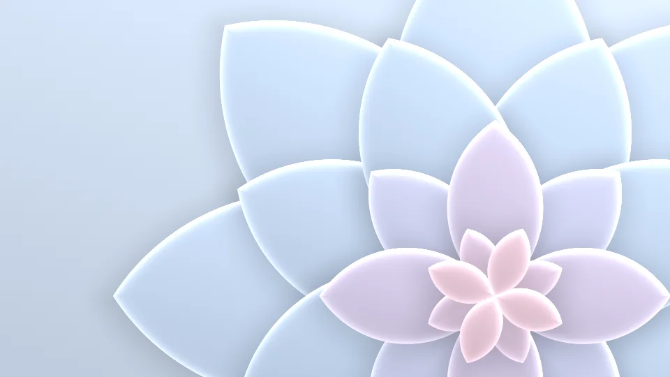](https://github.com/tarpetos/fractique/raw/master/docs/gallery/wallpapers/W088-amethyst-dahlia.frcq) |
| [Mint Contours](W085-mint-contours.frcq) | [Rose Steps](W086-rose-steps.frcq) | [Emerald Fan](W087-emerald-fan.frcq) | [Amethyst Dahlia](W088-amethyst-dahlia.frcq) |
|  |  |  |  |
| [Pewter Bars](W089-pewter-bars.frcq) | [Amber Chevron](W090-amber-chevron.frcq) | [Amber Diamond](W091-amber-diamond.frcq) | [Blue Coil](W092-blue-coil.frcq) |
| [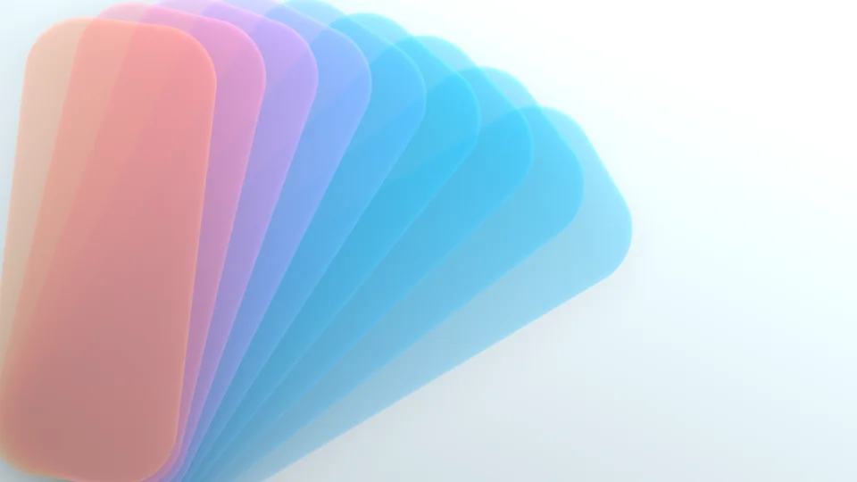](https://github.com/tarpetos/fractique/raw/master/docs/gallery/wallpapers/W093-cobalt-feathers.frcq) |  |  |  |
| [Cobalt Feathers](W093-cobalt-feathers.frcq) | [Orange Propeller](W094-orange-propeller.frcq) | [Pink Bars](W095-pink-bars.frcq) | [Pastel Facets](W096-pastel-facets.frcq) |
|  | [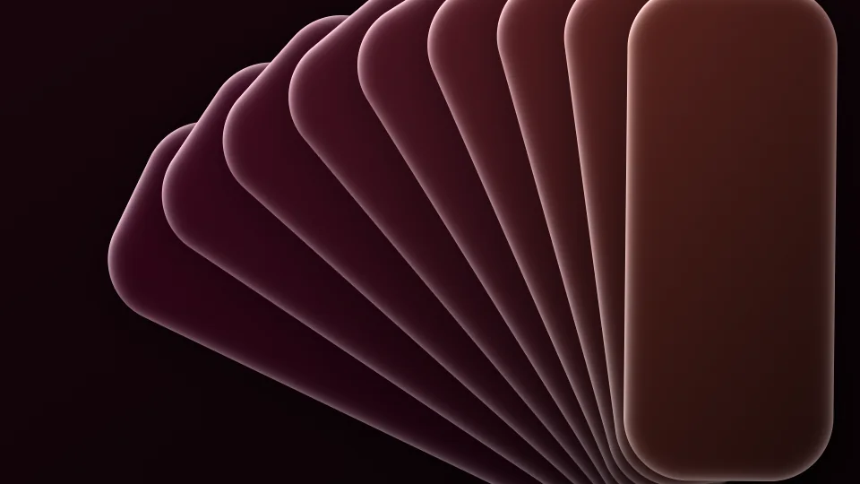](https://github.com/tarpetos/fractique/raw/master/docs/gallery/wallpapers/W098-garnet-fan.frcq) |  | [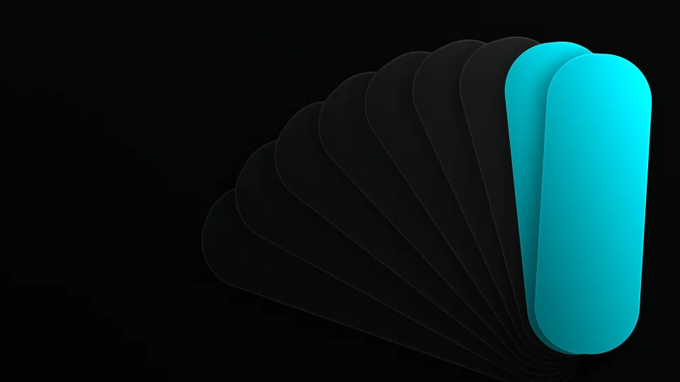](https://github.com/tarpetos/fractique/raw/master/docs/gallery/wallpapers/W100-cyan-keystone.frcq) |
| [Apricot Diamonds](W097-apricot-diamonds.frcq) | [Garnet Fan](W098-garnet-fan.frcq) | [Ivory Lotus](W099-ivory-lotus.frcq) | [Cyan Keystone](W100-cyan-keystone.frcq) |

[Gallery](../README.md) · next: [Flames](../flames/README.md)
