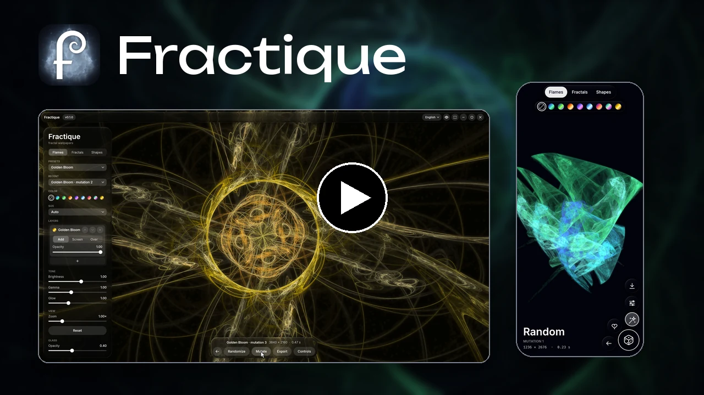
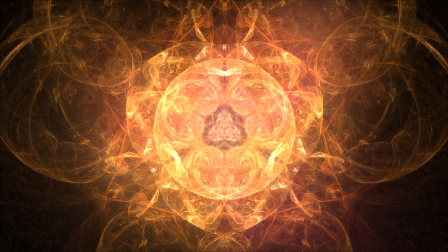
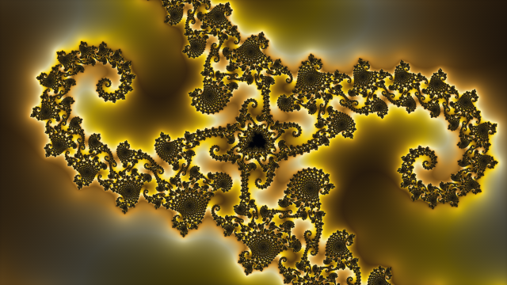
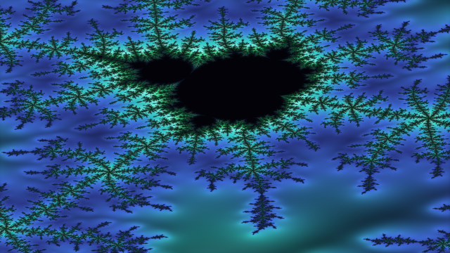
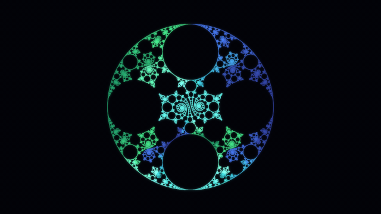

<div align="center">
  
  <h1>Fractique</h1>
  <p><strong>一款分形火焰、经典分形与壁纸生成器：相同的输入，在任何平台上都得到相同的图像。</strong></p>
  <p><sub>
    <a href="../../README.md">English</a> · <a href="README_UK.md">Українська</a> · <a href="README_RU.md">Русский</a> · <a href="README_DE.md">Deutsch</a> · <a href="README_FR.md">Français</a> · <a href="README_ES.md">Español</a> · <a href="README_IT.md">Italiano</a> · <a href="README_JA.md">日本語</a><br>
    <strong>简体中文</strong> · <a href="README_PT.md">Português</a> · <a href="README_KO.md">한국어</a> · <a href="README_HI.md">हिन्दी</a> · <a href="README_TR.md">Türkçe</a> · <a href="README_PL.md">Polski</a> · <a href="README_ID.md">Bahasa Indonesia</a>
  </sub></p>
</div>

<p align="center">
  <a href="https://apps.apple.com/app/fractique/id6836122841"></a><br>
  <sub>iPhone 和 iPad。Windows、macOS、Linux 和 Android：在<a href="https://github.com/tarpetos/fractique/releases/latest">最新版本</a>中免费下载。</sub>
</p>

<p align="center">
  <a href="https://www.youtube.com/watch?v=z7EAQGUys8U"></a>
</p>

Fractique 生成三类图像。一类是分形火焰：由纤细曲线和柔和光线构成的、发光而轻盈的分形。一类是经典分形：共 22 种，从曼德博集合、朱利亚集合和奇异吸引子到三维的曼德球。另一类是壁纸：边缘受光、带柔和阴影的扁平薄片，每张都有浅色和深色两个版本。你可以选择预设、生成随机图像，或把多个火焰叠加在一起，再以任意尺寸导出，从手机屏幕到 4K 显示器都可以。一个场景就是一个小文件，同一个文件在 Windows、macOS、Linux、Android 和 iOS 上始终渲染出完全相同的像素。

<p align="center">
  
</p>

## 功能

- **火焰：** 49 种变体、带混合模式的图层、旋转对称与镜像对称、密度估计、辉光，以及 29 个内置预设。
- **分形：** 19 种平面分形：逃逸时间类（曼德博、朱利亚、燃烧船、三角帽、多重曼德博、凤凰、磁铁）、求根类（牛顿、新星）、以密度绘制的轨道（佛陀布罗特、克利福德、德容、洛伦兹、古莫夫斯基-米拉、霍帕隆）和几何类（阿波罗尼奥斯垫片、克莱因群、L-系统、李雅普诺夫），各有预设，每个种子对应一张图像；与火焰共用调色板、图层和深度缩放。
- **立体：** 三维的曼德球、曼德盒和门格海绵，带有光照、阴影和雾；可以绕着它们转，也可以进入内部。
- **壁纸：** 每个种子对应一张，由 23 种布局和 11 种材质组合而成，每张都有浅色和深色版本，并按屏幕尺寸排布。
- **应用：** 一套代码支持 Windows、macOS、Linux、Android、iOS 和 Web。图像铺满窗口，玻璃面板浮在其上；在桌面端，应用有自己的玻璃标题栏。三个标签页“火焰”、“分形”和“形状”（壁纸）各自保留自己的图像和最近的图像。支持 15 种语言。
- **GPU 加速：** 在显卡明显快于处理器的设备上，火焰、三种吸引子、逃逸时间类和求根类分形以及壁纸由显卡自己绘制，处理器保持空闲。三个更高质量等级的导出始终由处理器精确渲染。
- **“随机”与“变异”：** 每个种子都是一幅图像；会变成一个点或一块实心方形的火焰会被跳过。“变异”为你喜欢的图像生成一个变异版本。
- **图层：** 从预设中添加火焰或添加随机火焰，删除、调整顺序，并为每个图层设置混合方式（相加、滤色、覆盖）和不透明度。最多 16 个图层。每个图层都有自己的配色。
- **图像尺寸：** 窗口自身的尺寸、61 种屏幕之一（最高 16K 的电脑、Android 手机和平板、iPhone、iPad、Mac 和 Apple Watch），或 16 到 16384 像素之间的任意宽高。
- **深度缩放：** 拖动、滚轮和双指捏合可移动视图，并在仍成画面的范围内将其放大：火焰 10 到 300 倍，吸引子 10 到 100 倍，壁纸 8 倍，其余分形最高一百亿倍。图像立即跟随，视图停下后重新绘制为清晰的画面。
- **手机：** 专属界面。一个圆形按钮生成新图像，滑动切换到下一张壁纸，一张由实时小图组成的面板用来选择风格，你收藏的图像汇成收藏夹。处理器绘制耗时较长的分形种类不在其中。
- **导出：** 任意尺寸的 PNG：按屏幕所示即时保存，或以三档更高的质量在后台渲染。在手机上可保存到“照片”或相册，也可以分享。 所有功能在各平台均免费；仅 App Store 版本（iPhone、iPad、Mac）每天可免费导出三张图片，导出更多或按自定义尺寸导出时，需要一次性购买 Fractique Pro。
- **项目文件：** `.frcq` 文件保存场景及其视图、色调和尺寸，因此打开时与保存时一致（[docs/scene-format.md](../scene-format.md)）。普通的 `.json` 场景以及 flam3 和 Apophysis 的 `.flame` 文件也能打开。再次启动时，应用会回到上次离开时的会话。
- **更新：** 一个窗口列出每个已发布版本及其说明，并可安装其中任意一个。在 Windows 上，应用是一个会自我替换的便携 `.exe`。
- **精确可重复：** 同一个场景在任何机器上都得到相同的像素，并由 Linux、Windows 和 macOS 上的测试验证（[docs/determinism.md](../determinism.md)）。
- **命令行工具**（`fractique`）：将火焰、分形和壁纸渲染为 PNG，生成随机场景和变异版本，转换 `.flame` 和 `.frcq` 文件。
- **MCP 服务器**（`fractique-mcp`，或 `fractique mcp`）：AI 智能体创建、修改并渲染场景（[docs/mcp.md](../mcp.md)）。
- **HTTP 服务器**（`fractique-server`）：带渲染队列和限制的 HTTP API，在 `/docs` 提供交互式参考文档，在 `/mcp` 为 AI 智能体提供 MCP，同时提供网页版应用，每个发行版中都有它的单独下载，并附带用于构建镜像的 `Dockerfile`（[docs/server.md](../server.md)）。

| | |
| --- | --- |
|  |  |
| 祖母绿之星（两个图层） | 余烬漩涡 |
|  |  |
| 金色绽放 | 太阳曼陀罗 |

另有 100 幅火焰以及一些分形和壁纸，每幅都附有可按任意尺寸重新渲染的 `.frcq` 文件：[画廊](../gallery/README.md)。

其他种类的分形：曼德博集合、朱利亚集合和克利福德吸引子：

| | | |
| --- | --- | --- |
|  |  |  |
| 曼德博: 螺旋 | 朱利亚: 螺旋 | 克利福德: 翅膀 |

更多逃逸时间类分形和求根类分形：燃烧船、三角帽、多重曼德博、凤凰、磁铁、牛顿、新星：

| | | | |
| --- | --- | --- | --- |
|  |  |  |  |
| 燃烧船: 船 | 三角帽: 岛屿 | 多重曼德博: 螺旋 | 凤凰: 星系 |
|  |  |  | |
| 磁铁: 珍珠 | 牛顿: 七 | 新星: 星 | |

以密度绘制的轨道：佛陀布罗特，以及德容、洛伦兹、古莫夫斯基-米拉和霍帕隆吸引子：

| | | |
| --- | --- | --- |
|  |  |  |
| 佛陀布罗特: 星云 | 德容: 经典 | 洛伦兹: 蝴蝶 |
|  |  | |
| 古莫夫斯基-米拉: 羽毛 | 霍帕隆: 蛛网 | |

几何分形：阿波罗尼奥斯垫片、克莱因群的极限集、L-系统和李雅普诺夫分形：

| | | | |
| --- | --- | --- | --- |
|  |  |  |  |
| 阿波罗尼奥斯垫片: 三重 | 克莱因群: 尖点 | L-系统: 植物 | 李雅普诺夫: 羽毛 |

三维立体：曼德球、曼德盒和门格海绵：

| | | |
| --- | --- | --- |
|  |  |  |
| 曼德球: 王冠 | 曼德盒: 车站 | 门格海绵: 经典 |

浅色和深色壁纸，各自的布局与材质：

| | | | |
| --- | --- | --- | --- |
|  |  |  |  |
| 波浪, 玻璃 | 花朵, 辉光 | 瓷砖, 浮雕 | 扇形, 玻璃 |
|  |  |  |  |
| 圆盘, 纸张 | 长条, 纸张 | 圆弧, 碳纤维 | 线条, 纸张 |

## 快速开始

一条命令即可构建应用和命令行工具。如果没有安装 Rust，它会自动安装。

| 系统 | 命令 |
| --- | --- |
| Linux, macOS | `./setup.sh` |
| Windows | `setup.cmd` |

启动应用：

```sh
./target/release/fractique-gui
```

或者从命令行渲染：

```sh
# 把预设渲染成 4K 图像
./target/release/fractique render --preset aurora-spiral --size 3840x2160 --quality high -o aurora.png

# 种子 42 的随机火焰，用于手机屏幕
./target/release/fractique render --random 42 --size 1080x2400 --quality mobile -o phone.png

# 种子 7 的随机曼德博集合视图
./target/release/fractique render --random 7 --fractal mandelbrot --size 1920x1080 -o mandelbrot.png

# 种子 7 的手机壁纸，浅色和深色
./target/release/fractique render --wallpaper 7 --size 1290x2796 -o wallpaper.png
./target/release/fractique render --wallpaper 7 --dark --size 1290x2796 -o wallpaper-dark.png

# 把随机场景保存为文件，修改后再渲染
./target/release/fractique randomize 42 -o scene.json
./target/release/fractique render scene.json -o mine.png
```

在 Windows 上，程序位于 `target\release\fractique-gui.exe` 和 `target\release\fractique.exe`。应用和命令的全部功能：[docs/usage.md](../usage.md)。

## 已测试的设备

| 设备 | 系统 | 处理器 | 显卡 |
| --- | --- | --- | --- |
| PC | Windows 11 | AMD Ryzen 7 5700X | NVIDIA GeForce RTX 4070 |
| PC | Ubuntu 24.04 (WSL2) | AMD Ryzen 7 5700X | 无：仅处理器 |
| PC | Ubuntu 26.04 | AMD Ryzen 7 5700X | NVIDIA GeForce RTX 4070 |
| PC | Arch Linux (Linux 7.3.4) | AMD Ryzen 7 9800X3D | AMD Radeon RX 9070 XT |
| 笔记本电脑, ASUS TUF Gaming FX505DT | Windows 11 | AMD Ryzen 5 3550H | NVIDIA GeForce GTX 1650 |
| 笔记本电脑, HP 15-db1xxx | Debian 13 | AMD Ryzen 3 3200U | AMD Radeon Vega 3 |
| MacBook Pro | macOS 27 | Apple M5 Pro | Apple M5 Pro |
| ZTE Blade A7 | Android 9 | MediaTek Helio P22 | PowerVR GE8320 |
| Asus Zenfone 10 | Android 15 | Qualcomm Snapdragon 8 Gen 2 | Adreno 740 |
| iPhone 13 Pro | iOS 27 | Apple A15 Bionic | Apple A15 |
| iPhone 18 Pro Max | iOS 27 | Apple A20 Pro | Apple A20 Pro |

## 文档

文档为英文。

| | |
| --- | --- |
| [docs/usage.md](../usage.md) | 应用、命令、质量等级、如何编辑场景 |
| [docs/scene-format.md](../scene-format.md) | 场景文件的每个字段、每种变体、薄片、`.frcq` 文件 |
| [docs/mcp.md](../mcp.md) | MCP 服务器：连接 AI 智能体、工具列表 |
| [docs/server.md](../server.md) | HTTP 服务器：接口、限制、Docker |
| [docs/ios.md](../ios.md) | 在 iPhone 或 iOS 模拟器上构建和运行 |
| [docs/releasing.md](../releasing.md) | 如何发布版本，应用如何自我更新 |
| [docs/architecture.md](../architecture.md) | 各部分如何配合，渲染如何工作 |
| [docs/determinism.md](../determinism.md) | 渲染为何能精确重复，哪些有保证、哪些没有 |
| [docs/performance.md](../performance.md) | 实测的渲染时间和内存 |
| [docs/roadmap.md](../roadmap.md) | 已完成的内容和后续计划 |

## 许可证

[PolyForm Noncommercial License 1.0.0](../../LICENSE.md)：任何非商业用途均可免费使用。商业用途请向作者申请单独的许可证。第三方许可证列于 [THIRD_PARTY_NOTICES.md](../../THIRD_PARTY_NOTICES.md)。参与贡献：参见 [CONTRIBUTING.md](../../CONTRIBUTING.md)。
