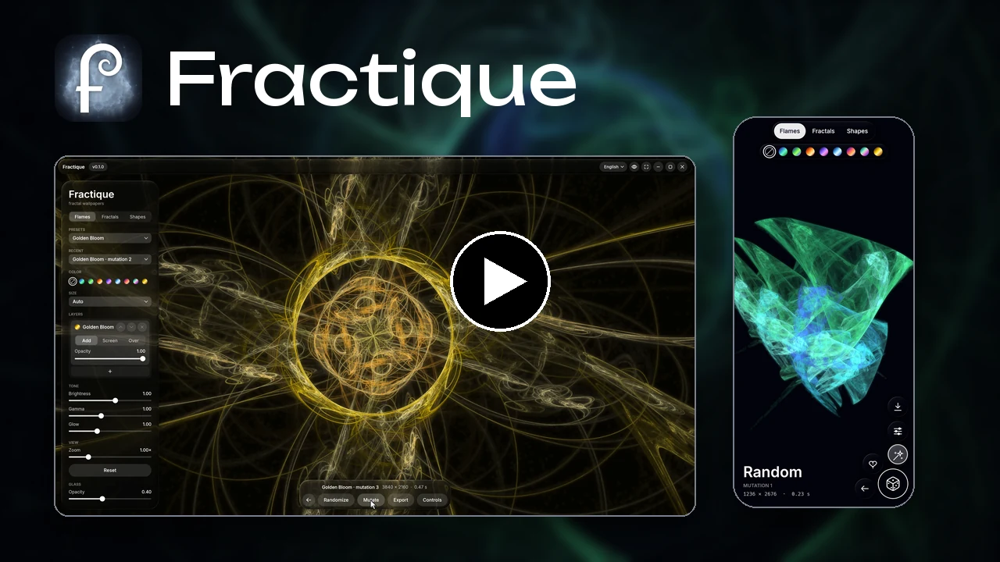

<div align="center">
  
  <h1>Fractique</h1>
  <p><strong>Ein Generator für fraktale Flammen, klassische Fraktale und Hintergrundbilder, der aus derselben Eingabe auf jeder Plattform dasselbe Bild erzeugt.</strong></p>
  <p><sub>
    <a href="../../README.md">English</a> · <a href="README_UK.md">Українська</a> · <a href="README_RU.md">Русский</a> · <strong>Deutsch</strong> · <a href="README_FR.md">Français</a> · <a href="README_ES.md">Español</a> · <a href="README_IT.md">Italiano</a> · <a href="README_JA.md">日本語</a><br>
    <a href="README_CN.md">简体中文</a> · <a href="README_PT.md">Português</a> · <a href="README_KO.md">한국어</a> · <a href="README_HI.md">हिन्दी</a> · <a href="README_TR.md">Türkçe</a> · <a href="README_PL.md">Polski</a> · <a href="README_ID.md">Bahasa Indonesia</a>
  </sub></p>
</div>

<p align="center">
  <a href="https://www.youtube.com/watch?v=z7EAQGUys8U"></a>
</p>

Fractique erzeugt drei Arten von Bildern. Fraktale Flammen: leuchtende, zarte Fraktale aus feinen Kurven und weichem Licht. Klassische Fraktale in 22 Arten: von der Mandelbrot-Menge, Julia-Mengen und seltsamen Attraktoren bis zum Mandelbulb in drei Dimensionen. Und Hintergrundbilder: flache Blätter mit beleuchteten Kanten und weichen Schatten, jedes in einer hellen und einer dunklen Fassung. Du wählst eine Vorlage, würfelst ein zufälliges Bild oder legst mehrere Flammen übereinander und exportierst das Ergebnis in jeder Größe, vom Handybildschirm bis zum 4K-Monitor. Eine Szene ist eine kleine Datei, und dieselbe Datei ergibt immer exakt dieselben Pixel, unter Windows, macOS, Linux, Android und iOS.

<p align="center">
  
</p>

## Was Fractique kann

- **Flammen:** 49 Variationen, Ebenen mit Mischmodi, Dreh- und Spiegelsymmetrie, Dichteschätzung, Leuchten und 29 eingebaute Vorlagen.
- **Fraktale:** 19 Arten in der Ebene: Fluchtzeit-Fraktale (Mandelbrot, Julia, Burning Ship, Tricorn, Multibrot, Phönix, Magnet), Nullstellensuche (Newton, Nova), als Dichte gezeichnete Bahnen (Buddhabrot, Clifford, De Jong, Lorenz, Gumowski-Mira, Hopalong) und geometrische Fraktale (Apollonisches Netz, Kleinsche Gruppe, L-System, Ljapunow), jeweils mit Vorlagen und einem Bild für jeden Seed; sie teilen Paletten, Ebenen und den tiefen Zoom mit den Flammen.
- **Körper:** Mandelbulb, Mandelbox und Menger-Schwamm in drei Dimensionen, mit Licht, Schatten und Nebel; man kann um sie herumgehen oder hineinfliegen.
- **Hintergrundbilder:** eines für jeden Seed, aus 14 Layouts und 6 Materialien, jedes in einer hellen und einer dunklen Fassung, passend zur Größe des Bildschirms angeordnet.
- **Die App:** eine Codebasis für Windows, macOS, Linux, Android, iOS und das Web. Das Bild füllt das Fenster, darüber schweben Glasflächen; auf dem Desktop hat die App eine eigene gläserne Titelleiste. Drei Tabs, „Flammen“, „Fraktale“ und „Formen“ (die Hintergrundbilder), behalten jeweils ihr eigenes Bild und ihre zuletzt gezeigten Bilder. In 15 Sprachen.
- **GPU-Beschleunigung:** wo die Grafikkarte deutlich schneller ist als der Prozessor, zeichnet sie Flammen, drei Attraktoren, die Fraktale der Fluchtzeit und der Nullstellensuche sowie die Hintergrundbilder selbst, und der Prozessor bleibt frei. Exporte in den drei höheren Qualitätsstufen rendert immer der Prozessor, exakt.
- **„Zufall“ und „Mutieren“:** jeder Seed ist ein Bild; Flammen, die nur ein Punkt oder ein gefülltes Quadrat wären, werden übersprungen. „Mutieren“ erzeugt eine Variante des Bildes, das dir gefällt.
- **Ebenen:** eine Flamme aus den Vorlagen oder eine zufällige hinzufügen, entfernen, umsortieren und für jede den Mischmodus („Summe“, „Screen“, „Darüber“) und die Deckkraft einstellen. Bis zu 16 Ebenen. Jede Ebene hat ihre eigenen Farben.
- **Bildgröße:** die des Fensters, einer von 61 Bildschirmen (Computer bis 16K, Android-Handys und -Tablets, iPhones, iPads, Macs und Apple Watch) oder jede Breite und Höhe von 16 bis 16384 Pixeln.
- **Tiefer Zoom:** Ziehen, Mausrad und Zwei-Finger-Geste bewegen die Ansicht und vergrößern sie, solange sie ein Bild bleibt: eine Flamme 10- bis 300-fach, einen Attraktor 10- bis 100-fach, ein Hintergrundbild 8-fach und die übrigen Fraktale bis zu zehnmilliardenfach. Das Bild folgt sofort und wird scharf neu gezeichnet, sobald die Ansicht ruht.
- **Handys:** ein eigener Bildschirm. Ein runder Knopf erzeugt ein neues Bild, ein Wisch führt zum nächsten Hintergrundbild, ein Blatt mit kleinen Live-Bildern wählt den Stil, und die Bilder, die du behältst, bilden eine Sammlung. Die Fraktalarten, für die der Prozessor lange braucht, fehlen dort.
- **Export:** ein PNG in jeder Größe: sofort, so wie es auf dem Bildschirm ist, oder im Hintergrund in drei höheren Qualitätsstufen gerendert. Auf dem Handy wird es in Fotos oder der Galerie gespeichert oder geteilt. Alle Funktionen sind auf jeder Plattform kostenlos; nur die Version aus dem App Store (iPhone, iPad, Mac) verlangt für den Export ab 2560 × 1440 Pixeln oder in einer eigenen Größe den einmaligen Kauf von Fractique Pro.
- **Projektdateien:** eine `.frcq`-Datei enthält die Szene samt Ansicht, Ton und Größe und öffnet sich so, wie sie gespeichert wurde ([docs/scene-format.md](../scene-format.md)). Einfache `.json`-Szenen und `.flame`-Dateien von flam3 und Apophysis lassen sich ebenfalls öffnen. Zwischen zwei Starts kehrt die App zu der Sitzung zurück, in der sie verlassen wurde.
- **Updates:** ein Fenster listet jede veröffentlichte Version mit ihren Hinweisen auf und installiert jede beliebige davon. Unter Windows ist die App eine einzige portable `.exe`, die sich selbst ersetzt.
- **Exakte Wiederholbarkeit:** dieselbe Szene ergibt auf jedem Rechner dieselben Pixel, geprüft durch Tests unter Linux, Windows und macOS ([docs/determinism.md](../determinism.md)).
- **Das Kommandozeilenwerkzeug** (`fractique`): rendert Flammen, Fraktale und Hintergrundbilder als PNG, erzeugt zufällige Szenen und Varianten, konvertiert `.flame`- und `.frcq`-Dateien.
- **MCP-Server** (`fractique-mcp` oder `fractique mcp`): ein KI-Agent erstellt, ändert und rendert Szenen ([docs/mcp.md](../mcp.md)).
- **HTTP-Server** (`fractique-server`): eine HTTP-API mit Render-Warteschlange und Grenzen, eine interaktive Referenz dazu unter `/docs`, MCP für KI-Agenten unter `/mcp`, liefert die Web-App aus, in jeder Version als eigener Download, dazu ein `Dockerfile` für ein Image ([docs/server.md](../server.md)).

| | |
| --- | --- |
|  |  |
| Smaragdstern (zwei Ebenen) | Glutwirbel |
|  |  |
| Goldblüte | Sonnenmandala |

Hundert weitere Flammen sowie Fraktale und Hintergrundbilder, jeweils mit der `.frcq`-Datei, die das Bild in jeder Größe erneut rendert: [die Galerie](../gallery/README.md).

Fraktale anderer Art: die Mandelbrot-Menge, eine Julia-Menge und der Clifford-Attraktor:

| | | |
| --- | --- | --- |
|  |  |  |
| Mandelbrot: Spirale | Julia: Spiralen | Clifford: Flügel |

Weitere Fluchtzeit-Fraktale und die der Nullstellensuche: Burning Ship, Tricorn, Multibrot, Phönix, Magnet, Newton, Nova:

| | | | |
| --- | --- | --- | --- |
|  |  |  |  |
| Burning Ship: Schiff | Tricorn: Insel | Multibrot: Spiralen | Phönix: Galaxie |
|  |  |  | |
| Magnet: Perlen | Newton: Sieben | Nova: Stern | |

Als Dichte gezeichnete Bahnen: das Buddhabrot und die Attraktoren von De Jong, Lorenz, Gumowski-Mira und Hopalong:

| | | |
| --- | --- | --- |
|  |  |  |
| Buddhabrot: Nebel | De Jong: Klassiker | Lorenz: Schmetterling |
|  |  | |
| Gumowski-Mira: Federn | Hopalong: Spinnennetz | |

Geometrische Fraktale: ein Apollonisches Netz, die Grenzmenge einer Kleinschen Gruppe, ein L-System und ein Ljapunow-Fraktal:

| | | | |
| --- | --- | --- | --- |
|  |  |  |  |
| Apollonisches Netz: Dreifach | Kleinsche Gruppe: Spitze | L-System: Pflanze | Ljapunow: Federn |

Körper in drei Dimensionen: Mandelbulb, Mandelbox und Menger-Schwamm:

| | | |
| --- | --- | --- |
|  |  |  |
| Mandelbulb: Krone | Mandelbox: Station | Menger-Schwamm: Klassisch |

Hintergrundbilder, hell und dunkel, jedes mit seinem Layout und Material:

| | | | |
| --- | --- | --- | --- |
|  |  |  |  |
| Wellen, Glas | Blüte, Leuchten | Kacheln, Relief | Fächer, Glas |
|  |  |  |  |
| Scheiben, Papier | Balken, Papier | Bögen, Carbon | Linien, Papier |

## Schnellstart

Ein Befehl baut die App und das Kommandozeilenwerkzeug. Fehlt Rust, wird es installiert.

| System | Befehl |
| --- | --- |
| Linux, macOS | `./setup.sh` |
| Windows | `setup.cmd` |

Die App starten:

```sh
./target/release/fractique-gui
```

Oder von der Kommandozeile rendern:

```sh
# eine Vorlage als 4K-Bild
./target/release/fractique render --preset aurora-spiral --size 3840x2160 --quality high -o aurora.png

# die zufällige Flamme mit Seed 42 für einen Handybildschirm
./target/release/fractique render --random 42 --size 1080x2400 --quality mobile -o phone.png

# die zufällige Mandelbrot-Ansicht mit Seed 7
./target/release/fractique render --random 7 --fractal mandelbrot --size 1920x1080 -o mandelbrot.png

# das Hintergrundbild mit Seed 7 für ein Handy, hell und dunkel
./target/release/fractique render --wallpaper 7 --size 1290x2796 -o wallpaper.png
./target/release/fractique render --wallpaper 7 --dark --size 1290x2796 -o wallpaper-dark.png

# eine zufällige Szene als Datei behalten, ändern, rendern
./target/release/fractique randomize 42 -o scene.json
./target/release/fractique render scene.json -o mine.png
```

Unter Windows heißen die Programme `target\release\fractique-gui.exe` und `target\release\fractique.exe`. Alles, was die App und die Befehle können: [docs/usage.md](../usage.md).

## Getestet auf

| Gerät | System | Prozessor | Grafik |
| --- | --- | --- | --- |
| PC | Windows 11 | AMD Ryzen 7 5700X | NVIDIA GeForce RTX 4070 |
| PC | Ubuntu 24.04 (WSL2) | AMD Ryzen 7 5700X | Keine: nur der Prozessor |
| PC | Ubuntu 26.04 | AMD Ryzen 7 5700X | NVIDIA GeForce RTX 4070 |
| PC | Arch Linux (Linux 7.3.4) | AMD Ryzen 7 9800X3D | AMD Radeon RX 9070 XT |
| Laptop, ASUS TUF Gaming FX505DT | Windows 11 | AMD Ryzen 5 3550H | NVIDIA GeForce GTX 1650 |
| Laptop, HP 15-db1xxx | Debian 13 | AMD Ryzen 3 3200U | AMD Radeon Vega 3 |
| MacBook Pro | macOS 27 | Apple M5 Pro | Apple M5 Pro |
| ZTE Blade A7 | Android 9 | MediaTek Helio P22 | PowerVR GE8320 |
| Asus Zenfone 10 | Android 15 | Qualcomm Snapdragon 8 Gen 2 | Adreno 740 |
| iPhone 13 Pro | iOS 27 | Apple A15 Bionic | Apple A15 |
| iPhone 18 Pro Max | iOS 27 | Apple A20 Pro | Apple A20 Pro |

## Dokumentation

Die Dokumentation ist auf Englisch.

| | |
| --- | --- |
| [docs/usage.md](../usage.md) | Die App, die Befehle, die Qualitätsstufen, wie man eine Szene bearbeitet |
| [docs/scene-format.md](../scene-format.md) | Jedes Feld einer Szenendatei, jede Variation, Blätter, die `.frcq`-Datei |
| [docs/mcp.md](../mcp.md) | Der MCP-Server: einen KI-Agenten anbinden, die Werkzeuge |
| [docs/server.md](../server.md) | Der HTTP-Server: Endpunkte, Grenzen, Docker |
| [docs/ios.md](../ios.md) | Bauen und Ausführen auf einem iPhone oder im iOS-Simulator |
| [docs/releasing.md](../releasing.md) | Wie ein Release entsteht und wie sich die App selbst aktualisiert |
| [docs/architecture.md](../architecture.md) | Wie die Teile zusammenpassen, wie ein Rendering abläuft |
| [docs/determinism.md](../determinism.md) | Warum sich ein Rendering exakt wiederholt, was zugesagt ist und was nicht |
| [docs/performance.md](../performance.md) | Gemessene Renderzeiten und Speicherbedarf |
| [docs/roadmap.md](../roadmap.md) | Was fertig ist und was als Nächstes kommt |

## Lizenz

[PolyForm Noncommercial License 1.0.0](../../LICENSE.md): kostenlos für jede nichtkommerzielle Nutzung. Für kommerzielle Nutzung frage den Autor nach einer gesonderten Lizenz. Die Lizenzen Dritter stehen in [THIRD_PARTY_NOTICES.md](../../THIRD_PARTY_NOTICES.md). Beiträge: siehe [CONTRIBUTING.md](../../CONTRIBUTING.md).
