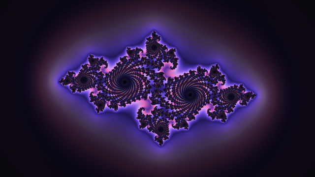
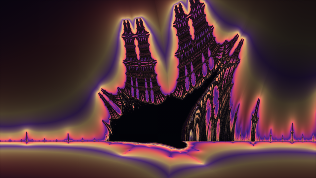
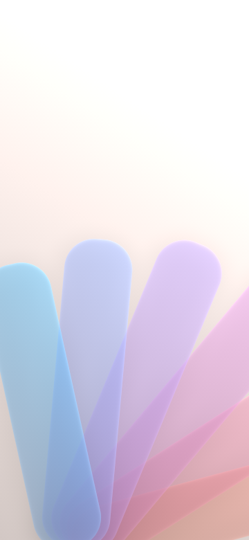

<div align="center">
  
  <h1>Fractique</h1>
  <p><strong>फ्रैक्टल लपटों और वॉलपेपर का जनरेटर, जो एक ही इनपुट से हर प्लेटफ़ॉर्म पर एक ही तस्वीर बनाता है।</strong></p>
  <p><sub>
    <a href="../../README.md">English</a> · <a href="README_UK.md">Українська</a> · <a href="README_RU.md">Русский</a> · <a href="README_DE.md">Deutsch</a> · <a href="README_FR.md">Français</a> · <a href="README_ES.md">Español</a> · <a href="README_IT.md">Italiano</a> · <a href="README_JA.md">日本語</a><br>
    <a href="README_CN.md">简体中文</a> · <a href="README_PT.md">Português</a> · <a href="README_KO.md">한국어</a> · <strong>हिन्दी</strong> · <a href="README_TR.md">Türkçe</a> · <a href="README_PL.md">Polski</a> · <a href="README_ID.md">Bahasa Indonesia</a>
  </sub></p>
</div>

Fractique तीन तरह की तस्वीरें बनाता है। फ्रैक्टल लपटें: पतली वक्र रेखाओं और कोमल रोशनी से बने चमकदार, धुएँ जैसे फ्रैक्टल। 22 प्रकार के क्लासिक फ्रैक्टल: मैंडलब्रॉट सेट, जूलिया सेट और विचित्र आकर्षकों से लेकर तीन आयामों के मैंडलबल्ब तक। और वॉलपेपर: रोशन किनारों और हल्की परछाइयों वाली सपाट शीटें, हर एक हल्के और गहरे रूप में। आप कोई प्रीसेट चुनते हैं, कोई यादृच्छिक तस्वीर बनाते हैं या कई लपटें एक-दूसरे पर रखते हैं, और नतीजे को फ़ोन की स्क्रीन से लेकर 4K मॉनिटर तक किसी भी आकार में निर्यात करते हैं। एक सीन एक छोटी फ़ाइल है, और वही फ़ाइल Windows, macOS, Linux, Android और iOS पर हमेशा बिल्कुल वही पिक्सेल देती है।

<p align="center">
  
</p>

## Fractique क्या करता है

- **लपटें:** 49 वेरिएशन, ब्लेंड मोड वाली परतें, घूर्णी और दर्पण सममिति, घनत्व आकलन, आभा और 29 बिल्ट-इन प्रीसेट।
- **फ्रैक्टल:** समतल के 19 प्रकार: एस्केप-टाइम (मैंडलब्रॉट, जूलिया, बर्निंग शिप, ट्राइकॉर्न, मल्टीब्रॉट, फ़ीनिक्स, मैग्नेट), मूल-खोज (न्यूटन, नोवा), घनत्व के रूप में बनी कक्षाएँ (बुद्धब्रॉट, क्लिफ़र्ड, डी जोंग, लोरेंज़, गुमोव्स्की-मीरा, होपालोंग) और ज्यामितीय (अपोलोनियन गैस्केट, क्लाइनियन समूह, एल-सिस्टम, ल्यापुनोव), हर एक के अपने प्रीसेट और हर सीड के लिए एक तस्वीर; इनमें लपटों वाले ही पैलेट, परतें और गहरा ज़ूम हैं।
- **ठोस:** तीन आयामों में मैंडलबल्ब, मैंडलबॉक्स और मेंगर स्पंज, रोशनी, छाया और कोहरे के साथ; इनके चारों ओर घूमें या भीतर जाएँ।
- **वॉलपेपर:** हर सीड के लिए एक, 14 लेआउट और 6 सामग्रियों से, हर एक हल्के और गहरे रूप में, स्क्रीन के आकार के हिसाब से सजाया हुआ।
- **ऐप:** Windows, macOS, Linux, Android, iOS और वेब के लिए एक ही कोडबेस। तस्वीर पूरी विंडो में फैलती है और उसके ऊपर काँच के पैनल तैरते हैं; डेस्कटॉप पर ऐप की अपनी काँच की टाइटल बार है। तीन टैब, “लपटें”, “फ्रैक्टल” और “आकृतियाँ” (वॉलपेपर), हर एक अपनी तस्वीर और अपनी हाल की तस्वीरें रखता है। 15 भाषाओं में।
- **GPU त्वरण:** जहाँ ग्राफ़िक्स कार्ड प्रोसेसर से साफ़ तौर पर तेज़ है, वहाँ लपटें, तीन आकर्षक और एस्केप-टाइम तथा मूल-खोज फ्रैक्टल वह ख़ुद बनाता है और प्रोसेसर खाली रहता है। तीन ऊँचे गुणवत्ता स्तरों का निर्यात हमेशा प्रोसेसर ही सटीक रूप से रेंडर करता है।
- **“यादृच्छिक” और “उत्परिवर्तन”:** हर सीड एक तस्वीर है; जो लपटें सिर्फ़ एक बिंदु या भरा हुआ वर्ग बनतीं, वे छोड़ दी जाती हैं। “उत्परिवर्तन” आपकी पसंद की तस्वीर का एक रूपांतर बनाता है।
- **परतें:** प्रीसेट में से कोई लपट या कोई यादृच्छिक लपट जोड़ें, हटाएँ, क्रम बदलें और हर एक का ब्लेंड (“जोड़”, “स्क्रीन”, “ऊपर”) और अपारदर्शिता तय करें। अधिकतम 16 परतें।
- **तस्वीर का आकार:** विंडो का अपना आकार, 59 स्क्रीन में से एक (4K तक के कंप्यूटर, Android फ़ोन और टैबलेट, iPhone, iPad, Mac और Apple Watch), या 16 से 16384 पिक्सेल तक कोई भी चौड़ाई और ऊँचाई।
- **गहरा ज़ूम:** ड्रैग, व्हील और पिंच से दृश्य खिसकता है और दस अरब गुना तक बड़ा होता है। तस्वीर तुरंत साथ चलती है और दृश्य के रुकते ही साफ़ दोबारा बनती है।
- **फ़ोन:** अपनी अलग स्क्रीन। एक गोल बटन नई तस्वीर बनाता है, स्वाइप अगले वॉलपेपर पर ले जाता है, छोटी लाइव तस्वीरों की एक शीट से शैली चुनी जाती है, और जो तस्वीरें आप रखते हैं उनसे एक संग्रह बनता है। जिन प्रकार के फ्रैक्टल बनाने में प्रोसेसर को देर लगती है, वे वहाँ नहीं दिखते।
- **निर्यात:** किसी भी आकार का PNG: तुरंत, जैसा स्क्रीन पर है, या तीन ऊँचे गुणवत्ता स्तरों में, बैकग्राउंड में रेंडर होता है। फ़ोन पर यह “फ़ोटो” या गैलरी में सहेजा जाता है, या साझा किया जाता है। हर सुविधा हर प्लेटफ़ॉर्म पर मुफ़्त है; केवल App Store वाले संस्करण (iPhone, iPad, Mac) में 2560 × 1440 पिक्सेल या उससे बड़े, या अपने तय किए आकार में निर्यात के लिए एक बार की ख़रीदारी Fractique Pro चाहिए।
- **प्रोजेक्ट फ़ाइलें:** `.frcq` फ़ाइल सीन को उसके दृश्य, टोन और आकार के साथ रखती है, इसलिए वह वैसी ही खुलती है जैसी सहेजी गई थी ([docs/scene-format.md](../scene-format.md))। सादे `.json` सीन और flam3 तथा Apophysis की `.flame` फ़ाइलें भी खुलती हैं। दोबारा खोलने पर ऐप उसी सेशन पर लौटता है जहाँ उसे छोड़ा गया था।
- **अपडेट:** एक विंडो हर जारी संस्करण को उसके नोट्स के साथ दिखाती है और उनमें से कोई भी इंस्टॉल करती है। Windows पर ऐप एक पोर्टेबल `.exe` है, जो ख़ुद को बदल लेता है।
- **सटीक दोहराव:** एक ही सीन हर मशीन पर वही पिक्सेल देता है; Linux, Windows और macOS पर टेस्ट इसकी जाँच करते हैं ([docs/determinism.md](../determinism.md))।
- **कमांड लाइन टूल** (`fractique`): लपटों, फ्रैक्टल और वॉलपेपर को PNG में रेंडर करता है, यादृच्छिक सीन और रूपांतर बनाता है, `.flame` और `.frcq` फ़ाइलें कन्वर्ट करता है।
- **MCP सर्वर** (`fractique mcp`): एक AI एजेंट सीन बनाता, बदलता और रेंडर करता है ([docs/mcp.md](../mcp.md))।
- **HTTP सर्वर** (`fractique-server`): रेंडर कतार और सीमाओं वाला HTTP API, `/mcp` पर AI एजेंटों के लिए MCP, वेब ऐप भी परोसता है, Docker इमेज के रूप में उपलब्ध ([docs/server.md](../server.md))।

| | |
| --- | --- |
|  |  |
| `emerald-star` (दो परतें) | `ember-vortex` |
|  |  |
| `golden-bloom` | `solar-mandala` |

दूसरी तरह के फ्रैक्टल: मैंडलब्रॉट सेट, एक जूलिया सेट और क्लिफ़र्ड आकर्षक:

| | | |
| --- | --- | --- |
|  |  |  |
| `mandelbrot-spiral` | `julia-spirals` | `clifford-wings` |

और एस्केप-टाइम फ्रैक्टल तथा मूल-खोज फ्रैक्टल: बर्निंग शिप, ट्राइकॉर्न, मल्टीब्रॉट, फ़ीनिक्स, मैग्नेट, न्यूटन, नोवा:

| | | | |
| --- | --- | --- | --- |
|  |  |  |  |
| `burning_ship-ship` | `tricorn-island` | `multibrot-spirals` | `phoenix-galaxy` |
|  |  |  | |
| `magnet-pearls` | `newton-seven` | `nova-star` | |

घनत्व के रूप में बनी कक्षाएँ: बुद्धब्रॉट और डी जोंग, लोरेंज़, गुमोव्स्की-मीरा और होपालोंग आकर्षक:

| | | |
| --- | --- | --- |
|  |  |  |
| `buddhabrot-nebula` | `de_jong-classic` | `lorenz-butterfly` |
|  |  | |
| `gumowski_mira-feathers` | `hopalong-web` | |

ज्यामितीय फ्रैक्टल: अपोलोनियन गैस्केट, क्लाइनियन समूह का सीमा सेट, एल-सिस्टम और ल्यापुनोव फ्रैक्टल:

| | | | |
| --- | --- | --- | --- |
|  |  |  |  |
| `apollonian-threefold` | `kleinian-cusp` | `l_system-plant` | `lyapunov-feathers` |

तीन आयामों के ठोस: मैंडलबल्ब, मैंडलबॉक्स और मेंगर स्पंज:

| | | |
| --- | --- | --- |
|  |  |  |
| `mandelbulb-crown` | `mandelbox-station` | `menger_sponge-classic` |

हल्के और गहरे वॉलपेपर, हर एक अपने लेआउट और सामग्री के साथ:

| | | | |
| --- | --- | --- | --- |
|  |  |  |  |
| `waves`, `glass` | `burst`, `glow` | `tiles`, `relief` | `fan`, `glass` |
|  |  |  |  |
| `discs`, `paper` | `bars`, `paper` | `arcs`, `carbon` | `lines`, `paper` |

## झटपट शुरुआत

एक कमांड ऐप और कमांड लाइन टूल दोनों बना देता है। Rust न हो तो उसे इंस्टॉल कर देता है।

| सिस्टम | कमांड |
| --- | --- |
| Linux, macOS | `./setup.sh` |
| Windows | `setup.cmd` |

ऐप शुरू करें:

```sh
./target/release/fractique-gui
```

या कमांड लाइन से रेंडर करें:

```sh
# एक प्रीसेट 4K तस्वीर के रूप में
./target/release/fractique render --preset aurora-spiral --size 3840x2160 --quality high -o aurora.png

# सीड 42 की यादृच्छिक लपट, फ़ोन स्क्रीन के लिए
./target/release/fractique render --random 42 --size 1080x2400 --quality mobile -o phone.png

# सीड 7 का यादृच्छिक मैंडलब्रॉट दृश्य
./target/release/fractique render --random 7 --fractal mandelbrot --size 1920x1080 -o mandelbrot.png

# सीड 7 का वॉलपेपर फ़ोन के लिए, हल्का और गहरा
./target/release/fractique render --wallpaper 7 --size 1290x2796 -o wallpaper.png
./target/release/fractique render --wallpaper 7 --dark --size 1290x2796 -o wallpaper-dark.png

# यादृच्छिक सीन को फ़ाइल में रखें, बदलें, रेंडर करें
./target/release/fractique randomize 42 -o scene.json
./target/release/fractique render scene.json -o mine.png
```

Windows पर प्रोग्राम `target\release\fractique-gui.exe` और `target\release\fractique.exe` हैं। ऐप और कमांड जो कुछ करते हैं, वह सब: [docs/usage.md](../usage.md)।

## दस्तावेज़

दस्तावेज़ अंग्रेज़ी में हैं।

| | |
| --- | --- |
| [docs/usage.md](../usage.md) | ऐप, कमांड, गुणवत्ता स्तर, सीन कैसे संपादित करें |
| [docs/scene-format.md](../scene-format.md) | सीन फ़ाइल का हर फ़ील्ड, हर वेरिएशन, शीट, `.frcq` फ़ाइल |
| [docs/mcp.md](../mcp.md) | MCP सर्वर: AI एजेंट को जोड़ना, टूल |
| [docs/server.md](../server.md) | HTTP सर्वर: एंडपॉइंट, सीमाएँ, Docker |
| [docs/ios.md](../ios.md) | iPhone या iOS सिम्युलेटर पर बनाना और चलाना |
| [docs/releasing.md](../releasing.md) | रिलीज़ कैसे बनती है, ऐप ख़ुद को कैसे अपडेट करता है |
| [docs/architecture.md](../architecture.md) | हिस्से आपस में कैसे जुड़ते हैं, रेंडर कैसे काम करता है |
| [docs/determinism.md](../determinism.md) | रेंडर ठीक वैसा ही क्यों दोहराता है, किस बात का वादा है और किसका नहीं |
| [docs/performance.md](../performance.md) | मापा गया रेंडर समय और मेमोरी |
| [docs/roadmap.md](../roadmap.md) | क्या हो चुका है और आगे क्या है |

## लाइसेंस

[PolyForm Noncommercial License 1.0.0](../../LICENSE.md): किसी भी गैर-व्यावसायिक उपयोग के लिए मुफ़्त। व्यावसायिक उपयोग के लिए लेखक से अलग लाइसेंस माँगें। तृतीय-पक्ष लाइसेंस [THIRD_PARTY_NOTICES.md](../../THIRD_PARTY_NOTICES.md) में सूचीबद्ध हैं। योगदान: [CONTRIBUTING.md](../../CONTRIBUTING.md) देखें।
