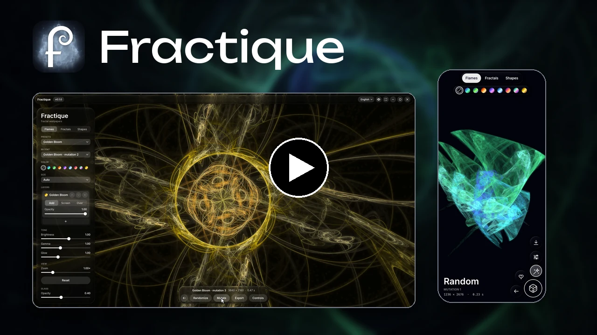
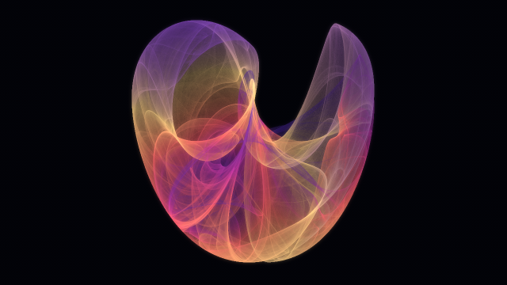
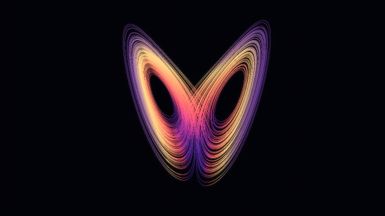
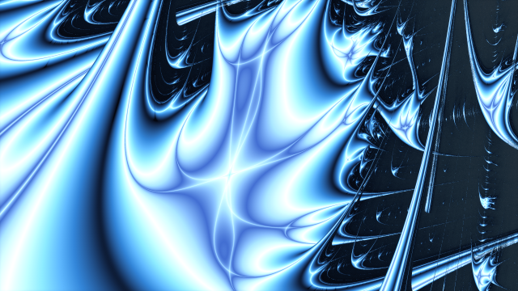
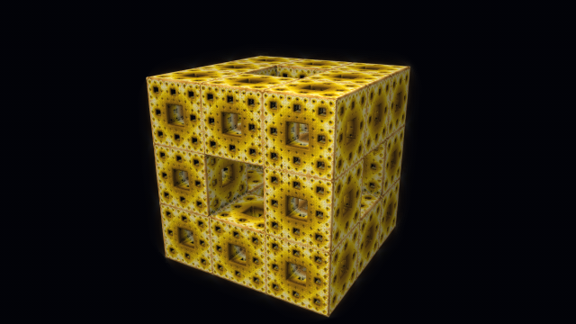

<div align="center">
  
  <h1>Fractique</h1>
  <p><strong>Generator api fraktal, fraktal klasik, dan wallpaper yang menghasilkan gambar yang sama dari masukan yang sama, di semua platform.</strong></p>
  <p><sub>
    <a href="../../README.md">English</a> · <a href="README_UK.md">Українська</a> · <a href="README_RU.md">Русский</a> · <a href="README_DE.md">Deutsch</a> · <a href="README_FR.md">Français</a> · <a href="README_ES.md">Español</a> · <a href="README_IT.md">Italiano</a> · <a href="README_JA.md">日本語</a><br>
    <a href="README_CN.md">简体中文</a> · <a href="README_PT.md">Português</a> · <a href="README_KO.md">한국어</a> · <a href="README_HI.md">हिन्दी</a> · <a href="README_TR.md">Türkçe</a> · <a href="README_PL.md">Polski</a> · <strong>Bahasa Indonesia</strong>
  </sub></p>
</div>

<p align="center">
  <a href="https://apps.apple.com/app/fractique/id6836122841"></a><br>
  <sub>iPhone dan iPad. Windows, macOS, Linux, dan Android: gratis, di <a href="https://github.com/tarpetos/fractique/releases/latest">rilis terbaru</a>.</sub>
</p>

<p align="center">
  <a href="https://www.youtube.com/watch?v=z7EAQGUys8U"></a>
</p>

Fractique membuat tiga jenis gambar. Api fraktal: fraktal bercahaya dan halus yang terbentuk dari kurva tipis dan cahaya lembut. Fraktal klasik dari 22 jenis: dari himpunan Mandelbrot, himpunan Julia, dan penarik aneh hingga Mandelbulb tiga dimensi. Dan wallpaper: lembaran datar dengan tepi bercahaya dan bayangan lembut, masing-masing dalam versi terang dan gelap. Anda memilih preset, membuat gambar acak, atau menumpuk beberapa api, lalu mengekspornya dalam ukuran apa pun, dari layar ponsel hingga monitor 4K. Sebuah adegan adalah satu berkas kecil, dan berkas yang sama selalu menghasilkan piksel yang persis sama, di Windows, macOS, Linux, Android, dan iOS.

<p align="center">
  
</p>

## Yang dilakukan Fractique

- **Api:** 49 variasi, lapisan dengan mode blend, simetri putar dan cermin, estimasi kerapatan, pendar, dan 29 preset bawaan.
- **Fraktal:** 19 jenis pada bidang: waktu lolos (Mandelbrot, Julia, Burning Ship, Tricorn, Multibrot, Phoenix, Magnet), pencarian akar (Newton, Nova), orbit yang digambar sebagai kerapatan (Buddhabrot, Clifford, De Jong, Lorenz, Gumowski-Mira, Hopalong), dan geometris (Gasket Apollonius, Grup Klein, Sistem-L, Lyapunov), masing-masing dengan preset dan satu gambar untuk setiap seed; palet, lapisan, dan zoom dalamnya sama dengan milik api.
- **Benda padat:** Mandelbulb, Mandelbox, dan spons Menger dalam tiga dimensi, dengan cahaya, bayangan, dan kabut; kelilingi atau masuki bagian dalamnya.
- **Wallpaper:** satu untuk setiap seed, dari 14 tata letak dan 6 bahan, masing-masing dalam versi terang dan gelap, ditata sesuai ukuran layar.
- **Aplikasi:** satu basis kode untuk Windows, macOS, Linux, Android, iOS, dan web. Gambar memenuhi jendela dan panel kaca melayang di atasnya; di desktop aplikasi memiliki bilah judul kaca sendiri. Tiga tab, “Api”, “Fraktal”, dan “Bentuk” (wallpaper), masing-masing menyimpan gambarnya sendiri dan gambar-gambar terbarunya. Dalam 15 bahasa.
- **Akselerasi GPU:** di perangkat yang kartu grafisnya jelas lebih cepat daripada prosesor, kartu grafis itu sendiri yang menggambar api, tiga penarik, fraktal waktu lolos dan pencarian akar, serta wallpaper, dan prosesor tetap bebas. Ekspor pada tiga tingkat kualitas yang lebih tinggi selalu dirender oleh prosesor, secara persis.
- **“Acak” dan “Mutasi”:** setiap seed adalah sebuah gambar; api yang hanya akan menjadi titik atau kotak penuh dilewati. “Mutasi” membuat varian dari gambar yang Anda sukai.
- **Lapisan:** tambahkan api dari preset atau api acak, hapus, ubah urutannya, dan atur blend (“Tambah”, “Layar”, “Timpa”) serta opasitas masing-masing. Hingga 16 lapisan. Setiap lapisan memiliki warnanya sendiri.
- **Ukuran gambar:** ukuran jendela itu sendiri, salah satu dari 61 layar (komputer hingga 16K, ponsel dan tablet Android, iPhone, iPad, Mac, dan Apple Watch), atau lebar dan tinggi berapa pun dari 16 hingga 16384 piksel.
- **Zoom dalam:** seret, roda mouse, dan cubit menggeser tampilan dan memperbesarnya selama masih berupa gambar: api 10 hingga 300 kali, penarik 10 hingga 100 kali, wallpaper 8 kali, dan fraktal lainnya hingga sepuluh miliar kali. Gambar langsung mengikuti dan digambar ulang dengan tajam saat tampilan berhenti.
- **Ponsel:** layar tersendiri. Satu tombol bulat membuat gambar baru, usapan berpindah ke wallpaper berikutnya, sebuah lembar berisi gambar-gambar kecil yang hidup dipakai untuk memilih gaya, dan gambar yang Anda simpan menjadi koleksi. Jenis fraktal yang lama digambar oleh prosesor tidak ditampilkan di sana.
- **Ekspor:** PNG dalam ukuran apa pun: seketika, seperti yang tampil di layar, atau dirender di latar belakang dengan tiga tingkat kualitas yang lebih tinggi. Di ponsel, gambar disimpan ke Foto atau galeri, atau dibagikan. Semua fitur gratis di semua platform; hanya versi App Store (iPhone, iPad, Mac) yang mengekspor tiga gambar sehari secara gratis dan meminta pembelian satu kali, Fractique Pro, untuk lebih banyak atau untuk ukuran kustom.
- **Berkas proyek:** berkas `.frcq` menyimpan adegan beserta tampilan, rona, dan ukurannya, sehingga terbuka persis seperti saat disimpan ([docs/scene-format.md](../scene-format.md)). Adegan `.json` biasa dan berkas `.flame` dari flam3 dan Apophysis juga dapat dibuka. Saat dijalankan lagi, aplikasi kembali ke sesi yang terakhir ditinggalkan.
- **Pembaruan:** sebuah jendela menampilkan setiap versi yang dirilis beserta catatannya dan memasang versi mana pun. Di Windows aplikasinya adalah satu `.exe` portabel yang mengganti dirinya sendiri.
- **Keterulangan yang persis:** adegan yang sama menghasilkan piksel yang sama di semua mesin, diperiksa oleh pengujian di Linux, Windows, dan macOS ([docs/determinism.md](../determinism.md)).
- **Alat baris perintah** (`fractique`): merender api, fraktal, dan wallpaper ke PNG, membuat adegan acak dan varian, mengonversi berkas `.flame` dan `.frcq`.
- **Server MCP** (`fractique-mcp`, atau `fractique mcp`): agen AI membuat, mengubah, dan merender adegan ([docs/mcp.md](../mcp.md)).
- **Server HTTP** (`fractique-server`): API HTTP dengan antrean render dan batasan, referensi interaktifnya di `/docs`, MCP untuk agen AI di `/mcp`, menyajikan aplikasi web, unduhan tersendiri di setiap rilis, dan `Dockerfile` untuk membuat image ([docs/server.md](../server.md)).

| | |
| --- | --- |
|  |  |
| Bintang Zamrud (dua lapisan) | Pusaran Bara |
|  |  |
| Mekar Keemasan | Mandala Surya |

Seratus api lagi, juga fraktal dan wallpaper, masing-masing dengan berkas `.frcq` yang merendernya kembali dalam ukuran apa pun: [galeri](../gallery/README.md).

Fraktal jenis lain: himpunan Mandelbrot, himpunan Julia, dan penarik Clifford:

| | | |
| --- | --- | --- |
|  |  |  |
| Mandelbrot: Spiral | Julia: Spiral | Clifford: Sayap |

Fraktal waktu lolos lainnya dan fraktal pencarian akar: Burning Ship, Tricorn, Multibrot, Phoenix, Magnet, Newton, Nova:

| | | | |
| --- | --- | --- | --- |
|  |  |  |  |
| Burning Ship: Kapal | Tricorn: Pulau | Multibrot: Spiral | Phoenix: Galaksi |
|  |  |  | |
| Magnet: Mutiara | Newton: Tujuh | Nova: Bintang | |

Orbit yang digambar sebagai kerapatan: Buddhabrot serta penarik De Jong, Lorenz, Gumowski-Mira, dan Hopalong:

| | | |
| --- | --- | --- |
|  |  |  |
| Buddhabrot: Nebula | De Jong: Klasik | Lorenz: Kupu-Kupu |
|  |  | |
| Gumowski-Mira: Bulu | Hopalong: Jaring Laba-Laba | |

Fraktal geometris: gasket Apollonius, himpunan limit grup Klein, sistem-L, dan fraktal Lyapunov:

| | | | |
| --- | --- | --- | --- |
|  |  |  |  |
| Gasket Apollonius: Rangkap Tiga | Grup Klein: Ujung Runcing | Sistem-L: Tanaman | Lyapunov: Bulu |

Benda padat tiga dimensi: Mandelbulb, Mandelbox, dan spons Menger:

| | | |
| --- | --- | --- |
|  |  |  |
| Mandelbulb: Mahkota | Mandelbox: Stasiun | Spons Menger: Klasik |

Wallpaper, terang dan gelap, masing-masing dengan tata letak dan bahannya:

| | | | |
| --- | --- | --- | --- |
|  |  |  |  |
| Ombak, Kaca | Bunga, Pendar | Ubin, Relief | Kipas, Kaca |
|  |  |  |  |
| Cakram, Kertas | Batang, Kertas | Busur, Karbon | Garis, Kertas |

## Mulai cepat

Satu perintah membangun aplikasi dan alat baris perintah. Rust dipasang jika belum ada.

| Sistem | Perintah |
| --- | --- |
| Linux, macOS | `./setup.sh` |
| Windows | `setup.cmd` |

Jalankan aplikasi:

```sh
./target/release/fractique-gui
```

Atau render dari baris perintah:

```sh
# sebuah preset sebagai gambar 4K
./target/release/fractique render --preset aurora-spiral --size 3840x2160 --quality high -o aurora.png

# api acak dari seed 42, untuk layar ponsel
./target/release/fractique render --random 42 --size 1080x2400 --quality mobile -o phone.png

# tampilan Mandelbrot acak dari seed 7
./target/release/fractique render --random 7 --fractal mandelbrot --size 1920x1080 -o mandelbrot.png

# wallpaper dari seed 7 untuk ponsel, terang dan gelap
./target/release/fractique render --wallpaper 7 --size 1290x2796 -o wallpaper.png
./target/release/fractique render --wallpaper 7 --dark --size 1290x2796 -o wallpaper-dark.png

# simpan adegan acak sebagai berkas, ubah, lalu render
./target/release/fractique randomize 42 -o scene.json
./target/release/fractique render scene.json -o mine.png
```

Di Windows programnya adalah `target\release\fractique-gui.exe` dan `target\release\fractique.exe`. Semua yang dilakukan aplikasi dan perintahnya: [docs/usage.md](../usage.md).

## Diuji pada

| Perangkat | Sistem | Prosesor | Grafis |
| --- | --- | --- | --- |
| PC | Windows 11 | AMD Ryzen 7 5700X | NVIDIA GeForce RTX 4070 |
| PC | Ubuntu 24.04 (WSL2) | AMD Ryzen 7 5700X | Tidak ada: hanya prosesor |
| PC | Ubuntu 26.04 | AMD Ryzen 7 5700X | NVIDIA GeForce RTX 4070 |
| PC | Arch Linux (Linux 7.3.4) | AMD Ryzen 7 9800X3D | AMD Radeon RX 9070 XT |
| Laptop, ASUS TUF Gaming FX505DT | Windows 11 | AMD Ryzen 5 3550H | NVIDIA GeForce GTX 1650 |
| Laptop, HP 15-db1xxx | Debian 13 | AMD Ryzen 3 3200U | AMD Radeon Vega 3 |
| MacBook Pro | macOS 27 | Apple M5 Pro | Apple M5 Pro |
| ZTE Blade A7 | Android 9 | MediaTek Helio P22 | PowerVR GE8320 |
| Asus Zenfone 10 | Android 15 | Qualcomm Snapdragon 8 Gen 2 | Adreno 740 |
| iPhone 13 Pro | iOS 27 | Apple A15 Bionic | Apple A15 |
| iPhone 18 Pro Max | iOS 27 | Apple A20 Pro | Apple A20 Pro |

## Dokumentasi

Dokumentasi ditulis dalam bahasa Inggris.

| | |
| --- | --- |
| [docs/usage.md](../usage.md) | Aplikasi, perintah, tingkat kualitas, cara menyunting adegan |
| [docs/scene-format.md](../scene-format.md) | Setiap field berkas adegan, setiap variasi, lembaran, berkas `.frcq` |
| [docs/mcp.md](../mcp.md) | Server MCP: menghubungkan agen AI, daftar alat |
| [docs/server.md](../server.md) | Server HTTP: endpoint, batasan, Docker |
| [docs/ios.md](../ios.md) | Membangun dan menjalankan di iPhone atau di iOS Simulator |
| [docs/releasing.md](../releasing.md) | Cara rilis dibuat, cara aplikasi memperbarui dirinya |
| [docs/architecture.md](../architecture.md) | Bagaimana bagian-bagiannya saling terhubung, cara kerja render |
| [docs/determinism.md](../determinism.md) | Mengapa render terulang persis, apa yang dijanjikan dan apa yang tidak |
| [docs/performance.md](../performance.md) | Waktu render dan memori hasil pengukuran |
| [docs/roadmap.md](../roadmap.md) | Apa yang sudah selesai dan apa berikutnya |

## Lisensi

[PolyForm Noncommercial License 1.0.0](../../LICENSE.md): gratis untuk penggunaan nonkomersial apa pun. Untuk penggunaan komersial, mintalah lisensi terpisah kepada penulis. Lisensi pihak ketiga tercantum di [THIRD_PARTY_NOTICES.md](../../THIRD_PARTY_NOTICES.md). Kontribusi: lihat [CONTRIBUTING.md](../../CONTRIBUTING.md).
