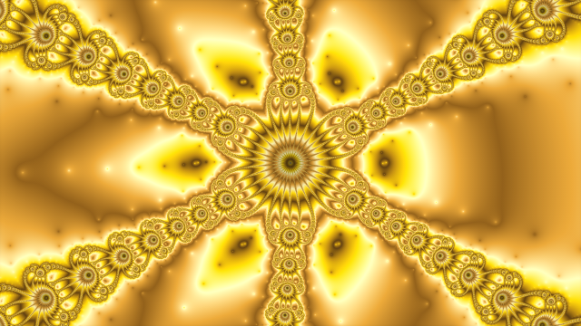
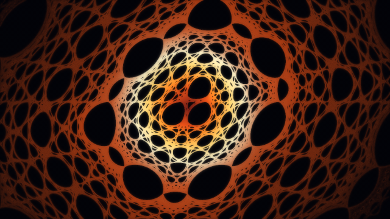

<div align="center">
  
  <h1>Fractique</h1>
  <p><strong>Un generatore di fiamme frattali, frattali classici e sfondi che produce la stessa immagine dallo stesso input, su ogni piattaforma.</strong></p>
  <p><sub>
    <a href="../../README.md">English</a> · <a href="README_UK.md">Українська</a> · <a href="README_RU.md">Русский</a> · <a href="README_DE.md">Deutsch</a> · <a href="README_FR.md">Français</a> · <a href="README_ES.md">Español</a> · <strong>Italiano</strong> · <a href="README_JA.md">日本語</a><br>
    <a href="README_CN.md">简体中文</a> · <a href="README_PT.md">Português</a> · <a href="README_KO.md">한국어</a> · <a href="README_HI.md">हिन्दी</a> · <a href="README_TR.md">Türkçe</a> · <a href="README_PL.md">Polski</a> · <a href="README_ID.md">Bahasa Indonesia</a>
  </sub></p>
</div>

Fractique crea tre tipi di immagini. Fiamme frattali: frattali luminosi ed eterei fatti di curve sottili e luce morbida. Frattali classici di 22 tipi: dall’insieme di Mandelbrot, dagli insiemi di Julia e dagli attrattori strani fino al Mandelbulb in tre dimensioni. E sfondi: fogli piatti con bordi illuminati e ombre morbide, ciascuno in versione chiara e scura. Scegli un preset, generi un’immagine casuale o sovrapponi più fiamme, ed esporti il risultato a qualsiasi dimensione, dallo schermo di un telefono a un monitor 4K. Una scena è un unico piccolo file, e lo stesso file dà sempre esattamente gli stessi pixel, su Windows, macOS, Linux, Android e iOS.

<p align="center">
  
</p>

## Che cosa fa Fractique

- **Fiamme:** 49 variazioni, livelli con metodi di fusione, simmetria rotazionale e speculare, stima della densità, bagliore e 29 preset integrati.
- **Frattali:** 19 tipi nel piano: a tempo di fuga (Mandelbrot, Julia, Burning Ship, Tricorn, Multibrot, Fenice, Magnet), di ricerca delle radici (Newton, Nova), orbite disegnate come densità (Buddhabrot, Clifford, De Jong, Lorenz, Gumowski-Mira, Hopalong) e geometrici (Guarnizione apolloniana, Gruppo kleiniano, Sistema L, Lyapunov), ciascuno con i suoi preset e un’immagine per ogni seme; condividono le palette, i livelli e lo zoom profondo delle fiamme.
- **Solidi:** il Mandelbulb, la Mandelbox e la spugna di Menger in tre dimensioni, con luce, ombre e nebbia; giraci intorno o entra al loro interno.
- **Sfondi:** uno per ogni seme, da 14 disposizioni e 6 materiali, ciascuno in versione chiara e scura, disposto per la dimensione dello schermo.
- **L’app:** un’unica base di codice per Windows, macOS, Linux, Android, iOS e il web. L’immagine riempie la finestra e sopra fluttuano pannelli di vetro; sul desktop l’app ha una propria barra del titolo di vetro. Tre schede, «Fiamme», «Frattali» e «Forme» (gli sfondi), conservano ciascuna la propria immagine e quelle recenti. In 15 lingue.
- **Accelerazione GPU:** dove la scheda grafica è nettamente più veloce del processore, disegna da sé le fiamme, tre attrattori, i frattali a tempo di fuga e di ricerca delle radici e gli sfondi, e il processore resta libero. Le esportazioni ai tre livelli di qualità superiori sono sempre renderizzate dal processore, in modo esatto.
- **«Casuale» e «Muta»:** ogni seme è un’immagine; le fiamme che sarebbero un punto o un quadrato pieno vengono scartate. «Muta» crea una variante di quella che ti piace.
- **Livelli:** aggiungi una fiamma dai preset o una casuale, rimuovila, cambia l’ordine e imposta per ciascuna la fusione («Somma», «Scolora», «Sopra») e l’opacità. Fino a 16 livelli.
- **Dimensione dell’immagine:** quella della finestra, uno dei 61 schermi (computer fino al 16K, telefoni e tablet Android, iPhone, iPad, Mac e Apple Watch) oppure qualsiasi larghezza e altezza da 16 a 16384 pixel.
- **Zoom profondo:** trascinamento, rotellina e pizzico spostano la vista e la ingrandiscono finché resta un’immagine: una fiamma da 10 a 300 volte, un attrattore da 10 a 100 volte, uno sfondo 8 volte e gli altri frattali fino a dieci miliardi di volte. L’immagine segue subito e viene ridisegnata nitida quando la vista si ferma.
- **Telefoni:** una schermata dedicata. Un pulsante rotondo crea una nuova immagine, uno scorrimento passa allo sfondo successivo, un foglio di piccole immagini vive sceglie lo stile e le immagini che tieni formano una collezione. I tipi di frattale che il processore impiega molto a disegnare lì non compaiono.
- **Esportazione:** un PNG di qualsiasi dimensione: subito, così com’è sullo schermo, oppure renderizzato in background in tre livelli di qualità superiori. Su un telefono viene salvato in Foto o nella galleria, oppure condiviso. Tutte le funzioni sono gratuite su ogni piattaforma; solo la versione dell’App Store (iPhone, iPad, Mac) chiede un acquisto una tantum, Fractique Pro, per esportare da 2560 × 1440 pixel in su o in una dimensione personalizzata.
- **File di progetto:** un file `.frcq` conserva la scena con vista, tono e dimensione, così si riapre com’era stata salvata ([docs/scene-format.md](../scene-format.md)). Si aprono anche le scene `.json` semplici e i file `.flame` di flam3 e Apophysis. Tra un avvio e l’altro l’app torna alla sessione in cui era stata lasciata.
- **Aggiornamenti:** una finestra elenca ogni versione pubblicata con le sue note e installa una qualsiasi di esse. Su Windows l’app è un unico `.exe` portatile che sostituisce sé stesso.
- **Ripetibilità esatta:** la stessa scena dà gli stessi pixel su ogni macchina, come verificano i test su Linux, Windows e macOS ([docs/determinism.md](../determinism.md)).
- **Lo strumento da riga di comando** (`fractique`): renderizza fiamme, frattali e sfondi in PNG, crea scene casuali e varianti, converte i file `.flame` e `.frcq`.
- **Server MCP** (`fractique-mcp`, oppure `fractique mcp`): un agente IA crea, modifica e renderizza scene ([docs/mcp.md](../mcp.md)).
- **Server HTTP** (`fractique-server`): un’API HTTP con coda di rendering e limiti, il suo riferimento interattivo su `/docs`, MCP per agenti IA su `/mcp`, serve l’app web, un download a sé in ogni versione e un `Dockerfile` per costruire un’immagine ([docs/server.md](../server.md)).

| | |
| --- | --- |
|  |  |
| Stella smeraldo (due livelli) | Vortice di brace |
|  |  |
| Fioritura dorata | Mandala solare |

Altre cento fiamme, oltre a frattali e sfondi, ogni immagine con il file `.frcq` che la riproduce a qualsiasi dimensione: [la galleria](../gallery.md).

Frattali di altri tipi: l’insieme di Mandelbrot, un insieme di Julia e l’attrattore di Clifford:

| | | |
| --- | --- | --- |
|  |  |  |
| Mandelbrot: Spirale | Julia: Spirali | Clifford: Ali |

Altri frattali a tempo di fuga e quelli di ricerca delle radici: Burning Ship, Tricorn, Multibrot, Fenice, Magnet, Newton, Nova:

| | | | |
| --- | --- | --- | --- |
|  |  |  |  |
| Burning Ship: Nave | Tricorn: Isola | Multibrot: Spirali | Fenice: Galassia |
|  |  |  | |
| Magnet: Perle | Newton: Sette | Nova: Stella | |

Orbite disegnate come densità: il Buddhabrot e gli attrattori di De Jong, Lorenz, Gumowski-Mira e Hopalong:

| | | |
| --- | --- | --- |
|  |  |  |
| Buddhabrot: Nebulosa | De Jong: Classico | Lorenz: Farfalla |
|  |  | |
| Gumowski-Mira: Piume | Hopalong: Ragnatela | |

Frattali geometrici: una guarnizione apolloniana, l’insieme limite di un gruppo kleiniano, un sistema L e un frattale di Lyapunov:

| | | | |
| --- | --- | --- | --- |
|  |  |  |  |
| Guarnizione apolloniana: Triplo | Gruppo kleiniano: Cuspide | Sistema L: Pianta | Lyapunov: Piume |

Solidi in tre dimensioni: il Mandelbulb, la Mandelbox e la spugna di Menger:

| | | |
| --- | --- | --- |
|  |  |  |
| Mandelbulb: Corona | Mandelbox: Stazione | Spugna di Menger: Classico |

Sfondi, chiari e scuri, ciascuno con la sua disposizione e il suo materiale:

| | | | |
| --- | --- | --- | --- |
|  |  |  |  |
| Onde, Vetro | Fiore, Bagliore | Piastrelle, Rilievo | Ventaglio, Vetro |
|  |  |  |  |
| Dischi, Carta | Barre, Carta | Archi, Carbonio | Linee, Carta |

## Avvio rapido

Un solo comando compila l’app e lo strumento da riga di comando. Installa Rust se manca.

| Sistema | Comando |
| --- | --- |
| Linux, macOS | `./setup.sh` |
| Windows | `setup.cmd` |

Avvia l’app:

```sh
./target/release/fractique-gui
```

Oppure renderizza dalla riga di comando:

```sh
# un preset come immagine 4K
./target/release/fractique render --preset aurora-spiral --size 3840x2160 --quality high -o aurora.png

# la fiamma casuale del seme 42, per lo schermo di un telefono
./target/release/fractique render --random 42 --size 1080x2400 --quality mobile -o phone.png

# la vista casuale dell’insieme di Mandelbrot del seme 7
./target/release/fractique render --random 7 --fractal mandelbrot --size 1920x1080 -o mandelbrot.png

# lo sfondo del seme 7 per un telefono, chiaro e scuro
./target/release/fractique render --wallpaper 7 --size 1290x2796 -o wallpaper.png
./target/release/fractique render --wallpaper 7 --dark --size 1290x2796 -o wallpaper-dark.png

# conservare una scena casuale in un file, modificarla, renderizzarla
./target/release/fractique randomize 42 -o scene.json
./target/release/fractique render scene.json -o mine.png
```

Su Windows i programmi sono `target\release\fractique-gui.exe` e `target\release\fractique.exe`. Tutto ciò che fanno l’app e i comandi: [docs/usage.md](../usage.md).

## Testato su

| Dispositivo | Sistema | Processore | Grafica |
| --- | --- | --- | --- |
| PC | Windows 11 | AMD Ryzen 7 5700X | NVIDIA GeForce RTX 4070 |
| PC | Ubuntu 24.04 (WSL2) | AMD Ryzen 7 5700X | Nessuna: solo il processore |
| Portatile, ASUS TUF Gaming FX505DT | Windows 11 | AMD Ryzen 5 3550H | NVIDIA GeForce GTX 1650 |
| Portatile, HP 15-db1xxx | Debian 13 | AMD Ryzen 3 3200U | AMD Radeon Vega 3 |
| ZTE Blade A7 | Android 9 | MediaTek Helio P22 | PowerVR GE8320 |
| Asus Zenfone 10 | Android 15 | Qualcomm Snapdragon 8 Gen 2 | Adreno 740 |
| iPhone 13 Pro | iOS 27 | Apple A15 Bionic | Apple A15 |
| iPhone 11 | iOS 27 | Apple A13 Bionic | Apple A13 |

## Documentazione

La documentazione è in inglese.

| | |
| --- | --- |
| [docs/usage.md](../usage.md) | L’app, i comandi, i livelli di qualità, come modificare una scena |
| [docs/scene-format.md](../scene-format.md) | Ogni campo di un file di scena, ogni variazione, i fogli, il file `.frcq` |
| [docs/mcp.md](../mcp.md) | Il server MCP: collegare un agente IA, gli strumenti |
| [docs/server.md](../server.md) | Il server HTTP: endpoint, limiti, Docker |
| [docs/ios.md](../ios.md) | Compilare ed eseguire su un iPhone o nel simulatore iOS |
| [docs/releasing.md](../releasing.md) | Come si pubblica una versione e come l’app si aggiorna |
| [docs/architecture.md](../architecture.md) | Come si combinano le parti, come funziona un rendering |
| [docs/determinism.md](../determinism.md) | Perché un rendering si ripete esattamente, che cosa è garantito e che cosa no |
| [docs/performance.md](../performance.md) | Tempi di rendering e memoria misurati |
| [docs/roadmap.md](../roadmap.md) | Che cosa è fatto e che cosa viene dopo |

## Licenza

[PolyForm Noncommercial License 1.0.0](../../LICENSE.md): gratuita per qualsiasi uso non commerciale. Per l’uso commerciale, chiedi all’autore una licenza separata. Le licenze di terze parti sono elencate in [THIRD_PARTY_NOTICES.md](../../THIRD_PARTY_NOTICES.md). Contributi: vedi [CONTRIBUTING.md](../../CONTRIBUTING.md).
