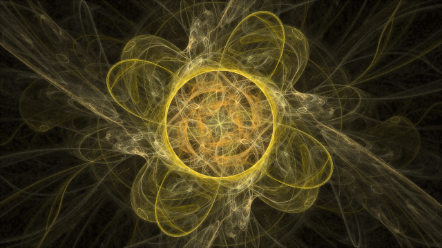
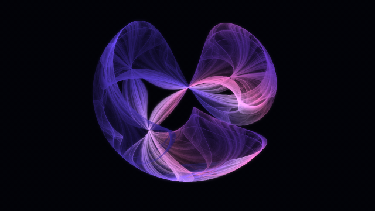
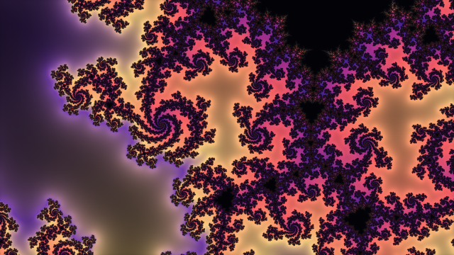
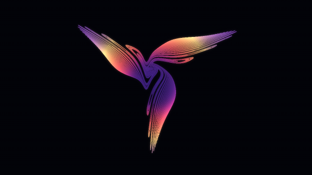
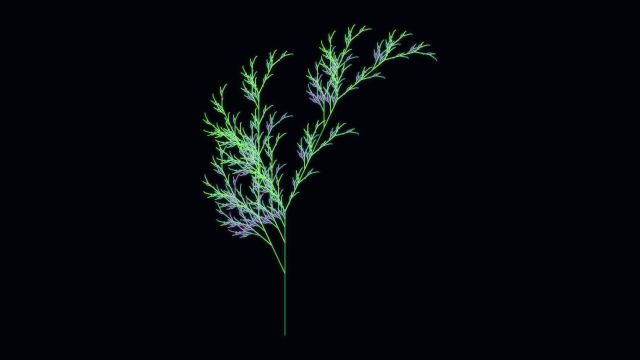
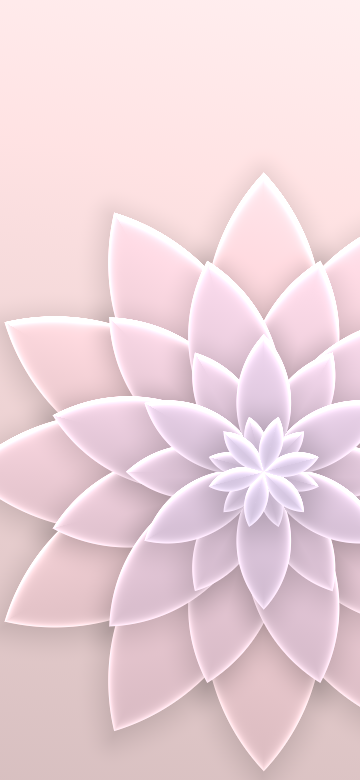
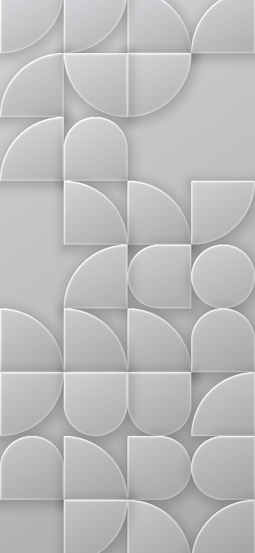

<div align="center">
  
  <h1>Fractique</h1>
  <p><strong>同じ入力からは、どのプラットフォームでも同じ画像を生成する、フラクタルの炎、古典的なフラクタル、壁紙のジェネレーター。</strong></p>
  <p><sub>
    <a href="../../README.md">English</a> · <a href="README_UK.md">Українська</a> · <a href="README_RU.md">Русский</a> · <a href="README_DE.md">Deutsch</a> · <a href="README_FR.md">Français</a> · <a href="README_ES.md">Español</a> · <a href="README_IT.md">Italiano</a> · <strong>日本語</strong><br>
    <a href="README_CN.md">简体中文</a> · <a href="README_PT.md">Português</a> · <a href="README_KO.md">한국어</a> · <a href="README_HI.md">हिन्दी</a> · <a href="README_TR.md">Türkçe</a> · <a href="README_PL.md">Polski</a> · <a href="README_ID.md">Bahasa Indonesia</a>
  </sub></p>
</div>

Fractique は 3 種類の画像を作ります。ひとつはフラクタルの炎。細い曲線と柔らかな光でできた、輝く霞のようなフラクタルです。ひとつは古典的なフラクタル。マンデルブロ集合、ジュリア集合、ストレンジアトラクターから三次元のマンデルバルブまで、22 種類あります。もうひとつは壁紙。縁が光り、柔らかな影を落とす平らなシートを重ねたもので、それぞれにライト版とダーク版があります。プリセットを選ぶ、ランダムな画像を生成する、複数の炎を重ねるなどして、スマートフォンの画面から 4K モニターまで、好きなサイズで書き出せます。シーンは小さなファイル 1 つで、同じファイルは Windows、macOS、Linux、Android、iOS のどれでも常にまったく同じピクセルになります。

<p align="center">
  
</p>

## できること

- **炎：** 49 種類のバリエーション、ブレンドモード付きレイヤー、回転対称と鏡像対称、密度推定、グロー、そして 29 種類の組み込みプリセット。
- **フラクタル：** 平面のフラクタル 19 種類。脱出時間型（マンデルブロ、ジュリア、バーニングシップ、トライコーン、マルチブロ、フェニックス、マグネット）、求根型（ニュートン、ノヴァ）、密度として描く軌道（ブッダブロ、クリフォード、デ・ヨング、ローレンツ、グモウスキー・ミラ、ホパロング）、幾何学的なもの（アポロニウスのギャスケット、クライン群、Lシステム、リアプノフ）。それぞれにプリセットがあり、シードごとに 1 枚の画像ができます。パレット、レイヤー、深いズームは炎と共通です。
- **立体：** マンデルバルブ、マンデルボックス、メンガーのスポンジを三次元で。光と影と霧があり、まわりを回ることも中に入ることもできます。
- **壁紙：** シードごとに 1 枚。14 種類のレイアウトと 6 種類の素材から作られ、それぞれにライト版とダーク版があり、画面のサイズに合わせて配置されます。
- **アプリ：** Windows、macOS、Linux、Android、iOS、Web を 1 つのコードベースで。画像がウィンドウいっぱいに広がり、その上にガラスのパネルが浮かびます。デスクトップでは独自のガラスのタイトルバーを備えます。「炎」、「フラクタル」、「図形」（壁紙）の 3 つのタブがあり、それぞれが自分の画像と最近の画像を保持します。15 言語に対応。
- **GPU アクセラレーション：** グラフィックカードがプロセッサーより明らかに速い環境では、炎、3 つのアトラクター、脱出時間型と求根型のフラクタル、壁紙をグラフィックカードが自分で描き、プロセッサーは空いたままになります。上位 3 段階の品質での書き出しは、常にプロセッサーが正確にレンダリングします。
- **「ランダム」と「変異」：** すべてのシードが 1 枚の画像になります。点や塗りつぶされた四角形になる炎は除外されます。「変異」は気に入った画像の変種を作ります。
- **レイヤー：** プリセットまたはランダムな炎を追加し、削除し、並べ替え、それぞれのブレンド（加算、スクリーン、重ねる）と不透明度を設定できます。最大 16 レイヤー。
- **画像サイズ：** ウィンドウそのもののサイズ、61 種類の画面（16K までのコンピューター、Android のスマートフォンとタブレット、iPhone、iPad、Mac、Apple Watch）のいずれか、または 16 から 16384 ピクセルの任意の幅と高さ。
- **ディープズーム：** ドラッグ、ホイール、ピンチで表示を動かし、画像として成り立つ範囲で拡大できます。炎は 10～300 倍、アトラクターは 10～100 倍、壁紙は 8 倍、そのほかのフラクタルは最大 100 億倍までです。画像はすぐに追従し、表示が止まると鮮明に描き直されます。
- **スマートフォン：** 専用の画面。丸いボタン 1 つで新しい画像を作り、スワイプで次の壁紙へ進み、小さなライブ画像が並ぶシートでスタイルを選び、キープした画像はコレクションになります。プロセッサーで描くのに時間がかかる種類のフラクタルは、そこには出ません。
- **書き出し：** 任意のサイズの PNG を、画面に表示されているまま即時に、または 3 段階のより高い品質でバックグラウンドでレンダリング。スマートフォンでは「写真」やギャラリーに保存するか、共有できます。 すべての機能はどのプラットフォームでも無料です。App Store 版（iPhone、iPad、Mac）でのみ、2560 × 1440 ピクセル以上またはカスタムサイズでの書き出しに、買い切りの Fractique Pro が必要です。
- **プロジェクトファイル：** `.frcq` ファイルはシーンをその表示、トーン、サイズとともに保存するので、保存したときのまま開けます（[docs/scene-format.md](../scene-format.md)）。通常の `.json` シーンや、flam3 と Apophysis の `.flame` ファイルも開けます。アプリは次に起動したとき、前回のセッションに戻ります。
- **アップデート：** リリースされた各バージョンとそのノートをウィンドウに一覧表示し、どのバージョンでもインストールできます。Windows 版は、自分自身を置き換えるポータブルな `.exe` 1 つです。
- **完全な再現性：** 同じシーンはどのマシンでも同じピクセルになります。Linux、Windows、macOS のテストで確認しています（[docs/determinism.md](../determinism.md)）。
- **コマンドラインツール**（`fractique`）：炎、フラクタル、壁紙を PNG にレンダリングし、ランダムなシーンや変種を作り、`.flame` と `.frcq` のファイルを変換します。
- **MCP サーバー**（`fractique-mcp`、または `fractique mcp`）：AI エージェントがシーンを作成、変更、レンダリング（[docs/mcp.md](../mcp.md)）。
- **HTTP サーバー**（`fractique-server`）：レンダリングのキューと上限を備えた HTTP API。`/docs` に対話型のリファレンス。`/mcp` で AI エージェント向けの MCP も提供。Web アプリも配信し、各リリースに単体のダウンロードがあり、イメージを作るための `Dockerfile` も付属（[docs/server.md](../server.md)）。

| | |
| --- | --- |
|  |  |
| エメラルドの星（2 レイヤー） | 熾火の渦 |
|  |  |
| 黄金の開花 | 太陽の曼荼羅 |

さらに 100 点の炎とフラクタル、壁紙、それぞれを任意のサイズで再現できる `.frcq` ファイル：[ギャラリー](../gallery.md)。

ほかの種類のフラクタル。マンデルブロ集合、ジュリア集合、クリフォードアトラクター：

| | | |
| --- | --- | --- |
|  |  |  |
| マンデルブロ: 渦巻き | ジュリア: 渦巻き | クリフォード: 翼 |

そのほかの脱出時間型と求根型のフラクタル。バーニングシップ、トライコーン、マルチブロ、フェニックス、マグネット、ニュートン、ノヴァ：

| | | | |
| --- | --- | --- | --- |
|  |  |  |  |
| バーニングシップ: 船 | トライコーン: 島 | マルチブロ: 渦巻き | フェニックス: 銀河 |
|  |  |  | |
| マグネット: 真珠 | ニュートン: 7 | ノヴァ: 星 | |

密度として描く軌道。ブッダブロと、デ・ヨング、ローレンツ、グモウスキー・ミラ、ホパロングの各アトラクター：

| | | |
| --- | --- | --- |
|  |  |  |
| ブッダブロ: 星雲 | デ・ヨング: クラシック | ローレンツ: 蝶 |
|  |  | |
| グモウスキー・ミラ: 羽根 | ホパロング: 蜘蛛の巣 | |

幾何学的なフラクタル。アポロニウスのギャスケット、クライン群の極限集合、Lシステム、リアプノフ・フラクタル：

| | | | |
| --- | --- | --- | --- |
|  |  |  |  |
| アポロニウスのギャスケット: 三重 | クライン群: カスプ | Lシステム: 植物 | リアプノフ: 羽根 |

三次元の立体。マンデルバルブ、マンデルボックス、メンガーのスポンジ：

| | | |
| --- | --- | --- |
|  |  |  |
| マンデルバルブ: 王冠 | マンデルボックス: ステーション | メンガーのスポンジ: クラシック |

ライトとダークの壁紙。それぞれのレイアウトと素材：

| | | | |
| --- | --- | --- | --- |
|  |  |  |  |
| 波, ガラス | 花, グロー | タイル, レリーフ | 扇, ガラス |
|  |  |  |  |
| 円盤, 紙 | バー, 紙 | 弧, カーボン | 線, 紙 |

## クイックスタート

コマンド 1 つでアプリとコマンドラインツールをビルドします。Rust がなければインストールします。

| システム | コマンド |
| --- | --- |
| Linux, macOS | `./setup.sh` |
| Windows | `setup.cmd` |

アプリを起動：

```sh
./target/release/fractique-gui
```

またはコマンドラインからレンダリング：

```sh
# プリセットを 4K 画像として
./target/release/fractique render --preset aurora-spiral --size 3840x2160 --quality high -o aurora.png

# シード 42 のランダムな炎をスマートフォン画面用に
./target/release/fractique render --random 42 --size 1080x2400 --quality mobile -o phone.png

# シード 7 のランダムなマンデルブロ集合の眺め
./target/release/fractique render --random 7 --fractal mandelbrot --size 1920x1080 -o mandelbrot.png

# シード 7 の壁紙をスマートフォン用に、ライトとダークで
./target/release/fractique render --wallpaper 7 --size 1290x2796 -o wallpaper.png
./target/release/fractique render --wallpaper 7 --dark --size 1290x2796 -o wallpaper-dark.png

# ランダムシーンをファイルに保存し、変更して、レンダリング
./target/release/fractique randomize 42 -o scene.json
./target/release/fractique render scene.json -o mine.png
```

Windows ではプログラムは `target\release\fractique-gui.exe` と `target\release\fractique.exe` にあります。アプリとコマンドでできることのすべて：[docs/usage.md](../usage.md)。

## 動作確認済みの環境

| デバイス | システム | プロセッサ | グラフィックス |
| --- | --- | --- | --- |
| PC | Windows 11 | AMD Ryzen 7 5700X | NVIDIA GeForce RTX 4070 |
| PC | Ubuntu 24.04 (WSL2) | AMD Ryzen 7 5700X | なし：プロセッサのみ |
| ノートPC, ASUS TUF Gaming FX505DT | Windows 11 | AMD Ryzen 5 3550H | NVIDIA GeForce GTX 1650 |
| ノートPC, HP 15-db1xxx | Debian 13 | AMD Ryzen 3 3200U | AMD Radeon Vega 3 |
| MacBook Pro | macOS | Apple M5 Pro | Apple M5 Pro |
| ZTE Blade A7 | Android 9 | MediaTek Helio P22 | PowerVR GE8320 |
| Asus Zenfone 10 | Android 15 | Qualcomm Snapdragon 8 Gen 2 | Adreno 740 |
| iPhone 13 Pro | iOS 27 | Apple A15 Bionic | Apple A15 |
| iPhone 11 | iOS 27 | Apple A13 Bionic | Apple A13 |

## ドキュメント

ドキュメントは英語です。

| | |
| --- | --- |
| [docs/usage.md](../usage.md) | アプリ、コマンド、品質レベル、シーンの編集方法 |
| [docs/scene-format.md](../scene-format.md) | シーンファイルの全フィールド、全バリエーション、シート、`.frcq` ファイル |
| [docs/mcp.md](../mcp.md) | MCP サーバー：AI エージェントの接続、ツール |
| [docs/server.md](../server.md) | HTTP サーバー：エンドポイント、上限、Docker |
| [docs/ios.md](../ios.md) | iPhone または iOS シミュレーターでのビルドと実行 |
| [docs/releasing.md](../releasing.md) | リリースの作り方、アプリが自分を更新する仕組み |
| [docs/architecture.md](../architecture.md) | 各部分のつながり、レンダリングの仕組み |
| [docs/determinism.md](../determinism.md) | レンダリングが正確に再現される理由、保証されることとされないこと |
| [docs/performance.md](../performance.md) | 計測したレンダリング時間とメモリ |
| [docs/roadmap.md](../roadmap.md) | 完了したことと今後の予定 |

## ライセンス

[PolyForm Noncommercial License 1.0.0](../../LICENSE.md)：非商用利用は無料です。商用利用については、作者に別途ライセンスをお問い合わせください。サードパーティのライセンスは [THIRD_PARTY_NOTICES.md](../../THIRD_PARTY_NOTICES.md) に記載しています。コントリビューション：[CONTRIBUTING.md](../../CONTRIBUTING.md) を参照。
