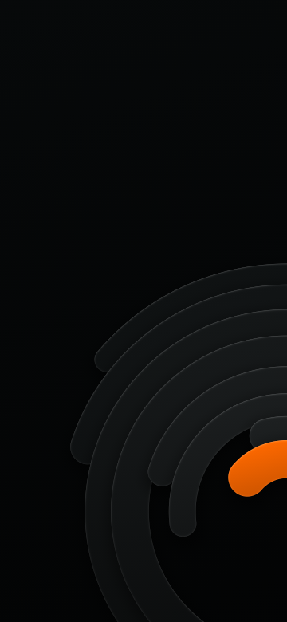

<div align="center">
  
  <h1>Fractique</h1>
  <p><strong>Generator fraktalnych płomieni i tapet, który z tych samych danych wejściowych daje ten sam obraz na każdej platformie.</strong></p>
  <p><sub>
    <a href="../../README.md">English</a> · <a href="README_UK.md">Українська</a> · <a href="README_RU.md">Русский</a> · <a href="README_DE.md">Deutsch</a> · <a href="README_FR.md">Français</a> · <a href="README_ES.md">Español</a> · <a href="README_IT.md">Italiano</a> · <a href="README_JA.md">日本語</a><br>
    <a href="README_CN.md">简体中文</a> · <a href="README_PT.md">Português</a> · <a href="README_KO.md">한국어</a> · <a href="README_HI.md">हिन्दी</a> · <a href="README_TR.md">Türkçe</a> · <strong>Polski</strong> · <a href="README_ID.md">Bahasa Indonesia</a>
  </sub></p>
</div>

Fractique tworzy obrazy dwóch rodzajów. Fraktalne płomienie: świetliste, zwiewne fraktale z cienkich krzywych i miękkiego światła. Oraz tapety: płaskie arkusze z podświetlonymi krawędziami i miękkimi cieniami, każda w wersji jasnej i ciemnej. Wybierasz preset, losujesz obraz albo nakładasz na siebie kilka płomieni i eksportujesz wynik w dowolnym rozmiarze, od ekranu telefonu po monitor 4K. Scena to jeden mały plik, a ten sam plik zawsze daje dokładnie te same piksele w systemach Windows, macOS, Linux, Android i iOS.

<p align="center">
  
</p>

## Co potrafi Fractique

- **Płomienie:** 49 wariacji, warstwy z trybami mieszania, symetria obrotowa i lustrzana, estymacja gęstości, poświata oraz 29 wbudowanych presetów.
- **Tapety:** osobna dla każdego ziarna, z 14 układów i 6 materiałów, każda w wersji jasnej i ciemnej, rozłożona pod rozmiar ekranu.
- **Aplikacja:** jedna baza kodu dla systemów Windows, macOS, Linux, Android, iOS i dla przeglądarki. Obraz wypełnia okno, a nad nim unoszą się szklane panele; na komputerze aplikacja ma własny szklany pasek tytułu. W 15 językach.
- **„Losuj” i „Mutuj”:** każde ziarno to obraz; płomienie, które byłyby kropką albo wypełnionym kwadratem, są pomijane. „Mutuj” tworzy wariant tego, który ci się podoba.
- **Warstwy:** dodaj płomień z presetów albo losowy, usuń go, zmień kolejność i ustaw dla każdej mieszanie („Suma”, „Ekran”, „Nad”) oraz krycie. Do 16 warstw.
- **Rozmiar obrazu:** rozmiar samego okna, jeden z 21 ekranów (komputery do 4K, telefony i tablety z Androidem, iPhone’y i iPady) albo dowolna szerokość i wysokość od 16 do 16384 pikseli.
- **Głęboki zoom:** przeciąganie, kółko myszy i szczypanie przesuwają widok i powiększają go do dziesięciu miliardów razy. Obraz podąża od razu, a gdy widok się zatrzyma, jest rysowany na nowo, ostro.
- **Telefony:** własny ekran. Jeden okrągły przycisk tworzy nowy obraz, przesunięcie palcem prowadzi do następnej tapety, arkusz z małymi żywymi obrazkami wybiera styl, a zachowane obrazy tworzą kolekcję.
- **Eksport:** PNG w dowolnym rozmiarze: natychmiast, taki jak na ekranie, albo renderowany w tle na trzech wyższych poziomach jakości. Na telefonie trafia do Zdjęć lub galerii albo jest udostępniany. Wszystkie funkcje są darmowe na każdej platformie; tylko wersja z App Store (iPhone, iPad, Mac) wymaga jednorazowego zakupu Fractique Pro, aby eksportować w rozmiarze 2560 × 1440 pikseli i większym albo we własnym rozmiarze.
- **Pliki projektu:** plik `.frcq` przechowuje scenę razem z widokiem, tonem i rozmiarem, więc otwiera się taka, jaka została zapisana ([docs/scene-format.md](../scene-format.md)). Otwierają się też zwykłe sceny `.json` i pliki `.flame` z flam3 i Apophysis. Między uruchomieniami aplikacja wraca do sesji, w której ją zostawiono.
- **Aktualizacje:** okno pokazuje każdą wydaną wersję z jej opisem i instaluje dowolną z nich. W systemie Windows aplikacja to jeden przenośny plik `.exe`, który sam siebie podmienia.
- **Dokładna powtarzalność:** ta sama scena daje te same piksele na każdej maszynie, co sprawdzają testy w systemach Linux, Windows i macOS ([docs/determinism.md](../determinism.md)).
- **Narzędzie wiersza poleceń** (`fractique`): renderuje płomienie i tapety do PNG, tworzy losowe sceny i warianty, konwertuje pliki `.flame`.
- **Serwer MCP** (`fractique mcp`): agent AI tworzy, zmienia i renderuje sceny ([docs/mcp.md](../mcp.md)).
- **Serwer HTTP** (`fractique-server`): API HTTP z kolejką renderowania i limitami, MCP dla agentów AI pod `/mcp`, udostępnia aplikację webową, dostępny jako obraz Dockera ([docs/server.md](../server.md)).

| | |
| --- | --- |
|  |  |
| `emerald-star` (dwie warstwy) | `ember-vortex` |
|  |  |
| `golden-bloom` | `solar-mandala` |

Tapety, jasne i ciemne, każda ze swoim układem i materiałem:

| | | | |
| --- | --- | --- | --- |
|  |  |  |  |
| `waves`, `glass` | `burst`, `glow` | `tiles`, `relief` | `fan`, `glass` |
|  |  |  |  |
| `discs`, `paper` | `bars`, `paper` | `arcs`, `carbon` | `lines`, `paper` |

## Szybki start

Jedno polecenie buduje aplikację i narzędzie wiersza poleceń. Jeśli brakuje Rusta, instaluje go.

| System | Polecenie |
| --- | --- |
| Linux, macOS | `./setup.sh` |
| Windows | `setup.cmd` |

Uruchom aplikację:

```sh
./target/release/fractique-gui
```

Albo renderuj z wiersza poleceń:

```sh
# preset jako obraz 4K
./target/release/fractique render --preset aurora-spiral --size 3840x2160 --quality high -o aurora.png

# losowy płomień z ziarna 42 na ekran telefonu
./target/release/fractique render --random 42 --size 1080x2400 --quality mobile -o phone.png

# tapeta z ziarna 7 na telefon, jasna i ciemna
./target/release/fractique render --wallpaper 7 --size 1290x2796 -o wallpaper.png
./target/release/fractique render --wallpaper 7 --dark --size 1290x2796 -o wallpaper-dark.png

# zachować losową scenę w pliku, zmienić ją, wyrenderować
./target/release/fractique randomize 42 -o scene.json
./target/release/fractique render scene.json -o mine.png
```

W systemie Windows programy to `target\release\fractique-gui.exe` i `target\release\fractique.exe`. Wszystko, co potrafią aplikacja i polecenia: [docs/usage.md](../usage.md).

## Dokumentacja

Dokumentacja jest po angielsku.

| | |
| --- | --- |
| [docs/usage.md](../usage.md) | Aplikacja, polecenia, poziomy jakości, jak edytować scenę |
| [docs/scene-format.md](../scene-format.md) | Każde pole pliku sceny, każda wariacja, arkusze, plik `.frcq` |
| [docs/mcp.md](../mcp.md) | Serwer MCP: podłączanie agenta AI, narzędzia |
| [docs/server.md](../server.md) | Serwer HTTP: punkty końcowe, limity, Docker |
| [docs/ios.md](../ios.md) | Budowanie i uruchamianie na iPhonie lub w symulatorze iOS |
| [docs/releasing.md](../releasing.md) | Jak powstaje wydanie i jak aplikacja sama się aktualizuje |
| [docs/architecture.md](../architecture.md) | Jak części do siebie pasują, jak działa renderowanie |
| [docs/determinism.md](../determinism.md) | Dlaczego renderowanie powtarza się dokładnie, co jest obiecane, a co nie |
| [docs/performance.md](../performance.md) | Zmierzone czasy renderowania i zużycie pamięci |
| [docs/roadmap.md](../roadmap.md) | Co jest zrobione i co dalej |

## Licencja

[PolyForm Noncommercial License 1.0.0](../../LICENSE.md): bezpłatna do każdego użytku niekomercyjnego. W sprawie użytku komercyjnego poproś autora o osobną licencję. Licencje stron trzecich są wymienione w [THIRD_PARTY_NOTICES.md](../../THIRD_PARTY_NOTICES.md). Wkład w projekt: zobacz [CONTRIBUTING.md](../../CONTRIBUTING.md).
