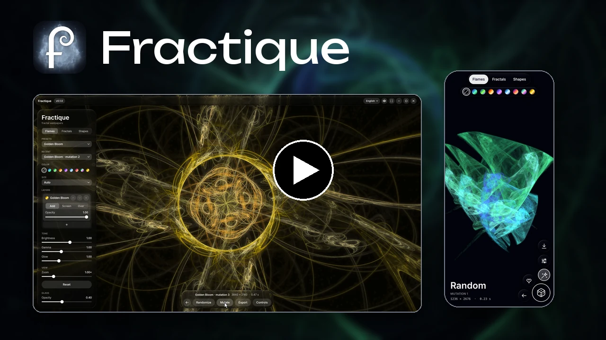
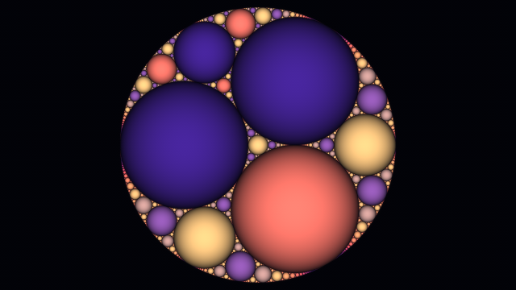
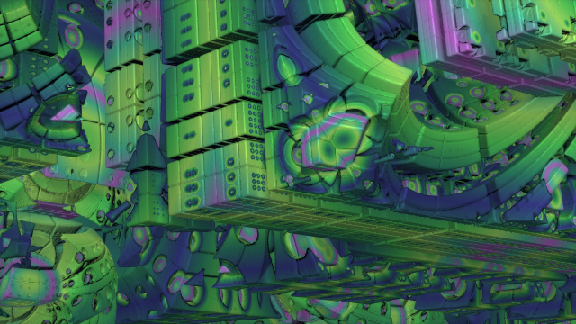

<div align="center">
  
  <h1>Fractique</h1>
  <p><strong>Um gerador de chamas fractais, fractais clássicos e papéis de parede que produz a mesma imagem a partir da mesma entrada, em qualquer plataforma.</strong></p>
  <p><sub>
    <a href="../../README.md">English</a> · <a href="README_UK.md">Українська</a> · <a href="README_RU.md">Русский</a> · <a href="README_DE.md">Deutsch</a> · <a href="README_FR.md">Français</a> · <a href="README_ES.md">Español</a> · <a href="README_IT.md">Italiano</a> · <a href="README_JA.md">日本語</a><br>
    <a href="README_CN.md">简体中文</a> · <strong>Português</strong> · <a href="README_KO.md">한국어</a> · <a href="README_HI.md">हिन्दी</a> · <a href="README_TR.md">Türkçe</a> · <a href="README_PL.md">Polski</a> · <a href="README_ID.md">Bahasa Indonesia</a>
  </sub></p>
</div>

<p align="center">
  <a href="https://apps.apple.com/app/fractique/id6836122841"></a><br>
  <sub>iPhone e iPad. Windows, macOS, Linux e Android: grátis, na <a href="https://github.com/tarpetos/fractique/releases/latest">versão mais recente</a>.</sub>
</p>

<p align="center">
  <a href="https://www.youtube.com/watch?v=z7EAQGUys8U"></a>
</p>

O Fractique cria três tipos de imagem. Chamas fractais: fractais luminosos e etéreos feitos de curvas finas e luz suave. Fractais clássicos de 22 tipos: do conjunto de Mandelbrot, dos conjuntos de Julia e dos atratores estranhos ao Mandelbulb em três dimensões. E papéis de parede: folhas planas com bordas iluminadas e sombras suaves, cada um em versão clara e escura. Você escolhe uma predefinição, gera uma imagem aleatória ou sobrepõe várias chamas e exporta o resultado em qualquer tamanho, da tela de um celular a um monitor 4K. Uma cena é um único arquivo pequeno, e o mesmo arquivo sempre gera exatamente os mesmos pixels, no Windows, macOS, Linux, Android e iOS.

<p align="center">
  
</p>

## O que o Fractique faz

- **Chamas:** 49 variações, camadas com modos de mesclagem, simetria rotacional e espelhada, estimativa de densidade, luminescência e 29 predefinições embutidas.
- **Fractais:** 19 tipos no plano: de tempo de escape (Mandelbrot, Julia, Burning Ship, Tricorn, Multibrot, Fênix, Magnet), de busca de raízes (Newton, Nova), órbitas desenhadas como densidades (Buddhabrot, Clifford, De Jong, Lorenz, Gumowski-Mira, Hopalong) e geométricos (Gaxeta de Apolônio, Grupo kleiniano, Sistema L, Lyapunov), cada um com predefinições e uma imagem para cada semente; compartilham as paletas, as camadas e o zoom profundo das chamas.
- **Sólidos:** o Mandelbulb, a Mandelbox e a esponja de Menger em três dimensões, com luz, sombras e névoa; gire ao redor deles ou entre neles.
- **Papéis de parede:** um para cada semente, a partir de 14 layouts e 6 materiais, cada um em versão clara e escura, disposto para o tamanho da tela.
- **O aplicativo:** uma única base de código para Windows, macOS, Linux, Android, iOS e a web. A imagem preenche a janela e painéis de vidro flutuam sobre ela; no desktop o aplicativo tem sua própria barra de título de vidro. Três abas, “Chamas”, “Fractais” e “Formas” (os papéis de parede), mantêm cada uma a sua imagem e as suas imagens recentes. Em 15 idiomas.
- **Aceleração por GPU:** onde a placa de vídeo é claramente mais rápida que o processador, ela mesma desenha as chamas, três atratores, os fractais de tempo de escape e de busca de raízes e os papéis de parede, e o processador fica livre. As exportações nos três níveis de qualidade mais altos são sempre renderizadas pelo processador, com exatidão.
- **“Aleatório” e “Mutar”:** cada semente é uma imagem; chamas que seriam um ponto ou um quadrado preenchido são descartadas. “Mutar” cria uma variante daquela de que você gostou.
- **Camadas:** adicione uma chama das predefinições ou uma aleatória, remova, reordene e defina a mesclagem (“Soma”, “Tela”, “Sobre”) e a opacidade de cada uma. Até 16 camadas. Cada camada tem as suas próprias cores.
- **Tamanho da imagem:** o da própria janela, uma de 61 telas (computadores até 16K, celulares e tablets Android, iPhones, iPads, Macs e Apple Watch) ou qualquer largura e altura de 16 a 16384 pixels.
- **Zoom profundo:** arrastar, a roda do mouse e a pinça movem a vista e a ampliam enquanto ela continua sendo uma imagem: uma chama de 10 a 300 vezes, um atrator de 10 a 100 vezes, um papel de parede 8 vezes e os demais fractais até dez bilhões de vezes. A imagem acompanha na hora e é redesenhada nítida quando a vista para.
- **Celulares:** uma tela própria. Um botão redondo cria uma nova imagem, um deslize passa para o próximo papel de parede, uma folha de pequenas imagens ao vivo escolhe o estilo, e as imagens que você guarda formam uma coleção. Os tipos de fractal que o processador demora a desenhar não aparecem ali.
- **Exportação:** um PNG de qualquer tamanho: na hora, como está na tela, ou renderizado em segundo plano em três níveis de qualidade superiores. No celular ele é salvo em Fotos ou na galeria, ou compartilhado. Todos os recursos são gratuitos em todas as plataformas; só a versão da App Store (iPhone, iPad, Mac) exporta três imagens por dia de graça e pede uma compra única, o Fractique Pro, para mais ou para um tamanho personalizado.
- **Arquivos de projeto:** um arquivo `.frcq` guarda a cena com sua vista, tom e tamanho, então ela abre como foi salva ([docs/scene-format.md](../scene-format.md)). Cenas `.json` simples e arquivos `.flame` do flam3 e do Apophysis também abrem. Entre uma execução e outra, o aplicativo volta à sessão em que foi deixado.
- **Atualizações:** uma janela lista cada versão lançada com suas notas e instala qualquer uma delas. No Windows o aplicativo é um único `.exe` portátil que substitui a si mesmo.
- **Repetibilidade exata:** a mesma cena gera os mesmos pixels em qualquer máquina, o que é verificado por testes no Linux, Windows e macOS ([docs/determinism.md](../determinism.md)).
- **A ferramenta de linha de comando** (`fractique`): renderiza chamas, fractais e papéis de parede em PNG, cria cenas aleatórias e variantes, converte arquivos `.flame` e `.frcq`.
- **Servidor MCP** (`fractique-mcp`, ou `fractique mcp`): um agente de IA cria, altera e renderiza cenas ([docs/mcp.md](../mcp.md)).
- **Servidor HTTP** (`fractique-server`): uma API HTTP com fila de renderização e limites, a referência interativa dela em `/docs`, MCP para agentes de IA em `/mcp`, serve o aplicativo web, um download próprio em cada versão e um `Dockerfile` para criar uma imagem ([docs/server.md](../server.md)).

| | |
| --- | --- |
|  |  |
| Estrela esmeralda (duas camadas) | Vórtice de brasa |
|  |  |
| Floração dourada | Mandala solar |

Mais cem chamas, além de fractais e papéis de parede, cada imagem com o arquivo `.frcq` que a reproduz em qualquer tamanho: [a galeria](../gallery/README.md).

Fractais de outros tipos: o conjunto de Mandelbrot, um conjunto de Julia e o atrator de Clifford:

| | | |
| --- | --- | --- |
|  |  |  |
| Mandelbrot: Espiral | Julia: Espirais | Clifford: Asas |

Mais fractais de tempo de escape e os de busca de raízes: Burning Ship, Tricorn, Multibrot, Fênix, Magnet, Newton, Nova:

| | | | |
| --- | --- | --- | --- |
|  |  |  |  |
| Burning Ship: Navio | Tricorn: Ilha | Multibrot: Espirais | Fênix: Galáxia |
|  |  |  | |
| Magnet: Pérolas | Newton: Sete | Nova: Estrela | |

Órbitas desenhadas como densidades: o Buddhabrot e os atratores de De Jong, Lorenz, Gumowski-Mira e Hopalong:

| | | |
| --- | --- | --- |
|  |  |  |
| Buddhabrot: Nebulosa | De Jong: Clássico | Lorenz: Borboleta |
|  |  | |
| Gumowski-Mira: Penas | Hopalong: Teia | |

Fractais geométricos: uma gaxeta de Apolônio, o conjunto limite de um grupo kleiniano, um sistema L e um fractal de Lyapunov:

| | | | |
| --- | --- | --- | --- |
|  |  |  |  |
| Gaxeta de Apolônio: Triplo | Grupo kleiniano: Cúspide | Sistema L: Planta | Lyapunov: Penas |

Sólidos em três dimensões: o Mandelbulb, a Mandelbox e a esponja de Menger:

| | | |
| --- | --- | --- |
|  |  |  |
| Mandelbulb: Coroa | Mandelbox: Estação | Esponja de Menger: Clássico |

Papéis de parede, claros e escuros, cada um com seu layout e material:

| | | | |
| --- | --- | --- | --- |
|  |  |  |  |
| Ondas, Vidro | Flor, Brilho | Ladrilhos, Relevo | Leque, Vidro |
|  |  |  |  |
| Discos, Papel | Barras, Papel | Arcos, Carbono | Linhas, Papel |

## Início rápido

Um único comando compila o aplicativo e a ferramenta de linha de comando. Ele instala o Rust se estiver faltando.

| Sistema | Comando |
| --- | --- |
| Linux, macOS | `./setup.sh` |
| Windows | `setup.cmd` |

Inicie o aplicativo:

```sh
./target/release/fractique-gui
```

Ou renderize pela linha de comando:

```sh
# uma predefinição como imagem 4K
./target/release/fractique render --preset aurora-spiral --size 3840x2160 --quality high -o aurora.png

# a chama aleatória da semente 42, para a tela de um celular
./target/release/fractique render --random 42 --size 1080x2400 --quality mobile -o phone.png

# a vista aleatória do conjunto de Mandelbrot da semente 7
./target/release/fractique render --random 7 --fractal mandelbrot --size 1920x1080 -o mandelbrot.png

# o papel de parede da semente 7 para um celular, claro e escuro
./target/release/fractique render --wallpaper 7 --size 1290x2796 -o wallpaper.png
./target/release/fractique render --wallpaper 7 --dark --size 1290x2796 -o wallpaper-dark.png

# guardar uma cena aleatória em um arquivo, alterá-la, renderizá-la
./target/release/fractique randomize 42 -o scene.json
./target/release/fractique render scene.json -o mine.png
```

No Windows os programas são `target\release\fractique-gui.exe` e `target\release\fractique.exe`. Tudo o que o aplicativo e os comandos fazem: [docs/usage.md](../usage.md).

## Testado em

| Dispositivo | Sistema | Processador | Gráficos |
| --- | --- | --- | --- |
| PC | Windows 11 | AMD Ryzen 7 5700X | NVIDIA GeForce RTX 4070 |
| PC | Ubuntu 24.04 (WSL2) | AMD Ryzen 7 5700X | Nenhuma: apenas o processador |
| PC | Ubuntu 26.04 | AMD Ryzen 7 5700X | NVIDIA GeForce RTX 4070 |
| PC | Arch Linux (Linux 7.3.4) | AMD Ryzen 7 9800X3D | AMD Radeon RX 9070 XT |
| Portátil, ASUS TUF Gaming FX505DT | Windows 11 | AMD Ryzen 5 3550H | NVIDIA GeForce GTX 1650 |
| Portátil, HP 15-db1xxx | Debian 13 | AMD Ryzen 3 3200U | AMD Radeon Vega 3 |
| MacBook Pro | macOS 27 | Apple M5 Pro | Apple M5 Pro |
| ZTE Blade A7 | Android 9 | MediaTek Helio P22 | PowerVR GE8320 |
| Asus Zenfone 10 | Android 15 | Qualcomm Snapdragon 8 Gen 2 | Adreno 740 |
| iPhone 13 Pro | iOS 27 | Apple A15 Bionic | Apple A15 |
| iPhone 18 Pro Max | iOS 27 | Apple A20 Pro | Apple A20 Pro |

## Documentação

A documentação está em inglês.

| | |
| --- | --- |
| [docs/usage.md](../usage.md) | O aplicativo, os comandos, os níveis de qualidade, como editar uma cena |
| [docs/scene-format.md](../scene-format.md) | Cada campo de um arquivo de cena, cada variação, as folhas, o arquivo `.frcq` |
| [docs/mcp.md](../mcp.md) | O servidor MCP: como conectar um agente de IA, as ferramentas |
| [docs/server.md](../server.md) | O servidor HTTP: endpoints, limites, Docker |
| [docs/ios.md](../ios.md) | Compilar e executar em um iPhone ou no simulador do iOS |
| [docs/releasing.md](../releasing.md) | Como uma versão é lançada e como o aplicativo se atualiza |
| [docs/architecture.md](../architecture.md) | Como as partes se encaixam, como funciona uma renderização |
| [docs/determinism.md](../determinism.md) | Por que uma renderização se repete exatamente, o que é prometido e o que não é |
| [docs/performance.md](../performance.md) | Tempos de renderização e memória medidos |
| [docs/roadmap.md](../roadmap.md) | O que está pronto e o que vem a seguir |

## Licença

[PolyForm Noncommercial License 1.0.0](../../LICENSE.md): gratuita para qualquer uso não comercial. Para uso comercial, peça ao autor uma licença separada. As licenças de terceiros estão listadas em [THIRD_PARTY_NOTICES.md](../../THIRD_PARTY_NOTICES.md). Contribuições: veja [CONTRIBUTING.md](../../CONTRIBUTING.md).
