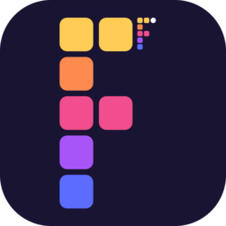

<div align="center">
  
  <h1>Fractique</h1>
  <p><strong>Um gerador de chamas fractais que produz a mesma imagem a partir da mesma entrada, em qualquer plataforma.</strong></p>
  <p><sub>
    <a href="../../README.md">English</a> · <a href="README_UK.md">Українська</a> · <a href="README_RU.md">Русский</a> · <a href="README_DE.md">Deutsch</a> · <a href="README_FR.md">Français</a> · <a href="README_ES.md">Español</a> · <a href="README_IT.md">Italiano</a> · <a href="README_JA.md">日本語</a><br>
    <a href="README_CN.md">简体中文</a> · <strong>Português</strong> · <a href="README_KO.md">한국어</a> · <a href="README_HI.md">हिन्दी</a> · <a href="README_TR.md">Türkçe</a> · <a href="README_PL.md">Polski</a> · <a href="README_ID.md">Bahasa Indonesia</a>
  </sub></p>
</div>

O Fractique desenha chamas fractais: fractais luminosos e etéreos feitos de curvas finas e luz suave. Você escolhe uma predefinição, gera uma cena aleatória ou sobrepõe várias chamas, e renderiza em qualquer resolução, da tela de um celular a um papel de parede 4K. Uma cena é um pequeno arquivo JSON, e o mesmo arquivo sempre produz exatamente os mesmos pixels no Windows, macOS, Linux, Android e iOS.

<p align="center">
  
</p>

## O que funciona hoje

- **O renderizador** (`fractique-core`): chamas fractais com 28 variações, camadas com modos de mesclagem, simetria rotacional e espelhada, estimativa de densidade, brilho, qualquer resolução.
- **O aplicativo:** um único código para Windows, Linux, Android, iOS e web, com painéis de vidro sobre a chama, em 15 idiomas.
- **Predefinições:** 9 cenas integradas.
- **Gerador aleatório:** cada semente é uma cena; cenas que seriam um ponto ou um quadrado preenchido são descartadas.
- **Mutação:** uma variante de uma cena de que você gosta, com intensidade de 0 a 1.
- **Repetibilidade exata:** a mesma cena gera os mesmos pixels em qualquer máquina, o que é verificado por testes no Linux, Windows e macOS ([docs/determinism.md](../determinism.md)).
- **Importação:** arquivos `.flame` do flam3 e do Apophysis são convertidos em cenas.
- **A ferramenta de linha de comando** (`fractique`): renderiza cenas em PNG.
- **Servidor MCP** (`fractique mcp`): um agente de IA cria, altera e renderiza cenas ([docs/mcp.md](../mcp.md)).

| | |
| --- | --- |
|  |  |
| `emerald-star` (duas camadas) | `ember-vortex` |

## Instalação

Um único comando compila tudo. Ele instala o Rust se estiver faltando.

| Sistema | Comando |
| --- | --- |
| Linux, macOS | `./setup.sh` |
| Windows | `setup.cmd` |

Depois:

```sh
# uma predefinição como papel de parede 4K
./target/release/fractique render --preset aurora-spiral --size 3840x2160 --quality high -o aurora.png

# a cena aleatória da semente 42, para a tela de um celular
./target/release/fractique render --random 42 --size 1080x2400 --quality mobile -o phone.png

# guardar uma cena aleatória em um arquivo, alterá-la, renderizá-la
./target/release/fractique randomize 42 -o scene.json
./target/release/fractique render scene.json -o mine.png
```

No Windows a ferramenta fica em `target\release\fractique.exe`. Todos os comandos e opções: [docs/usage.md](../usage.md).

## Documentação

A documentação está em inglês.

| | |
| --- | --- |
| [docs/usage.md](../usage.md) | Os comandos, os níveis de qualidade, como editar uma cena |
| [docs/scene-format.md](../scene-format.md) | Cada campo de um arquivo de cena, cada variação |
| [docs/mcp.md](../mcp.md) | O servidor MCP: conectar um agente de IA, as ferramentas |
| [docs/ios.md](../ios.md) | Compilar e executar em um iPhone ou no simulador do iOS |
| [docs/architecture.md](../architecture.md) | Como as partes se encaixam, como funciona uma renderização |
| [docs/determinism.md](../determinism.md) | Por que uma renderização se repete exatamente, o que é garantido e o que não é |
| [docs/performance.md](../performance.md) | Tempos de renderização e memória medidos |
| [docs/roadmap.md](../roadmap.md) | O que está pronto e o que vem a seguir |

## Licença

[PolyForm Noncommercial License 1.0.0](../../LICENSE.md): gratuito para qualquer uso não comercial. Para uso comercial, peça ao autor uma licença separada. As licenças de terceiros estão listadas em [THIRD_PARTY_NOTICES.md](../../THIRD_PARTY_NOTICES.md). Contribuições: veja [CONTRIBUTING.md](../../CONTRIBUTING.md).
