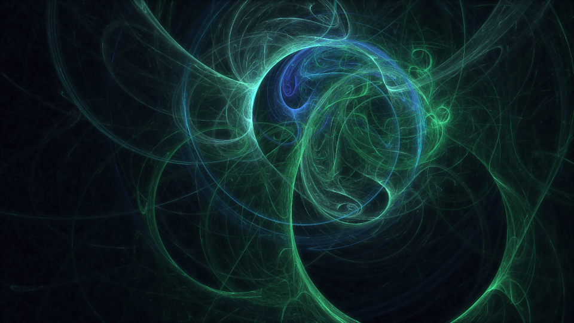

<div align="center">
  
  <h1>Fractique</h1>
  <p><strong>Генератор фрактального пламени и обоев, который из одинаковых входных данных даёт одинаковое изображение на любой платформе.</strong></p>
  <p><sub>
    <a href="../../README.md">English</a> · <a href="README_UK.md">Українська</a> · <strong>Русский</strong> · <a href="README_DE.md">Deutsch</a> · <a href="README_FR.md">Français</a> · <a href="README_ES.md">Español</a> · <a href="README_IT.md">Italiano</a> · <a href="README_JA.md">日本語</a><br>
    <a href="README_CN.md">简体中文</a> · <a href="README_PT.md">Português</a> · <a href="README_KO.md">한국어</a> · <a href="README_HI.md">हिन्दी</a> · <a href="README_TR.md">Türkçe</a> · <a href="README_PL.md">Polski</a> · <a href="README_ID.md">Bahasa Indonesia</a>
  </sub></p>
</div>

Fractique создаёт изображения двух видов. Фрактальное пламя: светящиеся, лёгкие фракталы из тонких кривых и мягкого света. И обои: плоские листы с подсвеченными краями и мягкими тенями, каждые в светлом и тёмном варианте. Вы выбираете пресет, генерируете случайное изображение или накладываете несколько слоёв пламени друг на друга и экспортируете результат в любом размере, от экрана телефона до монитора 4K. Сцена — это один небольшой файл, и один и тот же файл всегда даёт в точности те же пиксели на Windows, macOS, Linux, Android и iOS.

<p align="center">
  
</p>

## Что умеет Fractique

- **Пламя:** 49 вариаций, слои с режимами смешивания, поворотная и зеркальная симметрия, оценка плотности, свечение и 29 встроенных пресетов.
- **Обои:** свои для каждого зерна, из 14 композиций и 6 материалов, каждые в светлом и тёмном варианте, разложенные под размер экрана.
- **Приложение:** одна кодовая база для Windows, macOS, Linux, Android, iOS и веба. Изображение заполняет окно, а поверх него парят стеклянные панели; на компьютере у приложения собственная стеклянная строка заголовка. 15 языков.
- **«Случайно» и «Мутировать»:** каждое зерно — это изображение; пламя, которое было бы точкой или сплошным квадратом, пропускается. «Мутировать» делает вариант того, что вам понравилось.
- **Слои:** добавьте пламя из пресетов или случайное, удалите, поменяйте порядок, задайте для каждого смешивание («Сумма», «Экран», «Поверх») и непрозрачность. До 16 слоёв.
- **Размер изображения:** размер самого окна, один из 59 экрана (компьютеры до 4K, телефоны и планшеты Android, iPhone и iPad) или любые ширина и высота от 16 до 16384 пикселей.
- **Глубокое масштабирование:** перетаскивание, колёсико и щипок двигают вид и увеличивают его до десяти миллиардов раз. Изображение сразу следует за движением, а когда вид останавливается, перерисовывается чётко.
- **Телефоны:** собственный экран. Одна круглая кнопка создаёт новое изображение, свайп ведёт к следующим обоям, лист с маленькими живыми картинками выбирает стиль, а изображения, которые вы оставили, складываются в коллекцию.
- **Экспорт:** PNG любого размера: мгновенно, таким, как на экране, или рендер в фоне с тремя более высокими уровнями качества. На телефоне файл сохраняется в «Фото» или в галерею либо отправляется через «Поделиться». Все возможности бесплатны на всех платформах; только в версии из App Store (iPhone, iPad, Mac) для экспорта от 2560 × 1440 пикселей или в своём размере нужна разовая покупка Fractique Pro.
- **Файлы проекта:** файл `.frcq` хранит сцену вместе с видом, тоном и размером, поэтому она открывается такой, какой была сохранена ([docs/scene-format.md](../scene-format.md)). Открываются также обычные сцены `.json` и файлы `.flame` из flam3 и Apophysis. Между запусками приложение возвращается к сеансу, на котором его закрыли.
- **Обновления:** окно показывает все выпущенные версии с заметками и устанавливает любую из них. В Windows приложение — это один портативный `.exe`, который сам себя заменяет.
- **Точная повторяемость:** одна и та же сцена даёт те же пиксели на любой машине; это проверяют тесты на Linux, Windows и macOS ([docs/determinism.md](../determinism.md)).
- **Инструмент командной строки** (`fractique`): рендерит пламя и обои в PNG, создаёт случайные сцены и варианты, конвертирует файлы `.flame`.
- **Сервер MCP** (`fractique mcp`): ИИ-агент создаёт, изменяет и рендерит сцены ([docs/mcp.md](../mcp.md)).
- **HTTP-сервер** (`fractique-server`): HTTP API с очередью рендеров и лимитами, MCP для ИИ-агентов на `/mcp`, раздаёт веб-приложение, поставляется как образ Docker ([docs/server.md](../server.md)).

| | |
| --- | --- |
|  |  |
| `emerald-star` (два слоя) | `ember-vortex` |
|  |  |
| `golden-bloom` | `solar-mandala` |

Обои, светлые и тёмные, каждые со своей композицией и материалом:

| | | | |
| --- | --- | --- | --- |
|  |  |  |  |
| `waves`, `glass` | `burst`, `glow` | `tiles`, `relief` | `fan`, `glass` |
|  |  |  |  |
| `discs`, `paper` | `bars`, `paper` | `arcs`, `carbon` | `lines`, `paper` |

## Быстрый старт

Одна команда собирает приложение и инструмент командной строки. Если Rust не установлен, она его установит.

| Система | Команда |
| --- | --- |
| Linux, macOS | `./setup.sh` |
| Windows | `setup.cmd` |

Запустите приложение:

```sh
./target/release/fractique-gui
```

Или рендерьте из командной строки:

```sh
# пресет как изображение 4K
./target/release/fractique render --preset aurora-spiral --size 3840x2160 --quality high -o aurora.png

# случайное пламя с зерном 42 для экрана телефона
./target/release/fractique render --random 42 --size 1080x2400 --quality mobile -o phone.png

# обои с зерном 7 для телефона, светлые и тёмные
./target/release/fractique render --wallpaper 7 --size 1290x2796 -o wallpaper.png
./target/release/fractique render --wallpaper 7 --dark --size 1290x2796 -o wallpaper-dark.png

# сохранить случайную сцену в файл, изменить её, отрендерить
./target/release/fractique randomize 42 -o scene.json
./target/release/fractique render scene.json -o mine.png
```

В Windows программы лежат в `target\release\fractique-gui.exe` и `target\release\fractique.exe`. Всё, что умеют приложение и команды: [docs/usage.md](../usage.md).

## Документация

Документация написана на английском.

| | |
| --- | --- |
| [docs/usage.md](../usage.md) | Приложение, команды, уровни качества, как редактировать сцену |
| [docs/scene-format.md](../scene-format.md) | Каждое поле файла сцены, каждая вариация, листы, файл `.frcq` |
| [docs/mcp.md](../mcp.md) | Сервер MCP: подключение ИИ-агента, инструменты |
| [docs/server.md](../server.md) | HTTP-сервер: эндпоинты, лимиты, Docker |
| [docs/ios.md](../ios.md) | Сборка и запуск на iPhone или в симуляторе iOS |
| [docs/releasing.md](../releasing.md) | Как делается выпуск и как приложение обновляет себя |
| [docs/architecture.md](../architecture.md) | Как части связаны между собой, как работает рендер |
| [docs/determinism.md](../determinism.md) | Почему рендер повторяется точно, что гарантировано, а что нет |
| [docs/performance.md](../performance.md) | Измеренное время рендера и объём памяти |
| [docs/roadmap.md](../roadmap.md) | Что сделано и что дальше |

## Лицензия

[PolyForm Noncommercial License 1.0.0](../../LICENSE.md): бесплатно для любого некоммерческого использования. Для коммерческого использования обратитесь к автору за отдельной лицензией. Лицензии сторонних компонентов перечислены в [THIRD_PARTY_NOTICES.md](../../THIRD_PARTY_NOTICES.md). Вклад в проект: см. [CONTRIBUTING.md](../../CONTRIBUTING.md).
