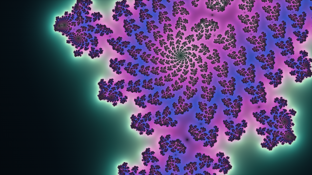
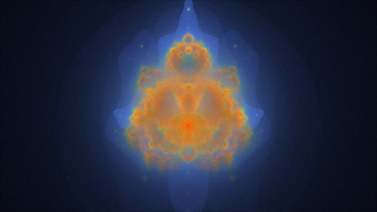
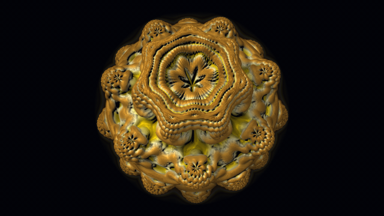

<div align="center">
  
  <h1>Fractique</h1>
  <p><strong>Aynı girdiden her platformda aynı görüntüyü üreten bir fraktal alev, klasik fraktal ve duvar kâğıdı üreteci.</strong></p>
  <p><sub>
    <a href="../../README.md">English</a> · <a href="README_UK.md">Українська</a> · <a href="README_RU.md">Русский</a> · <a href="README_DE.md">Deutsch</a> · <a href="README_FR.md">Français</a> · <a href="README_ES.md">Español</a> · <a href="README_IT.md">Italiano</a> · <a href="README_JA.md">日本語</a><br>
    <a href="README_CN.md">简体中文</a> · <a href="README_PT.md">Português</a> · <a href="README_KO.md">한국어</a> · <a href="README_HI.md">हिन्दी</a> · <strong>Türkçe</strong> · <a href="README_PL.md">Polski</a> · <a href="README_ID.md">Bahasa Indonesia</a>
  </sub></p>
</div>

Fractique üç tür görüntü üretir. Fraktal alevler: ince eğrilerden ve yumuşak ışıktan oluşan, parlayan, tül gibi fraktallar. 22 türde klasik fraktal: Mandelbrot kümesi, Julia kümeleri ve garip çekicilerden üç boyutlu Mandelbulb’a kadar. Ve duvar kâğıtları: kenarları aydınlatılmış, yumuşak gölgeli düz levhalar; her birinin açık ve koyu sürümü vardır. Bir hazır ayar seçer, rastgele bir görüntü üretir ya da birkaç alevi üst üste bindirirsiniz ve sonucu telefon ekranından 4K monitöre kadar istediğiniz boyutta dışa aktarırsınız. Bir sahne tek bir küçük dosyadır ve aynı dosya Windows, macOS, Linux, Android ve iOS’ta her zaman tam olarak aynı pikselleri verir.

<p align="center">
  
</p>

## Fractique neler yapar

- **Alevler:** 49 varyasyon, karıştırma modlu katmanlar, dönme ve ayna simetrisi, yoğunluk kestirimi, ışıltı ve 29 yerleşik hazır ayar.
- **Fraktallar:** düzlemde 19 tür: kaçış zamanı (Mandelbrot, Julia, Burning Ship, Tricorn, Multibrot, Anka, Magnet), kök bulma (Newton, Nova), yoğunluk olarak çizilen yörüngeler (Buddhabrot, Clifford, De Jong, Lorenz, Gumowski-Mira, Hopalong) ve geometrik (Apollonius contası, Klein grubu, L-sistemi, Lyapunov); her birinin hazır ayarları ve her tohum için bir görüntüsü vardır. Paletleri, katmanları ve derin yakınlaştırmayı alevlerle paylaşırlar.
- **Katı cisimler:** üç boyutta Mandelbulb, Mandelbox ve Menger süngeri; ışık, gölge ve sisle. Çevrelerinde dönebilir ya da içlerine girebilirsiniz.
- **Duvar kâğıtları:** her tohum için bir tane; 14 düzen ve 6 malzemeden, her biri açık ve koyu sürümüyle, ekranın boyutuna göre yerleştirilir.
- **Uygulama:** Windows, macOS, Linux, Android, iOS ve web için tek kod tabanı. Görüntü pencereyi doldurur, üzerinde cam paneller süzülür; masaüstünde uygulamanın kendi cam başlık çubuğu vardır. Üç sekme, “Alevler”, “Fraktallar” ve “Şekiller” (duvar kâğıtları), her biri kendi görüntüsünü ve son görüntülerini saklar. 15 dilde.
- **GPU hızlandırma:** ekran kartının işlemciden belirgin biçimde hızlı olduğu yerde alevleri, üç çekiciyi, kaçış zamanı ile kök bulma fraktallarını ve duvar kâğıtlarını ekran kartı kendisi çizer, işlemci boşta kalır. Üç yüksek kalite düzeyindeki dışa aktarımları her zaman işlemci, tam olarak işler.
- **“Rastgele” ve “Mutasyon”:** her tohum bir görüntüdür; bir nokta ya da dolu bir kare olacak alevler atlanır. “Mutasyon”, beğendiğinizin bir varyantını üretir.
- **Katmanlar:** hazır ayarlardan ya da rastgele bir alev ekleyin, kaldırın, sırasını değiştirin ve her birinin karıştırmasını (“Ekle”, “Ekran”, “Üstüne”) ve opaklığını ayarlayın. En çok 16 katman.
- **Görüntü boyutu:** pencerenin kendi boyutu, 61 ekrandan biri (16K’ya kadar bilgisayarlar, Android telefon ve tabletler, iPhone, iPad, Mac ve Apple Watch’lar) ya da 16 ile 16384 piksel arasında herhangi bir genişlik ve yükseklik.
- **Derin yakınlaştırma:** sürükleme, tekerlek ve kıstırma hareketi görünümü kaydırır ve resim olarak kaldığı sürece büyütür: bir alevi 10 ila 300 kat, bir çekiciyi 10 ila 100 kat, bir duvar kâğıdını 8 kat, diğer fraktalları on milyar kata kadar. Görüntü hemen izler, görünüm durduğunda da net olarak yeniden çizilir.
- **Telefonlar:** kendine ait bir ekran. Yuvarlak bir düğme yeni bir görüntü üretir, bir kaydırma sonraki duvar kâğıdına geçer, küçük canlı görüntülerden oluşan bir sayfa stili seçtirir ve sakladığınız görüntüler bir koleksiyon oluşturur. İşlemcinin uzun sürede çizdiği fraktal türleri orada yer almaz.
- **Dışa aktarma:** istediğiniz boyutta bir PNG: ekrandaki haliyle anında ya da üç daha yüksek kalite düzeyinde arka planda işlenerek. Telefonda Fotoğraflar’a ya da galeriye kaydedilir veya paylaşılır. Tüm özellikler her platformda ücretsizdir; yalnızca App Store sürümünde (iPhone, iPad, Mac) 2560 × 1440 piksel ve üzeri ya da özel bir boyutta dışa aktarmak için tek seferlik Fractique Pro satın alımı gerekir.
- **Proje dosyaları:** `.frcq` dosyası sahneyi görünümü, tonu ve boyutuyla birlikte saklar; böylece kaydedildiği gibi açılır ([docs/scene-format.md](../scene-format.md)). Düz `.json` sahneleri ile flam3 ve Apophysis’in `.flame` dosyaları da açılır. Uygulama, açılışlar arasında bırakıldığı oturuma geri döner.
- **Güncellemeler:** bir pencere yayımlanan her sürümü notlarıyla listeler ve istediğinizi kurar. Windows’ta uygulama, kendi kendini değiştiren tek bir taşınabilir `.exe` dosyasıdır.
- **Tam yinelenebilirlik:** aynı sahne her makinede aynı pikselleri verir; bunu Linux, Windows ve macOS’taki testler doğrular ([docs/determinism.md](../determinism.md)).
- **Komut satırı aracı** (`fractique`): alevleri, fraktalları ve duvar kâğıtlarını PNG olarak işler, rastgele sahneler ve varyantlar üretir, `.flame` ve `.frcq` dosyalarını dönüştürür.
- **MCP sunucusu** (`fractique-mcp` ya da `fractique mcp`): bir yapay zekâ ajanı sahneler oluşturur, değiştirir ve işler ([docs/mcp.md](../mcp.md)).
- **HTTP sunucusu** (`fractique-server`): işleme kuyruğu ve sınırları olan bir HTTP API’si; `/docs` adresinde etkileşimli başvuru sayfası; `/mcp` adresinde yapay zekâ ajanları için MCP; web uygulamasını sunar, her sürümde ayrı bir indirme ve imaj oluşturmak için bir `Dockerfile` ([docs/server.md](../server.md)).

| | |
| --- | --- |
|  |  |
| Zümrüt Yıldız (iki katman) | Kor Girdabı |
|  |  |
| Altın Çiçek | Güneş Mandalası |

Yüz alev daha, ayrıca fraktallar ve duvar kâğıtları; her görsel, onu istenen boyutta yeniden oluşturan `.frcq` dosyasıyla: [galeri](../gallery.md).

Başka türden fraktallar: Mandelbrot kümesi, bir Julia kümesi ve Clifford çekicisi:

| | | |
| --- | --- | --- |
|  |  |  |
| Mandelbrot: Sarmal | Julia: Sarmallar | Clifford: Kanatlar |

Diğer kaçış zamanı fraktalları ve kök bulma fraktalları: Burning Ship, Tricorn, Multibrot, Anka, Magnet, Newton, Nova:

| | | | |
| --- | --- | --- | --- |
|  |  |  |  |
| Burning Ship: Gemi | Tricorn: Ada | Multibrot: Sarmallar | Anka: Galaksi |
|  |  |  | |
| Magnet: İnciler | Newton: Yedi | Nova: Yıldız | |

Yoğunluk olarak çizilen yörüngeler: Buddhabrot ile De Jong, Lorenz, Gumowski-Mira ve Hopalong çekicileri:

| | | |
| --- | --- | --- |
|  |  |  |
| Buddhabrot: Bulutsu | De Jong: Klasik | Lorenz: Kelebek |
|  |  | |
| Gumowski-Mira: Tüyler | Hopalong: Örümcek Ağı | |

Geometrik fraktallar: bir Apollonius contası, bir Klein grubunun limit kümesi, bir L-sistemi ve bir Lyapunov fraktalı:

| | | | |
| --- | --- | --- | --- |
|  |  |  |  |
| Apollonius contası: Üçlü | Klein grubu: Sivri Uç | L-sistemi: Bitki | Lyapunov: Tüyler |

Üç boyutlu katı cisimler: Mandelbulb, Mandelbox ve Menger süngeri:

| | | |
| --- | --- | --- |
|  |  |  |
| Mandelbulb: Taç | Mandelbox: İstasyon | Menger süngeri: Klasik |

Açık ve koyu duvar kâğıtları, her biri kendi düzeni ve malzemesiyle:

| | | | |
| --- | --- | --- | --- |
|  |  |  |  |
| Dalgalar, Cam | Çiçek, Parıltı | Karolar, Kabartma | Yelpaze, Cam |
|  |  |  |  |
| Diskler, Kâğıt | Çubuklar, Kâğıt | Yaylar, Karbon | Çizgiler, Kâğıt |

## Hızlı başlangıç

Tek bir komut uygulamayı ve komut satırı aracını derler. Rust yoksa onu da kurar.

| Sistem | Komut |
| --- | --- |
| Linux, macOS | `./setup.sh` |
| Windows | `setup.cmd` |

Uygulamayı başlatın:

```sh
./target/release/fractique-gui
```

Ya da komut satırından işleyin:

```sh
# 4K görüntü olarak bir hazır ayar
./target/release/fractique render --preset aurora-spiral --size 3840x2160 --quality high -o aurora.png

# telefon ekranı için 42 tohumunun rastgele alevi
./target/release/fractique render --random 42 --size 1080x2400 --quality mobile -o phone.png

# 7 tohumunun rastgele Mandelbrot görünümü
./target/release/fractique render --random 7 --fractal mandelbrot --size 1920x1080 -o mandelbrot.png

# telefon için 7 tohumunun duvar kâğıdı, açık ve koyu
./target/release/fractique render --wallpaper 7 --size 1290x2796 -o wallpaper.png
./target/release/fractique render --wallpaper 7 --dark --size 1290x2796 -o wallpaper-dark.png

# rastgele bir sahneyi dosya olarak saklayın, değiştirin, işleyin
./target/release/fractique randomize 42 -o scene.json
./target/release/fractique render scene.json -o mine.png
```

Windows’ta programlar `target\release\fractique-gui.exe` ve `target\release\fractique.exe` konumundadır. Uygulamanın ve komutların yaptığı her şey: [docs/usage.md](../usage.md).

## Test edilen cihazlar

| Cihaz | Sistem | İşlemci | Grafik |
| --- | --- | --- | --- |
| PC | Windows 11 | AMD Ryzen 7 5700X | NVIDIA GeForce RTX 4070 |
| PC | Ubuntu 24.04 (WSL2) | AMD Ryzen 7 5700X | Yok: yalnızca işlemci |
| Dizüstü bilgisayar, ASUS TUF Gaming FX505DT | Windows 11 | AMD Ryzen 5 3550H | NVIDIA GeForce GTX 1650 |
| Dizüstü bilgisayar, HP 15-db1xxx | Debian 13 | AMD Ryzen 3 3200U | AMD Radeon Vega 3 |
| MacBook Pro | macOS | Apple M5 Pro | Apple M5 Pro |
| ZTE Blade A7 | Android 9 | MediaTek Helio P22 | PowerVR GE8320 |
| Asus Zenfone 10 | Android 15 | Qualcomm Snapdragon 8 Gen 2 | Adreno 740 |
| iPhone 13 Pro | iOS 27 | Apple A15 Bionic | Apple A15 |
| iPhone 11 | iOS 27 | Apple A13 Bionic | Apple A13 |

## Belgeler

Belgeler İngilizcedir.

| | |
| --- | --- |
| [docs/usage.md](../usage.md) | Uygulama, komutlar, kalite düzeyleri, bir sahnenin nasıl düzenleneceği |
| [docs/scene-format.md](../scene-format.md) | Sahne dosyasının her alanı, her varyasyon, levhalar, `.frcq` dosyası |
| [docs/mcp.md](../mcp.md) | MCP sunucusu: bir yapay zekâ ajanını bağlama, araçlar |
| [docs/server.md](../server.md) | HTTP sunucusu: uç noktalar, sınırlar, Docker |
| [docs/ios.md](../ios.md) | iPhone’da ya da iOS Simülatörü’nde derleme ve çalıştırma |
| [docs/releasing.md](../releasing.md) | Bir sürümün nasıl yayımlandığı, uygulamanın kendini nasıl güncellediği |
| [docs/architecture.md](../architecture.md) | Parçaların nasıl bir araya geldiği, bir işlemenin nasıl çalıştığı |
| [docs/determinism.md](../determinism.md) | Bir işlemenin neden tam olarak yinelendiği, neyin vaat edilip neyin edilmediği |
| [docs/performance.md](../performance.md) | Ölçülen işleme süreleri ve bellek |
| [docs/roadmap.md](../roadmap.md) | Neler yapıldı, sırada neler var |

## Lisans

[PolyForm Noncommercial License 1.0.0](../../LICENSE.md): ticari olmayan her kullanım için ücretsizdir. Ticari kullanım için yazardan ayrı bir lisans isteyin. Üçüncü taraf lisansları [THIRD_PARTY_NOTICES.md](../../THIRD_PARTY_NOTICES.md) dosyasında listelenmiştir. Katkılar: bkz. [CONTRIBUTING.md](../../CONTRIBUTING.md).
