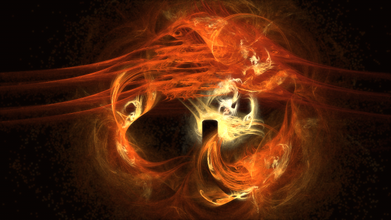
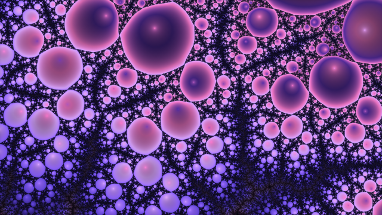
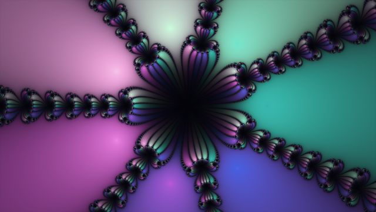
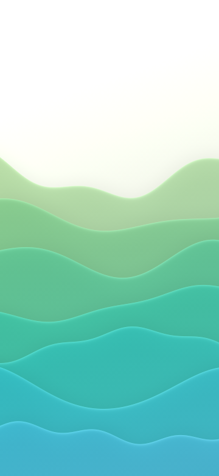
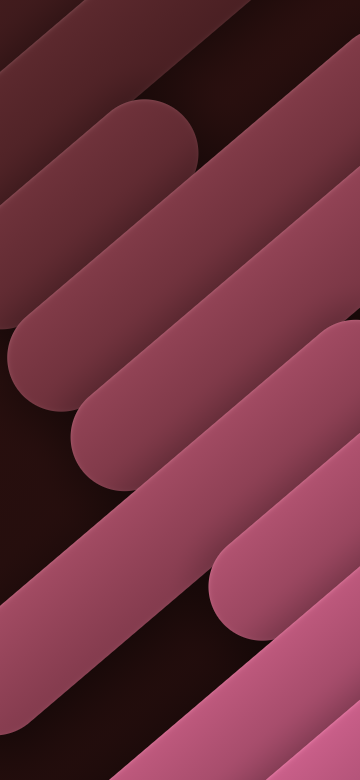

<div align="center">
  
  <h1>Fractique</h1>
  <p><strong>Генератор фрактального полум’я, класичних фракталів і шпалер, який з однакових вхідних даних дає однакове зображення на будь-якій платформі.</strong></p>
  <p><sub>
    <a href="../../README.md">English</a> · <strong>Українська</strong> · <a href="README_RU.md">Русский</a> · <a href="README_DE.md">Deutsch</a> · <a href="README_FR.md">Français</a> · <a href="README_ES.md">Español</a> · <a href="README_IT.md">Italiano</a> · <a href="README_JA.md">日本語</a><br>
    <a href="README_CN.md">简体中文</a> · <a href="README_PT.md">Português</a> · <a href="README_KO.md">한국어</a> · <a href="README_HI.md">हिन्दी</a> · <a href="README_TR.md">Türkçe</a> · <a href="README_PL.md">Polski</a> · <a href="README_ID.md">Bahasa Indonesia</a>
  </sub></p>
</div>

Fractique створює зображення трьох видів. Фрактальне полум’я: сяйливі, легкі фрактали з тонких кривих і м’якого світла. Класичні фрактали 22 видів: від множини Мандельброта, множин Жуліа й дивних атракторів до мандельбалба у трьох вимірах. І шпалери: пласкі аркуші з підсвіченими краями та м’якими тінями, кожні у світлому й темному варіанті. Ви обираєте пресет, генеруєте випадкове зображення або накладаєте кілька шарів полум’я один на один й експортуєте результат у будь-якому розмірі, від екрана телефона до монітора 4K. Сцена — це один невеликий файл, і той самий файл завжди дає точно ті самі пікселі на Windows, macOS, Linux, Android та iOS.

<p align="center">
  
</p>

## Що вміє Fractique

- **Полум’я:** 49 варіацій, шари з режимами змішування, поворотна й дзеркальна симетрія, оцінка щільності, сяйво та 29 вбудованих пресетів.
- **Фрактали:** 19 видів на площині: часу втечі (Мандельброт, Жуліа, Палаючий корабель, Трикорн, Мультиброт, Фенікс, Магніт), пошуку коренів (Ньютон, Нова), орбіти, намальовані як густини (Буддаброт, Кліффорд, Де Йонг, Лоренц, Гумовський–Міра, Хопалонг), і геометричні (Сітка Аполлонія, Кляйнова група, L-система, Ляпунов), кожен із пресетами та власним зображенням для кожного зерна; у них ті самі палітри, шари та глибоке масштабування, що й у полум’я.
- **Тіла:** мандельбалб, мандельбокс і губка Менгера у трьох вимірах, зі світлом, тінями й туманом; їх можна обійти довкола або зайти всередину.
- **Шпалери:** свої для кожного зерна, з 14 композицій і 6 матеріалів, кожні у світлому й темному варіанті, розкладені під розмір екрана.
- **Застосунок:** одна кодова база для Windows, macOS, Linux, Android, iOS та вебу. Зображення заповнює вікно, а поверх нього плавають скляні панелі; на комп’ютері застосунок має власний скляний рядок заголовка. Три вкладки, «Полум’я», «Фрактали» і «Форми» (шпалери), зберігають кожна своє зображення й свої нещодавні. 15 мов.
- **Прискорення GPU:** там, де відеокарта помітно швидша за процесор, вона сама малює полум’я, три атрактори, фрактали часу втечі й пошуку коренів та шпалери, а процесор лишається вільним. Експорт на трьох вищих рівнях якості завжди точно рендерить процесор.
- **«Випадково» і «Мутувати»:** кожне зерно — це зображення; полум’я, що було б крапкою або суцільним квадратом, пропускається. «Мутувати» робить варіант того, що вам сподобалося.
- **Шари:** додайте полум’я з пресетів або випадкове, видаліть, змініть порядок, задайте для кожного змішування («Сума», «Екран», «Поверх») і непрозорість. До 16 шарів.
- **Розмір зображення:** розмір самого вікна, один із 61 екрана (комп’ютери до 16K, телефони й планшети Android, iPhone, iPad, Mac та Apple Watch) або будь-які ширина й висота від 16 до 16384 пікселів.
- **Глибоке масштабування:** перетягування, коліщатко та щипок рухають вигляд і збільшують його, доки він лишається зображенням: полум’я у 10–300 разів, атрактор у 10–100 разів, шпалери у 8 разів, решту фракталів до десяти мільярдів разів. Зображення одразу йде за рухом, а коли вигляд зупиняється, перемальовується чітко.
- **Телефони:** власний екран. Одна кругла кнопка створює нове зображення, свайп веде до наступних шпалер, аркуш із маленькими живими картинками обирає стиль, а зображення, які ви залишили, складаються в колекцію. Видів фракталів, які процесор малює довго, там немає.
- **Експорт:** PNG будь-якого розміру: миттєво, таким, як на екрані, або рендер у фоні з трьома вищими рівнями якості. На телефоні файл зберігається у «Фото» чи в галерею або надсилається через «Поділитися». Усі можливості безкоштовні на всіх платформах; лише у версії з App Store (iPhone, iPad, Mac) для експорту від 2560 × 1440 пікселів або у власному розмірі потрібна одноразова покупка Fractique Pro.
- **Файли проєкту:** файл `.frcq` зберігає сцену разом із виглядом, тоном і розміром, тож вона відкривається такою, якою була збережена ([docs/scene-format.md](../scene-format.md)). Відкриваються також звичайні сцени `.json` і файли `.flame` з flam3 та Apophysis. Між запусками застосунок повертається до сеансу, на якому його закрили.
- **Оновлення:** вікно показує всі випущені версії з примітками й установлює будь-яку з них. У Windows застосунок — це один портативний `.exe`, який сам себе замінює.
- **Точна повторюваність:** та сама сцена дає ті самі пікселі на будь-якій машині; це перевіряють тести на Linux, Windows і macOS ([docs/determinism.md](../determinism.md)).
- **Інструмент командного рядка** (`fractique`): рендерить полум’я, фрактали та шпалери у PNG, створює випадкові сцени й варіанти, конвертує файли `.flame` і `.frcq`.
- **Сервер MCP** (`fractique-mcp` або `fractique mcp`): ШІ-агент створює, змінює й рендерить сцени ([docs/mcp.md](../mcp.md)).
- **HTTP-сервер** (`fractique-server`): HTTP API з чергою рендерів і лімітами, його інтерактивний довідник на `/docs`, MCP для ШІ-агентів на `/mcp`, роздає вебзастосунок, окреме завантаження в кожному випуску та `Dockerfile` для збирання образу ([docs/server.md](../server.md)).

| | |
| --- | --- |
|  |  |
| Смарагдова зірка (два шари) | Розжарений вихор |
|  |  |
| Золотий розквіт | Сонячна мандала |

Ще сто зображень полум’я, а також фрактали й шпалери, кожне зображення з файлом `.frcq`, який відтворює його в будь-якому розмірі: [галерея](../gallery/README.md).

Фрактали інших видів: множина Мандельброта, множина Жуліа й атрактор Кліффорда:

| | | |
| --- | --- | --- |
|  |  |  |
| Мандельброт: Спіраль | Жуліа: Спіралі | Кліффорд: Крила |

Інші фрактали часу втечі та фрактали пошуку коренів: Палаючий корабель, Трикорн, Мультиброт, Фенікс, Магніт, Ньютон, Нова:

| | | | |
| --- | --- | --- | --- |
|  |  |  |  |
| Палаючий корабель: Корабель | Трикорн: Острів | Мультиброт: Спіралі | Фенікс: Галактика |
|  |  |  | |
| Магніт: Перли | Ньютон: Сім | Нова: Зірка | |

Орбіти, намальовані як густини: Буддаброт і атрактори Де Йонга, Лоренца, Гумовського–Міри та Хопалонг:

| | | |
| --- | --- | --- |
|  |  |  |
| Буддаброт: Туманність | Де Йонг: Класика | Лоренц: Метелик |
|  |  | |
| Гумовський–Міра: Пір'я | Хопалонг: Павутина | |

Геометричні фрактали: сітка Аполлонія, гранична множина кляйнової групи, L-система і фрактал Ляпунова:

| | | | |
| --- | --- | --- | --- |
|  |  |  |  |
| Сітка Аполлонія: Потрійний | Кляйнова група: Вістря | L-система: Рослина | Ляпунов: Пір’я |

Тіла у трьох вимірах: мандельбалб, мандельбокс і губка Менгера:

| | | |
| --- | --- | --- |
|  |  |  |
| Мандельбалб: Корона | Мандельбокс: Станція | Губка Менгера: Класичний |

Шпалери, світлі й темні, кожні зі своєю композицією й матеріалом:

| | | | |
| --- | --- | --- | --- |
|  |  |  |  |
| Хвилі, Скло | Квітка, Сяйво | Плитка, Рельєф | Віяло, Скло |
|  |  |  |  |
| Диски, Папір | Бруски, Папір | Дуги, Карбон | Лінії, Папір |

## Швидкий старт

Одна команда збирає застосунок та інструмент командного рядка. Якщо Rust не встановлено, вона його встановить.

| Система | Команда |
| --- | --- |
| Linux, macOS | `./setup.sh` |
| Windows | `setup.cmd` |

Запустіть застосунок:

```sh
./target/release/fractique-gui
```

Або рендеріть із командного рядка:

```sh
# пресет як зображення 4K
./target/release/fractique render --preset aurora-spiral --size 3840x2160 --quality high -o aurora.png

# випадкове полум’я із зерном 42 для екрана телефона
./target/release/fractique render --random 42 --size 1080x2400 --quality mobile -o phone.png

# випадковий вид множини Мандельброта із зерном 7
./target/release/fractique render --random 7 --fractal mandelbrot --size 1920x1080 -o mandelbrot.png

# шпалери із зерном 7 для телефона, світлі й темні
./target/release/fractique render --wallpaper 7 --size 1290x2796 -o wallpaper.png
./target/release/fractique render --wallpaper 7 --dark --size 1290x2796 -o wallpaper-dark.png

# зберегти випадкову сцену у файл, змінити її, відрендерити
./target/release/fractique randomize 42 -o scene.json
./target/release/fractique render scene.json -o mine.png
```

У Windows програми лежать у `target\release\fractique-gui.exe` і `target\release\fractique.exe`. Усе, що вміють застосунок і команди: [docs/usage.md](../usage.md).

## На чому протестовано

| Пристрій | Система | Процесор | Графіка |
| --- | --- | --- | --- |
| ПК | Windows 11 | AMD Ryzen 7 5700X | NVIDIA GeForce RTX 4070 |
| ПК | Ubuntu 24.04 (WSL2) | AMD Ryzen 7 5700X | Немає: лише процесор |
| Ноутбук, ASUS TUF Gaming FX505DT | Windows 11 | AMD Ryzen 5 3550H | NVIDIA GeForce GTX 1650 |
| Ноутбук, HP 15-db1xxx | Debian 13 | AMD Ryzen 3 3200U | AMD Radeon Vega 3 |
| MacBook Pro | macOS 27 | Apple M5 Pro | Apple M5 Pro |
| ZTE Blade A7 | Android 9 | MediaTek Helio P22 | PowerVR GE8320 |
| Asus Zenfone 10 | Android 15 | Qualcomm Snapdragon 8 Gen 2 | Adreno 740 |
| iPhone 13 Pro | iOS 27 | Apple A15 Bionic | Apple A15 |
| iPhone 18 Pro Max | iOS 27 | Apple A20 Pro | Apple A20 Pro |

## Документація

Документація написана англійською.

| | |
| --- | --- |
| [docs/usage.md](../usage.md) | Застосунок, команди, рівні якості, як редагувати сцену |
| [docs/scene-format.md](../scene-format.md) | Кожне поле файлу сцени, кожна варіація, аркуші, файл `.frcq` |
| [docs/mcp.md](../mcp.md) | Сервер MCP: підключення ШІ-агента, інструменти |
| [docs/server.md](../server.md) | HTTP-сервер: ендпоінти, ліміти, Docker |
| [docs/ios.md](../ios.md) | Збирання й запуск на iPhone або в симуляторі iOS |
| [docs/releasing.md](../releasing.md) | Як робиться випуск і як застосунок оновлює себе |
| [docs/architecture.md](../architecture.md) | Як частини поєднані між собою, як працює рендер |
| [docs/determinism.md](../determinism.md) | Чому рендер повторюється точно, що гарантовано, а що ні |
| [docs/performance.md](../performance.md) | Виміряний час рендеру й обсяг пам’яті |
| [docs/roadmap.md](../roadmap.md) | Що зроблено і що далі |

## Ліцензія

[PolyForm Noncommercial License 1.0.0](../../LICENSE.md): безкоштовно для будь-якого некомерційного використання. Для комерційного використання зверніться до автора по окрему ліцензію. Ліцензії сторонніх компонентів перелічено в [THIRD_PARTY_NOTICES.md](../../THIRD_PARTY_NOTICES.md). Внески: див. [CONTRIBUTING.md](../../CONTRIBUTING.md).
