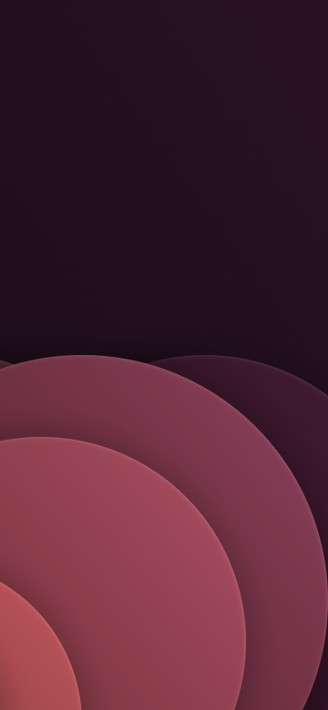
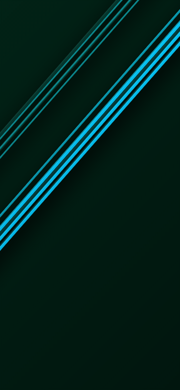

<div align="center">
  
  <h1>Fractique</h1>
  <p><strong>Генератор фрактального полум’я та шпалер, який з однакових вхідних даних дає однакове зображення на будь-якій платформі.</strong></p>
  <p><sub>
    <a href="../../README.md">English</a> · <strong>Українська</strong> · <a href="README_RU.md">Русский</a> · <a href="README_DE.md">Deutsch</a> · <a href="README_FR.md">Français</a> · <a href="README_ES.md">Español</a> · <a href="README_IT.md">Italiano</a> · <a href="README_JA.md">日本語</a><br>
    <a href="README_CN.md">简体中文</a> · <a href="README_PT.md">Português</a> · <a href="README_KO.md">한국어</a> · <a href="README_HI.md">हिन्दी</a> · <a href="README_TR.md">Türkçe</a> · <a href="README_PL.md">Polski</a> · <a href="README_ID.md">Bahasa Indonesia</a>
  </sub></p>
</div>

Fractique створює зображення двох видів. Фрактальне полум’я: сяйливі, легкі фрактали з тонких кривих і м’якого світла. І шпалери: пласкі аркуші з підсвіченими краями та м’якими тінями, кожні у світлому й темному варіанті. Ви обираєте пресет, генеруєте випадкове зображення або накладаєте кілька шарів полум’я один на один й експортуєте результат у будь-якому розмірі, від екрана телефона до монітора 4K. Сцена — це один невеликий файл, і той самий файл завжди дає точно ті самі пікселі на Windows, macOS, Linux, Android та iOS.

<p align="center">
  
</p>

## Що вміє Fractique

- **Полум’я:** 49 варіацій, шари з режимами змішування, поворотна й дзеркальна симетрія, оцінка щільності, сяйво та 29 вбудованих пресетів.
- **Шпалери:** свої для кожного зерна, з 14 композицій і 6 матеріалів, кожні у світлому й темному варіанті, розкладені під розмір екрана.
- **Застосунок:** одна кодова база для Windows, macOS, Linux, Android, iOS та вебу. Зображення заповнює вікно, а поверх нього плавають скляні панелі; на комп’ютері застосунок має власний скляний рядок заголовка. 15 мов.
- **«Випадково» і «Мутувати»:** кожне зерно — це зображення; полум’я, що було б крапкою або суцільним квадратом, пропускається. «Мутувати» робить варіант того, що вам сподобалося.
- **Шари:** додайте полум’я з пресетів або випадкове, видаліть, змініть порядок, задайте для кожного змішування («Сума», «Екран», «Поверх») і непрозорість. До 16 шарів.
- **Розмір зображення:** розмір самого вікна, один із 21 екрана (комп’ютери до 4K, телефони й планшети Android, iPhone та iPad) або будь-які ширина й висота від 16 до 16384 пікселів.
- **Глибоке масштабування:** перетягування, коліщатко та щипок рухають вигляд і збільшують його до десяти мільярдів разів. Зображення одразу йде за рухом, а коли вигляд зупиняється, перемальовується чітко.
- **Телефони:** власний екран. Одна кругла кнопка створює нове зображення, свайп веде до наступних шпалер, аркуш із маленькими живими картинками обирає стиль, а зображення, які ви залишили, складаються в колекцію.
- **Експорт:** PNG будь-якого розміру: миттєво, таким, як на екрані, або рендер у фоні з трьома вищими рівнями якості. На телефоні файл зберігається у «Фото» чи в галерею або надсилається через «Поділитися».
- **Файли проєкту:** файл `.frcq` зберігає сцену разом із виглядом, тоном і розміром, тож вона відкривається такою, якою була збережена ([docs/scene-format.md](../scene-format.md)). Відкриваються також звичайні сцени `.json` і файли `.flame` з flam3 та Apophysis. Між запусками застосунок повертається до сеансу, на якому його закрили.
- **Оновлення:** вікно показує всі випущені версії з примітками й установлює будь-яку з них. У Windows застосунок — це один портативний `.exe`, який сам себе замінює.
- **Точна повторюваність:** та сама сцена дає ті самі пікселі на будь-якій машині; це перевіряють тести на Linux, Windows і macOS ([docs/determinism.md](../determinism.md)).
- **Інструмент командного рядка** (`fractique`): рендерить полум’я та шпалери у PNG, створює випадкові сцени й варіанти, конвертує файли `.flame`.
- **Сервер MCP** (`fractique mcp`): ШІ-агент створює, змінює й рендерить сцени ([docs/mcp.md](../mcp.md)).
- **HTTP-сервер** (`fractique-server`): HTTP API з чергою рендерів і лімітами, MCP для ШІ-агентів на `/mcp`, роздає вебзастосунок, постачається як образ Docker ([docs/server.md](../server.md)).

| | |
| --- | --- |
|  |  |
| `emerald-star` (два шари) | `ember-vortex` |
|  |  |
| `golden-bloom` | `solar-mandala` |

Шпалери, світлі й темні, кожні зі своєю композицією й матеріалом:

| | | | |
| --- | --- | --- | --- |
|  |  |  |  |
| `waves`, `glass` | `burst`, `glow` | `tiles`, `relief` | `fan`, `glass` |
|  |  |  |  |
| `discs`, `paper` | `bars`, `paper` | `arcs`, `carbon` | `lines`, `paper` |

## Швидкий старт

Одна команда збирає застосунок та інструмент командного рядка. Якщо Rust не встановлено, вона його встановить.

| Система | Команда |
| --- | --- |
| Linux, macOS | `./setup.sh` |
| Windows | `setup.cmd` |

Запустіть застосунок:

```sh
./target/release/fractique-gui
```

Або рендеріть із командного рядка:

```sh
# пресет як зображення 4K
./target/release/fractique render --preset aurora-spiral --size 3840x2160 --quality high -o aurora.png

# випадкове полум’я із зерном 42 для екрана телефона
./target/release/fractique render --random 42 --size 1080x2400 --quality mobile -o phone.png

# шпалери із зерном 7 для телефона, світлі й темні
./target/release/fractique render --wallpaper 7 --size 1290x2796 -o wallpaper.png
./target/release/fractique render --wallpaper 7 --dark --size 1290x2796 -o wallpaper-dark.png

# зберегти випадкову сцену у файл, змінити її, відрендерити
./target/release/fractique randomize 42 -o scene.json
./target/release/fractique render scene.json -o mine.png
```

У Windows програми лежать у `target\release\fractique-gui.exe` і `target\release\fractique.exe`. Усе, що вміють застосунок і команди: [docs/usage.md](../usage.md).

## Документація

Документація написана англійською.

| | |
| --- | --- |
| [docs/usage.md](../usage.md) | Застосунок, команди, рівні якості, як редагувати сцену |
| [docs/scene-format.md](../scene-format.md) | Кожне поле файлу сцени, кожна варіація, аркуші, файл `.frcq` |
| [docs/mcp.md](../mcp.md) | Сервер MCP: підключення ШІ-агента, інструменти |
| [docs/server.md](../server.md) | HTTP-сервер: ендпоінти, ліміти, Docker |
| [docs/ios.md](../ios.md) | Збирання й запуск на iPhone або в симуляторі iOS |
| [docs/releasing.md](../releasing.md) | Як робиться випуск і як застосунок оновлює себе |
| [docs/architecture.md](../architecture.md) | Як частини поєднані між собою, як працює рендер |
| [docs/determinism.md](../determinism.md) | Чому рендер повторюється точно, що гарантовано, а що ні |
| [docs/performance.md](../performance.md) | Виміряний час рендеру й обсяг пам’яті |
| [docs/roadmap.md](../roadmap.md) | Що зроблено і що далі |

## Ліцензія

[PolyForm Noncommercial License 1.0.0](../../LICENSE.md): безкоштовно для будь-якого некомерційного використання. Для комерційного використання зверніться до автора по окрему ліцензію. Ліцензії сторонніх компонентів перелічено в [THIRD_PARTY_NOTICES.md](../../THIRD_PARTY_NOTICES.md). Внески: див. [CONTRIBUTING.md](../../CONTRIBUTING.md).
