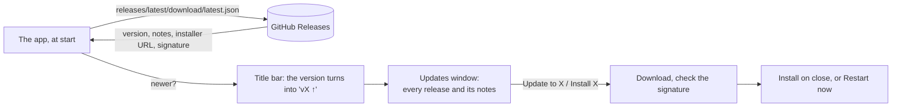
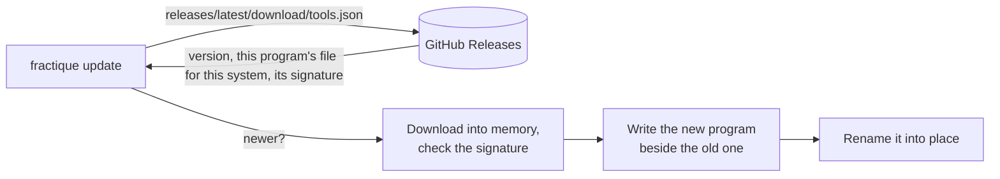

# Releasing and updates

A release is a version tag. Pushing `v0.2.0` makes GitHub build every installer, sign them and publish them with
that version's part of the changelog; installed copies of the app then find it by themselves, and the command
line tool and the two servers take it when they are told to.

## What a release contains

| File | For | Updates itself |
| --- | --- | --- |
| `Fractique_<version>_x64.exe` | Windows: the app itself, one file, no installer | yes |
| `fractique-cli_<version>_x64.exe` | Windows: the command line tool | on command: `update` |
| `fractique-mcp_<version>_x64.exe` | Windows: the MCP server for AI agents | on command |
| `fractique-server_<version>_x64.exe` | Windows: the HTTP server | on command |
| `Fractique_<version>_x86_64.AppImage` | Linux, any distribution | yes |
| `Fractique_<version>_amd64.deb` | Debian, Ubuntu | no: it points at the download page |
| `Fractique_<version>_universal.dmg` | macOS, every Mac: one app with the code for Apple Silicon and for Intel | yes (the app inside) |
| `Fractique_<version>_universal.app.tar.gz` | what the macOS update downloads | |
| `Fractique_<version>_android.apk` | Android | no: Android installs an APK only by hand |
| `fractique-cli_<version>_x86_64-linux.tar.gz`, `fractique-mcp_…`, `fractique-server_…` | Linux: the command line tool, the MCP server and the HTTP server on their own, for a machine that wants no app | on command |
| `fractique-cli_<version>_universal-macos.tar.gz`, `fractique-mcp_…`, `fractique-server_…` | macOS: the same three, universal too | on command |
| `latest.json` | the update manifest the app reads | |
| `tools.json` | the update manifest the three other programs read ([its shape](#toolsjson)) | |
| `SHA256SUMS.txt` | checksums | |

The Linux and macOS packages carry the app (`fractique-gui`), the command line tool (`fractique`), the MCP server
(`fractique-mcp`) and the HTTP server (`fractique-server`); where they are after installing is in [mcp.md](mcp.md#where-the-program-is). The iOS
build goes to TestFlight and is not among the files. Neither is the Docker image of the HTTP server with the web
app: it goes to the GitHub Container Registry as `ghcr.io/tarpetos/fractique-server`, under the version and under
`latest`, for x86-64 and for ARM64 ([server.md](server.md#docker)).

## How to release

1. Set the new version in four places: `version` under `[workspace.package]` in `Cargo.toml`, `version` in
   `crates/fractique-app/Packager.toml` and `MARKETING_VERSION` in `ios/project.yml` and in `mac/project.yml`. A
   build script refuses to build when its own differs from `Cargo.toml` (the desktop scripts read
   `Packager.toml`, `testflight.sh` and `appstore.sh` their `project.yml`), and the `Release` workflow when any of the three does, before anything is built. Every program takes the
   one in `Cargo.toml`.
2. Add a section `## <version>` at the top of `CHANGELOG.md`. It becomes the release's notes and what the app
   shows under "Updates and what's new". On the release's page a table of the downloads by system stands above
   it: GitHub lists the files by name only.
3. Commit, then tag and push the tag:

   ```sh
   git tag v0.2.0
   git push origin v0.2.0
   ```

The `Release` workflow does the rest. It refuses a tag that does not match the version in `Cargo.toml`, before
anything is built. The desktop installers, the APK and the Docker image are then made
side by side; the release is published when the installers and the APK are there, whatever becomes of the image. A tag
uploads nothing to Apple: the builds for TestFlight and for the Mac App Store are uploaded by hand, before the tag,
so that what is sent for review is the build that was tested. Started by hand without a tag, it builds the installers and keeps them as
artifacts without publishing, uploads the iOS build to TestFlight and the Mac one to App Store Connect, and builds the image and asks the server
in it for an answer without pushing it; with **ios**, **mac** or **docker** chosen it does only that one, and with **appstore** the two uploads to Apple, side by side in one run.

The workflows are three. `CI` and `Release` are each one entry file that calls the others, so GitHub shows one run
for each:

| Run | When | Entry | Calls |
| --- | --- | --- | --- |
| `CI` | Every pull request and every push to `master` | `ci.yml` (what changed) | `lint.yml`, `test.yml` |
| `Title` | Every pull request, and again when its title is edited | `title.yml` | |
| `Release` | A version tag, or by hand | `release.yml` (the version, the publishing) | `release-desktop.yml`, `release-android.yml`, `release-ios.yml`, `release-mac.yml`, `release-docker.yml` |

The title has a workflow of its own so that an edited title checks the title alone and leaves the checks of the
code as they were. One more file, `ios-sim.yml`, is started by hand only: it runs the app in the iOS Simulator
([ios.md](ios.md#in-the-simulator)).

To build installers on your own machine: `scripts/build/build-linux.sh`, `build-mac.sh`, `build-win.ps1`. They
write to `dist/`.

| Target | Built by | With |
| --- | --- | --- |
| Windows | `scripts/build/build-win.ps1` | The four programs copied as they are; no installer |
| Linux | `scripts/build/build-linux.sh [--formats appimage,deb]` | `cargo-packager` |
| macOS | `scripts/build/build-mac.sh [--formats app,dmg]` | `cargo-packager`, after both kinds of Mac are built and joined with `lipo` into universal programs. The app is not signed by Apple: copied from the `.dmg` it needs `xattr -dr com.apple.quarantine /Applications/Fractique.app` |
| Android | `cargo apk build --release --lib` in `crates/fractique-app`, as the workflow does | `cargo-apk`, the Android NDK, Java 17, the keystore |
| iOS | `scripts/ios/testflight.sh` ([ios.md](ios.md#testflight)), as the workflow does; it goes to TestFlight, not into the release's files | Xcode, xcodegen, the App Store Connect key |
| The Mac App Store | `scripts/mac/appstore.sh` ([ios.md](ios.md#a-mac-app-store-build)), as the workflow does; it goes to App Store Connect, not into the release's files | Xcode, xcodegen, the App Store Connect key |
| Docker | `docker build -t fractique-server .` ([server.md](server.md#docker)), as the workflow does on a runner of each processor | Docker |
| Web | `crates/fractique-app/index.html` is a [Trunk](https://trunkrs.dev) page; not part of a release | Trunk |

## How the app updates



- **The check** reads `latest.json` of the newest release. It happens once at start, in the background, and on
  **Check for updates**. When a newer version is out, the version in the title bar shows it with an arrow; a click
  on it opens the updates window.
- **The list** in the updates window comes from the GitHub Releases API: every full release from `0.1.0` on, with
  its date and notes. Pre-releases and drafts are left out.
- **Any version can be installed**, older ones too: each release has its own `latest.json`, and the app reads the
  one of the chosen version.
- **The download is verified** against the signature in the manifest with the public key built into the app
  (`PUBKEY` in `crates/fractique-update/src/lib.rs`). A file signed with another key is refused.
- **Installing** happens when the app closes, or at once with **Restart now**. On Windows the app is one portable
  program file: it renames its own file to `.old`, puts the new one in its place and removes the old one at the
  next start. The settings are not in that file: they stay in the data folder
  ([usage.md](usage.md#what-the-app-keeps)).

Which copy can do what:

| Copy | Behaviour |
| --- | --- |
| The Windows program in a folder it can write to, the AppImage, the macOS app | Updates itself |
| The Windows program in a folder it cannot write to (`Program Files`) | Shows the versions and opens the download page |
| The `.deb`, or a binary copied by hand | Shows the versions and opens the download page |
| Built from a checkout (`cargo build`, `setup.sh`) | Shows the versions, installs nothing |
| Android, iOS, the web | No updates window: the stores, TestFlight, or a new APK by hand, replace the app; the web is always the newest |

The release scripts mark a build as a release by setting `FRACTIQUE_RELEASE` while compiling. Without it the app
counts as built from a checkout.

The repository must be public for this to work: the app asks GitHub without signing in, and so do the other
programs ([below](#how-the-other-programs-update)).

## How the other programs update

The command line tool, the MCP server and the HTTP server are not replaced when the app updates. Each of them
replaces itself when it is told to, and never by itself:

```sh
fractique update                    # install the newest release
fractique update --check            # only say whether a newer one is out
fractique update --version 0.2.0    # install that version, an older one too
```

`fractique-mcp update` and `fractique-server update` are the same command for those two programs. Each program
updates only itself.



- **The newest version** is the `version` in `tools.json` of the newest release; **a named one** is read from
  that release's own `tools.json` (`releases/download/v0.2.0/tools.json`), as the app does with `latest.json`.
- **The download is verified** before anything is written: against the signature in the manifest, with the public
  key built into the program. It is the key of the app (`PUBKEY` in `crates/fractique-update/src/lib.rs`, which
  the app reads from there too). The signature also names the file it was made for, and that name must be the one
  downloaded and must be this program of the version asked for: a file signed for another program or another
  version is refused. On Linux and macOS the download is the program's `.tar.gz`; the signature covers the
  archive as it was downloaded, and the one program is unpacked from it in memory.
- **The old program is never half replaced.** The new one is written to a file beside it, and only then renamed
  into place: on Linux and macOS over the old one in one step, with the same mode bits; on Windows, which does
  not let a running program be overwritten, the old file is renamed to `.old` first, as the app does, and removed
  at once when Windows allows it or else at the program's next start. If anything fails before that, the old
  program is untouched.
- **A program that is running stays the old one** until it is restarted: an HTTP server above all, and an MCP
  server that a client has started.
- **On Windows the file keeps its name**, so `fractique-cli_0.1.0_x64.exe` is a newer version after an update.
  `--version` says which.

| Exit code | `update` | `update --check` |
| --- | --- | --- |
| 0 | The program was replaced, or it already is that version | This is the newest version |
| 10 | | A newer version is out |
| 3 | This copy is not replaced (the table below); nothing was asked of the network | |
| 1 | It could not be found out or done: no answer, no `tools.json`, a signature that does not fit | The same |
| 2 | An option that does not exist | The same |

Which copy does what:

| Copy | `update` |
| --- | --- |
| A program of a release in a folder it can write to | Replaces itself |
| In a folder it cannot write to | Refuses: run it with the rights to write there, or keep the program in a folder of your own |
| From the `.deb`: a file a package owns (`/var/lib/dpkg/info`), or one in `/usr` outside `/usr/local`, `/bin`, `/sbin`, `/nix`, `/snap`, `/gnu` | Refuses: update the package |
| Inside the AppImage or inside the macOS app | Refuses: the app updates the whole package, these programs with it |
| Built from a checkout (`cargo build`, `setup.sh`, the `Dockerfile`) | Refuses: build the new version; an image is built again |
| A system the release holds no file for (Linux on ARM) | Refuses, with the address of the downloads |

Every refusal says why, what to do instead and where the downloads are. When a rule is in doubt the program is
left alone. `update --check` works for every copy and adds the reason when that copy would not be replaced.

A release made before the programs could update themselves has no `tools.json`: `update` says so and names the
page to take the files from by hand.

### What contacts the network, and when

Only two things do, and only when a person asks:

- `update`, with or without `--check` or `--version`.
- `--version` typed into a terminal: it prints the version at once and then waits at most 1.5 seconds for
  `tools.json` of the newest release; when that names a newer version it adds one line, `0.3.0 is out: fractique
  update`, and on any failure nothing. When the output is not a terminal (a script, a pipe, a file) it prints the
  version alone and asks no one. `FRACTIQUE_NO_UPDATE_CHECK=1` switches the look off in a terminal too, and a
  build from a checkout never looks.

Nothing else does: not `fractique render` or any other command, not the MCP server while it serves, not the HTTP
server while it runs. There is no check at start, none in the background and none on a timer.

### `tools.json`

```json
{
  "version": "0.3.0",
  "pub_date": "2026-11-20T12:00:00Z",
  "programs": {
    "fractique-cli": {
      "windows-x86_64": { "url": "https://github.com/tarpetos/fractique/releases/download/v0.3.0/fractique-cli_0.3.0_x64.exe", "signature": "…" },
      "linux-x86_64": { "url": "…/fractique-cli_0.3.0_x86_64-linux.tar.gz", "signature": "…" },
      "macos-aarch64": { "url": "…/fractique-cli_0.3.0_universal-macos.tar.gz", "signature": "…" },
      "macos-x86_64": { "url": "…/fractique-cli_0.3.0_universal-macos.tar.gz", "signature": "…" }
    },
    "fractique-mcp": { "windows-x86_64": { "url": "…", "signature": "…" }, "linux-x86_64": { "…": "…" }, "macos-aarch64": { "…": "…" } },
    "fractique-server": { "windows-x86_64": { "url": "…", "signature": "…" }, "linux-x86_64": { "…": "…" }, "macos-aarch64": { "…": "…" } }
  }
}
```

A program is named as its release file is (`fractique-cli` is the program `fractique`), a system as
`<os>-<arch>`, as in `latest.json`. `signature` is the content of the `.sig` file that
`cargo packager signer sign` writes next to the file: a minisign signature in base64. The build scripts sign the
three programs when the key is set, and the `Release` workflow writes `tools.json` from the `.sig` files beside
`latest.json`, whose shape is unchanged. A program whose file was not signed is left out of the manifest and
does not update itself.

The code is in `crates/fractique-update`, used by the three programs; it reads the manifest over HTTPS with
certificates of its own, so it needs nothing installed on a bare server.

## Files of the app (`.frcq`)

Each system is told that `.frcq` files belong to Fractique, so a double click opens them in the app. The app takes
the file as its first argument; a second start passes the file to the window that is already open.

| System | How | Where it is set |
| --- | --- | --- |
| Windows | There is no installer, so the program registers itself at start, for the current user only (`HKCU\Software\Classes`, no administrator rights): the extension `.frcq`, the type `Fractique.Scene` with the program's icon, and the open command `"<program>" "%1"`. It writes only the values that differ from what is stored, so a moved or renamed program repairs the association at its next start, and a start that changes nothing writes nothing. A failure is ignored | `crates/fractique-app/src/association.rs` |
| Linux (`.deb`, AppImage) | The desktop entry gets `MimeType=application/x-fractique` and `Exec=fractique-gui %F`, and the package carries the type's definition (`usr/share/mime/packages/app.fractique.xml`: the pattern `*.frcq` and the first bytes `FRCQ`) | `[[file-associations]]`, `[deb] files` and `[appimage] files` in `Packager.toml`; `crates/fractique-app/assets/linux/app.fractique.xml` |
| macOS | The bundle's `Info.plist` declares the document type (`CFBundleDocumentTypes`) | `[[file-associations]]` in `Packager.toml` |

Only a release build registers itself on Windows (`FRACTIQUE_RELEASE`, as for updates): a build from a checkout
never writes to the registry, and neither does a screenshot run.

What is missing:

- **macOS:** Finder hands a document to a running app as an event, not as an argument, and the app does not listen
  for it yet. Until it does, the type is declared but a double click starts the app without the file.
- **AppImage:** a bare AppImage is not installed, so the system learns the type only through a tool that integrates
  AppImages (AppImageLauncher, `appimaged`). The `.deb` needs nothing.
- **Windows:** nothing removes the registry values when the program is deleted; they are a few strings under
  `HKCU\Software\Classes\.frcq` and `HKCU\Software\Classes\Fractique.Scene`. The type's name in Explorer is
  "Fractique", not translated.

## The keys

Three keys sign a release. None is in the repository; the workflow reads them from the repository's secrets.

| Secret | What it signs | If it is lost |
| --- | --- | --- |
| `CARGO_PACKAGER_SIGN_PRIVATE_KEY`, `CARGO_PACKAGER_SIGN_PRIVATE_KEY_PASSWORD` | The desktop installers, for the app's updater, and the command line tool, the MCP server and the HTTP server, for their `update` command | Installed copies refuse every later update, the app and the three programs alike: people must install by hand once |
| `ANDROID_KEYSTORE_BASE64`, `ANDROID_KEYSTORE_PASSWORD` | The APK | Android refuses to install a later APK over the app: it must be removed first |
| `ASC_KEY_P8`, `ASC_KEY_ID`, `ASC_ISSUER_ID` | The iOS build, for TestFlight, and the build for the Mac App Store ([ios.md](ios.md#from-github)) | Nothing is lost: the key is revoked in App Store Connect and a new one made |

Keep copies of the first two outside GitHub: a secret cannot be read back from there.

A new updater key is made with `cargo packager signer generate`; its public half replaces `PUBKEY` in
`crates/fractique-update/src/lib.rs`, the one place the app and the three programs read it from.
