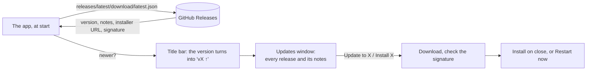

# Releasing and updates

A release is a version tag. Pushing `v0.2.0` makes GitHub build every installer, sign them and publish them with
that version's part of the changelog; installed copies of the app then find it by themselves.

## What a release contains

| File | For | Updates itself |
| --- | --- | --- |
| `Fractique_<version>_x64.exe` | Windows: the app itself, one file, no installer | yes |
| `fractique-cli_<version>_x64.exe` | Windows: the command line tool | no |
| `fractique-mcp_<version>_x64.exe` | Windows: the MCP server for AI agents | no |
| `fractique-server_<version>_x64.exe` | Windows: the HTTP server | no |
| `Fractique_<version>_x86_64.AppImage` | Linux, any distribution | yes |
| `Fractique_<version>_amd64.deb` | Debian, Ubuntu | no: it points at the download page |
| `Fractique_<version>_aarch64.dmg` | macOS, Apple Silicon | yes (the app inside) |
| `Fractique_<version>_aarch64.app.tar.gz` | what the macOS update downloads | |
| `Fractique_<version>_android.apk` | Android | no: Android installs an APK only by hand |
| `fractique-cli_<version>_x86_64-linux.tar.gz`, `fractique-mcp_…`, `fractique-server_…` | Linux: the command line tool, the MCP server and the HTTP server on their own, for a machine that wants no app | no |
| `fractique-cli_<version>_aarch64-macos.tar.gz`, `fractique-mcp_…`, `fractique-server_…` | macOS: the same three | no |
| `latest.json` | the update manifest the app reads | |
| `SHA256SUMS.txt` | checksums | |

The Linux and macOS packages carry the app (`fractique-gui`), the command line tool (`fractique`), the MCP server
(`fractique-mcp`) and the HTTP server (`fractique-server`); where they are after installing is in [mcp.md](mcp.md#where-the-program-is). The iOS
build goes to TestFlight and is not among the files.

## How to release

1. Set the new version in three places: `version` under `[workspace.package]` in `Cargo.toml`, `version` in
   `crates/fractique-app/Packager.toml` and `MARKETING_VERSION` in `ios/project.yml`. The build scripts refuse to
   build when they differ, and so does the `Release` workflow, before anything is built. Every program takes the
   one in `Cargo.toml`.
2. Add a section `## <version>` at the top of `CHANGELOG.md`. It becomes the release's notes and what the app
   shows under "Updates and what's new".
3. Commit, then tag and push the tag:

   ```sh
   git tag v0.2.0
   git push origin v0.2.0
   ```

The `Release` workflow does the rest. It refuses a tag that does not match the version in `Cargo.toml`, before
anything is built. The desktop installers, the APK and the iOS build for TestFlight are then made side by side;
the release is published when the installers and the APK are there, whatever Apple says to the upload. Started by
hand without a tag, it builds the installers and keeps them as artifacts without publishing, and uploads the iOS
build to TestFlight; with **ios** chosen it does only that.

The workflows are two, each one entry file that calls the others, so GitHub shows one run for each:

| Run | When | Entry | Calls |
| --- | --- | --- | --- |
| `CI` | Every pull request | `ci.yml` (the title, what changed) | `lint.yml`, `test.yml` |
| `Release` | A version tag, or by hand | `release.yml` (the version, the publishing) | `release-desktop.yml`, `release-android.yml`, `release-ios.yml` |

To build installers on your own machine: `scripts/build/build-linux.sh`, `build-mac.sh`, `build-win.ps1`. They
write to `dist/`.

| Target | Built by | With |
| --- | --- | --- |
| Windows | `scripts/build/build-win.ps1` | The two programs copied as they are; no installer |
| Linux | `scripts/build/build-linux.sh [--formats appimage,deb]` | `cargo-packager` |
| macOS | `scripts/build/build-mac.sh [--formats app,dmg]` | `cargo-packager`. The app is not signed by Apple: copied from the `.dmg` it needs `xattr -dr com.apple.quarantine /Applications/Fractique.app` |
| Android | `cargo apk build --release --lib` in `crates/fractique-app`, as the workflow does | `cargo-apk`, the Android NDK, Java 17, the keystore |
| iOS | `scripts/ios/testflight.sh` ([ios.md](ios.md#testflight)), as the workflow does; it goes to TestFlight, not into the release's files | Xcode, xcodegen, the App Store Connect key |
| Web | `crates/fractique-app/index.html` is a [Trunk](https://trunkrs.dev) page; not part of a release | Trunk |

## How the app updates



- **The check** reads `latest.json` of the newest release. It happens once at start, in the background, and on
  **Check for updates**. When a newer version is out, the version in the title bar shows it with an arrow; a click
  on it opens the updates window.
- **The list** in the updates window comes from the GitHub Releases API: every full release from `0.1.0` on, with
  its date and notes. Pre-releases and drafts are left out.
- **Any version can be installed**, older ones too: each release has its own `latest.json`, and the app reads the
  one of the chosen version.
- **The download is verified** against the signature in the manifest with the public key built into the app
  (`PUBKEY` in `crates/fractique-app/src/update.rs`). A file signed with another key is refused.
- **Installing** happens when the app closes, or at once with **Restart now**. On Windows the app is one portable
  program file: it renames its own file to `.old`, puts the new one in its place and removes the old one at the
  next start. The settings are not in that file: they stay in the data folder
  ([usage.md](usage.md#what-the-app-keeps)).

Which copy can do what:

| Copy | Behaviour |
| --- | --- |
| The Windows program in a folder it can write to, the AppImage, the macOS app | Updates itself |
| The Windows program in a folder it cannot write to (`Program Files`) | Shows the versions and opens the download page |
| The `.deb`, or a binary copied by hand | Shows the versions and opens the download page |
| Built from a checkout (`cargo build`, `setup.sh`) | Shows the versions, installs nothing |
| Android, iOS, the web | No updates window: the stores, TestFlight, or a new APK by hand, replace the app; the web is always the newest |

The release scripts mark a build as a release by setting `FRACTIQUE_RELEASE` while compiling. Without it the app
counts as built from a checkout.

The repository must be public for this to work: the app asks GitHub without signing in.

## Files of the app (`.frcq`)

Each system is told that `.frcq` files belong to Fractique, so a double click opens them in the app. The app takes
the file as its first argument; a second start passes the file to the window that is already open.

| System | How | Where it is set |
| --- | --- | --- |
| Windows | There is no installer, so the program registers itself at start, for the current user only (`HKCU\Software\Classes`, no administrator rights): the extension `.frcq`, the type `Fractique.Scene` with the program's icon, and the open command `"<program>" "%1"`. It writes only the values that differ from what is stored, so a moved or renamed program repairs the association at its next start, and a start that changes nothing writes nothing. A failure is ignored | `crates/fractique-app/src/association.rs` |
| Linux (`.deb`, AppImage) | The desktop entry gets `MimeType=application/x-fractique` and `Exec=fractique-gui %F`, and the package carries the type's definition (`usr/share/mime/packages/app.fractique.xml`: the pattern `*.frcq` and the first bytes `FRCQ`) | `[[file-associations]]`, `[deb] files` and `[appimage] files` in `Packager.toml`; `crates/fractique-app/assets/linux/app.fractique.xml` |
| macOS | The bundle's `Info.plist` declares the document type (`CFBundleDocumentTypes`) | `[[file-associations]]` in `Packager.toml` |

Only a release build registers itself on Windows (`FRACTIQUE_RELEASE`, as for updates): a build from a checkout
never writes to the registry, and neither does a screenshot run.

What is missing:

- **macOS:** Finder hands a document to a running app as an event, not as an argument, and the app does not listen
  for it yet. Until it does, the type is declared but a double click starts the app without the file.
- **AppImage:** a bare AppImage is not installed, so the system learns the type only through a tool that integrates
  AppImages (AppImageLauncher, `appimaged`). The `.deb` needs nothing.
- **Windows:** nothing removes the registry values when the program is deleted; they are a few strings under
  `HKCU\Software\Classes\.frcq` and `HKCU\Software\Classes\Fractique.Scene`. The type's name in Explorer is
  "Fractique", not translated.

## The keys

Three keys sign a release. None is in the repository; the workflow reads them from the repository's secrets.

| Secret | What it signs | If it is lost |
| --- | --- | --- |
| `CARGO_PACKAGER_SIGN_PRIVATE_KEY`, `CARGO_PACKAGER_SIGN_PRIVATE_KEY_PASSWORD` | The desktop installers, for the updater | Installed copies refuse every later update: people must install by hand once |
| `ANDROID_KEYSTORE_BASE64`, `ANDROID_KEYSTORE_PASSWORD` | The APK | Android refuses to install a later APK over the app: it must be removed first |
| `ASC_KEY_P8`, `ASC_KEY_ID`, `ASC_ISSUER_ID` | The iOS build, for TestFlight ([ios.md](ios.md#from-github)) | Nothing is lost: the key is revoked in App Store Connect and a new one made |

Keep copies of the first two outside GitHub: a secret cannot be read back from there.

A new updater key is made with `cargo packager signer generate`; its public half replaces `PUBKEY`.
