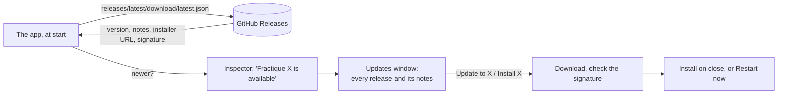

# Releasing and updates

A release is a version tag. Pushing `v0.2.0` makes GitHub build every installer, sign them and publish them with
that version's part of the changelog; installed copies of the app then find it by themselves.

## What a release contains

| File | For | Updates itself |
| --- | --- | --- |
| `Fractique_<version>_x64-setup.exe` | Windows | yes |
| `Fractique_<version>_x86_64.AppImage` | Linux, any distribution | yes |
| `Fractique_<version>_amd64.deb` | Debian, Ubuntu | no: it points at the download page |
| `Fractique_<version>_aarch64.dmg` | macOS, Apple Silicon | yes (the app inside) |
| `Fractique_<version>_aarch64.app.tar.gz` | what the macOS update downloads | |
| `Fractique_<version>_android.apk` | Android | no: Android installs an APK only by hand |
| `latest.json` | the update manifest the app reads | |
| `SHA256SUMS.txt` | checksums | |

The desktop installers carry the app (`fractique-gui`) and the command line tool (`fractique`).

## How to release

1. Set the new version in two places: `version` under `[workspace.package]` in `Cargo.toml` and `version` in
   `crates/fractique-app/Packager.toml`. The build scripts refuse to build when they differ.
2. Add a section `## <version>` at the top of `CHANGELOG.md`. It becomes the release's notes and what the app
   shows under "Updates and what's new".
3. Commit, then tag and push the tag:

   ```sh
   git tag v0.2.0
   git push origin v0.2.0
   ```

The `Release` workflow does the rest. It refuses a tag that does not match the version in `Cargo.toml`. Started by
hand without a tag, it builds the installers and keeps them as artifacts without publishing.

To build installers on your own machine: `scripts/build/build-linux.sh`, `build-mac.sh`, `build-win.ps1`. They
write to `dist/`.

## How the app updates



- **The check** reads `latest.json` of the newest release. It happens once at start, in the background, and on
  **Check for updates**.
- **The list** in the updates window comes from the GitHub Releases API: every full release from `0.1.0` on, with
  its date and notes. Pre-releases and drafts are left out.
- **Any version can be installed**, older ones too: each release has its own `latest.json`, and the app reads the
  one of the chosen version.
- **The download is verified** against the signature in the manifest with the public key built into the app
  (`PUBKEY` in `crates/fractique-app/src/update.rs`). A file signed with another key is refused.
- **Installing** happens when the app closes, or at once with **Restart now**. On Windows the installer runs in
  passive mode and starts the new version.

Which copy can do what:

| Copy | Behaviour |
| --- | --- |
| Installed with the Windows setup, the AppImage, the macOS app | Updates itself |
| The `.deb`, or a binary copied by hand | Shows the versions and opens the download page |
| Built from a checkout (`cargo build`, `setup.sh`) | Shows the versions, installs nothing |
| Android, iOS, the web | No updates window: the stores, or a new APK by hand, replace the app; the web is always the newest |

The release scripts mark a build as a release by setting `FRACTIQUE_RELEASE` while compiling. Without it the app
counts as built from a checkout.

The repository must be public for this to work: the app asks GitHub without signing in.

## The keys

Two keys sign a release. Neither is in the repository; the workflow reads them from the repository's secrets.

| Secret | What it signs | If it is lost |
| --- | --- | --- |
| `CARGO_PACKAGER_SIGN_PRIVATE_KEY`, `CARGO_PACKAGER_SIGN_PRIVATE_KEY_PASSWORD` | The desktop installers, for the updater | Installed copies refuse every later update: people must install by hand once |
| `ANDROID_KEYSTORE_BASE64`, `ANDROID_KEYSTORE_PASSWORD` | The APK | Android refuses to install a later APK over the app: it must be removed first |

Keep copies of both outside GitHub: a secret cannot be read back from there.

A new updater key is made with `cargo packager signer generate`; its public half replaces `PUBKEY`.
